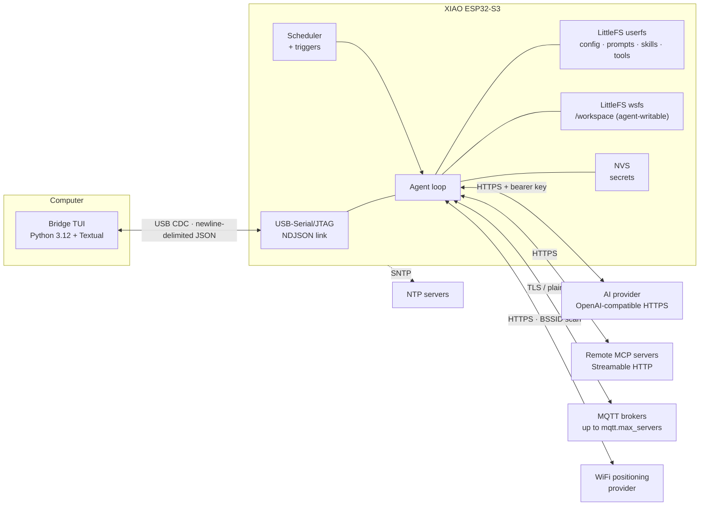

# 00 — Overview & Frozen Contracts

This document is **authoritative**. Every other document in `docs/` references the
contracts defined here. If a lower document disagrees with this one, this one wins.

## 1. What we are building

A single AI agent running on a Seeed Studio XIAO ESP32-S3. The device talks to a
secured, OpenAI-compatible LLM provider over WiFi and to a terminal UI on a
computer over USB. The computer is **only** a terminal — it holds no agent logic,
no history, no keys.



### 1.1 Goals

1. One agent, one conversation, one persona. Ask it things from a terminal.
2. Survives reboot: config, prompts, skills, tools and tasks live in flash.
3. Works without the computer: scheduled and GPIO-triggered tasks fire on their own.
4. Degrades instead of dying: WiFi failover, provider failover, MCP failure isolation.
5. Reaches the real world: GPIO, ADC, I2C, HTTP, MQTT — and knows roughly where it is
   from WiFi, since there is no GPS receiver.

### 1.2 Non-goals (v1)

| Not in v1 | Why / where it goes |
|---|---|
| Multi-role agents (planner/worker, personas switching) | Explicit user constraint. One `system_prompt`, one conversation. |
| Subagents (agent spawning agent) | Explicit user constraint. One in-flight agent run, queue depth 2. |
| Bridge-side inference or history | Bridge is a terminal. Reconnect shows device history only. |
| Token streaming | Non-streaming v1 → `docs/07-roadmap.md`. |
| Cron expressions | `at`/`every` + `repeat` covers the requested one-time / N-times / forever. Roadmap. |
| OTA updates | Not planned. Flashing stays wired. |
| Camera, microphone, audio, voice wake word | **Not planned.** The agent is invoked over USB, by a scheduled task or by a hardware event. Pins D11/D12 are reserved and unused, and no audio component is built. |
| IM channels (Telegram, WhatsApp, Discord, Slack) | **Not planned.** The bridge is the only channel. There is no inbound message path from the internet. |
| Agent editing `config.json` or `skills` | Roadmap. Config and skills stay user-authored; `tasks.json` **is** agent-writable via `task.set` (§7). |

## 2. Decisions (locked)

| # | Decision | Consequence |
|---|---|---|
| D1 | Firmware: **ESP-IDF v5.x, C** | Own task priorities, mbedTLS, `esp_http_client`, SNTP, LittleFS via `esp_littlefs`. |
| D2 | Board: **Seeed XIAO ESP32-S3** (R8) | 8 MB flash, 8 MB octal PSRAM, 11 exposed GPIO, LED on GPIO21 (active-low), native USB only (no UART bridge chip). |
| D3 | Protocol: **NDJSON** over USB-Serial/JTAG CDC | One JSON object per line, UTF-8, `\n` terminated. Human-readable in any terminal. |
| D4 | LLM: **OpenAI-compatible** `/chat/completions` + `tools` | OpenAI, OpenRouter, Groq, Ollama (local and cloud), vLLM, plus the Anthropic and Gemini compatibility endpoints. Provider list *is* the fallback chain; URLs in `03-config.md` §Provider compatibility. |
| D5 | Bridge: **Python 3.12 + Textual + pyserial** | Single `uv run bridge` command. |
| D6 | MCP: **device-direct Streamable HTTP** | Works with no computer attached. Costs one TLS connection per MCP server, lazily opened. |
| D7 | Secrets: **NVS**, referenced from `config.json` | `config.json` is safe to dump and share; it holds `secret_ref` strings only. |
| D8 | LLM responses: **non-streaming** | No `delta` events; TUI shows a spinner driven by `agent.start`. |
| D9 | Logs: **NDJSON only** while the link is open | `esp_log_set_vprintf` is hooked so ESP-IDF logs become `log` messages. A raw byte on the link would break framing. |

## 3. Storage layout (device flash)

Two LittleFS partitions, mounted separately and registered as **distinct VFS
mounts**. Confinement is therefore a filesystem fact, not a string check.

| Partition | Size | Mount | Agent sees | Writable by tools |
|---|---|---|---|---|
| `factory` | 3 MiB | — | — | app image only |
| `userfs` | 3.75 MiB | `/fs` | `/` | never |
| `wsfs` | 1 MiB | `/workspace` | `/workspace/` | yes, this one only |

Path translation is pure prefix substitution and happens in one place:

```
agent "/config.json"      -> VFS "/fs/config.json"
agent "/skills/a.md"      -> VFS "/fs/skills/a.md"
agent "/workspace/x.txt"  -> VFS "/workspace/x.txt"
```

There is no path that crosses the two mounts: `/workspace/../config.json` resolves
inside `wsfs` only, where `..` above its root does not exist, so `open()` fails with
`ENOENT` and the tool returns `E_TOOL`. The agent-visible path prefix map:

| Agent path | Writable by | Contents |
|---|---|---|
| `/config.json` | user | All settings. Secret **references** only. |
| `/tasks.json` | user + agent (`task.set`, add/update only) | Triggered and scheduled tasks. |
| `/prompts/system.md` | user | Main system prompt. MUST instruct the model to open a `todo` list for multi-step work and close every entry before answering (`03-config.md` §prompts). |
| `/prompts/*.md` | user | Prompt templates. |
| `/skills/*.md` | user | Skills (frontmatter + body). |
| `/tools/*.json` | user | Declarative HTTP tools. |
| `/workspace/` | agent | The only writable mount. Separate partition (`wsfs`). |

`/workspace/` is the agent's sandbox and it is **a different filesystem**. No tool
path may leave it: `..` traversal, absolute paths, and duplicated-separator
variants either fail inside `wsfs` or are refused by the resolver. The canonical
rule and its defense-in-depth steps live in `docs/06-security.md` §6.1; firmware
implements it once in `store`, never in individual tools.

Sizing consequences: the user tree (`userfs`) cannot be starved by agent writes,
and `config.set` / `reload` keep working after the workspace quota is exhausted.
The quota (`06-security.md` §6.2) still exists, because a full `wsfs` breaks the
agent even though it no longer harms config. Partition sizes are `[ASSUMPTION]`
until `01-hardware.md` §4 fixes the table at build time.

NVS namespace `secrets` (and NVS keys are **≤ 15 chars**, `[A-Za-z0-9_]`).
Runtime state that changes often (`last_fired`, `fired_count`, sync timestamps, the
boot guard's `boot_failures` counter) goes to NVS namespace `runtime` to spare flash
wear. Namespace `memory` holds the model's key/value store (`memory.*` tools),
bounded by `tools.memory_max_bytes`. Every other config key, including
`sys.safe_mode_after`, lives in `config.json`.
`tasks.json` is written only by
`store_task_write()`: the `task.set` tool, and the host's `tasks.set` and
`tasks.delete` commands. Never by the scheduler or by trigger bookkeeping.

## 4. Frozen config keys

Defined in full, with examples, in `docs/03-config.md`. The key names below are the
contract; do not rename.

```
version
device.name  device.log_level
wifi.connect_timeout_ms  wifi.retry_backoff_ms[]  wifi.networks[].{ssid,password_ref,priority}
ntp.servers[]  ntp.timezone  ntp.sync_interval_s  ntp.sync_timeout_ms
llm.providers[].{id,base_url,model,api_key_ref,timeout_ms,max_output_tokens}
llm.max_tool_rounds  llm.max_history_messages  llm.max_calls_per_hour  llm.max_calls_per_day
mcp.servers[].{id,url,enabled,auth_header_ref,timeout_ms}
geo.enabled  geo.cache_ttl_s  geo.timeout_ms  geo.max_bssids
geo.providers[].{id,kind,url,api_key_ref}
mqtt.max_servers  mqtt.servers[].{id,host,port,tls,client_id,username,password_ref,keepalive_s,topics[],qos}
agent.system_prompt  agent.max_input_bytes
tools.allow_dangerous  tools.http_allow_hosts[]  tools.i2c_sda  tools.i2c_scl  tools.task_max
tools.memory_max_bytes
sys.safe_mode_after
serial.baud  serial.max_line_bytes
```

`secret_ref` format is fixed: the literal string `nvs:<key>`, where `<key>` is an
NVS key in namespace `secrets`. A reference that does not resolve is a **config
error**, reported at boot as `E_CONFIG` — never silently replaced with an empty key.

`nvs:<key>` is also accepted **as a value** inside `http.headers` for declarative
tools; it is resolved at request time and never shown to the model
(`03-config.md` §tools).

### 4.1 Geolocation (no GPS)

There is no GPS receiver. Position comes from WiFi: scan visible BSSIDs with their
RSSI, send them to a WiFi-positioning provider, and cache the fix. `geo.providers[]`
is an ordered fallback chain like `llm.providers[]`:

| `kind` | Input sent | Notes |
|---|---|---|
| `wifi_scan` | array of `{bssid, rssi}` from `esp_wifi_scan_start` | needs a provider API key; typically 20–200 m accuracy |
| `ip` | nothing (provider geolocates the public IP) | no key needed; city-level accuracy, works as last resort |

A fix is cached for `geo.cache_ttl_s` and reused by `geo.locate`. Accuracy is
provider-reported and MUST be surfaced to the model rather than implied as precise.

### 4.2 MQTT

`mqtt.servers[]` holds **multiple independent brokers**; each entry is its own
`esp_mqtt_client_handle_t` with its own TLS, credentials, and topic list.
Subscriptions are declared in config, never chosen by the model. Tools may only
`mqtt.publish` to the server ids and topics present in that config.
Inbound messages surface as `mqtt.message` frames and can fire `mqtt_message`
triggered tasks.

## 5. Frozen trigger enum

`/tasks.json` `trigger.type` is exactly one of:

`boot` · `wifi_connected` · `ntp_synced` · `serial_connected` · `gpio` · `mqtt_message` · `event` · `schedule` · `manual`

Nine values. The `event` member fires when `event.emit` is called with a matching
`name` (exact, case-sensitive); the tool then also emits an `agent.event` frame.

Schedule shape: `{"kind":"at"|"every", "at", "interval_s", "first_at"}` plus
`repeat: {mode: "once"|"count"|"forever", count}`.
Missed-fire policy: `missed: "skip"|"run_once"` (default `skip`).
Semantics live in `docs/02-firmware.md`; formats in `docs/03-config.md`.

## 6. Frozen wire protocol

Envelope: `{"v":1,"type":"...","id":"...","ts":<unix>}`. NDJSON. 4 KiB max device
RX line, 16 KiB max device TX line.

| Direction | `type` values |
|---|---|
| bridge → device | `hello` `prompt` `cancel` `command` `secret.set` `ping` `ack` |
| device → bridge | `hello_ack` `status` `log` `agent.start` `agent.tool` `agent.tool_result` `agent.final` `agent.error` `task.fired` `gpio.edge` `mqtt.message` `event` `command.result` `pong` |

`command.name` ∈ `status` `reload` `reboot` `tasks.list` `tasks.run`
`tasks.set` `tasks.delete` `config.get` `config.set` `secret.set`
`templates.list` `template.get` `geo.locate` `mqtt.publish` `mqtt.status`
`fs.put`.

Error codes: `E_CONFIG` `E_WIFI` `E_LLM_UNAVAILABLE` `E_LLM_RATE` `E_TOOL` `E_MCP`
`E_MQTT` `E_GEO` `E_BUSY` `E_SAFE_MODE` `E_TIMEOUT` `E_PROTOCOL` `E_AUTH`
`E_STORAGE` `E_CANCELLED` `E_INTERNAL`.

Full catalog, fields and state machine: `docs/04-protocol.md`.

## 7. Frozen tool surface

This section freezes the **set**: which twenty-five built-ins exist, plus the two
non-built-in sources. It does not state gates, arguments or result shapes - those
live in one place each.

| Owner | What it decides |
|---|---|
| this section | the frozen set of built-in tool names |
| `06-security.md` §6 | every gate and failure code (sole authority) |
| `03-config.md` §tools | the config keys the gates read |
| `tools/README.md` and the domain files under `docs/tools/` | arguments, result shape, model-facing JSON Schema, per-tool errors |
| `04-protocol.md` §4 | host commands, which are not tools |

Built-in, always present (twenty-five):

`gpio.read` `gpio.write` `adc.read` `i2c.scan` `i2c.read` `i2c.write` `time.now`
`fs.list` `fs.read` `fs.write` `fs.delete` `http.get` `skill.read` `task.list`
`task.set` `event.emit` `todo` `geo.locate` `mqtt.list` `mqtt.publish`
`memory.get` `memory.set` `memory.list` `memory.delete` `sys.diagnostics`

`i2c.write` is present only when the bus is configured, like `i2c.scan` and
`i2c.read` (`tools/i2c.md`).

Declarative: any `/tools/*.json` becomes a tool of the same name. MCP: namespaced
`mcp.<server_id>.<tool_name>`. Both are additional to the twenty-five and neither can
shadow a built-in.

Shipped-by-default declarative tools, user-editable files rather than built-ins:
`weather_now` (Open-Meteo, no key) and `web_search` (Brave-compatible, key via an
`nvs:` header ref). They are ordinary `/tools/*.json` and can be replaced through
`fs.put`.

The one structural rule worth stating here because it bounds everything else: among
model-reachable tools, only `task.set` writes `userfs`, and it goes through
`store_task_write()`, which serialises the whole `tasks.json` atomically under a
mutex. That lifts the old "agent never writes tasks.json" non-goal; the bound is
`tools.task_max` plus schema validation, not trust, and the tool can only add or
update - delete is the host-only `tasks.delete` command. Every other `userfs` write
is host-originated.

## 8. Firmware modules

`app` · `cfg` · `store` · `net` · `clock` · `llm` · `agent` · `skills` · `tools`
· `sched` · `mcp` · `mqtt` · `geo` · `link` · `sys`. Details and APIs in
`docs/02-firmware.md`; layering, ports and energy rules in
`docs/08-code-architecture.md`.

## 9. Feature → document traceability

| Requirement | Where |
|---|---|
| WiFi from config, several hotspots, pick best | `02-firmware.md` §3.1 Boot Sequence step 5, `03-config.md` §wifi |
| Config holds WiFi, provider, NTP URL | `03-config.md` §config.json |
| NTP clock discipline | `02-firmware.md` §3.1 Boot Sequence step 6, `03-config.md` §ntp |
| USB Serial to computer | `04-protocol.md`, `05-bridge.md`, `09-bridge-architecture.md` |
| Browse and edit the agent sandbox from the terminal | `05-bridge.md` §5.8, `04-protocol.md` §4.17 to §4.20 |
| Secured provider (URL + API key) | `03-config.md` §llm, `06-security.md` |
| First-run setup from the terminal | `05-bridge.md` §7 `/onboard` |
| Provider/model fallback | `02-firmware.md` §Request body, §4.2 Fallback & Error Handling |
| Extensible skills | `03-config.md` §skills, `tools/skills.md` |
| Extensible tools | `03-config.md` §tools, `tools/README.md`, `02-firmware.md` §7.1 Tool definitions sent to the model |
| Prompt templates | `03-config.md` §prompts, `02-firmware.md` §Request body |
| Scheduled tasks: once / N / forever | `03-config.md` §tasks, `02-firmware.md` §5.1 Trigger Semantics |
| Triggered tasks (GPIO, boot, …) | same as above; trigger list = §5 |
| Remote MCP servers | `02-firmware.md` §6. MCP Dispatch, `03-config.md` §mcp |
| WiFi-based geolocation (no GPS) | `tools/geo.md`, `02-firmware.md` §geo, `03-config.md` §geo |
| Multiple MQTT brokers | `tools/mqtt.md`, `02-firmware.md` §mqtt, `03-config.md` §mqtt |
| Built-in tools (ADC, I2C, HTTP, task.set, event.emit) | §7 here for the frozen set; per-tool contracts in `tools/` |
| Shipped `weather_now` / `web_search` | `03-config.md` §tools (Shipped tools), `tools/web.md` |
| TUI bridge | `05-bridge.md`, `09-bridge-architecture.md` |
| Bridge testing without hardware | `10-test-agent.md` |
| No multirole / no subagents | §1.2 here, `07-roadmap.md` (explicit non-goal) |
| Hardware facts, pin safety | `01-hardware.md` |
| Code layering, ports, energy rules | `08-code-architecture.md` |
| Threat model, redaction | `06-security.md` |

## 10. Glossary

- **Agent run**: one prompt → (tool rounds) → final answer. Serialized.
- **Tool round**: one provider response asking for tools, plus their execution.
- **Secret ref**: `nvs:<key>` placeholder resolved at use time.
- **Link**: the NDJSON conversation over USB.
- **Bridge**: the Python TUI process on the computer.
- **Workspace**: the `wsfs` mount at `/workspace`, the only place tools may write.
- **BSSID**: a WiFi access point's MAC address; used for positioning with no GPS.
- **Geo fix**: a cached `{lat, lon, accuracy_m}` from a positioning provider.
- **Trigger**: a condition that starts a task (`boot`, `gpio`, `mqtt_message`, ...).
- **Declarative tool**: a `/tools/*.json` file describing one HTTP call.
- **Broker**: one entry in `mqtt.servers[]`, connected independently.
- **Musteval**: the project's namesake and mascot — a two-foot celestial spy with
  white fur, tufted ears, an elongated snout and pink eyes, able to cast magic
  missile at will. It appears on the bridge splash (`05` §5.9); nothing in the
  firmware depends on it.
