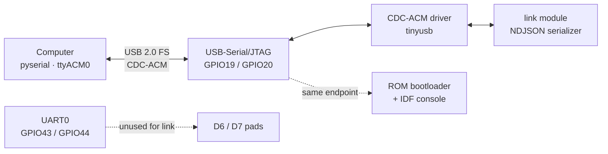

# 01 — Hardware

Target board: **Seeed Studio XIAO ESP32-S3 (R8)**. The board is fixed by
`docs/00-overview.md` §2 D2; this document explains what that choice gives us, how
the USB link is wired internally, how to power the device, and which pins firmware
is allowed to touch.

Everything here is a constraint on `docs/02-firmware.md`. If a pin is marked
reserved below, `gpio.read` / `gpio.write` must refuse it.

## 1. Board at a glance

| Property | Value |
|---|---|
| SoC | Espressif ESP32-S3, dual-core Xtensa LX7, up to 240 MHz |
| SRAM | 512 KiB internal + 8 MiB **octal** PSRAM (part of the R8 module) |
| Flash | 8 MiB quad SPI, external to the SoC die |
| Radio | WiFi 802.11 b/g/n, **2.4 GHz only**; Bluetooth 5 LE |
| USB | USB-C, **native USB-Serial/JTAG** — no UART bridge chip |
| Exposed GPIO | 11 (D0–D10) + onboard user LED |
| User LED | GPIO21, **active-low** |
| Charge LED | Separate, not GPIO-controlled |
| Footprint | 21 x 17.8 mm, 14 castellated edge pins |
| Logic level | 3.3 V |
| Antenna | Onboard 2.4 GHz; external IPEX connector on the module |

Two consequences follow immediately and shape the whole firmware:

1. **No 5 GHz.** `wifi.networks[]` entries pointing at 5 GHz-only APs fail with
   `E_WIFI` after `wifi.connect_timeout_ms`. There is nothing to fall back to.
2. **No UART bridge.** The computer enumerates the USB-Serial/JTAG peripheral
   directly, so the link survives even if the application crashes, and ROM
   bootloader output arrives on the same USB endpoint as our NDJSON.

## 2. Memory budget

The R8 module's 8 MiB octal PSRAM is not automatic — it must be enabled in the
build (`CONFIG_SPIRAM_MODE_OCT=y`) and it is *not* usable as a general heap unless
`CONFIG_SPIRAM_USE_MALLOC=y`.

| Resource | Budget for Musteval | Notes |
|---|---|---|
| Internal SRAM | FreeRTOS tasks, TLS record buffers, NDJSON scratch | Never satisfied from PSRAM; mbedTLS DMA-capable allocations must stay internal |
| PSRAM | History buffers, tool-result spill, `/workspace/` file staging | Octal mode steals GPIO33–37 (see §6.1) |
| Flash | App partition + LittleFS (`docs/00-overview.md` §3) | 8 MiB is ample; LittleFS sized at build time |
| MQTT clients | One `esp_mqtt_client_handle_t` + RX buffer per `mqtt.servers[]` entry | Bounded by `mqtt.max_servers` (default 4); a `tls: true` entry adds an mbedTLS session to internal SRAM |
| Geo scan buffer | `wifi_ap_record_t` array of `geo.max_bssids` entries plus one provider response buffer | Default 12 entries (~1.3 KiB in internal SRAM); freed as soon as the fix is returned |

Rules:

- A single 16 KiB TX line (`docs/00-overview.md` §6) plus TLS overhead must fit
  without PSRAM allocation, so the link serializer writes from an internal buffer.
  Measured cost of honouring that: the emit and wrap scratch are two 16 KiB statics
  (`s_emit`, `s_tx`), the reader is 4,104 B and the log hook's three buffers 3,200 B
  — 40,072 B of `.bss` — and the driver's own rings add `LINK_TX_MAX + 2` and
  `LINK_RX_MAX + 2` on the heap (`02-firmware.md` §2, `link`). DIRAM sits at 31.2%
  of 341,760 B with that in place, so it fits; it is also why DIRAM is not nearer a
  tenth.
- Anything sized from `llm.max_history_messages` is allocated in PSRAM and marked
  `MALLOC_CAP_SPIRAM`.
- MQTT client contexts and the geo scan buffer stay in internal SRAM: both are
  DMA-reachable network buffers and must not be satisfied from PSRAM.
- Firmware must degrade, not abort, when a PSRAM allocation fails: drop the oldest
  history entry and log a `log` message at `warn`.

[ASSUMPTION] Concrete free-heap numbers after boot (WiFi + mbedTLS + LittleFS) are
not measurable until the first bring-up; treat any figure in later documents as
provisional until `heap_caps_get_free_size()` is recorded on hardware.

## 3. USB-CDC: how the link exists

The XIAO ESP32-S3 has **one** USB-C port wired to the SoC's native
USB-Serial/JTAG peripheral (GPIO19 = D-, GPIO20 = D+). There is no CH340/CP210x.
This is what makes `docs/00-overview.md` §2 D3/D9 possible.



| Fact | Consequence |
|---|---|
| Single USB peripheral serves app + bootloader | If the device resets, the host sees the port disappear/reappear; the bridge must reconnect, not exit |
| `serial.baud` is cosmetic | CDC-ACM ignores baud; the key is kept frozen in `config.json` for bridge compatibility (see `docs/03-config.md`) |
| Logs share the endpoint | `esp_log_set_vprintf` is hooked (D9). A raw `printf` would corrupt framing — firmware must never use `printf` on this build |
| USB is the only console | Panic output is visible only if the bridge is attached and the port is open at 115200 for the ROM stage |
| M1 answers the link | `link_task` owns the CDC endpoint (`02-firmware.md` §3.1 step 7), so the board answers `hello`, `ping` and `command`. A bridge pointed at it reaches `linked`. At M0 the same board enumerated as `ttyACM0`, logged to it and never read it, so a write filled the TX buffer and timed out; that silence was the milestone, not a fault |

Because the peripheral is the *SoC's* USB, not a bridge chip, a hard hang still
leaves USB enumerated. That is why `reboot` is a protocol command
(`docs/00-overview.md` §6) rather than a physical power cycle.

## 4. Flash partitions

Confinement is a filesystem boundary (`docs/00-overview.md` §3), so the table
below is a security artifact, not just sizing. Two LittleFS partitions, two mount
points, no path between them.

| # | Label | Type | SubType | Offset | Size | Purpose |
|---|---|---|---|---|---|---|
| 0 | `nvs` | data | nvs | 0x9000 | 0x6000 (24 KiB) | `secrets` + `runtime` (incl. `boot_failures`) + `memory` namespaces |
| 1 | `nvs_keys` | data | nvs_keys | 0xF000 | 0x1000 (4 KiB) | NVS encryption key page |
| 2 | `otadata` | data | ota | 0x10000 | 0x2000 (8 KiB) | OTA selector, kept for partition-table convention; OTA is not planned |
| 3 | `phy_init` | data | phy | 0x12000 | 0x1000 (4 KiB) | RF calibration |
| 4 | `factory` | app | factory | 0x20000 | 0x300000 (3 MiB) | Application image |
| 5 | `userfs` | data | littlefs | 0x320000 | 0x3C0000 (3.75 MiB) | User tree: config, tasks, prompts, skills, tools |
| 6 | `wsfs` | data | littlefs | 0x6E0000 | 0x100000 (1 MiB) | Agent workspace only |

Total 0x7E0000 (7.875 MiB) of the 8 MiB part; the remainder is the bootloader,
partition table and NVS key pages.

NVS encryption is enabled in v1 and requires this partition (D-OQ1); flash encryption and secure boot are NOT enabled.

`firmware/partitions.csv` holds exactly this table, byte for byte; `#` is the only
comment form `gen_esp32part.py` accepts, so the fence is valid CSV on its own.

```c
# Name,    Type, SubType, Offset,   Size,     Flags
nvs,       data, nvs,     0x9000,   0x6000,
nvs_keys,  data, nvs_keys, 0xF000,   0x1000,
otadata,   data, ota,     0x10000,   0x2000,
phy_init,  data, phy,     0x12000,   0x1000,
factory,   app,  factory, 0x20000,  0x300000,
userfs,    data, littlefs,0x320000, 0x3C0000,
wsfs,      data, littlefs,0x6E0000, 0x100000,
```

Mount registration (`app` boot step 3, `docs/02-firmware.md` §3.1):

| Partition | `esp_vfs_littlefs_register` base path | Format on mount failure |
|---|---|---|
| `userfs` | `/fs` | never; a corrupt user tree is a boot error (`E_STORAGE`), not a silent wipe |
| `wsfs` | `/workspace` | yes; the workspace is regenerable, the user tree is not |

`wsfs` formatting on corruption is safe precisely because nothing else lives there.
That asymmetry is the point of the split: the partition the model can write is the
one we are willing to erase.

The 1 MiB `wsfs` size plus the 64 KiB quota (`docs/06-security.md` §6.2) leaves
ample headroom for LittleFS metadata and wear-levelling blocks; the quota is what
bounds the model, not the partition size.

If a future revision wants to grow `userfs`, take it from `wsfs` first — agent
scratch space is cheaper to lose than user config.

| Note | Detail |
|---|---|
| Flash mode | Quad SPI (QIO), 8 MiB part on the R8 module |
| PSRAM | Octal, `CONFIG_SPIRAM_MODE_OCT=y`; not a partition, no entry above |
| OTA | `otadata` is reserved but v1 ships one app slot; OTA is not planned, and the row is kept because ESP-IDF partition tables expect it |

## 5. Power

| Rail | Source | Notes |
|---|---|---|
| 5 V | USB-C VBUS | Also the charging input |
| 3V3 | Onboard regulator output, broken out on the edge pin | 3.3 V logic for all peripherals |
| BAT | Pads on the underside (`BAT+` / `BAT-`) | Li-ion/LiPo, onboard charge management with the charge LED |

Rules for a device that is expected to stay up:

- **Do not back-feed 3V3** from an external supply while USB is attached.
- Peak WiFi TX current exceeds what a weak USB port or a long thin cable can
  deliver; symptoms are brownout resets mid-request. [ASSUMPTION] Peak draw is on
  the order of 350 mA; a 500 mA-capable port and a short cable are required.
- Brownout resets must not be mistaken for firmware bugs: the boot counter in NVS
  namespace `runtime` is how `app` distinguishes "rebooted after brownout" from
  "rebooted by command".
- Battery operation is supported but **not** a v1 requirement. When on battery,
  the USB link disappears; the agent keeps running and scheduled triggers still
  fire (`docs/00-overview.md` §1.1 goal 3).
- Idle draw targets, for `docs/08-code-architecture.md` §5 to verify at M5:
  [ASSUMPTION] roughly 80 mA with WiFi associated and no link, under 120 mA with
  the link open, ~350 mA peak during an LLM round. Modem sleep is what makes the
  idle figures reachable; it stays enabled.
- Deep sleep is available but disabled in v1: the device must answer `ping` and
  fire `schedule` triggers, so `app` never enters light/deep sleep. **Modem sleep
  stays enabled** — it is set automatically once WiFi associates and is the
  difference between roughly 80 mA and 20 mA at idle without affecting `ping`.
  Light-sleep support is conditional on an idle-draw measurement that has not been
  taken (`docs/08-code-architecture.md` §5.4).

## 6. GPIO map

XIAO header names are printed on the board (D0–D10). Firmware and `/tasks.json`
refer to **GPIO numbers**, not D-numbers, so that a pin rename on the silkscreen
never changes config semantics.

| XIAO | GPIO | Usable by agent | Default function | Notes |
|---|---|---|---|---|
| D0 | GPIO1 | yes | — | ADC1_CH0, touch |
| D1 | GPIO2 | yes | — | ADC1_CH1, touch |
| D2 | GPIO3 | **caution** | Boot strapping (JTAG source select) | Externally pulled; do not drive low during reset. Read is safe, write is allowed only after boot |
| D3 | GPIO4 | yes | — | ADC1_CH3, touch |
| D4 | GPIO5 | yes | I2C SDA (recommended) | ADC1_CH4 |
| D5 | GPIO6 | yes | I2C SCL (recommended) | ADC1_CH5 |
| D6 | GPIO43 | yes | UART0 TX (ROM console) | See warning below |
| D7 | GPIO44 | yes | UART0 RX (ROM console) | See warning below |
| D8 | GPIO7 | yes | SPI SCK (recommended) | ADC1_CH6 |
| D9 | GPIO8 | yes | SPI MISO (recommended) | ADC1_CH7 |
| D10 | GPIO9 | yes | SPI MOSI (recommended) | ADC1_CH8 |
| — | GPIO21 | **no** | Onboard user LED, active-low | Not on the header; driven only by firmware status |

- D4/D5 are recommended defaults for I2C (`tools.i2c_sda`=5, `tools.i2c_scl`=6, §7); D8–D10 are only recommendations for SPI, which no tool opens in v1, so those pins remain freely writable.

### 6.1 Reserved — firmware must refuse these

| GPIO | Why reserved |
|---|---|
| GPIO0 | Boot mode strapping. Low at reset = download mode. On the board it is a button, not a header pin |
| GPIO3 | Strapping (JTAG source). Exposed as D2; writable after boot, never held low across reset |
| GPIO19, GPIO20 | USB D- / D+. The link dies if anything drives these |
| GPIO26–GPIO32 | Quad SPI flash and PSRAM lines (SPI0/SPI1). Firmware must never touch them |
| GPIO33–GPIO37 | **Octal PSRAM** extra data lines. Consumed because the R8 module has octal PSRAM |
| GPIO45, GPIO46 | Strapping (VDD_SPI voltage, ROM messages). Not exposed on the header; never reassigned |
| GPIO38–GPIO48 | Not exposed on this board. The Sense variant repurposes GPIO41/42 (PDM mic) and GPIO10–18 (camera) — out of scope per `docs/00-overview.md` §1.2 |
| GPIO21 | Onboard LED, active-low. Owned by firmware status signalling |

The Sense-variant expansion pads referenced in `docs/00-overview.md` §1.2 as
"D11/D12" are reserved and unused. This build targets the plain R8 board; no
camera or microphone pin is ever assigned.

### 6.2 ADC notes

- All exposed analog pins are on **ADC1**. ADC2 is claimed by the WiFi driver and
  returns garbage while the radio is on — this is why no ADC2 pin is offered.
- `gpio.read` on an ADC-capable pin returns the **digital** level, not a voltage;
  voltage is sampled via `adc.read` (`docs/00-overview.md` §7).
- ADC tooling is limited to the ADC1 channels on **D0/D1/D3 (GPIO1, GPIO2, GPIO4)**,
  sampled at **12-bit** resolution with the ESP-IDF default attenuation
  (`ADC_ATTEN_DB_12`, nominally 0–3.1 V). `adc.read` returns the raw 0–4095
  code plus a millivolt value converted through the IDF calibration driver.
- D4/D5 and D8–D10 are also ADC1 channels (CH4–CH8) but are **not** in the tool
  allowlist: they carry the recommended I2C/SPI roles (§7), and enabling their
  analog function would conflict with the bus configuration.
- **GPIO3 (D2) is refused**: it is ADC-incompatible while strapping — a valid
  analog read requires the pin free of the reset-time strap, which it is not.
- ADC1 attenuation and calibration are still affected by WiFi activity on this
  SoC; any analog sampling must happen with the radio idle. [ASSUMPTION]
  Quantified error is unmeasured.
### 6.3 Electrical limits

- 3.3 V logic. **Never** apply 5 V to a GPIO; the SoC is not 5 V tolerant.
- Sink/source per pin: keep to a few mA for signalling, never drive a relay or
  motor directly. [ASSUMPTION] The datasheet ceiling is around 40 mA per pin, but
  the board's thermal headroom is far lower.
- No internal pull-up is reliable on GPIO3 as a boot strap; use an external
  resistor if D2 must idle high.

## 7. Buses

### 7.1 I2C

The I2C master bus is optional and pins are chosen by config, not hardwired:

| Config key | Default | Constraint |
|---|---|---|
| `tools.i2c_sda` | `null` (bus disabled) | a usable pin from the §6 table, not reserved in §6.1 |
| `tools.i2c_scl` | `null` (bus disabled) | same constraint, must differ from SDA |

- GPIO3 (strapping) and GPIO43/GPIO44 (ROM console) are never accepted, even
  though §6 marks them usable for general I/O.
- Both keys `null` means the I2C tools (`i2c.scan`, `i2c.read`, `i2c.write`) are absent from the tool list.
- The bus is created with `i2c_driver_install` on first use and deleted after the
  call returns, so no clock is held on the pins between tool calls.
- Standard mode, 100 kHz. Fast mode is not offered: the exposed header has no
  pull-ups, and 400 kHz over jumper wires is not reliable.
- Only 7-bit addresses `0x08`–`0x77` are probed. `0x00`–`0x07` and `0x78`–`0x7F` are
  reserved; addressing them is refused with `E_TOOL`.
- External pull-ups (4.7 kΩ to 3.3 V) are required. The SoC's internal pull-ups
  are too weak for I2C and must not be relied on.
- Recommended default wiring is D4 = SDA (GPIO5), D5 = SCL (GPIO6), which is what
  the §6 table marks.

### 7.2 SPI

Not exposed in v1. The flash and octal PSRAM consume the SPI0/SPI1 pins (§6.1),
and no second host is reserved for a user bus.

## 8. GPIO as a trigger source

`gpio` is one of the frozen trigger types (`docs/00-overview.md` §5) and
`gpio.read` / `gpio.write` are frozen tools (§7). The hardware contract for both:

| Requirement | Detail |
|---|---|
| Interrupt-capable | Any exposed GPIO. Edge detection via the GPIO ISR service, not polling |
| Debounce | Firmware-side, in `sched`; a bouncing contact must not fire a task twice |
| Write gate | `gpio.write` is refused unless `tools.allow_dangerous` is `true` (§7) |
| Read gate | `gpio.read` is always available, including on GPIO21 (LED state). The LED itself is written only by firmware |
| Refusal | Reserved pins (§6.1) return a tool error, not a silent no-op |

Edge events are reported to the bridge as `gpio.edge`; task firing is reported as
`task.fired` (`docs/00-overview.md` §6). Example envelope — field names beyond the
frozen four are owned by `docs/04-protocol.md`:

```json
{"v":1,"type":"gpio.edge","id":"evt-0007","ts":1767225600,"pin":9,"edge":"rising"}
```

## 9. What is deliberately not on this board

| Feature | Status | Where it would go |
|---|---|---|
| UART bridge chip (CH340/CP210x) | Absent by design | Not needed; D2 freezes native USB |
| 5 GHz WiFi | Absent | Not addable |
| Camera, microphone, audio | Absent by design; not planned | `docs/00-overview.md` §1.2 records both as permanent non-goals; this build targets the plain R8 board, so no camera or microphone pin is ever assigned |
| microSD | Absent on this board | No slot exists on the XIAO ESP32-S3; storage is the internal `userfs` and `wsfs` partitions only (`docs/01-hardware.md` §4) |
| OTA | Not planned; flashing stays wired | `docs/07-roadmap.md` |
| Battery fuel gauge | None | Out of scope; charge LED is the only power feedback |

## 10. Bring-up checklist

Flashing needs esptool 5.6 or newer. IDF v5.5.6 ships 4.12.0, whose flasher stub
stalls at `Running stub...` against the native USB-JTAG on this board; 5.6 completes
in seconds. IDF pins `esptool~=4.12` in `~/.espressif/espidf.constraints.v5.5.txt`,
so upgrading the package alone makes `idf.py` refuse to run — that pin moves with it.
Legacy command spellings (`write_flash`, `merge_bin`, `erase_flash`) still work under
5.6 with a deprecation warning, which is what keeps `idf.py` and `run_qemu.sh`
working unchanged.

A virgin board also needs a seeded `userfs`: it is never formatted by the firmware,
and a blank one halts with `E_STORAGE` (§4). `build/qemu/userfs.bin` from
`02-firmware.md` §8 serves until `bridge/tools/build_userfs.py` exists.

The working sequence, and the two traps in it:

```
idf.py -p /dev/ttyACM0 -b 921600 flash
esptool --chip esp32s3 -p /dev/ttyACM0 -b 460800 write-flash \
   0x320000 build/qemu/userfs.bin        # only on a fresh or erased board
idf.py -p /dev/ttyACM0 monitor            # or a pyserial reader, see below
```

- **Reading the log means leaving the modem lines alone.** On native USB-JTAG DTR
  and RTS drive the reset strap, and *any* transition on the pair resets the chip:
  clearing them after `open` reboots the board, and so does clearing them before it,
  because the kernel's CDC-ACM layer asserts both when it activates the port.
  `SerialTransport` therefore never touches them (`09-bridge-architecture.md` §4.2).
  A hand-written reader that wants a fresh boot must pulse RTS itself; one that only
  wants the running device must not touch either line.
- **The flashed NVS survives reflashing**, so the boot guard keeps counting across
  experiments and can sit in safe mode. `esptool erase-region 0x9000 0x6000` clears
  just the counter; a full `erase-flash` also wipes both LittleFS images.
- **`verify-flash` is not read-only: it is a boot.** Every esptool invocation ends
  with `--after hard_reset`, so verifying three images costs three runs of the guard
  — measured at exactly +1 each, and nothing at M0 ever decrements it (reaching idle
  clears the counter, and `main.c` stops before the scheduler). Verify once after a
  flash, not after each edit, and check the counter in the log rather than assuming
  it is still where it was left. One `erase-region` resets it to zero.

1. Attach the board; confirm the host enumerates a CDC-ACM device. Reading the ROM
   text needs a deliberate reset, not a side effect: to land a fresh boot in an
   attached reader, pulse RTS high for ~150 ms and release it. Merely opening the
   port does not reboot the chip, which is the point — an idle bridge reconnects to
   the running device and `uptime_s` keeps climbing.
2. Confirm PSRAM is detected as octal and 8 MiB — if it reports none, the build is
   missing the SPIRAM octal config and the memory budget in §2 is invalid.
3. Drive GPIO21 to confirm the LED is active-low (writing `0` lights it).
4. Read every exposed pin with `gpio.read`; every reserved pin must be refused.
5. Confirm a WiFi association survives 10 minutes at `device.log_level` =
   `debug` without a brownout reset (§5).

Cross-references: USB framing and message catalog in `docs/04-protocol.md`; pin
usage from `/tasks.json` in `docs/03-config.md`; GPIO tool implementation in
`docs/02-firmware.md` §Tools.
