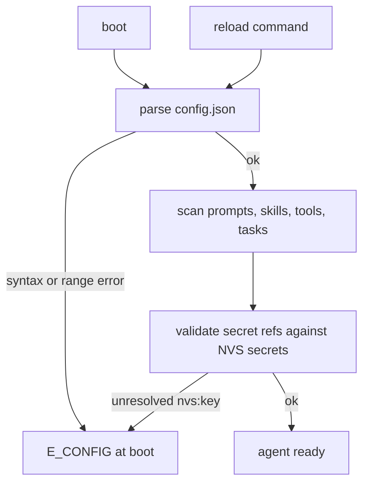
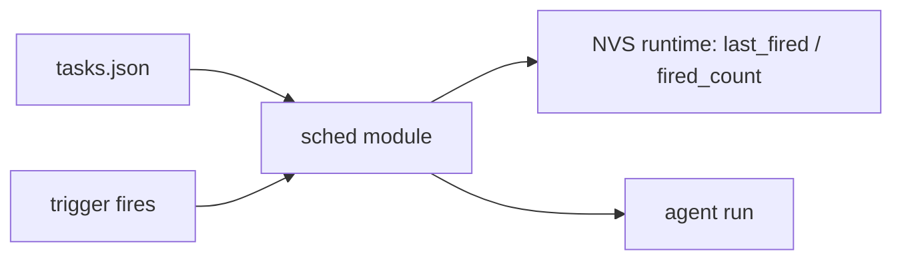
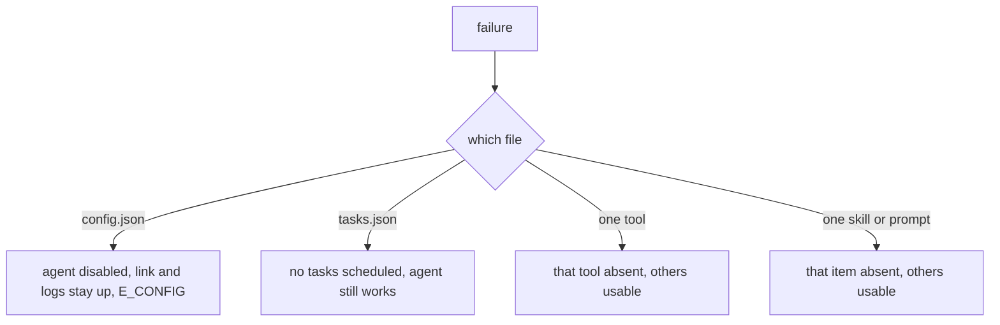

# 03 -- Configuration and File Formats

This document defines every file the device loads from LittleFS, their exact schemas,
validation rules and storage limits.

**Authority.** `docs/00-overview.md` is authoritative. Key names, the trigger enum, the
`secret_ref` format, the tool surface and the wire limits are frozen there; this
document only expands them. Where a schema detail is not fixed by `00-overview.md` it
is marked `[ASSUMPTION]`. Every question that was open during design is resolved at
the end of this file.

Sections are named after the config key groups so the traceability table in
`00-overview.md` Section 9 resolves directly (`#wifi`, `#ntp`, `#llm`, `#mcp`, `#geo`,
`#mqtt`, `#skills`, `#tools`, `#prompts`, `#tasks`).

---

## 1. Storage map

Two LittleFS partitions (`docs/01-hardware.md` §4), two mounts:

| Partition | Mount | Agent path prefix | Writable by tools |
|---|---|---|---|
| `userfs` | `/fs` | `/` | no |
| `wsfs` | `/workspace` | `/workspace/` | yes |

Paths below are **agent-visible**; `store_map_path()` translates them, and
`/workspace/...` never maps into `userfs`.

| Path | Writable by | Format | Loaded at |
|---|---|---|---|
| `/config.json` | flashing a `userfs` image, or `config.set` | JSON | boot, `reload` |
| `/tasks.json` | `tasks.set`/`tasks.delete` commands, or agent via `task.set` | JSON | boot, `reload` |
| `/prompts/system.md` | flashing a `userfs` image | Markdown | boot, `reload` |
| `/prompts/*.md` | flashing a `userfs` image | Markdown + optional frontmatter | boot, `reload` |
| `/skills/*.md` | flashing a `userfs` image | Markdown with YAML frontmatter | boot, `reload` |
| `/tools/*.json` | flashing a `userfs` image | JSON | boot, `reload` |
| `/workspace/` | agent (`fs.write`) | free-form | never |

Rules that follow from the map:

- The agent may write **only** under `/workspace/`, which is a separate filesystem
  (`wsfs`), not a subdirectory of `userfs`. `fs.write` outside it is refused with
  `E_TOOL` regardless of `tools.allow_dangerous`. Canonicalisation rejects escapes
  such as `/workspace/../config.json` (`06-security.md` §6.1), and the mount split
  means even a resolver bug cannot open a `userfs` file through a workspace path.
- `/workspace/` exists as soon as `wsfs` mounts; it is never touched by `reload` or
  `config.set`, and formatting `wsfs` only ever erases agent scratch data.
- `/workspace/` is quota-bounded: a write that would push the tree past 64 KiB or
  64 files is refused with `E_STORAGE` before any bytes are written. The quota no
  longer protects `config.set` (the partitions are separate) but still keeps the
  agent from wedging itself; accounting lives in `store`.
- Exactly three paths mutate a user file. `config.set` writes `/config.json`, the
  `task.set` tool writes `/tasks.json`, and the host-only `fs.put` command
  (`04-protocol.md` §4.16) writes any path not shipped in the image, which is how
  prompts, skills and declarative tools are imported. Only `task.set` is reachable
  from the model; `config.set` and `fs.put` are host-only.
- Runtime state (`last_fired`, `fired_count`, clock sync timestamps, the boot
  guard's `boot_failures`, and the LLM budget counters) lives in NVS namespace
  `runtime`, never in flash files, to spare LittleFS wear.
- Secrets live in NVS namespace `secrets`. Files hold `nvs:<key>` references only.
  `link_token` is the optional USB link token checked during `hello`
  (`04-protocol.md` §3.1); it is unset by default, which leaves the link open.



---

## config.json

Single JSON object, UTF-8, no comments, no trailing commas.

### Full schema

| Key | Type | Required | Default | Bounds |
|---|---|---|---|---|
| `version` | int | yes | none | must be `1` |
| `device.name` | string | no | `"musteval"` | 1..32 chars, `[A-Za-z0-9_-]` |
| `device.log_level` | string enum | no | `"info"` | `none` `error` `warn` `info` `debug` |
| `wifi.connect_timeout_ms` | int | no | `15000` | 1000..120000 |
| `wifi.retry_backoff_ms` | int[] | no | `[1000,2000,5000,10000]` | 1..6 entries, 100..60000 each |
| `wifi.networks[]` | object[] | yes (1..8) | none | see below |
| `wifi.networks[].ssid` | string | yes | none | 1..32 chars |
| `wifi.networks[].password_ref` | string | yes | none | `^nvs:[A-Za-z0-9_]{1,15}$` |
| `wifi.networks[].priority` | int | no | `0` | 0..100, higher wins when several APs are visible |
| `ntp.servers[]` | string[] | no | `["pool.ntp.org"]` | 1..4 hostnames or IPv4 |
| `ntp.timezone` | string | no | `"UTC0"` | POSIX TZ string |
| `ntp.sync_interval_s` | int | no | `3600` | 60..86400 |
| `ntp.sync_timeout_ms` | int | no | `3000` | 100..60000 |
| `llm.providers[]` | object[] | yes (1..4) | none | ordered fallback chain |
| `llm.providers[].id` | string | yes | none | `[a-z0-9_-]{1,16}`, unique |
| `llm.providers[].base_url` | string | yes | none | `https://` or `http://`, must include the provider's version prefix; the firmware appends `/chat/completions` |
| `llm.providers[].model` | string | yes | none | 1..64 chars |
| `llm.providers[].api_key_ref` | string | yes | none | `^nvs:[A-Za-z0-9_]{1,15}$` |
| `llm.providers[].timeout_ms` | int | no | `30000` | 1000..120000 |
| `llm.providers[].max_output_tokens` | int | no | `1024` | 16..8192; sent under the name in `token_param` |
| `llm.providers[].token_param` | string enum | no | `max_tokens` | `max_tokens` or `max_completion_tokens`; see §Provider compatibility |
| `llm.providers[].extra_body` | object | no | `{}` | merged into the request body; max 4 members, flat scalars only, and must not contain `model`, `messages`, `tools` or `stream` (`E_CONFIG`) |
| `llm.max_tool_rounds` | int | no | `8` | 1..16; also bounds the close-out round described in `02-firmware.md` §4.1, so a value of 1 can leave a task open and set `todo_open` |
| `llm.max_history_messages` | int | no | `8` | 0..32 |
| `llm.max_calls_per_hour` | int | no | `100` | 0..100000; `0` disables the window. Bounds `llm.providers[]` attempts per UTC hour, across the whole chain (`E_LLM_RATE`) |
| `llm.max_calls_per_day` | int | no | `1000` | 0..1000000; `0` disables the window. Bounds attempts per UTC day |
| `mcp.servers[]` | object[] | no | `[]` | 0..4 entries |
| `mcp.servers[].id` | string | yes | none | `[a-z0-9_-]{1,16}`, unique |
| `mcp.servers[].url` | string | yes | none | `https://` |
| `mcp.servers[].enabled` | bool | no | `true` | - |
| `mcp.servers[].auth_header_ref` | string | no | none | `^nvs:[A-Za-z0-9_]{1,15}$`, holds the whole header value |
| `mcp.servers[].timeout_ms` | int | no | `15000` | 1000..60000 |
| `agent.system_prompt` | string | no | `"/prompts/system.md"` | path starting `/` |
| `agent.max_input_bytes` | int | no | `3072` | 256..`serial.max_line_bytes` |
| `tools.allow_dangerous` | bool | no | `false` | switch read by the write tools; the list is `06-security.md` §6, not restated here |
| `tools.http_allow_hosts[]` | string[] | no | `[]` | 0..8 hostnames; exact match, no wildcards |
| `tools.memory_max_bytes` | int | no | `2048` | 256..4096; total bytes across the `memory` NVS namespace |
| `sys.safe_mode_after` | int | no | `3` | 2..10; consecutive failed boots before safe mode |
| `serial.baud` | int | no | `115200` | `115200` or `921600` only |
| `serial.max_line_bytes` | int | no | `4096` | 512..4096, must match `04-protocol.md` RX limit |


1. `agent.max_input_bytes` MUST be `<=` `serial.max_line_bytes`.
2. `llm.providers` order is the fallback order; `llm.providers[0]` is tried first.
3. Every `*_ref` value MUST resolve in NVS namespace `secrets` at boot. Unresolved
   reference is `E_CONFIG`; the key is never substituted with an empty string.
4. `mcp.servers[].id` MUST NOT contain `.` - it becomes the `mcp.<server_id>.<tool_name>`
   namespace.
5. No key may request multi-role or subagents: there is exactly one `agent.system_prompt`
   and no `agents[]` array. `[FROZEN by 00-overview Section 1.2]`

### wifi

`wifi.networks[]` is the hotspot list. Firmware scans, sorts visible APs by
`priority` descending, and tries them in order with `wifi.retry_backoff_ms` between
attempts. An empty list is a config error. Passwords are never inline.

```json
{
  "wifi": {
    "connect_timeout_ms": 15000,
    "retry_backoff_ms": [1000, 2000, 5000, 10000],
    "networks": [
      {
        "ssid": "HomeLab",
        "password_ref": "nvs:wifi_home",
        "priority": 100
      },
      {
        "ssid": "PhoneHotspot",
        "password_ref": "nvs:wifi_phone",
        "priority": 10
      }
    ]
  }
}
```

### ntp

`ntp.timezone` is a POSIX TZ string applied with `setenv("TZ", ...)`. `ntp.servers[]`
is tried in order until one sync succeeds. The onboarding wizard writes both from one
region choice (`05-bridge.md` §7.1) and `04` §4.9 records that a set creates a missing
`ntp` object, so a device that has never had this block accepts the two keys.

```json
{
  "ntp": {
    "servers": ["pool.ntp.org", "time.cloudflare.com"],
    "timezone": "CET-1CEST,M3.5.0,M10.5.0/3",
    "sync_interval_s": 3600,
    "sync_timeout_ms": 3000
  }
}
```

### llm

OpenAI-compatible `/chat/completions` with `tools`. The provider array *is* the
fallback chain; failover happens on connect error, 5xx, 429 and `E_TIMEOUT`.

```json
{
  "llm": {
    "providers": [
      {
        "id": "openrouter",
        "base_url": "https://openrouter.ai/api/v1",
        "model": "openai/gpt-4o-mini",
        "api_key_ref": "nvs:llm_or",
        "timeout_ms": 30000,
        "max_output_tokens": 1024
      },
      {
        "id": "local",
        "base_url": "http://192.168.1.10:11434/v1",
        "model": "qwen2.5:7b",
        "api_key_ref": "nvs:llm_local",
        "timeout_ms": 60000,
        "max_output_tokens": 512
      }
    ],
    "max_tool_rounds": 8,
    "max_history_messages": 8,
    "max_calls_per_hour": 100,
    "max_calls_per_day": 1000
  }
}
```

`max_calls_per_hour` and `max_calls_per_day` are hard caps on **request attempts**,
counted across the whole provider chain: a failover does not refund the attempt, so
the caps bound spend even when every provider in the chain is flapping. Exceeding
either returns `E_LLM_RATE` before a socket is opened (`02-firmware.md` §4.2), which
means a task with `interval_s: 60` and a paid provider cannot outrun the budget. Both
default to the values shown; set either to `0` to disable that window. Counters are
persisted in NVS and exposed as `llm.calls_hour` / `llm.calls_day` in `status`
(`04-protocol.md` §3.9).

**These are fixed windows on the UTC boundary, not sliding windows.** Each counter
stores a value and the UTC bucket it belongs to — the hour index (`unix / 3600`) and
the day index (`unix / 86400`). Charging a call increments the counter in place when
the current bucket matches the stored one, and resets it to `1` when it does not. So
the hour window is `[HH:00:00, HH:59:59]` UTC and the day window is `[00:00:00,
23:59:59]` UTC. Two counters and two bucket indices are the entire stored state,
which is why the cost per attempt is one small NVS write rather than a rewritten
timestamp array — the flash-wear objection in `06-security.md` T12 applies to any
scheme that keeps history. The bound this leaves: a burst straddling a boundary can
spend up to twice a cap in a short span (at most `cap` calls just before `HH:59:59`
and `cap` more just after `HH:00:00`). That is accepted — the caps exist to stop
runaway spend, not to meter billing to the call. Counters reset on reboot only if
NVS was erased; the bucket indices make a stale counter from a previous boot
harmless, since a mismatched bucket resets rather than trusts it.

#### Provider compatibility

`base_url` is the request prefix, not the origin: the firmware appends
`/chat/completions` verbatim, so the version path must already be in it. Every
provider below authenticates with `Authorization: Bearer <api_key_ref>`, which is why
`api_key_ref` needs no per-provider header variant.

| Provider | `base_url` | `model` example | `nvs` key | Notes |
|---|---|---|---|---|
| OpenAI | `https://api.openai.com/v1` | `gpt-5.6-luna` | `openai_key` | Set `token_param: "max_completion_tokens"`. `reasoning_effort` takes `none`/`low`/`medium`/`high`/`xhigh`/`max`, and which of them a model accepts, plus its default, is model-dependent. `none` is not universal: GPT-6 Astra answers 400 on it and GPT-6.1 Sol accepts neither `none` nor `minimal`. Chat Completions does **not** support function calling for GPT-6 Astra or GPT-6.1 Sol, which makes those two unusable by this agent: the loop needs tools and there is no text-only fallback (overview D4). `gpt-4o-mini` shuts down 2027-01-14. |
| OpenRouter | `https://openrouter.ai/api/v1` | `openai/gpt-4o-mini` | `openrouter_key` | Model ids are namespaced. Its model list publishes each model's own `reasoning.supported_efforts`, so the picker follows the chosen name instead of a provider-wide set. |
| Groq | `https://api.groq.com/openai/v1` | `openai/gpt-oss-120b` | `groq_key` | Set `token_param: "max_completion_tokens"`; Groq's own examples use it. `reasoning_effort` accepts `low`/`medium`/`high` on the GPT-OSS and Qwen3 families; `none` and `xhigh` are per-model extras. `llama-3.3-70b-versatile` was retired 2026-08-16. |
| Ollama Cloud | `https://ollama.com/v1` | `gemma4:31b` | `ollama_key` | Direct cloud access, no local install. Use the API name from `/api/tags` or `/v1/models`, not the app's `:cloud` suffix. `reasoning_effort` is supported and is the thinking member to write; the values a given model accepts are its own, published by `/api/show`, so only the names every thinking model takes (`low`, `high`) can be offered, and an unsupported name resolves to the model default rather than being rejected. Supports `tools`; does **not** support `tool_choice`, and its compatibility table supports `max_tokens` without listing `max_completion_tokens`, so keep the default `token_param`. |
| Ollama (local) | `http://<host>:11434/v1` | `qwen2.5:7b` | any placeholder | Server ignores the key but requires the header. Same compatibility layer as the cloud entry, so `reasoning_effort` is the thinking member here too. Plain `http://` is acceptable only on a trusted LAN. |
| vLLM | `http://<host>:8000/v1` | depends on the served model | any placeholder | Self-hosted, same OpenAI surface. `reasoning_effort` is injected into the chat template as `enable_thinking`: `low`/`medium`/`high` mean `true` and `none` means `false`. The template's own handling of a name it does not know is not the request's, so only those four are offered. |
| Anthropic (compat) | `https://api.anthropic.com/v1` | `claude-sonnet-4-6` | `anthropic_key` | Compatibility layer, documented by Anthropic as for testing rather than production. It **ignores** `reasoning_effort`, and thinking is the nested `{"type":"enabled","budget_tokens":N}`, which the flat-scalar rule below cannot express — so this row writes no thinking member. It also ignores `strict` on tool schemas, so tool arguments are not schema-guaranteed; the agent validates them anyway. |
| Google Gemini | `https://generativelanguage.googleapis.com/v1beta/openai` | `gemini-3.8-flash` | `gemini_key` | Note the prefix ends in `/openai`, not `/v1`. `reasoning_effort` maps to `thinking_level` up to `high`, and `none` disables 2.5 models only: reasoning cannot be turned off for 2.5 Pro or the Gemini 3 family. |
| Mistral | `https://api.mistral.ai/v1` | `mistral-medium-3-5` | `mistral_key` | Natively OpenAI-shaped, and the spec defines `max_tokens` only — no `max_completion_tokens` — so keep the default `token_param`. `reasoning_effort` is supported, and each model accepts its own subset: `mistral-large-4-0` takes `low`/`medium`/`high` and rejects `none`/`minimal`/`xhigh`/`max`, `mistral-small-2603` and `mistral-medium-3-5` take `high` and `none`, and the `zai-glm-5-3` models take `low`/`high`/`max` and **reject `none`**. Only `low` and `high` are safe on every row, so those are the offered levels. |

The `id` field is local and arbitrary; the table's `nvs` keys are suggestions, not
reserved names. A provider that is OpenAI-compatible in name but rejects `tools` is
out of scope: the agent's loop depends on function calling, and there is no
text-only fallback (overview D4).

### mcp

Device opens one Streamable HTTP session per enabled server, lazily. A failing server
is isolated: its tools are absent, the agent run continues (`E_MCP` in logs only).

```json
{
  "mcp": {
    "servers": [
      {
        "id": "weather",
        "url": "https://mcp.example.com/mcp",
        "enabled": true,
        "auth_header_ref": "nvs:mcp_weather_auth",
        "timeout_ms": 15000
      }
    ]
  }
}
```

### geo

Geolocation comes from WiFi scans and IP lookups; there is no GPS receiver. A fix is
cached for `geo.cache_ttl_s` and reused by `geo.locate`. Accuracy is provider-
reported and surfaced to the model.

```json
{
  "geo": {
    "enabled": true,
    "cache_ttl_s": 900,
    "timeout_ms": 5000,
    "max_bssids": 12,
    "providers": [
      {
        "id": "wifi_beacon",
        "kind": "wifi_scan",
        "url": "https://api.beacondb.net/v1/geolocate",
        "api_key_ref": "nvs:geo_beacon"
      },
      {
        "id": "ip_fallback",
        "kind": "ip",
        "url": "https://ipapi.co/json/"
      }
    ]
  }
}
```

| Key | Type | Required | Default | Bounds |
|---|---|---|---|---|
| `geo.enabled` | bool | no | `false` | gates `geo.locate` |
| `geo.cache_ttl_s` | int | no | `900` | 60..86400 |
| `geo.timeout_ms` | int | no | `5000` | 1000..15000, per provider attempt |
| `geo.max_bssids` | int | no | `12` | 4..32 |
| `geo.providers[]` | object[] | when `geo.enabled` | `[]` | 1..4, ordered fallback chain |
| `geo.providers[].id` | string | yes | none | `[a-z0-9_-]{1,16}`, unique |
| `geo.providers[].kind` | string enum | yes | none | `wifi_scan` `ip` |
| `geo.providers[].url` | string | yes | none | `https://` only |
| `geo.providers[].api_key_ref` | string | required for `wifi_scan` | none | `^nvs:[A-Za-z0-9_]{1,15}$`; forbidden on `ip` |

Providers are tried in order; the first to return a fix wins. `wifi_scan` requires
`api_key_ref` (sent as `Authorization: Bearer <key>` `[ASSUMPTION]`); `ip` must not
have one. Both `url` hosts MUST be reachable over TLS. If every provider fails, the
tool returns `E_GEO` and no fix is cached; `geo.enabled: false` returns `E_CONFIG`.

### mqtt

`mqtt.servers[]` holds multiple independent brokers. Subscriptions are declared in
config, never chosen by the model. Tools may only `mqtt.publish` to the server ids
and topics present in that config.

```json
{
  "mqtt": {
    "max_servers": 4,
    "servers": [
      {
        "id": "home",
        "host": "mqtt.home.example",
        "port": 8883,
        "tls": true,
        "client_id": "musteval-xiao-a1",
        "username": "musteval",
        "password_ref": "nvs:mqtt_home",
        "keepalive_s": 60,
        "topics": [
          { "filter": "home/office/temp", "qos": 0 },
          { "filter": "home/alerts/door", "qos": 1 }
        ],
        "qos": 1
      },
      {
        "id": "lab",
        "host": "192.168.1.20",
        "port": 1883,
        "tls": false,
        "client_id": "musteval-lab",
        "keepalive_s": 30,
        "topics": [
          { "filter": "lab/*", "qos": 0 }
        ],
        "qos": 0
      }
    ]
  }
}
```

| Key | Type | Required | Default | Bounds |
|---|---|---|---|---|
| `mqtt.max_servers` | int | no | `4` | 1..8 |
| `mqtt.servers[]` | object[] | no | `[]` | 0..`mqtt.max_servers`, unique `id` |
| `mqtt.servers[].id` | string | yes | none | `[a-z0-9_]{1,16}`, unique |
| `mqtt.servers[].host` | string | yes | none | 1..128 chars, hostname or IPv4 |
| `mqtt.servers[].port` | int | no | `8883` when `tls`, else `1883` | 1..65535 |
| `mqtt.servers[].tls` | bool | no | `true` | `false` only for brokers on local network |
| `mqtt.servers[].client_id` | string | no | `musteval-<device.name>-<server.id>` | 1..64 chars |
| `mqtt.servers[].username` | string | no | none | 1..64 chars |
| `mqtt.servers[].password_ref` | string | no | none | `^nvs:[A-Za-z0-9_]{1,15}$` |
| `mqtt.servers[].keepalive_s` | int | no | `60` | 10..300 |
| `mqtt.servers[].topics[]` | object[] | no | `[]` | 0..8 entries, each `{filter, qos}` |
| `mqtt.servers[].topics[].filter` | string | yes | none | 1..128 chars; `+` and `#` refused, `*` only as the final level |
| `mqtt.servers[].topics[].qos` | int | no | `0` | `0` or `1` |
| `mqtt.servers[].qos` | int | no | `0` | `0` or `1`; default publish QoS, `2` unsupported |

Server ids MUST be unique. `topics[]` is the complete publish/subscribe allowlist:
an outbound publish whose topic is not covered by an entry is refused with
`E_MQTT`, and an inbound message on a topic no entry covers is never delivered.
Only plain topic names are accepted, plus a trailing `*` on the final level,
which matches exactly one level (`sensors/*` matches `sensors/temp`, not
`sensors/temp/raw`). MQTT `+` and `#` filters are refused at validation, so the
allowlist cannot silently widen. A failing server is isolated; its tools are
absent, and the agent run continues.

### tools

These are the keys whose *names and types* this document owns. Which tools they
gate is `06-security.md` §6, and nothing here restates it.

`tools.allow_dangerous` is the switch the write tools read.
`tools.http_allow_hosts[]` is an exact-match hostname allowlist, and `https` is the
only accepted scheme for any allowlisted URL - an `http://` URL is refused even when
its host is listed, so the allowlist can never widen to plaintext.
`tools.i2c_sda`/`tools.i2c_scl` pin the I2C bus: both `null` (the default) means the
I2C tools are absent; both must be usable, non-reserved pins from `01-hardware.md`
§6 (GPIO1, GPIO2, GPIO4, GPIO5, GPIO6, GPIO7, GPIO8, GPIO9) and must differ. GPIO3
is excluded (strapping) and GPIO43/GPIO44 are excluded because they carry the ROM
console. `tools.task_max` is the agent-side ceiling on how many tasks the `task.set`
tool may leave in `/tasks.json`; it must not exceed the schema's 16-entry array cap.
The host commands `tasks.set`/`tasks.delete` are not bounded by it - they answer to
the 16-entry schema cap alone.

`tools.memory_max_bytes` bounds the `memory.*` tools: the total bytes the model may
store across all keys in the `memory` NVS namespace. It defaults to `2048` and may
not exceed `4096`, which is the namespace's share of the `nvs` partition
(`01-hardware.md` §4). Exceeding it returns `E_TOOL` and changes nothing; the model
must `memory.delete` first. Keys are not counted, only values, and the cap is on
persisted bytes rather than on a call, so a single oversized value and a hundred
small ones fail the same way.

```json
{
  "tools": {
    "allow_dangerous": false,
    "http_allow_hosts": ["api.open-meteo.com", "api.search.brave.com", "httpbin.org"],
    "i2c_sda": 5,
    "i2c_scl": 6,
    "task_max": 16,
    "memory_max_bytes": 2048
  }
}
```

### serial

Serial framing limits mirror `04-protocol.md`. Do not diverge: `max_line_bytes` is the
device RX cap and no TX line may exceed 16 KiB.

```json
{
  "serial": {
    "baud": 115200,
    "max_line_bytes": 4096
  }
}
```

### device

```json
{
  "device": {
    "name": "musteval",
    "log_level": "info"
  }
}
```

### sys

`safe_mode_after` is the boot-guard threshold: consecutive failed boots before the
device enters safe mode (`02-firmware.md` §3.2). A boot counts as failed until the
device reaches the idle step of the boot sequence, so a crash anywhere before or
during scheduler start increments it. Default `3`; range 2..10.

It is an ordinary `config.json` key, not an NVS value: the safe-mode decision is
made after config parsing, and the counter that feeds it (`boot_failures`) lives in
NVS namespace `runtime` because it must be incremented before the config that might
be broken is parsed. If `config.json` itself is unparseable the device falls back to
the default threshold rather than locking itself out.

```json
{
  "sys": {
    "safe_mode_after": 3
  }
}
```

### Complete example

```json
{
  "version": 1,
  "device": {
    "name": "musteval",
    "log_level": "info"
  },
  "wifi": {
    "connect_timeout_ms": 15000,
    "retry_backoff_ms": [1000, 2000, 5000, 10000],
    "networks": [
      {
        "ssid": "HomeLab",
        "password_ref": "nvs:wifi_home",
        "priority": 100
      },
      {
        "ssid": "PhoneHotspot",
        "password_ref": "nvs:wifi_phone",
        "priority": 10
      }
    ]
  },
  "ntp": {
    "servers": ["pool.ntp.org", "time.cloudflare.com"],
    "timezone": "CET-1CEST,M3.5.0,M10.5.0/3",
    "sync_interval_s": 3600,
    "sync_timeout_ms": 3000
  },
  "llm": {
    "providers": [
      {
        "id": "openrouter",
        "base_url": "https://openrouter.ai/api/v1",
        "model": "openai/gpt-4o-mini",
        "api_key_ref": "nvs:llm_or",
        "timeout_ms": 30000,
        "max_output_tokens": 1024
      },
      {
        "id": "local",
        "base_url": "http://192.168.1.10:11434/v1",
        "model": "qwen2.5:7b",
        "api_key_ref": "nvs:llm_local",
        "timeout_ms": 60000,
        "max_output_tokens": 512
      }
    ],
    "max_tool_rounds": 8,
    "max_history_messages": 8,
    "max_calls_per_hour": 100,
    "max_calls_per_day": 1000
  },
  "mcp": {
    "servers": [
      {
        "id": "weather",
        "url": "https://mcp.example.com/mcp",
        "enabled": true,
        "auth_header_ref": "nvs:mcp_weather_auth",
        "timeout_ms": 15000
      }
    ]
  },
  "agent": {
    "system_prompt": "/prompts/system.md",
    "max_input_bytes": 3072
  },
  "tools": {
    "allow_dangerous": false,
    "http_allow_hosts": ["api.open-meteo.com", "api.github.com"]
  },
  "serial": {
    "baud": 115200,
    "max_line_bytes": 4096
  }
}
```

---

## tasks

`/tasks.json` is a single JSON object with a `tasks` array. Two parties write it,
with deliberately different authority:

| Actor | Add | Update | Enable/disable | Delete |
|---|---|---|---|---|
| User, via the bridge | `tasks.set` | `tasks.set` with an existing `id` | `tasks.set` with `enabled` | `tasks.delete` |
| Agent, via `task.set` | yes | yes | yes | **no** |

Both go through `store_task_write()`, which rewrites the whole file atomically, so
only one writer's view ever lands on flash. Delete is host-only so a compromised
model cannot remove a task out from under the user (`06-security.md` §6.3). Setting
`enabled: false` is the agent-reachable way to stop a task firing without removing
it.

Runtime state (`last_fired`, `fired_count`) lives in NVS namespace `runtime`, keyed
by task id, and is never written back into this file.



### Task schema

| Key | Type | Required | Default | Notes |
|---|---|---|---|---|
| `version` | int | yes | none | must be `1` |
| `tasks[]` | object[] | yes | none | 0..16 tasks |
| `tasks[].id` | string | yes | none | `[a-z0-9_-]{1,15}`, unique, also the NVS runtime key |
| `tasks[].enabled` | bool | no | `true` | `false` skips scheduling entirely |
| `tasks[].description` | string | no | `""` | shown by `tasks.list` |
| `tasks[].trigger` | object | yes | none | see trigger table |
| `tasks[].action` | object | yes | none | see action table |
| `tasks[].repeat` | object | no | `{"mode":"forever","count":0}` | `mode` `once` `count` `forever` |
| `tasks[].repeat.mode` | string enum | yes if `repeat` | `forever` | `once` `count` `forever` |
| `tasks[].repeat.count` | int | required when `mode=count` | `0` | 1..1000 |
| `tasks[].missed` | string enum | no | `"skip"` | `skip` `run_once` |

The task schema is closed: `additionalProperties` is `false` at every object level
(`tasks[]` entries, `trigger`, `action`, `repeat`). A task object carrying any key
outside this table is rejected whole - `E_TOOL` from `task.set`, `E_CONFIG` from
`tasks.set` - and the file is never partially updated. This is what makes
"add/update only" enforceable rather than a convention: there is no field the
firmware could read as a delete request.

### Trigger schema (frozen enum)

`trigger.type` is exactly one of the nine values in `00-overview.md` Section 5.

| `trigger.type` | Extra fields | Fires when |
|---|---|---|
| `boot` | none | device finished boot and config validated |
| `wifi_connected` | none | station obtained an IP (each transition to connected) |
| `ntp_synced` | none | first successful SNTP sync after boot |
| `serial_connected` | none | bridge link opened |
| `gpio` | `pin` int, `level` int (0/1) | GPIO reaches `level`; edge detection owned by firmware |
| `mqtt_message` | `server_id`, `topic`, `payload_contains`, `cooldown_s` | a broker message matches the filter (`02-firmware.md` §5.4) |
| `event` | `name` | `event.emit` was called with a matching `name` |
| `schedule` | `kind` `at` `interval_s` `first_at` | see schedule table |
| `manual` | none | only via `tasks.run` command |

`event` fields:

| Key | Type | Required | Bounds |
|---|---|---|---|
| `trigger.name` | string | yes | 1..32 chars, `[a-z0-9._-]`, exact and case-sensitive match against the `type` argument of `event.emit` |

`mqtt_message` fields:

| Key | Type | Required | Bounds |
|---|---|---|---|
| `trigger.server_id` | string | yes | must exist in `mqtt.servers[]` |
| `trigger.topic` | string | yes | exact, or trailing `*` for one final level; MQTT `+`/`#` not accepted |
| `trigger.payload_contains` | string | no | 1..64 chars, case-sensitive |
| `trigger.cooldown_s` | int | no | 0..3600, default `5` |

The task is inert until that broker reports connected. `trigger.topic` MUST be covered
by an entry in that server's `topics[]`: the subscription list is the single allowlist,
so a task cannot subscribe the device to a topic the user never configured.

### Schedule sub-schema

| Key | Type | Applies to | Notes |
|---|---|---|---|
| `trigger.kind` | `"at"` or `"every"` | `schedule` | required |
| `trigger.at` | string | `kind=at` | ISO-8601 instant OR 'HH:MM:SS' for daily local time. Fires next wall-clock occurrence; requires NTP sync. |
| `trigger.interval_s` | int | `kind=every` | 60..604800, required |
| `trigger.first_at` | int | optional for `every` | Unix epoch seconds; aligns the first fire |

`at` with `kind=at` requires NTP time; before the first sync it is inert and does not
count as a missed fire.

### Action schema

| Key | Type | Required | Notes |
|---|---|---|---|
| `action.kind` | `"prompt"` or `"template"` | yes | `prompt` = literal text, `template` = render `/prompts/<name>.md` |
| `action.prompt` | string | when `kind=prompt` | 1..`agent.max_input_bytes` bytes |
| `action.template` | string | when `kind=template` | prompt file name without `.md` |
| `action.vars` | object | no | string values substituted into the template |

Actions never carry secrets and never run privileged writes: the resulting agent run
obeys `tools.allow_dangerous` like any other run.

### Complete example

```json
{
  "version": 1,
  "tasks": [
    {
      "id": "boot-report",
      "enabled": true,
      "description": "Announce boot and current IP",
      "trigger": { "type": "boot" },
      "action": {
        "kind": "template",
        "template": "boot_summary",
        "vars": { "board": "xiao-esp32s3" }
      },
      "repeat": { "mode": "once", "count": 0 },
      "missed": "skip"
    },
    {
      "id": "nightly-digest",
      "enabled": true,
      "description": "Summarize the day at 22:00 local time",
      "trigger": {
        "type": "schedule",
        "kind": "at",
        "at": "22:00:00"
      },
      "action": {
        "kind": "prompt",
        "prompt": "Summarize today's notes in /workspace/notes.md in five bullets."
      },
      "repeat": { "mode": "forever", "count": 0 },
      "missed": "run_once"
    },
    {
      "id": "led-blink-check",
      "enabled": true,
      "description": "Every 30 minutes, three times, verify the LED state",
      "trigger": {
        "type": "schedule",
        "kind": "every",
        "interval_s": 1800,
        "first_at": 1767258000
      },
      "action": {
        "kind": "prompt",
        "prompt": "Read GPIO21 and report whether the LED is on."
      },
      "repeat": { "mode": "count", "count": 3 },
      "missed": "skip"
    },
    {
      "id": "button-press",
      "enabled": true,
      "description": "Button on GPIO9 pulled low",
      "trigger": { "type": "gpio", "pin": 9, "level": 0 },
      "action": {
        "kind": "prompt",
        "prompt": "The user pressed the button. Ask what they need."
      },
      "repeat": { "mode": "forever", "count": 0 },
      "missed": "skip"
    },
    {
      "id": "mqtt-alert-fan",
      "enabled": true,
      "description": "Turn on the fan when the office sensor reports high temperature",
      "trigger": {
        "type": "mqtt_message",
        "server_id": "home",
        "topic": "home/office/temp",
        "payload_contains": "high",
        "cooldown_s": 30
      },
      "action": {
        "kind": "prompt",
        "prompt": "The office temperature sensor published a high-temperature alert. Call gpio.write on GPIO9 with value 1 to start the fan, then report the action."
      },
      "repeat": { "mode": "forever", "count": 0 },
      "missed": "skip"
    }
  ]
}
```

---

## skills

A skill is one Markdown file at `/skills/<name>.md`: YAML frontmatter delimited by
`---` lines, then a body of instructions. The agent discovers skills from frontmatter
(the body is only loaded by `skill.read`), so frontmatter must stay small.

### Frontmatter schema

| Key | Type | Required | Default | Notes |
|---|---|---|---|---|
| `name` | string | yes | none | `[a-z0-9_-]{1,32}`, must equal the file stem |
| `description` | string | yes | none | 1..200 chars, shown to the model in the skill index |
| `version` | string | no | `"1"` | free-form `MAJOR.MINOR` `[ASSUMPTION]` |
| `keywords` | string[] | no | `[]` | 0..8 lowercase words used for matching |
| `tools` | string[] | no | `[]` | tool names the skill expects; must exist in the tool surface |
| `max_body_bytes` | int | no | `4096` | advisory cap used by `skill.read` |

Body rules:

1. Body is Markdown, UTF-8, no frontmatter after the first block.
2. Body must not contain secrets or `nvs:` values.
3. A skill cannot grant tools. It only names them; the config allowlists still apply.
4. Skills are read-only to the agent (`fs.read` is fine, `fs.write` outside `/workspace/` is not).

### Example

```markdown
---
name: led-control
description: Turn the on-board LED on or off and report its current state.
version: "1.0"
keywords: [led, gpio, light]
tools: [gpio.read, gpio.write]
max_body_bytes: 2048
---

# LED control

The board LED is on GPIO21 and is active-low.

- To turn it on: `gpio.write` with `{"pin": 21, "value": 0}`.
- To turn it off: `gpio.write` with `{"pin": 21, "value": 1}`.
- To read it: `gpio.read` with `{"pin": 21}`; `0` means lit.

`gpio.write` requires `tools.allow_dangerous: true`. If the tool is refused, say so
plainly instead of retrying.
```

The same frontmatter, as the parsed object the firmware keeps in memory:

```json
{
  "name": "led-control",
  "description": "Turn the on-board LED on or off and report its current state.",
  "version": "1.0",
  "keywords": ["led", "gpio", "light"],
  "tools": ["gpio.read", "gpio.write"],
  "max_body_bytes": 2048
}
```

---

## prompts

`/prompts/system.md` is the single system prompt referenced by `agent.system_prompt`.
`/prompts/*.md` are templates usable from tasks via `action.kind = "template"`.
There is exactly one persona; no role switching.

`system.md` MUST carry two instructions, because the loop checks for their effect
and cannot check for their presence (`02-firmware.md` §4.1 step 5):

1. Open a `todo` list with `init` for any task that needs more than one step, and
   keep it current as work proceeds.
2. Before answering, close every entry with `done`, or `drop` it if it is being
   deliberately abandoned; nothing may be left `pending`, `in_progress` or
   `blocked`.

The close-out half is enforced by the loop regardless of what the prompt says. The
open-a-list half is not: a multi-round run that skips `todo` entirely is re-prompted
by the untracked-work check, but a prompt that never mentions the tool will produce
models that rarely reach for it, and the loop can only nudge, not teach.

### Template schema

Templates take optional frontmatter `[ASSUMPTION]` and use `{{var}}` placeholders.

| Key | Type | Required | Default | Notes |
|---|---|---|---|---|
| `name` | string | no | file stem | `[a-z0-9_-]{1,32}` |
| `description` | string | no | `""` | shown by `templates.list` |
| `vars` | string[] | no | `[]` | declared placeholder names; undeclared `{{x}}` is left literal |

Rendering rules:

1. Substitution is literal text replacement; no expressions, no loops, no includes.
2. Unknown variables render as the empty string only when declared in `vars`;
   otherwise `{{x}}` remains unchanged in the output.
3. Rendered size must be `<= agent.max_input_bytes`, else `E_PROTOCOL`.
4. Prompt files are never written by the agent.

### Example

`/prompts/boot_summary.md`:

```markdown
---
name: boot_summary
description: Report boot state. Used by the boot-report task.
vars: [board]
---

The device just booted.

Board: {{board}}
Report in one short paragraph: your name, the WiFi state, and whether the clock is
synchronised. Do not call any tool.
```

The same frontmatter, as JSON:

```json
{
  "name": "boot_summary",
  "description": "Report boot state. Used by the boot-report task.",
  "vars": ["board"]
}
```

---

## tools

Every `/tools/<name>.json` becomes a tool whose name is the file stem. Declarative
tools are HTTP-only in v1; built-ins (`gpio.read`, `gpio.write`, `adc.read`, `i2c.scan`,
`i2c.read`, `time.now`, `fs.list`, `fs.read`, `fs.write`, `fs.delete`, `http.get`,
`skill.read`, `task.list`, `task.set`, `todo`, `event.emit`, `geo.locate`,
`mqtt.list`, `mqtt.publish`) are always present and
cannot be redefined - a declarative tool using a built-in name fails validation.

Per-tool contracts - arguments, results and the JSON Schema sent to the model - live
in `tools/`, one file per domain (`tools/README.md` is the index). This section
defines only what a tool *file* may contain and how its call is bound.

### Tool schema

| Key | Type | Required | Default | Notes |
|---|---|---|---|---|
| `name` | string | no | file stem | if present MUST equal the file stem |
| `description` | string | yes | none | 1..300 chars, given to the model |
| `parameters` | object | yes | none | JSON Schema subset: `type: "object"`, `properties`, `required`, and `enum` for a closed value set; nothing else |
| `http` | object | yes | none | request template |
| `http.method` | string enum | no | `"GET"` | `GET` `POST` |
| `http.url` | string | yes | none | host MUST be in `tools.http_allow_hosts` |
| `http.headers` | object | no | `{}` | string to string; values may be `{{arg}}` or an `nvs:<key>` ref |
| `http.query` | object | no | `{}` | appended as query string |
| `http.body` | object | no | none | JSON body for `POST` |
| `http.timeout_ms` | int | no | `10000` | 1000..60000 |
| `http.response_path` | string | no | none | dotted path into the response JSON; the tool result is that subtree, not the whole body |

Parameter binding:

1. `{{arg}}` placeholders in `url`, `query`, `headers`, `body` are replaced with the
   model-supplied argument of that name.
2. Only parameters declared in `parameters.properties` may be bound; unknown arguments
   are rejected with `E_TOOL` before any request is made.
3. If `http.response_path` is set, the response is parsed as JSON and that dotted
   path is selected (for example `web.results`). A path that does not resolve is
   `E_TOOL` and no partial body is returned, so a changed upstream shape fails loudly
   instead of feeding the model a fragment. Without `response_path` the raw body is
   used.
4. The result is capped at 4 KiB before being returned to the model; the rest is
   dropped and a `truncated: true` note is appended. Truncating a projected array
   yields invalid JSON, so a tool whose projection can exceed 4 KiB must also bound
   it upstream through a request parameter such as `count`.
5. A header value of the exact form `nvs:<key>` is resolved from NVS namespace
   `secrets` by the HTTP layer *after* header assembly, so the tool-argument object
   only ever holds the literal ref. An unresolvable ref is `E_CONFIG` at validation,
   not at call time. Resolved values never reach the model, `agent.tool`,
   `agent.tool_result`, or `log` (`06-security.md` §7, T18).

### Shipped tools

`weather_now` and `web_search` ship in the default `userfs` image as ordinary
`/tools/*.json` files. They are not built-ins: they are listed in
`tools.http_allow_hosts` like any other tool. Editing or deleting them takes either
a `fs.put` command from the bridge (one file, chunked, no reflash) or a reflashed
`userfs` image. `reload` only re-reads what is already on flash, so it cannot
restore a deleted file by itself.

They differ in what they need before first use. `weather_now` is keyless
(Open-Meteo). `web_search` requires `brave_key` in NVS namespace `secrets`, set with
`secret.set`; without it the tool fails to load, because an unresolvable `nvs:` ref
is `E_CONFIG` at validation rather than a call-time error.

`/tools/weather_now.json` (Open-Meteo, no authentication):

```json
{
  "name": "weather_now",
  "description": "Current weather for a latitude/longitude via Open-Meteo.",
  "parameters": {
    "type": "object",
    "properties": {
      "latitude": { "type": "number", "description": "Latitude in decimal degrees." },
      "longitude": { "type": "number", "description": "Longitude in decimal degrees." }
    },
    "required": ["latitude", "longitude"]
  },
  "http": {
    "method": "GET",
    "url": "https://api.open-meteo.com/v1/forecast",
    "query": {
      "latitude": "{{latitude}}",
      "longitude": "{{longitude}}",
      "current": "temperature_2m"
    },
    "headers": {
      "Accept": "application/json"
    },
    "timeout_ms": 10000
  }
}
```

`/tools/web_search.json` (Brave Search API, key from NVS; `response_path`
selects `web.results` so the model sees only the results array, and `count: 5`
keeps that array under the 4 KiB cap):

```json
{
  "name": "web_search",
  "description": "Search the web through the Brave Search API and return up to five web results. Each result includes a title, url and description; other fields are provider-specific.",
  "parameters": {
    "type": "object",
    "properties": {
      "query": { "type": "string", "description": "Search query, 1..200 chars." }
    },
    "required": ["query"]
  },
  "http": {
    "method": "GET",
    "url": "https://api.search.brave.com/res/v1/web/search",
    "query": {
      "q": "{{query}}",
      "count": "5",
      "safesearch": "moderate"
    },
    "headers": {
      "Accept": "application/json",
      "X-Subscription-Token": "nvs:brave_key"
    },
    "response_path": "web.results",
    "timeout_ms": 15000
  }
}
```

### Example

`/tools/notes_append.json` (Example using a stateless echo service):

```json
{
  "name": "notes_append",
  "description": "POST a note to httpbin.org and return the echoed request.",
  "parameters": {
    "type": "object",
    "properties": {
      "text": { "type": "string", "description": "Note text, max 500 chars." }
    },
    "required": ["text"]
  },
  "http": {
    "method": "POST",
    "url": "https://httpbin.org/post",
    "headers": {
      "Accept": "application/json"
    },
    "body": {
      "note": "{{text}}"
    },
    "timeout_ms": 15000
  }
}
```

httpbin.org is a stateless echo service: the note is not persisted. It exists to
show a `POST` with a JSON body without requiring a credential.
## Validation rules

Validation runs at boot and on `reload` / `config.set`, in this fixed order. The first
failure stops the sequence and is reported as `E_CONFIG` (boot) or in the
`command.result` for `config.set` (protocol detail in `04-protocol.md`).

| # | Check | Scope | On failure |
|---|---|---|---|
| 1 | File readable, UTF-8, size within limit | each file | `E_CONFIG`, file skipped |
| 2 | JSON/YAML parses | each file | `E_CONFIG`, file skipped |
| 3 | Root `version == 1` | config, tasks | `E_CONFIG`, file rejected |
| 4 | Required keys present | all | `E_CONFIG`, file rejected |
| 5 | Type and bound range per table above | all | `E_CONFIG`, file rejected |
| 6 | Uniqueness (`providers[].id`, `tasks[].id`, `mcp.servers[].id`, file stems) | all | `E_CONFIG`, file rejected |
| 7 | Enum membership (`log_level`, `trigger.type`, `repeat.mode`, `missed`, `serial.baud`, `token_param`) | all | `E_CONFIG`, file rejected |
| 8 | Cross-field: `agent.max_input_bytes <= serial.max_line_bytes`; `extra_body` has no `model`/`messages`/`tools`/`stream` key | config | `E_CONFIG`, config rejected |
| 9 | `secret_ref` syntax, then NVS resolution in namespace `secrets` | config | `E_CONFIG`, config rejected |
| 10 | Declarative tool name not a built-in, host in `tools.http_allow_hosts`, `nvs:` header refs resolvable | tools | tool dropped: `E_TOOL` on call, or `E_CONFIG` at load if a ref is unresolvable |
| 11 | Skill/template frontmatter `name` equals file stem | skills, prompts | item dropped, warning logged |

Degradation policy:



Default / reject matrix:

| Situation | Behaviour |
|---|---|
| Optional key absent | apply default from the schema table |
| Optional key `null` | treated as absent |
| Unknown key anywhere | ignored, one warning line to the log |
| Value out of bounds | reject the whole file (config/tasks) or the single item (tool/skill/prompt) |
| Duplicate id | reject the whole file |
| `nvs:` reference unresolvable | `E_CONFIG`, never substitute empty string |
| `secret_ref` written in plain text instead of `nvs:` | `E_CONFIG` (format is frozen) |
| `tasks.json` written by the agent | only via `task.set` (`store_task_write()`), capped by `tools.task_max`; host writes via `tasks.set`/`tasks.delete` are capped by the 16-entry schema limit instead |
| Write attempt outside `/workspace/` via `fs.write` | `E_TOOL` |
| `gpio.write` / `fs.write` with `tools.allow_dangerous: false` | `E_TOOL`, refusal is explicit |

---

## Storage limits

| Item | Limit | Source |
|---|---|---|
| NVS key length | <= 15 chars, `[A-Za-z0-9_]` | frozen, `00-overview.md` Section 3 |
| NVS namespaces used | `secrets`, `runtime`, `memory` | frozen, `00-overview.md` Section 3 |
| `memory` namespace | <= `tools.memory_max_bytes`, 256..4096 bytes | proposed; the model-reachable half of NVS |
| `secret_ref` format | `nvs:<key>` | frozen, `00-overview.md` Section 4 |
| Device RX line | 4096 bytes | frozen, `00-overview.md` Section 6 |
| Device TX line | 16384 bytes | frozen, `00-overview.md` Section 6 |
| `serial.max_line_bytes` | 512..4096 | derived from RX cap |
| `agent.max_input_bytes` | <= `serial.max_line_bytes`, default 3072 | derived |
| `/config.json` | <= 8 KiB `[ASSUMPTION]` | proposed |
| `/tasks.json` | <= 8 KiB, <= `tools.task_max` tasks `[ASSUMPTION]` | proposed |
| `/skills/*.md` | <= 8 KiB per file, <= 16 skills total `[ASSUMPTION]` | proposed; one budget for built-in and imported files alike |
| `/prompts/*.md` | <= 4 KiB per file, <= 16 templates total `[ASSUMPTION]` | proposed; same |
| `/tools/*.json` | <= 2 KiB per file, <= 16 tools total `[ASSUMPTION]` | proposed; same |
| Declarative HTTP result fed to the model (after `response_path`) | 4096 bytes, then truncated | [ASSUMPTION] |
| `/workspace/` total bytes | <= 64 KiB `[ASSUMPTION]`, enforced on write | proposed |
| `/workspace/` files | <= 64 files `[ASSUMPTION]` | proposed |
| `userfs` partition | 3.75 MiB | frozen, `01-hardware.md` §4 |
| `wsfs` partition | 1 MiB | frozen, `01-hardware.md` §4 |
| MQTT subscriptions | <= 8 topics per server | RAM budget |

The proposed per-file caps are chosen so the full user tree (16 skills + 16 prompts +
16 tools + config + tasks) stays far below `userfs`; the firmware enforces them with
a size check before parsing so an oversized file cannot exhaust RAM. Files arriving
through `fs.put` are bound by the same numbers, not by a separate import budget
(`04-protocol.md` §4.16), so there is one set of caps to reason about.

`wsfs` at 1 MiB against a 64 KiB quota leaves room for LittleFS metadata and wear
levelling, so the quota, not the partition, is what bounds the model.

---

## Open questions

1. Resolved: `tasks[].id` is capped at 15 characters; ids are used verbatim as NVS runtime keys, which is why the 15-character ceiling applies; there is no hashing.
2. Resolved: `agent.system_prompt` is path-only.
3. Resolved: `templates.list` returns only file-name strings; frontmatter metadata is not returned.
4. Resolved: `geo.locate` does not auto-refresh on RSSI change; the cache is TTL-bounded only.
5. Resolved: QoS 2 is never supported; `qos` accepts `0` and `1` only, permanently.
6. Resolved: `task.set` is add/update only; the host deletes with `tasks.delete`. Both
   write through `store_task_write()`, so the file keeps a single atomic writer, and
   destructive task changes stay outside the agent's reach.
7. Resolved: `/prompts/`, `/skills/` and `/tools/*.json` reach the device two ways.
   A subset ships baked into the `userfs` image built at flash time - these are the
   built-in skills, prompts, the two shipped declarative tools and the default
   `config.json` - and any further file is imported in-session with the host-only
   `fs.put` command (`04-protocol.md` §4.16). `fs.put` is chunked, so a file larger
   than the 4 KiB RX line still imports. The link still cannot carry an arbitrary
   directory tree; the bridge imports one file per invocation.
8. Resolved: the `userfs` image is built by a Python script shipped in the bridge
   repository (`bridge/tools/build_userfs.py`). It takes a source directory, produces
   a littlefs image sized for the `userfs` partition, and flashes it at the offset
   given in `01-hardware.md` Section 4. The script is an M4 deliverable and is not
   written by this documentation pass.
