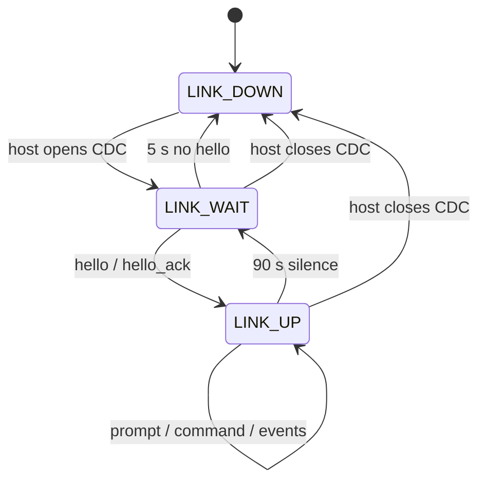
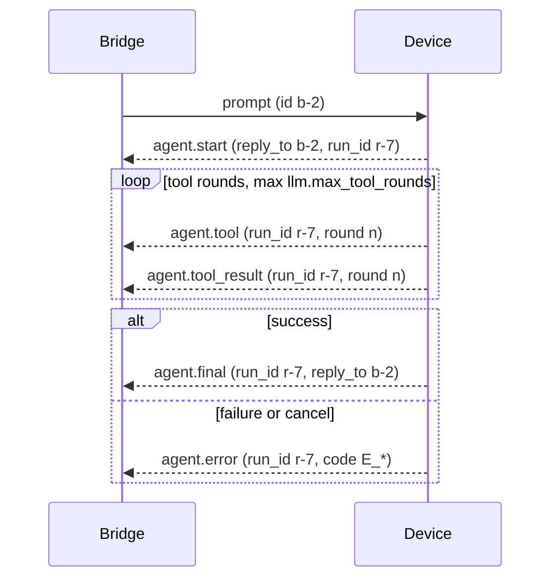

# 04 — Wire Protocol

Status: frozen by `docs/00-overview.md` §6. This document expands that contract; it
never overrides it. Where a detail here is not stated in the overview it is marked
`[ASSUMPTION]`, and any conflict resolves upward to `00-overview.md`.

Audience: firmware `link` module and the Python bridge (`docs/05-bridge.md`).

## 1. Transport

| Property | Value |
|---|---|
| Physical link | USB-Serial/JTAG CDC (native USB, no UART bridge chip) |
| Framing | NDJSON: one JSON object per line, UTF-8, terminated by a single `\n` |
| Direction | Full duplex, independent byte streams |
| Device RX limit | 4096 bytes per line, including the terminating `\n` |
| Device TX limit | 16384 bytes per line, including the terminating `\n` |
| Request/reply | Correlated by `id` in the reply, echoed as `reply_to` |
| Encryption | None. USB is a local wire; secrets are never sent device-to-bridge |

`serial.baud` in `config.json` is retained for host-tool compatibility. CDC-ACM
ignores the value; the bridge still opens the port at that rate so that non-ACM
adapters and terminal multiplexers behave identically `[ASSUMPTION]`.

### 1.1 Line discipline

1. A line is complete only when `\n` arrives. A frame MUST NOT contain a literal
   `\n` inside its JSON text; JSON encoders escape it as `\n` within strings.
2. A trailing `\r` before `\n` is stripped and is not part of the frame. The bridge
   therefore accepts CRLF and LF output from any host.
3. Bytes after an oversize line's overflow are discarded up to and including the
   next `\n`, so one bad line can never desynchronise the stream.
4. Invalid UTF-8 in a line is treated as an oversize/invalid frame: discarded, and
   the receiver reports `E_PROTOCOL` if it can recover an `id` from the prefix.
5. No binary passthrough exists in v1. Firmware hooks `esp_log_set_vprintf` so that
   ESP-IDF logging becomes `log` messages (overview D9); a raw log byte on the link
   would break framing and is a firmware bug.

### 1.2 Framing limits and overflow behaviour

| Condition | Receiver | Observable result |
|---|---|---|
| RX line > 4096 bytes | device | line discarded; if `id` recoverable, `command.result` `ok:false` with `E_PROTOCOL`; else `event{kind:"protocol.error"}` |
| RX line is not valid JSON | device | same as above; `message` names the parse offset |
| RX envelope has `v` != 1 | device | `command.result` `ok:false` with `E_PROTOCOL` |
| RX type unknown to device | device | `command.result` `ok:false` with `E_PROTOCOL`, `detail.direction` = `bridge_to_device` |
| TX serialisation would exceed 16384 bytes | device | `agent.final` (and only that type) truncates `text`, sets `truncated:true` and `full_bytes` |
| Bridge receives > 16384 bytes | bridge | line discarded, `E_PROTOCOL` shown in Logs screen |

`serial.max_line_bytes` is the user-visible cap and defaults to 4096. Values above
4096 are clamped to 4096 at config load, because the device RX buffer is fixed by
the protocol `[ASSUMPTION]`.

Truncation is only permitted on `agent.final.text`. Every other message type MUST
fit in 16384 bytes by construction; `templates.*` and `config.get` results are sized
by the flash files they read and are validated against the cap before send, failing
with `E_STORAGE` if they do not fit.

## 2. Envelope

Every frame, both directions, is a JSON object with these members:

| Field | Type | Required | Meaning |
|---|---|---|---|
| `v` | integer | yes | Protocol version. Exactly `1` in v1. |
| `type` | string | yes | Message type from the frozen lists in §3. |
| `id` | string | yes | Frame identity, unique per sender per connection. |
| `ts` | integer | yes | Sender's Unix seconds, or `0` when the clock is unsynced. |
| `reply_to` | string | no | `id` of the frame being answered. Present on all replies. |

Rules:

- `id` is 1–32 characters from `[A-Za-z0-9._-]`. The bridge uses `b-<counter>`; the
  device uses `d-<counter>`. Counters are per boot and never reused.
- `ts` is informational. The device clock is only trustworthy when
  `hello_ack.time_synced` is `true`; a bridge MUST NOT use `ts` for ordering.
  Ordering is guaranteed by the byte stream. A device with `ts:0` is pre-NTP.
- Unknown members MUST be ignored by both sides (forward compatibility).
- Unknown `type` values MUST be rejected, not ignored, because a request whose
  semantics are unknown cannot be answered correctly.

### 2.1 Allowed directions

| Type | bridge → device | device → bridge |
|---|---|---|
| `hello` | required on connect | — |
| `hello_ack` | — | reply to `hello` |
| `prompt` | request | — |
| `cancel` | request | — |
| `command` | request | — |
| `secret.set` | request (shorthand) | — |
| `ping` | request | — |
| `pong` | — | reply |
| `ack` | optional receipt | — |
| `status` | — | unsolicited periodic |
| `log` | — | unsolicited |
| `agent.start` | — | unsolicited, correlated |
| `agent.tool` | — | unsolicited |
| `agent.tool_result` | — | unsolicited |
| `agent.final` | — | terminal |
| `agent.error` | — | terminal or rejection |
| `task.fired` | — | unsolicited |
| `gpio.edge` | — | unsolicited |
| `mqtt.message` | — | unsolicited |
| `event` | — | unsolicited |
| `command.result` | — | reply |

Sending a type in the wrong direction is `E_PROTOCOL`.

## 3. Message catalog

Field tables list message-specific members only; `v`, `type`, `id`, `ts` and
`reply_to` are governed by §2. All examples are complete, valid frames.

### 3.1 `hello` (bridge → device)

Opens the link. The bridge sends exactly one `hello` per port open, then waits.

| Field | Type | Required | Meaning |
|---|---|---|---|
| `client` | string | yes | Client name, `musteval-tui`. |
| `client_version` | string | yes | Bridge package version. |
| `protocol` | integer | yes | Highest protocol the bridge speaks. `1`. |
| `token` | string | when `link_token` is provisioned | Shared link token; 1..64 chars. Omitted entirely when no token is provisioned. |

If the device has `link_token` provisioned in NVS (`nvs:link_token`), `token` is
REQUIRED; it MUST be omitted otherwise. A mismatch, or a missing token when one is
provisioned, produces no `hello_ack`: the device sends `event` with
`kind:"link.rejected"` and `data:{"reason":"auth"}`, then closes the port. The bridge
shows an error and does not retry automatically. The token crosses the USB link in
cleartext, so it stops a process that opens the port naively and stops nothing
against a hostile host that already holds the user's privileges.

The example omits `token` because no `link_token` is provisioned.

```json
{"v":1,"type":"hello","id":"b-1","ts":1730563200,"client":"musteval-tui","client_version":"1.0.0","protocol":1}
```

Reply: `hello_ack`. If no `hello_ack` arrives within 5 s the bridge closes the port
and retries (`05-bridge.md` §4.1).

### 3.2 `hello_ack` (device → bridge)

| Field | Type | Required | Meaning |
|---|---|---|---|
| `device` | string | yes | `device.name` from `config.json`. |
| `fw_version` | string | yes | Firmware semantic version. |
| `protocol` | integer | yes | Negotiated protocol version. |
| `boot_id` | string | yes | Hex id of this boot, stable until reset. |
| `time_synced` | boolean | yes | Whether SNTP has completed. |
| `limits` | object | yes | `{"rx_max":4096,"tx_max":16384}`. |
| `capabilities` | object | yes | `tools` (every tool the model can call right now), `mcp` (namespaced tool names), `dangerous_tools`, `streaming` (`false`). |

```json
{"v":1,"type":"hello_ack","id":"d-1","ts":1730563201,"reply_to":"b-1","device":"xiao-s3-01","fw_version":"1.0.0","protocol":1,"boot_id":"9f2c1a7e","time_synced":true,"limits":{"rx_max":4096,"tx_max":16384},"capabilities":{"tools":["gpio.read","gpio.write","adc.read","i2c.scan","i2c.read","i2c.write","time.now","fs.list","fs.read","fs.write","fs.delete","http.get","skill.read","task.list","task.set","event.emit","todo","geo.locate","mqtt.list","mqtt.publish","memory.get","memory.set","memory.list","memory.delete","sys.diagnostics","weather_now","web_search"],"mcp":["mcp.home.home_status"],"dangerous_tools":false,"streaming":false}}
```

A rejected `hello` produces no `hello_ack`; the device sends `event` with
`kind:"link.rejected"` and closes the port. A `hello_ack` whose `protocol` differs from the bridge's is fatal for the session:
the bridge shows a version mismatch banner and refuses to send `prompt`.

`capabilities.streaming` is always `false` in v1 (overview D8).

`capabilities.tools` is the set the model can call **at this moment**, not a
compile-time constant. It is built from the 25 frozen built-ins
(`00-overview.md` §7) plus the declarative tools loaded from `/tools/*.json`, then
subtracted by the two runtime conditions: `i2c.scan`, `i2c.read` and `i2c.write` are
dropped when `tools.i2c_sda`/`tools.i2c_scl` are `null`, and `geo.locate` is dropped
when `geo.enabled` is `false`. `weather_now` and `web_search` therefore **do** appear,
which is the only way a host can discover them — no other frame carries a file list
(`05-bridge.md` §7). A gate such as `tools.allow_dangerous: false`
does not remove a tool from this list; the tool is offered and refuses the call with
`E_TOOL`, so the model can explain the refusal. The list changes only on `reload`,
never mid-run, so a run's tool array stays stable across rounds.

### 3.3 `prompt` (bridge → device)

| Field | Type | Required | Meaning |
|---|---|---|---|
| `text` | string | yes | User input, UTF-8. Capped by `agent.max_input_bytes`. |
| `template` | string | no | Prompt template name from `/prompts/` used to prefix `text`. |

```json
{"v":1,"type":"prompt","id":"b-2","ts":1730563210,"text":"What time is it on the device?"}
```

Reply: `agent.start` with `reply_to` equal to this `id`. Rejection: `agent.error`
with `reply_to` equal to this `id` and code `E_BUSY`, `E_CONFIG` or `E_PROTOCOL`.

Queueing is device-side, depth 2 (overview §1.2). A third concurrent `prompt` is
rejected with `E_BUSY`; it is never silently dropped.

### 3.4 `cancel` (bridge → device)

| Field | Type | Required | Meaning |
|---|---|---|---|
| `run_id` | string | no | Run to cancel. Omitted or `"*"` means the current run. |
| `reason` | string | no | `user` (default), `shutdown`, `timeout`. |

```json
{"v":1,"type":"cancel","id":"b-3","ts":1730563300,"run_id":"r-7","reason":"user"}
```

`cancel` has no dedicated acknowledgement type. The terminal outcome of the run is
`agent.error` with `code:"E_CANCELLED"` and the run's `run_id`. Cancelling when
nothing is in flight emits `event{kind:"cancel.noop"}`.

### 3.5 `command` (bridge → device)

| Field | Type | Required | Meaning |
|---|---|---|---|
| `name` | string | yes | One of the sixteen names in §4. |
| `args` | object | no | Command arguments; defaults to `{}`. |

```json
{"v":1,"type":"command","id":"b-4","ts":1730563220,"name":"tasks.list","args":{}}
```

Reply: exactly one `command.result` carrying the same `name` and `reply_to`.

### 3.6 `secret.set` (bridge → device)

Top-level shorthand for the `secret.set` command. Both forms MUST be accepted and
MUST be behaviourally identical; the bridge uses the shorthand because the key and
value are the entire payload `[ASSUMPTION]`.

| Field | Type | Required | Meaning |
|---|---|---|---|
| `key` | string | yes | NVS key in namespace `secrets`: `[A-Za-z0-9_]`, 1–15 chars. |
| `value` | string | yes | Secret material. Never logged, never echoed. |

An empty `value` is rejected with `E_CONFIG`, naming the empty value in `detail`,
and is never treated as deletion.

```json
{"v":1,"type":"secret.set","id":"b-5","ts":1730563400,"key":"llm_key","value":"sk-EXAMPLE-NOT-A-REAL-KEY"}
```

Reply: `command.result` with `name:"secret.set"` and `result:{key, stored, length}`.
The `value` never appears device-to-bridge, in `log`, or in `config.get`.

### 3.7 `ping` / `pong`

```json
{"v":1,"type":"ping","id":"b-6","ts":1730563500}
```

```json
{"v":1,"type":"pong","id":"d-2","ts":1730563500,"reply_to":"b-6"}
```

The device answers every `ping` within 1 s even while an agent run is in flight; the
link task is separate from the agent task. A device that cannot answer within 5 s is
considered wedged and the bridge reconnects.

### 3.8 `ack` (bridge → device)

| Field | Type | Required | Meaning |
|---|---|---|---|
| `ack_of` | string | yes | `id` of an unsolicited device frame the user has seen. |

```json
{"v":1,"type":"ack","id":"b-7","ts":1730570401,"ack_of":"d-12"}
```

`ack` is advisory: it lets the device drop a retained frame (used for `task.fired`
and `agent.final` when the bridge is slow). Unknown `ack_of` values are ignored.

### 3.9 `status` (device → bridge)

Sent unsolicited every 30 s when idle, immediately after handshake, and as the
`result` of the `status` command. The object below is the single canonical status
shape; the `status` message body is that object inline, and
`command.result.result` is the same object.

| Field | Type | Meaning |
|---|---|---|
| `wifi.state` | string | `connected`, `connecting`, `failed`, `off` |
| `wifi.ssid` | string or null | Active SSID |
| `wifi.rssi` | integer or null | dBm |
| `wifi.ip` | string or null | IPv4 |
| `wifi.failovers` | integer | Networks tried since boot |
| `time.synced` | boolean | SNTP complete |
| `time.unix` | integer | Effective clock |
| `time.tz` | string | `ntp.timezone` |
| `llm.provider` | string or null | Active provider id |
| `llm.model` | string or null | Active model |
| `llm.available` | boolean | Last call succeeded |
| `llm.last_error` | string or null | Last provider error text |
| `mcp[]` | array | `{id, enabled, state}` where state is `connected`, `idle`, `error` |
| `agent.busy` | boolean | A run is in flight |
| `agent.run_id` | string or null | Current run |
| `agent.queue_depth` | integer | 0–2 |
| `agent.max_queue` | integer | 2 |
| `mqtt[]` | array | `{id, connected}` per configured broker |
| `geo` | object or null | `{lat, lon, accuracy_m, age_s}`; `null` until a fix is cached |
| `storage.userfs.used_bytes` | integer | Bytes used in `userfs` |
| `storage.userfs.total_bytes` | integer | `userfs` partition size |
| `storage.wsfs.used_bytes` | integer | Bytes used in `wsfs` (the agent sandbox) |
| `storage.wsfs.total_bytes` | integer | `wsfs` partition size |
| `storage.workspace_quota_bytes` | integer | Constant quota enforced on `/workspace/` |
| `llm.calls_hour` | integer | LLM calls charged in the current UTC hour |
| `llm.calls_day` | integer | LLM calls charged in the current day |
| `llm.limit_hour` | integer or null | `llm.max_calls_per_hour`; `null` when the limit is disabled |
| `llm.limit_day` | integer or null | `llm.max_calls_per_day`; `null` when the limit is disabled |
| `mem.heap_free` | integer | Internal heap bytes |
| `mem.psram_free` | integer | PSRAM bytes |
| `sys.safe_mode` | boolean | Safe mode is active (`02-firmware.md` §3.2) |
| `sys.boot_failures` | integer | Consecutive failed boots recorded by the boot guard |
| `sys.tool_calls` | integer | Built-in and declarative tool calls since boot |
| `sys.tool_failures` | integer | Of those, the ones returning `ok:false` |
| `uptime_s` | integer | Seconds since boot |
| `boot_id` | string | Matches `hello_ack.boot_id` |

```json
{"v":1,"type":"status","id":"d-3","ts":1730563600,"wifi":{"state":"connected","ssid":"home-2g","rssi":-58,"ip":"192.168.1.42","failovers":0},"time":{"synced":true,"unix":1730563600,"tz":"UTC"},"llm":{"provider":"openai","model":"gpt-4o-mini","available":true,"last_error":null,"calls_hour":7,"calls_day":41,"limit_hour":100,"limit_day":1000},"mcp":[{"id":"home","enabled":true,"state":"connected"}],"agent":{"busy":false,"run_id":null,"queue_depth":0,"max_queue":2},"mqtt":[{"id":"home","connected":true},{"id":"lab","connected":false}],"geo":{"lat":52.3676,"lon":4.9041,"accuracy_m":65,"age_s":42},"storage":{"userfs":{"used_bytes":18432,"total_bytes":3932160},"wsfs":{"used_bytes":0,"total_bytes":1048576},"workspace_quota_bytes":65536},"mem":{"heap_free":182344,"psram_free":8123456},"sys":{"safe_mode":false,"boot_failures":0,"tool_calls":12,"tool_failures":1},"uptime_s":812,"boot_id":"9f2c1a7e"}
```

### 3.10 `log` (device → bridge)

| Field | Type | Required | Meaning |
|---|---|---|---|
| `level` | string | yes | `error`, `warn`, `info`, `debug`, `verbose` |
| `tag` | string | yes | Firmware module name, e.g. `llm`, `net`, `sched` |
| `msg` | string | yes | Rendered log line, UTF-8 |
| `t_ms` | integer | yes | Milliseconds since boot |

```json
{"v":1,"type":"log","id":"d-4","ts":1730563700,"level":"warn","tag":"llm","msg":"provider openai timed out after 30000 ms; falling back to openrouter","t_ms":812340}
```

Log lines are filtered device-side by `device.log_level`. Secrets never appear:
the device redacts any NVS value from log output before framing.

### 3.11 `agent.start` (device → bridge)

| Field | Type | Required | Meaning |
|---|---|---|---|
| `reply_to` | string | yes | `prompt` or `tasks.run` id that began the run |
| `run_id` | string | yes | Run identity used by every subsequent event |
| `trigger` | string | yes | Frozen trigger enum value (`manual` for prompts) |
| `source` | string | yes | `prompt`, `task`, `template` |
| `provider` | string | yes | Provider id in use |
| `model` | string | yes | Model in use |
| `input_bytes` | integer | yes | Size of the assembled user input |
| `queue_depth` | integer | yes | Runs still queued behind this one |

```json
{"v":1,"type":"agent.start","id":"d-5","ts":1730563211,"reply_to":"b-2","run_id":"r-7","trigger":"manual","source":"prompt","provider":"openai","model":"gpt-4o-mini","input_bytes":37,"queue_depth":0}
```

This is the only "the run has begun" signal (overview D8): the bridge starts its
spinner here and stops it on `agent.final` or `agent.error`.

### 3.12 `agent.tool` (device → bridge)

| Field | Type | Required | Meaning |
|---|---|---|---|
| `run_id` | string | yes | Owning run |
| `round` | integer | yes | Tool round, 1-based, capped by `llm.max_tool_rounds` |
| `call_id` | string | yes | Provider tool-call id, echoed in the result |
| `tool` | string | yes | Tool name from the frozen surface |
| `args` | object | yes | Arguments as sent by the model |

```json
{"v":1,"type":"agent.tool","id":"d-6","ts":1730563213,"run_id":"r-7","round":1,"call_id":"call_a1","tool":"time.now","args":{}}
```

### 3.13 `agent.tool_result` (device → bridge)

| Field | Type | Required | Meaning |
|---|---|---|---|
| `run_id` | string | yes | Owning run |
| `round` | integer | yes | Same round as the call |
| `call_id` | string | yes | Matching call |
| `tool` | string | yes | Tool name |
| `ok` | boolean | yes | Success flag |
| `result` | any | when `ok` | Tool output, JSON-serialisable |
| `error` | object | when not `ok` | `{code, message}` |
| `duration_ms` | integer | yes | Execution time |

```json
{"v":1,"type":"agent.tool_result","id":"d-7","ts":1730563213,"run_id":"r-7","round":1,"call_id":"call_a1","tool":"time.now","ok":true,"result":{"unix":1730563213,"iso":"2026-11-02T12:00:13Z"},"duration_ms":2}
```

```json
{"v":1,"type":"agent.tool_result","id":"d-8","ts":1730563214,"run_id":"r-7","round":1,"call_id":"call_a2","tool":"fs.write","ok":false,"error":{"code":"E_TOOL","message":"fs.write refused: tools.allow_dangerous is false"},"duration_ms":1}
```

Refused tools surface as `ok:false` with `E_TOOL`; they never abort the run. The
model sees the refusal text and may choose another tool.

### 3.14 `agent.final` (device → bridge)

| Field | Type | Required | Meaning |
|---|---|---|---|
| `run_id` | string | yes | Finished run |
| `reply_to` | string | no | Originating `prompt`/`command` id when the run came from the link |
| `text` | string | yes | Assistant answer, plain text |
| `usage` | object | yes | `{prompt_tokens, completion_tokens, total_tokens}` |
| `rounds` | integer | yes | Tool rounds used |
| `provider` | string | yes | Provider that produced the answer |
| `model` | string | yes | Model name |
| `duration_ms` | integer | yes | Wall time of the run |
| `truncated` | boolean | yes | Whether `text` was shortened to fit 16384 bytes |
| `todo_open` | boolean | yes | `true` when the close-out check failed at budget end: a task was still `pending`, `in_progress` or `blocked`, or the run took two or more tool rounds without ever opening a list. `false` otherwise |
| `full_bytes` | integer | when `truncated` | Pre-truncation text length |

The agent loop refuses to finalize while the close-out check fails: it appends a
synthetic system message and takes another LLM round, repeating until the check
passes or `llm.max_tool_rounds` is spent. It fails when a task was left open, or when
a run of two or more tool rounds never opened a list at all. `todo_open:true`
therefore means the model still had open work, or never tracked any, when that
budget ended. The flag is advisory — it never becomes `agent.error` and does not
change `E_TOOL`. Tasks are closed with the `done` and `drop` operations of the
[todo tool](tools/todo.md).

```json
{"v":1,"type":"agent.final","id":"d-9","ts":1730563216,"run_id":"r-7","reply_to":"b-2","text":"The device clock reads 2026-11-02T12:00:13Z.","usage":{"prompt_tokens":812,"completion_tokens":34,"total_tokens":846},"rounds":1,"provider":"openai","model":"gpt-4o-mini","duration_ms":2840,"truncated":false,"todo_open":false}
```

### 3.15 `agent.error` (device → bridge)

| Field | Type | Required | Meaning |
|---|---|---|---|
| `code` | string | yes | Any code from §5 |
| `message` | string | yes | Human-readable, English, no secret material |
| `run_id` | string | when a run existed | Owning run |
| `reply_to` | string | when rejecting a request | Rejected request id |
| `retryable` | boolean | yes | Whether an identical retry may succeed |
| `detail` | object | no | Structured context, e.g. `{queue_depth, max_queue}` |

```json
{"v":1,"type":"agent.error","id":"d-10","ts":1730563217,"reply_to":"b-18","code":"E_BUSY","message":"agent run r-7 in flight; queue full (2), prompt rejected","retryable":true,"detail":{"queue_depth":2,"max_queue":2}}
```

This frame rejects a `prompt` (id `b-18`, not shown); it carries no `run_id` because
the run was never accepted. Contrast with a failed live run, which carries both
`run_id` and the `reply_to` of the request that started it.

`agent.error` is terminal for a run. Exactly one of `agent.final` or `agent.error`
is emitted per accepted run.

### 3.16 `task.fired` (device → bridge)

| Field | Type | Required | Meaning |
|---|---|---|---|
| `task_id` | string | yes | Task id from `/tasks.json` |
| `description` | string | yes | Task description, verbatim from `/tasks.json` |
| `trigger` | object | yes | The frozen trigger object that fired |
| `fire_count` | integer | yes | Times fired since the counter was set |
| `run_id` | string or null | yes | Run started by the task; `null` if the task is disabled or the run was skipped |

```json
{"v":1,"type":"task.fired","id":"d-11","ts":1730570400,"task_id":"morning","description":"Morning briefing","trigger":{"type":"schedule","kind":"every","interval_s":86400},"fire_count":4,"run_id":"r-8"}
```

A task that fires starts an agent run, so `agent.start` follows with the same
`run_id`. The bridge MAY `ack` this frame.

### 3.17 `gpio.edge` (device → bridge)

| Field | Type | Required | Meaning |
|---|---|---|---|
| `pin` | integer | yes | GPIO number, an input pin. The status LED is GPIO21 and never reported here |
| `level` | integer | yes | `0` or `1` after the edge |
| `edge` | string | yes | `rising` or `falling` |
| `mode` | string | yes | `input`, `input_pullup`, `input_pulldown` |

```json
{"v":1,"type":"gpio.edge","id":"d-12","ts":1730570500,"pin":3,"level":0,"edge":"falling","mode":"input_pullup"}
```

### 3.18 `mqtt.message` (device → bridge)

Unsolicited. Emitted for every inbound message on a subscribed topic, whether or
not a task matched. It may arrive while an agent run is in flight; the bridge MUST
NOT treat it as a reply, and `reply_to` is absent.

| Field | Type | Required | Meaning |
|---|---|---|---|
| `server_id` | string | yes | `mqtt.servers[].id` that received it |
| `topic` | string | yes | Full topic, as received |
| `payload` | string | yes | UTF-8 payload, capped at 1024 bytes |
| `truncated` | boolean | yes | `true` if the payload exceeded the cap |
| `qos` | integer | yes | `0` or `1` |
| `retain` | boolean | yes | Retained-flag from the broker |
| `received_ts` | integer | yes | Unix seconds; equals `ts` when the clock is synced |

```json
{"v":1,"type":"mqtt.message","id":"d-13","ts":1730570600,"server_id":"home","topic":"garage/door/state","payload":"open","truncated":false,"qos":1,"retain":true,"received_ts":1730570600}
```

Payloads are raw broker bytes. They are **not** escaped for terminal control
characters; the bridge sanitises them before rendering (`05-bridge.md` §5.5).

### 3.19 `event` (device → bridge)

Generic unsolicited notification with a stable `kind` and free-form `data`.

| `kind` | Emitted when | `data` |
|---|---|---|
| `boot` | firmware ready | `{fw_version, boot_id}` |
| `wifi.connected` | network up | `{ssid, rssi, attempt}` |
| `wifi.disconnected` | network lost | `{ssid, reason}` |
| `ntp.synced` | clock disciplined | `{unix, offset_ms}` |
| `serial.connected` | handshake completed | `{client, client_version}` |
| `serial.disconnected` | bridge gone | `{after_s}` |
| `config.reloaded` | `reload` command | `{scopes}` |
| `mcp.connected` | MCP session up | `{server_id}` |
| `mcp.error` | MCP failure | `{server_id, message}` |
| `cancel.noop` | nothing to cancel | `{reason}` |
| `protocol.error` | unrecoverable frame | `{code, message, dropped_bytes}` |
| `queue.full` | run rejected | `{queue_depth}` |
| `link.rejected` | `hello` failed token check | `{reason}` |
| `agent.event` | `event.emit` tool called | `{type, data, task_hits}` |

`event.emit` both feeds the scheduler and produces `agent.event`; the frame is
emitted even when zero tasks matched (`task_hits:0`).

```json
{"v":1,"type":"event","id":"d-13","ts":1730570600,"kind":"wifi.connected","data":{"ssid":"home-2g","rssi":-57,"attempt":1}}
```

Adding a new `kind` is a compatible change: bridges MUST render unknown kinds as a
generic notification line and MUST NOT error.

### 3.20 `command.result` (device → bridge)

| Field | Type | Required | Meaning |
|---|---|---|---|
| `name` | string | yes | Echo of `command.name` |
| `ok` | boolean | yes | Success flag |
| `result` | any | when `ok` | Command-specific result (§4) |
| `error` | object | when not `ok` | `{code, message, detail?}` |
| `duration_ms` | integer | yes | Handler time |

```json
{"v":1,"type":"command.result","id":"d-14","ts":1730563220,"reply_to":"b-4","name":"tasks.list","ok":true,"result":{"tasks":[{"id":"morning","description":"Morning briefing","enabled":true,"trigger":{"type":"schedule"},"repeat":{"mode":"forever"},"fired_count":3,"next_fire_at":1730570400}]},"duration_ms":6}
```

```json
{"v":1,"type":"command.result","id":"d-15","ts":1730563221,"reply_to":"b-4","name":"template.get","ok":false,"error":{"code":"E_STORAGE","message":"template not found: missing.md"},"duration_ms":3}
```

## 4. Command catalog

All sixteen names, their arguments and their `result` shapes. Unknown names are
`E_PROTOCOL`. Missing required arguments are `E_PROTOCOL`. Invalid values are
`E_CONFIG`. All commands are refused with `E_BUSY` only where the table says so;
reads are never refused.

| `name` | Args | `result` | Errors | Busy-safe |
|---|---|---|---|---|
| `status` | `{}` | status object (§3.9) | `E_INTERNAL` | yes |
| `reload` | `{}` | `{reloaded:[...], warnings:[{scope,message}]}` | `E_CONFIG`, `E_STORAGE` | yes |
| `reboot` | `{delay_ms?}` | `{rebooting:true, grace_ms}` | `E_BUSY` if a run is in flight | no |
| `tasks.list` | `{}` | `{tasks:[{id,description,enabled,trigger,repeat,fired_count,next_fire_at?}]}` | `E_STORAGE`, `E_CONFIG` | yes |
| `tasks.run` | `{id}` | `{task_id, run_id}` | `E_CONFIG` (unknown id), `E_BUSY` | no |
| `tasks.set` | `{task}` | `{id, created, count}` | `E_CONFIG` (schema violation or 16-entry cap), `E_STORAGE` | yes |
| `tasks.delete` | `{id}` | `{id, deleted, count}` | `E_CONFIG` (unknown id), `E_STORAGE` | yes |
| `config.get` | `{path?}` | `{config}` or `{path, value}` | `E_CONFIG` (bad path) | yes |
| `config.set` | `{path, value}` | `{path, applied, requires_reboot}` | `E_CONFIG`, `E_STORAGE` | yes |
| `secret.set` | `{key, value}` | `{key, stored, length}` | `E_CONFIG`, `E_STORAGE` | yes |
| `templates.list` | `{}` | `{"templates":["brief.md","daily.md"]}` | `E_STORAGE` | yes |
| `template.get` | `{name}` | `{name, bytes, text}` | `E_STORAGE` (missing), `E_PROTOCOL` (bad name) | yes |
| `geo.locate` | `{}` | `{lat, lon, accuracy_m, source, age_s}` | `E_GEO`, `E_CONFIG` (geo disabled) | yes |
| `mqtt.publish` | `{server_id, topic, payload, qos?, retain?}` | `{published, server_id, topic}` | `E_MQTT` (unknown server/topic, disconnected) | yes |
| `mqtt.status` | `{}` | `{servers:[{id,connected,subscriptions,last_error}]}` | `E_INTERNAL` | yes |
| `fs.put` | `{path, data, offset?, final?, encoding?}` | `{path, bytes, created}` | `E_CONFIG` (bad path, bad extension, or a built-in target), `E_STORAGE` (quota or entry cap), `E_PROTOCOL` (oversize, bad base64, or out-of-sequence chunk) | yes |
| `sandbox.list` | `{path?}` | `{path, entries:[{name,dir,bytes}]}` | `E_CONFIG` (path outside `/workspace/`), `E_STORAGE` (missing directory) | yes |
| `sandbox.read` | `{path}` | `{path, bytes, text, truncated}` | `E_CONFIG` (path outside `/workspace/`), `E_STORAGE` (missing file) | yes |
| `sandbox.delete` | `{path}` | `{path, deleted}` | `E_CONFIG` (path outside `/workspace/` or a non-empty directory), `E_STORAGE` (missing) | yes |
| `sandbox.write` | `{path, data, offset?, final?, encoding?}` | `{path, bytes, created}` | `E_CONFIG` (path outside `/workspace/`), `E_STORAGE` (quota or entry cap), `E_PROTOCOL` (oversize, bad base64, or out-of-sequence chunk) | yes |

### 4.1 `status`

```json
{"v":1,"type":"command","id":"b-8","ts":1730563222,"name":"status","args":{}}
```

```json
{"v":1,"type":"command.result","id":"d-16","ts":1730563222,"reply_to":"b-8","name":"status","ok":true,"result":{"wifi":{"state":"connected","ssid":"home-2g","rssi":-58,"ip":"192.168.1.42","failovers":0},"time":{"synced":true,"unix":1730563222,"tz":"UTC"},"llm":{"provider":"openai","model":"gpt-4o-mini","available":true,"last_error":null,"calls_hour":7,"calls_day":41,"limit_hour":100,"limit_day":1000},"mcp":[],"agent":{"busy":true,"run_id":"r-7","queue_depth":0,"max_queue":2},"mqtt":[{"id":"home","connected":true},{"id":"lab","connected":false}],"geo":{"lat":52.3676,"lon":4.9041,"accuracy_m":65,"age_s":42},"storage":{"userfs":{"used_bytes":18432,"total_bytes":3932160},"wsfs":{"used_bytes":0,"total_bytes":1048576},"workspace_quota_bytes":65536},"mem":{"heap_free":181004,"psram_free":8123456},"sys":{"safe_mode":false,"boot_failures":0,"tool_calls":12,"tool_failures":1},"uptime_s":834,"boot_id":"9f2c1a7e"},"duration_ms":9}
```

### 4.2 `reload`

Re-reads `/config.json`, `/tasks.json`, `/prompts/*.md`, `/skills/*.md` and
`/tools/*.json` from flash without rebooting. Fields that only take effect at boot
(`wifi.*`, `serial.*`, `ntp.servers`) are reported in `warnings`.

```json
{"v":1,"type":"command","id":"b-9","ts":1730571200,"name":"reload","args":{}}
```

```json
{"v":1,"type":"command.result","id":"d-17","ts":1730571203,"reply_to":"b-9","name":"reload","ok":true,"result":{"reloaded":["config","tasks","skills","tools"],"warnings":[{"scope":"tasks","message":"task nightly disabled: gpio trigger pin not configured"}]},"duration_ms":214}
```

### 4.3 `reboot`

Requires an idle agent. The device sends `command.result` first, then schedules the
reset after `grace_ms` so the frame leaves the CDC buffer.

```json
{"v":1,"type":"command","id":"b-10","ts":1730571300,"name":"reboot","args":{"delay_ms":250}}
```

```json
{"v":1,"type":"command.result","id":"d-18","ts":1730571300,"reply_to":"b-10","name":"reboot","ok":true,"result":{"rebooting":true,"grace_ms":250},"duration_ms":2}
```

### 4.4 `tasks.list`

`next_fire_at` is present only for enabled `schedule` triggers with a known clock.

```json
{"v":1,"type":"command","id":"b-11","ts":1730571400,"name":"tasks.list","args":{}}
```


### 4.5 `tasks.run`

Starts the task immediately, regardless of its trigger, and returns before the run
completes. The run streams `agent.start`, `agent.tool*`, then `agent.final` or
`agent.error` with the returned `run_id`.

```json
{"v":1,"type":"command","id":"b-12","ts":1730571500,"name":"tasks.run","args":{"id":"morning"}}
```

```json
{"v":1,"type":"command.result","id":"d-20","ts":1730571500,"reply_to":"b-12","name":"tasks.run","ok":true,"result":{"task_id":"morning","run_id":"r-9"},"duration_ms":5}
```

### 4.6 `tasks.set`

Creates or replaces one task and writes `/tasks.json`. `args.task` obeys the schema in
`docs/03-config.md` §tasks; `args.task.id` selects the entry, so an existing id is
replaced wholesale and a new id appends. Replacement is total, not a field patch:
`enabled` omitted means `true`, so `tasks.set` without `enabled` re-enables a
disabled task. Use `"enabled": false` to keep it off. The write is the same atomic
temp-file-plus-rename path as the `task.set` tool, under the same mutex, and is
refused during `reload`.

The command is the host's authoring path and is not gated by
`tools.allow_dangerous`; that gate constrains the model, not the person at the
terminal. Nor is it capped by `tools.task_max`, which is the agent's ceiling: a host
write is bounded only by the schema's 16-entry array limit, so raising
`tools.task_max` for the model does not silently raise it for the user, and lowering
it does not lock the user out of their own file.

```json
{"v":1,"type":"command","id":"b-13","ts":1730571600,"name":"tasks.set","args":{"task":{"id":"morning","enabled":true,"description":"Morning briefing","trigger":{"type":"schedule","kind":"every","interval_s":86400},"action":{"kind":"prompt","prompt":"Brief me."},"repeat":{"mode":"forever","count":0}}}}
```

```json
{"v":1,"type":"command.result","id":"d-21","ts":1730571600,"reply_to":"b-13","name":"tasks.set","ok":true,"result":{"id":"morning","created":false,"count":3},"duration_ms":9}
```

`created` is `true` when the id was absent. `count` is the task total after the
write.

### 4.7 `tasks.delete`

Removes one task by id and rewrites `/tasks.json`. This is the only way to remove a
task; it has no tool equivalent, so the model cannot do it (`06-security.md` §6.3).
Deleting an unknown id is `E_CONFIG` and leaves the file untouched. Runtime state
for the id is dropped from NVS namespace `runtime` in the same operation, so
re-adding the id starts from `fired_count: 0`.

```json
{"v":1,"type":"command","id":"b-14","ts":1730571650,"name":"tasks.delete","args":{"id":"nightly"}}
```

```json
{"v":1,"type":"command.result","id":"d-22","ts":1730571650,"reply_to":"b-14","name":"tasks.delete","ok":true,"result":{"id":"nightly","deleted":true,"count":2},"duration_ms":7}
```

### 4.8 `config.get`

With no `path`, returns the whole effective config with every `secret_ref` still a
reference string. With a `path`, returns a dotted path resolved against the frozen
key tree of `00-overview.md` §4. Array members use numeric indexes.

```json
{"v":1,"type":"command","id":"b-13","ts":1730571600,"name":"config.get","args":{"path":"llm.providers.0.model"}}
```

### 4.9 `config.set`

Validates, writes `/config.json`, and applies what can be applied live. `false` for
`requires_reboot` means the new value is active immediately. Setting a path to a
`secret_ref` whose NVS key is missing fails with `E_CONFIG`; the old value is kept
(no partial write).

```json
{"v":1,"type":"command","id":"b-14","ts":1730571700,"name":"config.set","args":{"path":"device.log_level","value":"debug"}}
```

```json
{"v":1,"type":"command.result","id":"d-22","ts":1730571701,"reply_to":"b-14","name":"config.set","ok":true,"result":{"path":"device.log_level","applied":true,"requires_reboot":false},"duration_ms":38}
```

### 4.10 `secret.set`

Writes NVS namespace `secrets`. Key rules: `[A-Za-z0-9_]`, 1–15 characters. The
value is stored verbatim and never returned. `length` is the byte length, which is
enough for the bridge to confirm the paste and useless to an attacker without the
device.

```json
{"v":1,"type":"command","id":"b-15","ts":1730571800,"name":"secret.set","args":{"key":"llm_key","value":"sk-EXAMPLE-NOT-A-REAL-KEY"}}
```

```json
{"v":1,"type":"command.result","id":"d-23","ts":1730571801,"reply_to":"b-15","name":"secret.set","ok":true,"result":{"key":"llm_key","stored":true,"length":24},"duration_ms":11}
```

### 4.11 `templates.list`

Lists `/prompts/*.md`, excluding `system.md`. Frontmatter metadata is not returned
by this command; `template.get` returns the body.

```json
{"v":1,"type":"command","id":"b-16","ts":1730571900,"name":"templates.list","args":{}}
```

```json
{"v":1,"type":"command.result","id":"d-24","ts":1730571900,"reply_to":"b-16","name":"templates.list","ok":true,"result":{"templates":["brief.md","daily.md"]},"duration_ms":5}
```

### 4.12 `template.get`

`name` MUST match `[A-Za-z0-9._-]+\.md` and MUST NOT contain `/`. Anything else is
`E_PROTOCOL`.

```json
{"v":1,"type":"command","id":"b-17","ts":1730572000,"name":"template.get","args":{"name":"brief.md"}}
```

```json
{"v":1,"type":"command.result","id":"d-25","ts":1730572000,"reply_to":"b-17","name":"template.get","ok":true,"result":{"name":"brief.md","bytes":24,"text":"Summarise /data today."},"duration_ms":4}
```

### 4.13 `geo.locate`

Forces a geolocation lookup via the `geo.providers[]` fallback chain. Returns a
cached fix if one is younger than `geo.cache_ttl_s`.

```json
{"v":1,"type":"command","id":"b-18","ts":1730572000,"name":"geo.locate","args":{}}
```

```json
{"v":1,"type":"command.result","id":"d-26","ts":1730572000,"reply_to":"b-18","name":"geo.locate","ok":true,"result":{"lat":52.3676,"lon":4.9041,"accuracy_m":65,"provider":"home_wifi","age_s":42},"duration_ms":120}
```

Disabled `geo.enabled` returns `E_CONFIG`; provider chain failure returns `E_GEO`.

### 4.14 `mqtt.publish`

Publishes a message to a specified broker and topic. Both `server_id` and `topic`
MUST already exist in the configured `mqtt.servers[]` list; otherwise returns
`E_MQTT` (not `E_CONFIG`, as this validates broker state).

```json
{"v":1,"type":"command","id":"b-19","ts":1730572100,"name":"mqtt.publish","args":{"server_id":"home","topic":"sensors/temp","payload":"{\"t\":21.5}","qos":1}}
```

```json
{"v":1,"type":"command.result","id":"d-27","ts":1730572100,"reply_to":"b-19","name":"mqtt.publish","ok":true,"result":{"published":true},"duration_ms":45}
```

Broker unreachable or PUBACK failure returns `E_MQTT`.

### 4.15 `mqtt.status`

Lists the connection state and subscription count for all configured MQTT brokers.

```json
{"v":1,"type":"command","id":"b-20","ts":1730572200,"name":"mqtt.status","args":{}}
```

```json
{"v":1,"type":"command.result","id":"d-28","ts":1730572200,"reply_to":"b-20","name":"mqtt.status","ok":true,"result":[{"id":"home","connected":true,"subscriptions":["sensors/temp","sensors/rh"]},{"id":"lab","connected":false,"subscriptions":["lab/telemetry"]}],"duration_ms":12}
```

Only returns `E_CONFIG` if `mqtt.servers[]` is completely missing or malformed.
Individual broker disconnection is reported as `connected:false`.

```json
{"v":1,"type":"command.result","id":"d-21","ts":1730571600,"reply_to":"b-13","name":"config.get","ok":true,"result":{"path":"llm.providers.0.model","value":"gpt-4o-mini"},"duration_ms":4}
```

### 4.16 `fs.put`

Writes one file into `userfs` (`/fs`), the only way user content reaches the device
without a reflash. It exists so the bridge can import skills, prompts and
declarative tool definitions. It is **host-only**: no tool wraps it, so the model
cannot call it. Built-in content ships in the `userfs` image built at flash time;
this command adds or replaces user-imported files next to it.

Files are written in chunks because the RX line cap is 4 KiB and a skill may be
8 KiB. Each frame carries one chunk; the bridge splits, the device assembles.

```json
{"v":1,"type":"command","id":"b-21","ts":1730572300,"name":"fs.put","args":{"path":"/skills/led-control.md","data":"LS0tCm5hbWU6IGxlZC1jb250cm9sCi0tLQo=","encoding":"base64","offset":0,"final":true}}
```

```json
{"v":1,"type":"command.result","id":"d-29","ts":1730572300,"reply_to":"b-21","name":"fs.put","ok":true,"result":{"path":"/skills/led-control.md","bytes":21,"created":true},"duration_ms":48}
```

| Arg | Type | Required | Notes |
|---|---|---|---|
| `path` | string | yes | Absolute, under one of `/config.json`, `/tasks.json`, `/skills/`, `/prompts/`, `/tools/` |
| `data` | string | yes | One chunk. Raw bytes must not exceed 2048, so a base64 chunk encodes to at most 2732 and the whole line stays under the 4 KiB cap |
| `encoding` | string | no | `base64` or `utf8`; default `utf8` |
| `offset` | int | no | Byte offset this chunk starts at; default `0`. A chunk whose offset is not the current staged size is `E_PROTOCOL` |
| `final` | bool | no | `true` on the last chunk; default `false`. Only `final:true` commits |

Staging: offset `0` truncates the target to `<path>.new` and starts a new
transfer. Each later chunk is appended after checking its offset matches the staged
length. On `final:true` the staged file is flushed and renamed over the target, so a
failed or abandoned transfer leaves the previous file intact and never exposes a
partial file. A transfer left unfinished for longer than the `secret.set` idle
timeout is discarded on the next `fs.put` to the same path.

`/config.json` writes are **not** applied to the running configuration until
`reload`; the command returns `requires_reboot: true` when the changed file is
`/config.json`.

An imported file is held to exactly the caps its directory already carries
(`03-config.md` §Storage limits): 8 KiB per skill, 4 KiB per prompt, 2 KiB per
declarative tool, and 16 entries per directory. `E_STORAGE` is returned before the
final chunk commits when the assembled file or the resulting entry count would
exceed either. Imports are not an exception carve-out and get no larger budget than
a baked-in file.

Built-in and imported files share one directory, so a name collision has to be
decided rather than left to whichever write ran last. **A baked-in file wins.** An
import that targets a path already shipped in the `userfs` image is refused with
`E_CONFIG`, the `error.detail` field naming the built-in it collided with; the bridge
offers to save it under a different name instead. This keeps the shipped
`config.json`, the two declarative tools and the built-in skills and prompts
impossible to shadow or corrupt through
`fs.put`, which is the same reasoning that keeps `config.json` out of the tool
surface. Deleting a built-in is likewise not expressible: `fs.put` writes, it does
not remove, and no command deletes from `userfs`.

To change a built-in anyway, edit it in the image and reflash; `fs.put` is for
adding content, not for overriding what shipped.

Errors: `E_CONFIG` for a path outside the allowlist or a disallowed extension,
`E_STORAGE` when the assembled file would exceed the per-file or partition limit,
`E_PROTOCOL` for an out-of-sequence offset, a chunk over 2048 raw bytes, malformed
base64, or `final:true` on a path with no staged transfer. `E_BUSY` never applies:
concurrent transfers serialise on the same mutex `store_task_write()` uses, and
two interleaved transfers to one path fail the offset check rather than corrupting
the file.

### 4.17 `sandbox.list`

Lists one directory of the agent sandbox, `/workspace/`, which is the `wsfs`
partition. This is the browse half of the file manager in `05-bridge.md` §5.8. It
is **host-only** like `fs.put`: no tool wraps it, so the model cannot widen its own
reach with it, and `fs.list` remains the model's only listing tool.

`path` is absolute and defaults to `/workspace/`. It MUST resolve inside
`/workspace/` by the same canonicalisation `docs/06-security.md` §6.1 defines for
`fs.*`, and a path that resolves elsewhere is `E_CONFIG`, never a silent fallback
to the root.

```json
{"v":1,"type":"command","id":"b-31","ts":1730572400,"name":"sandbox.list","args":{"path":"/workspace/"}}
```

```json
{"v":1,"type":"command.result","id":"d-41","ts":1730572400,"reply_to":"b-31","name":"sandbox.list","ok":true,"result":{"path":"/workspace/","entries":[{"name":"notes.md","dir":false,"bytes":412},{"name":"runs","dir":true,"bytes":0}]},"duration_ms":9}
```

| Arg | Type | Required | Notes |
|---|---|---|---|
| `path` | string | no | Absolute, resolved under `/workspace/`; default `/workspace/` |

Entries are sorted by `dir` first, then `name`, both ascending, and are not
recursive. `bytes` is the file length, and `0` for a directory. A directory
holding more entries than the listing cap is `E_STORAGE` rather than a truncated
list, because a browser that silently hides files is worse than one that says the
directory is too large.

### 4.18 `sandbox.read`

Returns one file from the sandbox as UTF-8 text for viewing and editing.

```json
{"v":1,"type":"command","id":"b-32","ts":1730572410,"name":"sandbox.read","args":{"path":"/workspace/notes.md"}}
```

```json
{"v":1,"type":"command.result","id":"d-42","ts":1730572410,"reply_to":"b-32","name":"sandbox.read","ok":true,"result":{"path":"/workspace/notes.md","bytes":412,"text":"# Notes\n","truncated":false},"duration_ms":6}
```

| Arg | Type | Required | Notes |
|---|---|---|---|
| `path` | string | yes | Absolute file path under `/workspace/` |

`truncated` is `true` when the file exceeded the read cap and only its first part
is returned; the bridge renders a banner rather than editing a partial file. A
file that is not valid UTF-8 is `E_STORAGE`, so the bridge never shows mojibake.
The read cap is fixed at 32 KiB, which keeps the whole `command.result` inside the
16 KiB TX limit only because the device answers in one frame under the
`04-protocol.md` §1 line caps: a longer file MUST be `truncated`, never a second
frame.

### 4.19 `sandbox.delete`

Deletes one sandbox file, or one **empty** directory.

```json
{"v":1,"type":"command","id":"b-33","ts":1730572420,"name":"sandbox.delete","args":{"path":"/workspace/notes.md"}}
```

```json
{"v":1,"type":"command.result","id":"d-43","ts":1730572420,"reply_to":"b-33","name":"sandbox.delete","ok":true,"result":{"path":"/workspace/notes.md","deleted":true},"duration_ms":11}
```

A directory that still holds entries is `E_CONFIG` with `detail` naming the
offending path, so deletion is never recursive and a mis-keyed confirmation cannot
take a subtree with it. `tools.allow_dangerous` does not gate this command: it is
host-only, and the gate exists to stop the model, which cannot reach it.

### 4.20 `sandbox.write`

Replaces one sandbox file, or creates it. The chunking, staging and commit rules
are exactly `fs.put` §4.16's, and the only differences are the target mount and
that no extension allowlist applies.

```json
{"v":1,"type":"command","id":"b-34","ts":1730572430,"name":"sandbox.write","args":{"path":"/workspace/notes.md","data":"IyBOb3Rlcwo=","encoding":"base64","offset":0,"final":true}}
```

```json
{"v":1,"type":"command.result","id":"d-44","ts":1730572430,"reply_to":"b-34","name":"sandbox.write","ok":true,"result":{"path":"/workspace/notes.md","bytes":9,"created":false},"duration_ms":22}
```

| Arg | Type | Required | Notes |
|---|---|---|---|
| `path` | string | yes | Absolute file path under `/workspace/` |
| `data` | string | yes | One chunk, at most 2048 raw bytes |
| `encoding` | string | no | `base64` or `utf8`; default `utf8` |
| `offset` | int | no | Byte offset; default `0`. A mismatch is `E_PROTOCOL` |
| `final` | bool | no | `true` commits the staged file; default `false` |

A write that would exceed the workspace quota is `E_STORAGE` and leaves the
previous file intact, because the staged file is renamed only on `final:true`.

## 5. Error codes

| Code | Meaning | Retryable | Typical source |
|---|---|---|---|
| `E_CONFIG` | Config invalid, missing key, unresolved `secret_ref` | no (user fixes file) | boot, `reload`, `config.*`, `tasks.*` |
| `E_WIFI` | No network; provider unreachable at the link layer | yes (after backoff) | agent run |
| `E_LLM_UNAVAILABLE` | All providers in the fallback chain failed | yes | agent run |
| `E_LLM_RATE` | A configured LLM call cap (hour or day) is exhausted; no request was sent | yes (after the window rolls over) | `prompt`, agent run |
| `E_TOOL` | Tool refused or failed (missing tool, dangerous tool blocked, host not allowlisted) | no | `agent.tool_result` |
| `E_MCP` | MCP server handshake or call failed | yes | agent run, tool call |
| `E_BUSY` | Agent run active and queue full, or command requires idle | yes (after run ends) | `prompt`, `tasks.run`, `reboot` |
| `E_SAFE_MODE` | Safe mode is active and the request needs the network, the scheduler or the agent loop. `reload` is never refused; it is the exit | no (repair config, then `reload`) | `prompt`, `tasks.run` |
| `E_TIMEOUT` | Operation exceeded its configured timeout | yes | agent run, `config.set` flash write |
| `E_PROTOCOL` | Malformed frame, bad envelope, unknown type, oversize line | no (fix client) | link |
| `E_AUTH` | Provider or MCP rejected credentials | no (rotate secret) | agent run, `mcp.error` |
| `E_MQTT` | Broker config, allowlist or publish failure; the whole `mqtt.publish` failure domain | yes (after reconnect) / no (bad args) | tool call |
| `E_GEO` | Every provider in the geo chain failed | yes | tool call |
| `E_STORAGE` | LittleFS read/write/mount failure | yes (transient) / no (full) | `reload`, `template.*`, `config.set` |
| `E_CANCELLED` | Run cancelled by `cancel` or shutdown | no | agent run |
| `E_INTERNAL` | Unclassified firmware fault | yes | any |

Codes are stable identifiers and MUST NOT be renamed. Human text lives in
`message` and MAY change. A bridge maps unknown codes to `E_INTERNAL` rendering and
shows the raw string.

## 6. Link state machine



| State | Device behaviour |
|---|---|
| `LINK_DOWN` | No host. Agent still runs for scheduled and GPIO triggers; nothing is framed to a dead port. |
| `LINK_WAIT` | CDC open, port configured, awaiting `hello`. All other types are answered with `E_PROTOCOL`. No unsolicited traffic, so a half-open terminal is not spammed. |
| `LINK_UP` | Full duplex. Unsolicited events, `status` heartbeat and logs flow. |

Rules:

- The `serial_connected` trigger fires on the `LINK_WAIT → LINK_UP` transition, so a
  task that reports on connection has a live terminal to report to.
- `serial.disconnected` is emitted on `LINK_UP → LINK_DOWN` and best-effort on the
  90 s silence transition.
- Handshake resets on every new `hello`. A reconnecting bridge re-handshakes; it does
  not resume a prior session id.
- Agent state is independent of link state. `cancel` on a stale `run_id` is
  `E_CANCELLED` if the run is still live, otherwise `event{kind:"cancel.noop"}`.

### 6.1 Run lifecycle



Exactly one terminal frame per run. A bridge MUST treat a second terminal frame for
the same `run_id` as `E_PROTOCOL`.

## 7. Versioning

| Change | Allowed in v1 |
|---|---|
| New optional envelope field | yes |
| New `event.kind` | yes |
| New optional member in an existing message | yes |
| New required member | no — needs `v:2` |
| New `type` | no — needs `v:2` |
| New error code | no — codes are frozen |
| New `command.name` | no — needs `v:2` |

Two amendments have been applied while `v` stayed `1`, and they are recorded here
rather than left implicit. The first: the error catalog gained `E_LLM_RATE` and `E_SAFE_MODE`, and
`status` gained the `llm.calls_*`, `llm.limit_*` and `sys.*` members. It is
admissible because no firmware has shipped and therefore no receiver exists that
could be surprised; the freeze binds published versions, not a contract still being
written. The rule above applies unchanged from the first tagged release, at which
point this paragraph stops being true and a further change of this kind does need
`v:2`. The two new codes are additive in practice: a bridge that does not know them
still renders `error.code` as an opaque string.

The second amendment adds four `command.name` values, `sandbox.list`,
`sandbox.read`, `sandbox.delete` and `sandbox.write` (§4.17 to §4.20), which the
table above otherwise forbids. It is admissible on the same ground as the first:
the firmware does not exist, so no receiver can be surprised by a name it does not
know, and an older bridge that meets one renders it as an unknown command exactly
as §4 already requires. This is the last such amendment the `v:1` paragraph can
carry: once a build is published, another name is `v:2`.

`v` is a single integer. A receiver that sees a higher `v` MUST refuse the session
with `E_PROTOCOL` rather than guess. The bridge surfaces that as a hard banner, not
a retry loop.

## 8. Reference transcript

```json
{"v":1,"type":"hello","id":"b-1","ts":1730563200,"client":"musteval-tui","client_version":"1.0.0","protocol":1}
{"v":1,"type":"hello_ack","id":"d-1","ts":1730563201,"reply_to":"b-1","device":"xiao-s3-01","fw_version":"1.0.0","protocol":1,"boot_id":"9f2c1a7e","time_synced":true,"limits":{"rx_max":4096,"tx_max":16384},"capabilities":{"tools":["gpio.read","gpio.write","adc.read","i2c.scan","i2c.read","i2c.write","time.now","fs.list","fs.read","fs.write","fs.delete","http.get","skill.read","task.list","task.set","event.emit","todo","geo.locate","mqtt.list","mqtt.publish","memory.get","memory.set","memory.list","memory.delete","sys.diagnostics","weather_now","web_search"],"mcp":[],"dangerous_tools":false,"streaming":false}}
{"v":1,"type":"ping","id":"b-2","ts":1730563215}
{"v":1,"type":"pong","id":"d-2","ts":1730563215,"reply_to":"b-2"}
{"v":1,"type":"prompt","id":"b-3","ts":1730563220,"text":"What time is it on the device?"}
{"v":1,"type":"agent.start","id":"d-3","ts":1730563221,"reply_to":"b-3","run_id":"r-1","trigger":"manual","source":"prompt","provider":"openai","model":"gpt-4o-mini","input_bytes":31,"queue_depth":0}
{"v":1,"type":"agent.tool","id":"d-4","ts":1730563222,"run_id":"r-1","round":1,"call_id":"call_a1","tool":"time.now","args":{}}
{"v":1,"type":"agent.tool_result","id":"d-5","ts":1730563222,"run_id":"r-1","round":1,"call_id":"call_a1","tool":"time.now","ok":true,"result":{"unix":1730563222,"iso":"2026-11-02T12:00:22Z"},"duration_ms":2}
{"v":1,"type":"agent.final","id":"d-6","ts":1730563224,"run_id":"r-1","reply_to":"b-3","text":"The device clock reads 2026-11-02T12:00:22Z.","usage":{"prompt_tokens":780,"completion_tokens":22,"total_tokens":802},"rounds":1,"provider":"openai","model":"gpt-4o-mini","duration_ms":2610,"truncated":false,"todo_open":false}
{"v":1,"type":"ack","id":"b-4","ts":1730563225,"ack_of":"d-6"}
```

## 9. Relationship to known protocols

Framing is [NDJSON](http://ndjson.org): one JSON object per line, UTF-8, `\n`
terminated. That is the only external standard in play. The message vocabulary
(`hello`, `prompt`, `agent.start`, ...) is project-defined by this document.

**Deliberately not JSON-RPC 2.0.** There is no `method`, `params`, or `error`
object, no `jsonrpc` member, and no batch array. Correlation is `id` echoed as
`reply_to`, and failures carry our own `E_*` codes. Do not "regularise" `command`
into JSON-RPC; the device-side parser is a fixed-size line reader, not a general
dispatcher.

Comparison with omp's headless modes, the nearest existing shapes:

| Aspect | This link | `omp --mode=json` | `omp --mode=rpc` |
|---|---|---|---|
| Framing | NDJSON over USB CDC | JSONL on stdout | JSONL over stdio, custom (not JSON-RPC 2.0) |
| Direction | full duplex, correlated | server to client events only | full duplex, correlated by `id` |
| Lifetime | persistent; spans many runs | one shot; exits after the prompt | process lifetime |
| Startup | `hello` / `hello_ack` | session header | `ready` frame, then `negotiate_protocol` |
| Frame cap | 4 KiB RX, 16 KiB TX, truncate `agent.final` only | not applicable | 1 MiB v1; v2 `rpc_chunk` reassembly to 64 MiB |
| Unprompted device frames | `status`, `log`, `task.fired`, `gpio.edge`, `event` | `message_update`, `message_end` | `agent_start`, `message_update`, queue and session events |
| Out of scope here | none | none | sessions, model switching, queue modes, compaction, subagents, extension UI, host tools, voice |

`--mode=rpc` is the closest analogue, and the shapes (correlated commands plus
unsolicited events) were chosen to feel familiar to anyone who has written against
it. Compatibility is **not** a goal: no omp frame name, command name, or payload
shape is reused, and the bridge must not try to speak omp.

## 10. Cross-references

| Topic | Document |
|---|---|
| Why NDJSON, why USB | `00-overview.md` §2 (D3, D5, D9) |
| Config keys used here (`serial.*`, `agent.max_input_bytes`) | `03-config.md` |
| Log redaction and secret handling | `06-security.md` |
| TUI behaviour per message | `05-bridge.md` |
| Non-streaming decision | `00-overview.md` (D8), `07-roadmap.md` |
