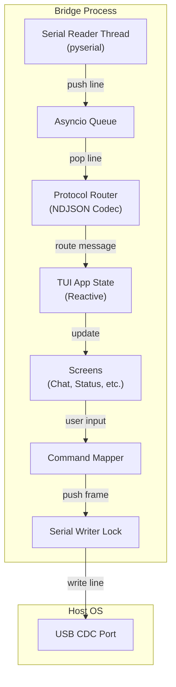

# 05 — Bridge TUI

Status: frozen by `docs/00-overview.md` §1, §2 (D5, D8, D9). This document specifies the terminal UI implementation.
Audience: bridge developers.

## 1. Scope & Constraints

The Bridge is a **dumb terminal**. It provides a user interface to the device but performs no agent logic, no prompt assembly, and no inference.

- **No local conversation history**: All conversation context is stored on the device (`llm.max_history_messages`). The one host-side file is the composer's recall list (§5.1), which holds only the lines the user typed.
- **No local keys**: API keys are stored in the device's NVS; the bridge never sees them.
- **No local inference**: The bridge does not call LLM APIs; it only routes frames.
- **Stateless**: All state (e.g., scrollback) is in-memory. Reconnecting to the device resets the TUI scrollback. The composer recall list is the single exception, and it is not scrollback.

## 2. Stack

| Component | Value | Note |
|---|---|---|
| Runtime | Python 3.12 | Standard distribution |
| TUI Framework | Textual | Async-first, reactive UI |
| Serial Link | pyserial | Blocked reads in a dedicated thread |
| Package Mgr | `uv` | Fast, reproducible environment |
| Deployment | `uv run bridge` | Single entry point |

### 2.1 Module Layout

- `bridge/protocol/` (L0): THE protocol module. Envelope build, parse and validate, NDJSON line framing, type and error-code enums, `reply_to` correlation ids. Pure functions and dataclasses.
- `bridge/link/` (L1): `Transport` ABC, `SerialTransport` (pyserial reader thread into an asyncio queue) and `FakeTransport` for tests.
- `bridge/client/` (L2): `Session`. Request/reply correlation, heartbeat, reconnect backoff, link state machine, frame-sink dispatch. Framework-agnostic.
- `bridge/ui/` (L3): Textual app, screens and widgets. Consumes `Session` events.
- `bridge/__main__.py` (L4): CLI flags, wiring, `uv run bridge` entry.
- `bridge/commands.py` (L2): slash-command string to `list[Frame]`. Pure, no Textual.

The dependency law between these layers and the two ports are specified in `docs/09-bridge-architecture.md`; this document only describes behavior.

## 3. Architecture



## 4. Connection Management

### 4.1 Handshake & Lifecycle

1. **Open**: The bridge opens the peer named by `--target` (`usb` or `test`, default
   `usb`). For `usb`, `--port` is optional and defaults to autodetect via VID/PID;
   for `test`, `--port` is required and points at the pseudo-terminal printed by
   `bridge/tools/test_agent.py`. Each target refuses a path belonging to the other
   before opening it, so a test session cannot reach real firmware and a hardware
   session cannot be pointed at a pty. The selection itself is specified in
   `10-test-agent.md` §3. Opening does not touch DTR or RTS: on the ESP32-S3's
   native USB-JTAG that pair is the reset strap, and any transition on it pulses a
   reset, so a bridge that drove them would reboot the board on every connection
   instead of reconnecting to the running device. The evidence is in
   `09-bridge-architecture.md` §4.2.
2. **Hello**: Bridge sends `hello` frame. When the user has configured a link token, the frame carries it as `token`; otherwise the field is omitted.
3. **Ack**: Bridge waits for `hello_ack` (5 s timeout). If missing, close and retry.
   - **Rejected**: If the device answers with `event` and `kind:"link.rejected"`, the token is wrong: render red line `link rejected: bad token` and stop -- no auto-retry, no backoff loop.
4. **Ready**: On `hello_ack`, the Bridge sets the app state to `CONNECTED` and triggers an immediate `status` command.

### 4.2 Heartbeat & Recovery

The bridge maintains the link using a ping-pong loop: it sends a `ping` frame
periodically and expects a `pong` within 5 s.

- **Degradation**: After 3 consecutive missed pongs, the TUI displays a `DEGRADED` banner.
- **Reconnect**: If the port closes or 3 pongs fail, the bridge enters an exponential backoff retry loop: 1 s, 2 s, 4 s, 8 s, 15 s (max).
- **Rejected**: A `link.rejected` close is not retried; see §4.1.

### 4.3 Headless Invocation

`bin/bridge` is the launcher: it locates the checkout, then `exec`s the venv's
`python -m bridge` with every argument passed through unchanged, so there is one
CLI definition, not two. The port is autodetected from the USB CDC vendor id when
`--port` is omitted.

`--send TEXT` skips the TUI: it connects, sends each `TEXT` (a prompt, or a
slash command turned into its frame), prints the reply, and exits. The exit code
is the contract a script depends on:

|Code|Meaning|
|---|---|
|`0`|every `--send` got its reply|
|`1`|the link never came up, a send was refused, or a reply never arrived|
|`2`|bad usage: a missing `--port`, a target/port mismatch, or a malformed command|

A send that is never answered is a `1` with one line of explanation, never a
traceback: the request timeout has no message of its own, so the headless path
supplies one.

## 5. Screens

### 5.1 Chat Screen (F2)
The primary interaction pane.

- **Input**: A multi-line input box at the bottom, with a one-row prompt bar
  directly above it.
- **Output**: A scrollable log of the conversation.
- **Behavior**:
  - `prompt` is sent on Enter. A prompt submitted while the link cannot answer —
    `down`, `linking` or `refused` — is answered in the log at once, naming the
    word the prompt bar is showing, rather than waiting for an acknowledgement
    that cannot arrive: the ack timeout is `6 × connect_timeout`, so the silent
    version left the reader with a typed prompt and no reply for half a minute.
    `flaky` is not refused: a degraded link still carries traffic, so the prompt
    is sent and either succeeds or reports its timeout like any other. A prompt on
    a `linked` peer that never answers leaves one line saying so, never silence.
    Slash commands are not gated this way — `/help`, `/config` and the other
    local screens work with no link.
  - Every submitted line is kept in a bounded ring (100 entries, adjacent
    duplicates collapsed, blank lines ignored). `Up` walks back through it,
    `Down` walks forward and returns to the line being typed, so a draft is
    never lost. The ring is persisted to
    `$XDG_CONFIG_HOME/musteval/history.ndjson` (default
    `~/.config/musteval/history.ndjson`), one NDJSON line per entry, the newest
    100 kept, and loaded at startup, so recall survives a restart. This is
    composer recall, not conversation: the file holds only the lines the user
    typed in the composer — no frames, no replies, no device output — and the
    conversation itself still lives only on the device (`06-security.md` §2
    row A6). Composer recall is a separate, host-side asset (A8), so the bridge
    still stores no conversation.
  - `Tab` accepts the completion instead of moving focus, because completing a
    half-typed command is what the composer's suggestion is for. `Shift+Tab`
    keeps its platform meaning.
  - While a slash command is being typed, the candidate completions are listed
    above the composer: the command names after `/`, and a command's subcommands
    after `/tasks ` and the like. The list filters as the user types, shows at
    most eight rows and ends with a `+N more` row when the list is longer, so it
    never pushes the conversation off the screen. Each row names its candidate and
    then a one-line help, from whichever owner holds that prose. A command's help
    is its `summary` in `COMMANDS`, the catalogue the help screen prints (§5.6). A
    sub-command's help is its line in `SUBCOMMAND_HELP`, the only place that prose
    lives, and a verb with no line there falls back to the head's summary rather
    than showing a blank column. So `/tasks` answers "what is this command" while
    `/tasks ` answers "which form does what". The help column is clipped to the
    panel, so a row is always one line and `+N more` stays visible. The list
    disappears when the composer is empty and when the typed text stops being a
    command prefix.
  - The list is navigated the way OMP navigates a picker. Its top row is
    selected when the list opens and a `>` marks it, so the selection is never
    carried by colour. `Up` and `Down` walk the rows and wrap at the edges,
    `Home` and `End` jump to them, and `Page Up` and `Page Down` move by a whole
    window. While the list is open these keys drive it and the history ring is
    left alone; when it is closed they recall history as usual, so `Up` never
    does both.
  - `Tab` and a `Right` at the end of the line apply the selected row and move
    the cursor to its end; a `Right` before the end keeps its cursor role.
    `Enter` applies the selected row and then submits the applied value, which
    is what makes `/tasks a` run `/tasks add` rather than the half-typed
    fragment. The marked row is always one the user can see, never the `+N more`
    counter, so a keypress cannot apply a command that was not on screen. `Esc`
    closes the list and does nothing else; with no list open it backs out of the
    screen as before.
  - The prompt bar above the composer is one row of facts about the link and the
    agent, in the manner of a shell's prompt line. Segments are joined by ` | `
    and each is a value the bridge already holds, so drawing the bar never
    costs a frame: the link state (`down`, `linking`, `linked`, `flaky`,
    `refused`; while the link is down, linking or refused that word is the whole
    bar, because every other fact would be the last thing heard before the link
    died), the provider, model and thinking level while a `status` has named
    one, the agent's `idle` or `busy <run_id>`, a queue segment only while the
    queue is non-empty, the wifi state and its signal, workspace use against its
    quota, the running token total once a call has been charged, and the
    `device` from `hello_ack`. A
    segment whose fact is unknown is omitted rather than rendered as `none`: a
    bar that blamed the provider before the first `status` arrived would send
    the reader after the wrong thing.
  - The model segment is `provider/model`, and `provider/model/level` when
    `status.llm.thinking` names a level. The level is one fact with the model it
    belongs to — it is that model's setting, not the provider's — so it rides in
    the same segment rather than standing alone where a narrow bar could drop it
    and keep the model. All three are what the device is *configured* to call
    (`04` §3.9), not what last answered, so the segment is there from the first
    `status` after boot rather than from the first successful call; `llm down`
    still reports the separate fact that the last call did not succeed, and is
    shown only when `llm.last_error` names why. `available: false` with a null
    `last_error` is a device that has not called yet, not a provider that failed —
    rendering it as `down` blamed a provider that was answering, and every
    `config.set` on an `llm.*` path used to produce exactly that state by
    re-running the chain read.
  - Two facts sit immediately behind the link word, because the bar drops from
    the right: `SAFE MODE` while safe mode is active, and the uptime from
    `status.uptime_s` as one compact segment — `45s`, `12m05s`, `3h04m`, `1d2h`.
    Safe mode is the fact that explains a failure, so it outranks everything the
    model or agent says; uptime dates every other fact on the bar.
  - The wifi fact carries `state`, not only the signal: `up` beside `-58dBm`
    while connected, and `wifi linking`, `wifi failed` or `wifi off` with no
    signal segment at all when there is none — a bar that showed nothing for a
    dead association would read as silence rather than as a fault. A `failovers`
    count above zero is appended as `N failover(s)`, because a network that took
    three tries to come up is about to take three tries again. All of it comes
    from the last `status` the bridge holds; none of it costs a frame.
  - The bar is redrawn when a fact changes: `hello_ack`, a `status` frame, the
    `status` command's own reply (a `/sys status` is a command, not a push, and a bar
    that ignored it would stay empty until the device volunteered one), a usage
    frame, a link-state transition (a drop emits no frame of its own), every
    applied `config.set`, mount and a resize. The `config.set` case is its own
    redraw because the bar names the configured model and level: the device does
    not push a fresh `status` on a write, so a bar left to the 30 s timer would
    name the model the reader had just replaced. Never on a keystroke. It is one
    row and drops whole trailing segments when the terminal is too narrow, so a
    narrow window loses the rightmost facts rather than showing half a word or
    the composer. The link word is never dropped: an empty bar would say less
    than a short one.
  - When `agent.start` arrives, a spinner is displayed.
  - `agent.tool` and `agent.tool_result` are rendered as collapsed "tool calls" (expandable).
  - `agent.final` stops the spinner and renders the assistant's answer. When the
    frame carries `truncated: true` the answer is followed by one `warn` line, so a
    paragraph that stops mid-word is never read as the whole reply: the provider
    stopped at `max_output_tokens` and asked for more is the only way to continue. A
    `full_bytes`-caused truncation names the byte counts it already carries; the
    token-cap case has no longer version to name.
  - `agent.error` stops the spinner and renders a red error box with the `code` and `message`.
**Message kinds.** Every line in the pane has one of seven kinds, and the kind is
what tells the reader whose words they are. It is a parameter of the one write
path (`ChatScreen.write`), not a string prefix a caller remembers to type, so a
line cannot land in the pane unclassified.

| Kind | Who | Reads as |
|---|---|---|
| `user` | the operator's prompt, echoed | Markdown, on `$accent` |
| `assistant` | `agent.final` | Markdown |
| `thinking` | `agent.start`, `agent.thinking`, `waiting for the run…` | dim |
| `tool` | `agent.tool`, `agent.tool_result` | dim, indented |
| `info` | a command's ordinary answer | plain |
| `warn` | degraded but working | `$warning`, `!` |
| `error` | refused, failed, or `agent.error` | `$error`, bold, `✗` |

**Markdown is for the two kinds that are prose.** The operator's line and the
model's answer are parsed as Markdown, so a fenced block, a list or a table reads
as one rather than as punctuation. Every other kind is terminal text, never
parsed: a tag a device returned must not become a heading, and a table a log line
happens to contain must not cost the line its meaning.

**A fenced `mermaid` block in the answer is drawn, not printed.** A terminal has no
renderer for the diagram, so the alternative is its source with the arrows spelt
out; the pane draws it as an indented tree instead — one node per line, the edge's
kind as a glyph, the edge's label after it, and a node reached twice marked
`(seen)` rather than expanded again. `flowchart` and `graph` are drawn in every
direction, and `stateDiagram-v2`'s transition list is read as the edges it is.
Anything else — `sequenceDiagram`, `classDiagram` — is left exactly as the model
wrote it, because a guessed picture of a sequence diagram is worse than its source
and the reader can still read the fence. A label longer than the pane wraps under
its own indent rather than being cut, so a diagram at sixty columns loses nothing.

The rule that a diagram is drawn only in `assistant` text follows from the kind
table above: the operator's own paste is echoed, not interpreted, and no device
frame reaches this path at all.

**A turn is separated from the one before it by a dim rule** — a full-width `─`
line in `$text-muted`, written before the second and every later prompt. The
first prompt needs none, because there is nothing above it to separate. The rule
marks where the conversation restarted, which is the boundary a reader scrolls
by; a blank line is not, because the pane has those inside a message too.

**Mockup:**
```text
+-----------------------------------------------------------------------+
| [Chat]                                                     [Status: OK|
+-----------------------------------------------------------------------+
| User: What time is it?                                                |
| Assistant:                                                            |
|   ( ) Thinking... [run_id: r-7]                                       |
|   v Tool: time.now (2ms) -> {unix: 1730563213}                        |
|   The device clock reads 2026-11-02T12:00:13Z.                        |
|                                                                       |
| User: [ /tasks list ]                                                 |
+-----------------------------------------------------------------------+
| linked | 3h04m | openai/gpt-4o-mini/high | idle | up | -58dBm           |
| > Hello agent!                                                        |
+-----------------------------------------------------------------------+
```

### 5.2 Status Screen (F3)
Displays real-time device health. **F3** opens this full grid; `/sys status` and
`/sys diag` instead open the info modal (§5.10), which shows the same two halves from
one fresh `status` frame.

- **Source**: `status` message (periodic or commanded).
- **Layout**: A grid of value-pairs.

**Mockup:**
```text
+-----------------------------------------------------------------------+
| [Status]                                          [Ctrl+R] Refresh    |
+-----------------------------------------------------------------------+
| WIFI: connected (home-2g) | RSSI: -58dBm | IP: 192.168.1.42           |
| TIME: 2026-11-02 12:00:15 | TZ: UTC | Synced: Yes                     |
| LLM:  openai (gpt-4o-mini) | Available: Yes                           |
| AGENT: Busy (r-7) | Queue: 0/2                                        |
| MEM:  Heap: 181KB | PSRAM: 8.1MB                                      |
| DISK: userfs 18KB/3.75MB | wsfs 0KB/1MB (quota 64KB)                  |
| MQTT: home connected | lab down (2 brokers)                           |
| GEO:  52.3676, 4.9041 (+/-65m) | age 42s                              |
| BOOT: 9f2c1a7e | Uptime: 834s                                         |
+-----------------------------------------------------------------------+
```

`04` §3.9 types `wifi.ssid`, `wifi.rssi`, `wifi.ip`, `llm.provider` and `llm.model` as
nullable, and a device with no provider, no model and no network is a legal document.
Those cells name the absence — `no provider`, `no model`, `no network`, `off`, `—`
for the rssi — rather than printing `None`, which is a Python word on a screen that
exists to say what is missing.

### 5.3 Tasks Screen (`/tasks`, F4)
Lists scheduled and triggered tasks.

- **Source**: `tasks.list` command.
- **Interaction**: Arrow keys select a task. Enter or `Ctrl+X` runs it, `Ctrl+E`
  edits it, `Ctrl+Y` toggles enabled, `Ctrl+D` deletes it after confirmation,
  `Ctrl+N` adds a new one, `Ctrl+R` re-lists. Mutations re-issue `tasks.list` on
  `command.result` so the table never shows a stale row.

**Mockup:**
```text
+-----------------------------------------------------------------------+
| [Tasks]                                     [Ctrl+R] Refresh          |
+-----------------------------------------------------------------------+
| ID        Description         Trigger       Status      Next Fire     |
| --------  ------------------  ------------  ----------  -----------   |
| morning   Morning briefing    schedule      Enabled     12:00:00      |
| on_boot   Boot report         boot          Enabled     -             |
| nightly   Nightly backup      schedule      Disabled    -             |
| > sensor  Temp check          gpio (pin 3)  Enabled     -             |
+-----------------------------------------------------------------------+
| [Ctrl+X] Run  [Ctrl+E] Edit  [Ctrl+Y] Enable  [Ctrl+D] Delete         |
| [Ctrl+N] New  [Ctrl+R] Refresh                                        |
```

### 5.4 Logs Screen (`/logs`, F5)
Streams firmware logs.

- **Source**: `log` messages.
- **Features**:
  - Coloring by `level` (Error=Red, Warn=Yellow, Info=Green).
  - Filtering by `tag` (e.g., only show `llm` logs) and by minimum level.
  - Auto-scroll (follow mode).

The buffer is bounded at 2000 lines and keeps a line whether or not the filter
passes it, so widening the filter shows what already arrived instead of only what
arrives next. A line carries its level in brackets (`[warn]`), which is what both
the colouring and the level filter read; a line with no bracket counts as `info`,
and an unrecognised token such as `[trace]` also counts as `info` so it is never
mistaken for a warning. `Ctrl+F` opens a one-line prompt seeded with the current
filter, `tag` or `tag:level`; an unknown level names itself and changes nothing.
`Ctrl+L` clears the buffer, `Ctrl+Y` turns follow mode off so the view stays where
the reader scrolled while lines keep arriving.

**Mockup:**
```text
+-----------------------------------------------------------------------+
| [Logs]  Filter: [ llm ]  Level: [ warn ]  Follow: [ON]                |
+-----------------------------------------------------------------------+
| 12:00:01 [info]  net: wifi connected to home-2g (rssi -57)            |
| 12:00:02 [warn]  llm: provider openai timed out; falling back...      |
| 12:00:05 [debug] agent: assembling prompt for run r-7                 |
| 12:00:06 [error] storage: /workspace/run_7.json (E_STORAGE)           |
+-----------------------------------------------------------------------+
```

### 5.5 MQTT Screen (`/mqtt`, F6)
Read-only view of broker state and inbound traffic. Publishing is done from the
Chat input (`/mqtt publish`) or by the agent; the screen has no composer.

- **Source**: `mqtt.status` command result (broker list) and `mqtt.message` events
  (traffic log). A run in flight does not block it.
- **Features**:
  - Broker list with connected state and subscription count.
  - Scrolling log of inbound messages: time, topic, payload (single line).
  - Sanitised rendering: control characters are stripped and payloads are clipped
    for display. Payload text is never interpreted as a terminal escape sequence.
  - `Ctrl+R` refreshes the broker list.

**Mockup:**
```text
+-----------------------------------------------------------------------+
| [MQTT]  2 brokers                               [Ctrl+R] Refresh      |
+-----------------------------------------------------------------------+
| home   connected    4 subs                                            |
| lab    disconnected 2 subs                                            |
+-----------------------------------------------------------------------+
| 12:04:11 home garage/door/state        open                           |
| 12:04:19 home sensors/temp             {"t":21.5}                     |
| 12:05:02 lab  bench/heartbeat          ok                             |
+-----------------------------------------------------------------------+
```

### 5.6 Help Modal (`/help`, F1)

Help is a modal over the current screen, not a screen of its own: `F1` is pressed
mid-composition, and a screen swap would discard the half-typed prompt. The draft
survives the modal opening and closing, which a test asserts.

The body is generated from one table, `COMMANDS` in `bridge/ui/help.py`: every
head `commands.py` accepts and every `LOCAL_COMMANDS` entry appears exactly once, so
the screen cannot drift from the parser. Each entry carries a `usage`, a one-line
`summary`, and whether it is local (`05` §7). A command that is accepted but absent
from the table, or documented but rejected, fails a test rather than a user's memory.

The entries are grouped by a second table, `CATEGORIES`, into four `TabPane`s —
**Device**, **Chat**, **Info**, **Screens** — and a coverage test asserts that the
groups name every command exactly once, so a new command cannot silently vanish
from the modal. Above the tabs sits the keyboard strip: the global shortcuts, as
`hint_bar` over `binding_pairs(BridgeApp.BINDINGS)`, handed in by the app that owns
them. It is here and not in the row under the composer because nine pairs wrapped to
four rows at 50 columns there (`17` §3). `Esc` dismisses.

When the longest usage in a group is wider than a column that still fits a terminal,
each form moves to its own line with the summary indented beneath it. The result
never exceeds 78 columns, so no line wraps on a narrow terminal.

```text
F1 Help  F2 Chat  F3 Status  F4 Tasks  F5 Logs  F6 MQTT  F7 Files
Escape Back / Cancel  Ctrl+R Reconnect  Ctrl+Q Quit
```

The modal itself, over whatever screen was open:

```text
+--------------------------------------------------------------+
| Help  Device | Chat | Info | Screens                         |
+--------------------------------------------------------------+
| Device commands                                              |
|   /sys status|diag|reload|reboot|reset-counter|prompt         |
|       read the device, edit its system prompt, or reload,    |
|       reboot and clear its failure counter                   |
+--------------------------------------------------------------+
```

### 5.7 Settings Screen (`/config`)

The device config, browsable without memorising dotted paths. One row per scalar
or simple-list key of `03-config.md` §Full schema, in table order and grouped by
section; the keys whose value is a nested object or an object array
(`wifi.networks[]`, `llm.providers[]`, `mcp.servers[]`, `geo.providers[]` and their
children) are not rows, because they need a form rather than a line.

`/config` and `/config edit` both open it; `/config get <path>` and
`/config set <path> <value>` are the two forms that stay device frames. There is no
`/settings`: the screen is reached only through the head it belongs to.

Opening the screen sends `config.get` with no `path` once and renders
the reply through `flatten`, which indexes arrays so a dotted row finds its value
(`04` §4.8). Until a config has been fetched the value column reads `-` and the
heading reads `no config yet: Ctrl+R fetches it from the device`, so the screen names
the key that fills it; nothing here invents a default and presents it as the device's
answer.

Fetched is recorded separately from what came back, because an empty config and a
config never asked for are both an empty mapping. A device that reports no config
must therefore be fetched once, not on every return to the screen; `Ctrl+R` is the
only thing that asks again.

`Enter` on a row opens a pre-filled prompt. The typed text is coerced to the row's
kind and checked against the bounds column before sending, so an out-of-range value
costs no round trip and names its own path in the error. The device re-validates:
this check is for latency and clarity, never the authority. A successful
`config.set` reports `applied` and `requires_reboot`, then re-fetches so the screen
shows what the device actually holds.

```text
+-----------------------------------------------------------------------+
| Key                          Value              Default    Bounds     |
| version                      1                  1          must be 1  |
| device.name                  musteval           musteval   1..32      |
| device.log_level             info               info       enum       |
| wifi.connect_timeout_ms      15000              15000      1000..     |
| llm.max_calls_per_hour       100                100        0..100000  |
+-----------------------------------------------------------------------+
| [Enter] Edit  [Ctrl+R] Fetch from device                              |
+-----------------------------------------------------------------------+
```

### 5.8 Files Screen (`/files`, F7)

The agent sandbox, `/workspace/`, browsed from the TUI. The screen is deliberately
scoped to that one mount: it is the only location the device exposes for browsing,
and it is where the agent writes, so a user debugging what the agent produced looks
here and not in `userfs`. Content outside it is `E_CONFIG` from the device and is
never reachable from this screen (`04` §4.17).

The pane is a three-column table, matching the mockup below: the type column holds
`d` for a directory and `f` for a file, the name column the entry as the device
reported it, and the size column the byte count or `-` for a directory. At any path
below the root an extra `..` row sits at the top so `Enter` can climb without a
separate key. The current path is the screen title. Entries sort as the device
returns them, directories first, so the browser never re-orders what it was given.

Opening the screen sends `sandbox.list` for `/workspace/` once. `Enter` on a
directory descends into it; `Enter` on a file opens it for viewing.

Editing happens in one modal holding a `TextArea`, pre-filled from `sandbox.read`.
`Ctrl+S` sends `sandbox.write` for the whole buffer, split into `04` §4.20 chunks of
at most 2048 raw bytes, `base64`-encoded, each carrying its `offset` and the last
carrying `final:true`. The device therefore commits or leaves the previous file
intact; a buffer is never half-written by a failed frame. A file the device reported
`truncated` is refused for editing instead, because saving a partial read would write
the cut back over the original. `Esc` discards. Nothing is written on navigation, so
leaving the screen with an open modal cannot silently save.

Deleting asks `y`/`n` first. For a file the question names the path. For a
directory the screen lists it first, counts the entries, and says how many a
recursive delete would take: *"Delete /workspace/runs and the 3 entries under it?"*
An empty directory asks without a count, because there is nothing to lose, and the
frame omits `recursive` (`04` §4.19). The destructive form of the command is never
sent for a directory the reader was not told the size of.

`Ctrl+M` moves or renames the selected entry through `sandbox.move`, with the prompt
pre-filled with the current path so a rename is an edit rather than retyping. The
target is normalised locally by `sandbox_normalise`, so a path outside `/workspace/`
is refused before a frame is sent. `Ctrl+K` creates a directory via `sandbox.mkdir`, in
the directory currently browsed. `Ctrl+N` creates a new empty file through `sandbox.write`
with an empty body, then opens it for editing. Both `Ctrl+N` and `Ctrl+K` re-request the
listing on success, so the new entry appears without a manual refresh.

### 5.8.1 Upload and Download

`Ctrl+X` downloads the selected entry to the host, `Ctrl+O` uploads a host file into
the directory currently browsed. The two directions are separate keys rather than one
modal with a direction toggle, because a modal that asks which way round the copy goes
makes the reader answer a question the keypress already answered.

Downloading a file asks for a host path, defaulting to the entry's name in the
working directory, and writes what `sandbox.read` returned. A device reply with
`truncated:true` is refused: `04` §4.18 caps a read at 8192 raw bytes and forbids a
second frame, so the file on the host would be a prefix presented as a file. The
browser says how long the device file is and stops, rather than writing a short
copy the reader has no way to notice.

Downloading a directory walks it with `sandbox.list` and, for each file, one
`sandbox.read`, writing the tree under the chosen host directory. It refuses before
the first write when any file in the tree exceeds the read cap, naming that file:
a partial tree is worse than no tree, because the reader cannot tell which files
were clipped. The walk is depth-first in the order the device listed, so the host
tree matches what the browser showed.

Uploading a file sends its bytes through `sandbox.write` in `04` §4.20 chunks, the
same path the editor uses. Uploading a directory mirrors the download walk: create
each directory with `sandbox.mkdir`, then write each file. A host entry the device
would refuse — a name outside the workspace, a symlink, a socket — aborts the upload
with the offending path named, rather than being skipped silently.

Both directions run as a worker, one frame at a time on the single session, and
report one summary line to the chat log when the copy finishes, naming the count and
the destination. Nothing is printed per frame: a tree of a hundred files would
otherwise scroll every line that came before it out of the log.

The editor modal holds a `TextArea` and supports `Ctrl+F` to search: the first
`Enter` sets the needle and selects the first match, the second replaces every
occurrence with the new text in one edit, so the whole cascade undoes as one step.
`F3` jumps to the next match and wraps at the end, because a search that stops at the
buffer's end reads as "not found" when the match is above the caret. `Ctrl+Z` and
`Ctrl+Y` undo and redo, and the hint line under the buffer names both, since a
keybinding nobody can discover is not a feature.

```text
+-----------------------------------------------------------------------+
| /workspace/runs                              3 entries                |
|Type  Name                              Bytes                          |
| d     ..                               -                              |
| d     2026-11-02                       -                              |
| f     notes.md                         412                            |
| f     run_7.json                       1834                           |
+-----------------------------------------------------------------------+
| Ctrl+E Edit  Ctrl+D Delete  Ctrl+M Move  Ctrl+N New  Ctrl+K Mkdir     |
| Ctrl+U Up  Ctrl+R Refresh  Ctrl+O Upload  Ctrl+X Download             |
| Ctrl+F Find  Enter Open                                               |
+-----------------------------------------------------------------------+
```

`Ctrl+U` goes up one directory and stops at `/workspace/`, the root this screen
can see. `Ctrl+R` re-requests the listing for the current path. `Ctrl+F` narrows
the rows already held, without another `sandbox.list`; the heading then reads
`filter 'x': 2 of 9`, so a missing entry is explained rather than mysterious.

### 5.9 Splash Screen

The first surface a reader sees on a normal run: the mascot, who is the musteval
of `00-overview.md` §10, and one tip drawn from the tips table. It is mounted
alongside the eight screens and shown by `display`, like every other screen, so
dismissing it needs no screen-stack plumbing.

- **Art**: two hand-drawn half-block blocks held in `splash.py` — `WORDMARK`, the
  name in half-block letters 47 columns wide, and `MASCOT`, a 35-column side
  profile of the musteval. Rows are stored unpadded and padded to the block width
  when drawn, so the panel never jitters and the literals carry no trailing spaces
  that a reader would have to count. Both are emitted one character at a time
  rather than through Rich markup, so no glyph can be reinterpreted.
  - **The wordmark carries the identity.** This is the lesson taken from the omp
    and pi splashes: neither draws its character. Their marks are abstract block
    grids twelve columns wide and the *name* in half-block letters does the
    identifying, because a creature rendered at a few dozen cells is read by the
    viewer as a blob whatever it was meant to be. Drawing the name is the part
    that is legible by construction.
  - **The art is a side profile, not a face.** What survives at this size is the
    long low body, the tail sweeping up behind it, two tufted ears, one eye and
    four short legs. It is seven rows and 34 columns, so wordmark and art stack
    inside the 78-column budget. A head alone reads as a cat; a head with tall ears reads as a bat;
    both were drawn and rejected before this shape was kept. The eye stays a
    literal `o` rather than a block so it survives the half-block merge.
  - **Solid blocks, not line art.** An outline made of `/ \ _ |` reads as scratches
    in a cell grid this small, which is why the omp and pi splashes use filled
    half-blocks for their marks too.
  - **Gradient, not a flat colour.** A diagonal pink → violet → cyan ramp runs
    across both blocks — the same three stops the omp lockup uses, sampled per
    cell. Each block spans the full ramp on its own geometry, so the wordmark is
    not squeezed into the top-left corner of the art's range. The eye is
    `hot_pink`, breaking out of the ramp, so the face keeps a focal point.
  - **The blocks stack**, following omp's lockup rather than setting them side by
    side: at this width a side-by-side layout either starves the tip or overruns
    the 78-column budget, and an overrun soft-wraps at the terminal edge and drops
    its tail to column 0.
- **Tip**: `TIPS` holds twelve one-line hints, each naming at most one slash
  command. `/onboard` is among them. A tip that names a command the catalogue
  dropped is a lie, so a test asserts every `/<head>` in `TIPS` is in the Help
  catalogue's names; the table lives here and not on the device because a tip read
  from `userfs` would need an answer from a link that is not up yet.
- **Dismissal**: any key, `Esc`, or `SPLASH_SECONDS` (8 s) elapsed, whichever comes
  first; a single guard makes the loser a no-op. The timer covers the reader who
  walked away, the key covers the reader who did not.
- **Headless**: `--json` runs and tests are headless, so the splash is never
  displayed and its timer is never started — a fired timer would steal focus from
  the composer the caller is driving. Chat is displayed instead.

### 5.10 Modals

Every modal derives from `PromptBox`, a `ModalScreen`, and all of them sit in the
centre of the terminal. The rule is `ModalScreen, * { align: center middle; }`:
selecting `Screen` alone does not match, because a `ModalScreen` subclass carries
its own `DEFAULT_CSS` with `layout: vertical`, and the more specific rule wins. The
symptom is a box pinned to the top-left while the stylesheet still reads correctly,
so a parametrised test measures each modal's rendered region and requires it within
one cell of centre on both axes.

Width follows content rather than a constant: a one-line prompt is narrow, the
editor takes most of the screen because a file is not a sentence, and every box
carries `max-width: 100%` so a 40-column terminal still shows the whole of it.
Textual has no CSS `min()`, so this is a clamp applied in the stylesheet, not a
measured `max-content`; a very narrow terminal clips rather than overflows.

State a modal needs — the selected row, the brokers already known, the answers
being edited — is set in `__init__`, never in `compose()`. A `compose()` that mutates
the screen re-applies its initial value on every mount, so a modal dismissed and
reopened loses what the reader had chosen.

**`InfoModal`** is the read-only one: a title and a list of `(heading, text)` sections
in a `VerticalScroll`. `/sys status` and `/sys diag` are its two-verb callers, and they
pass the same two sections in opposite order — `status` leads with the general half,
`diag` with the counters — so a reader comparing heap against its quota does not close
one box to open another. `/sys diag`'s half is itself headed (`render.diag_sections`):
`Memory`, `Boot`, `Tools` and `LLM budget` are four sections rather than one flat list
of `key: value`, because the modal already renders headings and eight unlabelled lines
give a reader no seam to scan by. The split is the modal's own structure, not a new
one: the box takes a section list, so the diagnostics arrive as sections. The facts are
unchanged — one line per fact, the same eight — and the grouping is the whole of the
edit; `render_status` still owns the general half's markup and escaping.

The body is a `Static` built with `Text.from_markup`, the
same way `StatusScreen._paint` builds the grid: `render_status` returns markup and
`escape`s every device-supplied value before splicing it, so the verdict colours are
rendered and an SSID or broker error containing `[` stays text. (A `markup=False`
body prints the tags at the reader instead.) The box scrolls rather than growing,
because the diagnostics half is longer than a 24-row terminal.

`/context` is its third caller, with one untitled section: the block table from
`render.context_lines` (`§7.5`). One box, because a budget is a glance rather than a
place to work, which is the same rule that put `/sys` there.

**`_PickBox`** is the choice list the two editors open on: a keyboard-scrolled list of
`(label, what the row does)` rows, answering the chosen label. A `Select` was not usable
here because it carries its own Enter handling and cannot show a per-row hint, and both
editors have to say what each row will do before it is chosen. It takes an optional
`header`, which `/providers` fills with `render.provider_lines`: a provider's model, URL
and key reference have to be visible before a row is chosen, and none of them is the
row's answer, so none of them may ride a label.

`WifiScanForm`, `WifiCustomForm` and the wizard's steps they resemble are
detailed in `§7.7` and `§7.1`.

## 6. Keybindings

Focus follows the screen: entering a screen puts focus on the widget that consumes
keys there — the composer on Chat, the table on Tasks and Settings — and the
conversation log is never focusable, so `Tab` cannot land on it. `PageUp`,
`PageDown` and the wheel scroll it without focus.

### 6.1 Global Bindings

| Key | Action |
|---|---|
| `F1` | Switch to Help screen |
| `F2` | Switch to Chat screen |
| `F3` | Switch to Status screen |
| `F4` | Switch to Tasks screen |
| `F5` | Switch to Logs screen |
| `F6` | Switch to MQTT screen |
| `F7` | Switch to Files screen |
| `Esc` | Close the top modal; otherwise leave a non-Chat screen for Chat; on Chat, cancel the current run |
| `Ctrl+R` | Force reconnect (close port, clear state, re-handshake) |
| `Ctrl+Q` | Exit bridge |

The slash commands are the primary route to every screen; the function keys above
remain as aliases for them.

`Esc` on a modal is bound by the modal, not by the App: `ModalScreen` sets
`_modal`, which suppresses app-level bindings, so an app-level `Esc` never fires
while one is open. Every prompt therefore extends `PromptBox` in
`bridge/ui/modals.py`, which owns that binding and dismisses with a result.
Popping the screen instead would leave the `push_screen_wait` worker awaiting a
future that is never resolved.

### 6.2 Screen-Specific Bindings

| Screen | Key | Action |
|---|---|---|
| Chat | `Enter` | Send prompt |
| Chat | `Ctrl+J` / `Shift+Enter` | Insert newline in input |
| Chat | `Right`/`Tab` | Accept the autocomplete suggestion in the composer. With no suggestion pending, `Tab` does nothing: it never moves focus, because a keystroke landing in the conversation log is silently lost |
| Chat | `Up`/`Down` | Recall a submitted prompt; `Down` past the newest returns to the draft |
| Chat | `Esc` | No modal and no other screen on top: cancel the current agent run (`cancel` message) |
| Chat | `Ctrl+L` | Clear current session scrollback |
| Chat | `Ctrl+C` | Clear the composer input: the typed text, the candidate list and the history walk are dropped; the run is not cancelled |
| Status | `Ctrl+R` | Request `status` command |
| Tasks | `Up`/`Down` | Navigate task list |
| Tasks | `Enter` | Send `tasks.run` for selected ID |
| Tasks | `Ctrl+E` | Edit selected task in a JSON modal, send `tasks.set` |
| Tasks | `Ctrl+Y` | Toggle `enabled` on selected task, send `tasks.set` |
| Tasks | `Ctrl+D` | Delete selected task after `y`/`n`, send `tasks.delete` |
| Tasks | `Ctrl+N` | Add a new task from a blank JSON modal, send `tasks.set` |
| Tasks | `Ctrl+R` | Request `tasks.list` command |
| Tasks | `Ctrl+X` | Run the selected task, send `tasks.run` |
| Logs | `Ctrl+F` | Open the filter line, seeded with the applied filter |
| Logs | `Ctrl+L` | Clear log buffer |
| Logs | `Ctrl+Y` | Toggle follow-mode (auto-scroll) |
| MQTT | `Up`/`Down` | Navigate broker/ message list |
| MQTT | `Ctrl+R` | Request `mqtt.status` command |
| Settings | `Up`/`Down` | Move between config rows |
| Settings | `Enter` | Edit the selected row in a pre-filled prompt, then send `config.set` |
| Settings | `Ctrl+R` | Re-request `config.get` |
| Settings | `Esc` | Cancel the edit prompt; on no prompt, back to Chat |
| Files | `Up`/`Down` | Move between entries |
| Files | `Enter` | Open the selected directory, or view the selected file |
| Files | `Ctrl+E` | Edit the selected file in a `TextArea` modal, send `sandbox.write` on `Ctrl+S` |
| Files | `Ctrl+D` | Delete the selected entry after `y`/`n`, send `sandbox.delete`; a directory is listed first and its entry count named |
| Files | `Ctrl+M` | Move or rename the selected entry through `sandbox.move`, prompt pre-filled with its current path |
| Files | `Ctrl+N` | Create an empty file at a prompted name, send `sandbox.write`, then edit it |
| Files | `Ctrl+K` | Create a directory at a prompted name, send `sandbox.mkdir` |
| Todo editor | `Up`/`Down` | Move between phases and tasks; tasks are listed under their phase |
| Todo editor | `Ctrl+E` | Modify the selected phase's name or the selected task's content, seeded with its current text |
| Todo editor | `Ctrl+N` / `Ctrl+B` | Add a phase, or a task in the selected task's phase, after / before the selection. On an empty tree both add the first phase, since there is no row to anchor on |
| Todo editor | `Ctrl+D` | Drop the selection. A phase drop names how many tasks go with it, and needs a second `Ctrl+D`; any other key disarms it |
| Todo editor | `Ctrl+Up` / `Ctrl+Down` | Move the selection up or down among its siblings; a move past either end is a no-op |
| Todo editor | `Ctrl+S` | Send the edited tree as one `init`. A tree edited back to what it opened with sends nothing |
| Todo editor | `Esc` | Clear a pending verb, or leave the editor without sending |
| Editor | `Ctrl+F` | Search: first `Enter` finds, second replaces every match in one undo step |
| Editor | `F3` | Jump to the next match, wrapping at the end of the buffer |
| Editor | `Ctrl+Z` / `Ctrl+Y` | Undo and redo |
| Files | `Ctrl+O` | Upload a host file or directory into the browsed directory, send `sandbox.mkdir` and `sandbox.write` |
| Files | `Ctrl+X` | Download the selected entry to a prompted host path, one `sandbox.read` per file |
| Files | `Ctrl+U` | Go up one directory, stopping at `/workspace/` |
| Files | `Ctrl+R` | Re-request `sandbox.list` for the current path |
| Files | `Ctrl+F` | Find: narrow the listing by name substring, locally |

## 7. Slash Commands

Slash commands in the Chat input are mapped to protocol frames. This section is
the owner of every mapping; `15-command-reference.md` is the same forms as one
alphabetical table, for looking a command up by name rather than by kind.

| Command | Protocol Mapping | Args | Note |
|---|---|---|---|
| `/sys status` | `command {name:"status"}` | none | Forces a fresh `status` and opens the info modal on its general half |
| `/sys reload` | `command {name:"reload"}` | none | Re-reads flash configs, in chat: the reloaded scopes, then one line per warning |
| `/sys reboot` | `command {name:"reboot"}` | none | Restarts the device, in chat: the grace period in milliseconds |
| `/sys reset-counter` | `command {name:"sys.reset_counter"}` | none | Clears the boot-failure counter |
| `/sys prompt` | `config.get` then `template.get` then `fs.put` | none | Opens the persona file in the editor; `Ctrl+S` writes it back (§7.6) |
| `/sys diag` | `command {name:"status"}` | none | The same modal, opened on the counters: heap, PSRAM, safe-mode flag, boot failures, tool call counts, and the LLM hour/day counters against their caps |
| `/tasks` | `command {name:"tasks.list"}` | none | Lists tasks in chat; also switches to the Tasks screen |
| `/run <id>` | `command {name:"tasks.run"}` | `id` | Runs a task now; confirms in chat with the `run_id` that `/cancel` and the status screen name |
| `/tasks add` | `command {name:"tasks.set"}` | `task` | Opens a blank task modal, then sends it |
| `/tasks set <id>` | `command {name:"tasks.set"}` | `task` | Opens the cached task in a modal, then sends it |
| `/tasks enable <id>` | `command {name:"tasks.set"}` | `task` | Resends the task with `enabled: true` |
| `/tasks disable <id>` | `command {name:"tasks.set"}` | `task` | Resends the task with `enabled: false` |
| `/tasks delete <id>` | `command {name:"tasks.delete"}` | `id` | Confirms, then deletes |
| `/config get <p>` | `command {name:"config.get"}` | `path` | Dumps config value |
| `/config set <p> <v>`| `command {name:"config.set"}` | `path, value` | Updates config |
| `/secret set <k>` | `secret.set` | `key` | Prompts for value (masked) |
| `/templates` | `command {name:"templates.list"}`| none | Lists prompt templates |
| `/template <n>` | `command {name:"template.get"}` | `name` | Dumps template text |
| `/mqtt` | `command {name:"mqtt.status"}` | none | Lists brokers and state; also switches to the MQTT screen |
| `/fs put <p>` | `command {name:"fs.put"}` | `path, data, offset, final` | Asks for a local file, uploads it to `userfs` in 2 KiB chunks, and reports its size and whether a reboot applies it; refuses a path outside the allowlist before sending |
| `/files` | `command {name:"sandbox.list"}` | `path?` | Opens the Files screen at `/workspace/` |
| `/files <p>` | `command {name:"sandbox.list"}` | `path` | Opens the Files screen at that sandbox directory |
| `/sandbox mkdir <p>` | `command {name:"sandbox.mkdir"}` | `path` | Creates one directory; refuses outside sandbox before sending |
| `/sandbox move <f> <t>` | `command {name:"sandbox.move"}` | `from, to` | Renames or relocates a file or directory |
| `/sandbox delete <p> [-r]` | `command {name:"sandbox.delete"}` | `path, recursive?` | Deletes one entry; recursive removes populated directories |
| `/wifi scan` | `command {name:"wifi.scan"}` | none | Lists the access points the radio can hear, strongest first. The scan holds the radio, so a run in flight answers `E_BUSY` rather than steering the station mid-run |
| `/wifi status` | `command {name:"wifi.status"}` | none | Reads the station's state, SSID, RSSI and IP without touching it. Busy-safe, so it answers during a run |
| `/wifi connect` | `command {name:"wifi.connect"}` | none | Joins the best configured network, as the boot sequence does; the join runs on its own task, so the prompt stays responsive while it waits |
| `/wifi disconnect` | `command {name:"wifi.disconnect"}` | none | Leaves the network and stays down: the connection does not come back on its own (`04-protocol.md` §4.26) |
| `/wifi reconnect` | `command {name:"wifi.reconnect"}` | none | Leaves and rejoins, so a link that is up but on the wrong AP is moved to the best one |
| `/wifi list` | `command {name:"wifi.status"}`, `command {name:"wifi.scan"}` | none | One row per configured network: priority, whether it is the joined one, and its RSSI when audible (§7.7) |
| `/wifi edit` | `command {name:"config.get"}`, `command {name:"wifi.scan"}`, `command {name:"config.set"}`, `command {name:"secret.set"}` | none | Opens the network editor: pick a known network to change its passphrase or forget it, or add one from the scan (`Ctrl+R` rescans) or by hand. Writes the whole `wifi.networks` array (§7.7) |
| `/providers` | `command {name:"config.get"}`, `command {name:"config.set"}`, `command {name:"secret.set"}`, `command {name:"secret.delete"}` | none | Opens the provider editor: add, log in to, or disconnect an `llm.providers` entry (§7.8) |
| `/mqtt publish <srv> <topic> <payload>` | `command {name:"mqtt.publish"}` | `server_id, topic, payload` | Publishes once |
| `/geo` | `command {name:"geo.locate"}` | none | Forces a fresh fix |
| `/tool` | `command {name:"config.get"}`, `command {name:"config.set"}` | `tools.disabled` | Lists every offered tool with the disabled ones marked, or turns one off for the model. Verbs: `list` (the bare default), `enable <name>`, `disable <name>`; each refuses the state it would not change |
| `/tools` | `command {name:"tools.list"}` | none | The tool table: name, enabled or disabled, description. Same output as `/tool list` |
| `/mcp` | (Local) | none | Lists servers from the last `status.mcp[]` |
| `/usage` | (Local) | none | Token totals from observed `agent.final.usage` |
| `/context` | `command {name:"context.budget"}`, `command {name:"context.block"}` | none | Opens one split box: the blocks of the next request with their item counts on the left, and the selected block's text on the right, fetched on selection (§7.5) |
| `/compact [keep]` | `command {name:"context.compact"}` | none | Asks first, naming the message count and the bytes; then has the device summarise the conversation and reports what it replaced and what it kept (§7.5) |
| `/todo [op] [target]` | `command {name:"todo.apply"}` | `op, task?, phase?, items?, list?, reason?` | Renders the phases and their tasks as one line per task, with `pending`, `in_progress`, `completed`, `abandoned` and `blocked` distinguished and a blocked task's `blocker` shown. Bare `/todo` is `view`. Verbs: `init [<phase> <item>...]` (no arguments clears), `start <task>`, `append <phase> <item>...`, `done`, `drop`, `rm`, `block`, `unblock`. A trailing target is sent as both `task` and `phase`: the tool's own `task → phase` chain decides which one matched, so `/todo done auth` finishes every task in phase `auth` without the bridge guessing, and each op keeps its own rule for what a phase target means (`block` still leaves a finished task alone). A required argument is refused by the bridge rather than sent. A finished run whose `agent.final` carried `todo_open: true` prints a hint pointing here, so an unfinished plan is visible instead of silent. `edit` is a UI verb, not an op: the completion list offers it after the device verbs, and it opens the tree editor of §6.2. The editor reads the live tree (`todo.apply` with `view`), lets the reader select a phase or a task, modify it, add one before or after it, drop it, or move it, and sends one `init` that rewrites the whole list. Esc sends nothing. Because that frame replaces every task, the editor re-reads the tree just before sending and refuses its own edit with `the todo list changed while you were editing` when the run moved anything meanwhile: an edit made against a stale tree would otherwise overwrite the run's own work. Because no device op moves, renames or inserts at a position, a full-list rewrite is the only way to express those edits — which is why `init`'s `items` accepts an object carrying a task's own `status` and `blocker` (`tools/todo.md` §Operations): a string would reset every task to `pending` and turn reordering into data loss. |
| `/export` | (Local) | none | Writes the chat pane to `bridge-export-<ts>.md` in the cwd (§7.9) |
| `/retry` | `prompt` | none | Resends the last prompt verbatim |
| `/ping <target>` | `ping` or `command {name:"net.ping"}` | `target` | `device` measures link latency (a `pong: <n> ms` chat line and the `PING` row on F3); `router`, `llm` and `ntp` ICMP the device's default gateway, its active provider host and its first NTP server from the device, one chat line per answer, 100 % loss shown as an error |
| `/thinking [level]` | `command {name:"config.get"}`, `command {name:"config.set"}` | `level` | Reads or sets the thinking level of `llm.providers[0]`. With no argument it opens a picker over the levels this provider accepts and writes the chosen one; with one it writes that level into the entry's `extra_body` and re-reads the chain, so the level applies to the next prompt without a `reload` (§7.2) |
| `/model [name]` | `command {name:"config.get"}`, `command {name:"config.set"}` | `name` | Sets the model of `llm.providers[0]`. With no argument it opens a picker of the provider's published models, pre-filled with the stored one and accepting a typed name instead; with one it writes that name directly. The write is the whole `llm.providers` array, so the rest of the entry moves untouched (§7.3) |
| `/cancel` | `cancel` | none | Cancels the run in flight, or says there is nothing to cancel. Both outcomes answer in chat, printed once with no prefix: a live run ends with the `E_CANCELLED` `message` (`run cancelled`), an idle one with the `cancel.noop` `reason` (`nothing to cancel`) |
| `/clear` | `command {name:"history.clear"}` | none | Forgets the conversation on both sides: the device's PSRAM history and this pane's scrollback. Refused with `E_BUSY` while a run is in flight, and then nothing is cleared on either side |
| `/logs` | (Local) | none | Switches to the Logs screen |
| `/help` | (Local) | none | Switches to the Help screen |
| `/config` | (Local) | none | Opens the settings screen (`05` §5.7); the screen sends `config.get` and `config.set` |
| `/config edit` | (Local) | none | The same screen as the bare `/config` |
| `/onboard` | `wifi.scan`, `status`, `reload`, `secret.set`, `command {name:"config.set"}`, `command {name:"config.get"}` | none | Wizard of three sequential steps: network and time (SSID, password, region), provider (provider, base URL, API key) and model (model, thinking level). Each step is pre-filled from the current config and each is **written and tested before the next is asked for** (`17` §6). The SSID comes from a `wifi.scan` dropdown or a manual entry; the provider comes from the bridge-side catalog (§7.1). Writes whole values only, secrets always before the `config.set` naming their `nvs:` key. Refuses at once on `down`, `linking` or `refused` |
| `/quit` | (Local) | none | Exits TUI |

Commands marked `(Local)` render from state the bridge already holds from
`hello_ack`, `status` and `agent.final`, and send no frame at all — except
`/onboard`, which is local only in that it takes no argument from the command line:
its whole purpose is to send the frames in its mapping. The five rows that are
neither `command` nor `(Local)` send the frame named in their mapping instead:
`/secret set` sends `secret.set`, `/retry` sends `prompt`, `/ping device` sends
`ping` while `/ping router|llm|ntp` sends `net.ping`, and `/cancel` sends `cancel`.
`/sys diag` and `/sys status` are `command` rows because both send `status`; they
differ in what the bridge does with the reply, which is why the verb is not
collapsed into the frame name.

`/onboard`'s writes are whole-value sets rather than per-leaf paths:
`config.set` with path `wifi.networks.0.ssid` assumes index 0 exists, and `04` §4.9
does not say that setting a missing index creates the array. `03` revalidates the
whole file, so on a fresh device the per-leaf form would answer `E_CONFIG` at the
second step, and on a configured one it would silently overwrite network 0.
`wifi.networks` and `llm.providers` are therefore sent as whole arrays, and
`ntp.servers` as a whole array with `ntp.timezone` beside it. `04` §4.9 defines a
set as creating a missing **object** parent, which is what lets a device with no
`ntp` block at all accept the timezone; it never creates a missing array index or
array, which is why the arrays go whole.

### 7.1 The provider catalog

`/onboard` offers providers, models and thinking levels from a catalog that lives
on the host, in `bridge/providers.py` at L2. The device never sees it: a provider
entry reaches the device only as the `base_url`, `model`, `token_param` and
`extra_body` fields of `llm.providers[]`, which is all `03-config.md` gives it. This
keeps a growing catalog of providers and model names out of a 3 MiB firmware image
and off its update cycle.

**The catalog is data, not behaviour.** Each entry is a name, a `base_url`, an
optional model-list endpoint and the thinking levels the provider's models accept:

| Field | Meaning |
|---|---|
| `id` | The `llm.providers[].id` written to the device: `[a-z0-9_-]{1,16}` |
| `label` | What the dropdown shows (`OpenAI`, `Ollama (local)`) |
| `base_url` | The request prefix, version path included, because the firmware appends `/chat/completions` verbatim |
| `models_url` | Optional; the absolute URL returning the model list, because a custom provider's list may live on another host than its `base_url`. Absent means the provider has no list this bridge can read |
| `show_url` | Optional; the endpoint answering which levels *one model* takes. Only Ollama has one — `POST <origin>/api/show` with `{"model":"<name>"}`. Absent means the row's `levels` is the widest answer available |
| `thinking` | `none`, or the `extra_body` member name that expresses a level |
| `levels` | The subset of the six-name ladder this row's surface can express; absent means none |
| `needs_key` | `false` for a local server that ignores the header but still requires it |

The built-in list covers the providers `03-config.md` §Provider compatibility
already documents, in that table's order, because it is the frozen statement of what
the firmware can talk to and a second list would drift from it. Adding a provider the
firmware can already reach is a catalog entry, not a code change. The same table
decides `token_param`: the rows that say to set `max_completion_tokens` are
transcribed once as `TOKEN_PARAM` in `bridge/providers.py`, and every other provider
keeps the firmware default.

**Models come from the provider when it publishes them.** With `models_url` set,
the bridge fetches it with the key the reader just typed and offers the result. The
call happens on a worker thread, never on the UI thread, and a failure — no network,
a rejected key, a shape this bridge does not recognise — is reported as one chat
line and leaves the model field free-text. The field is never left empty and the
wizard never blocks on a provider being reachable: a manual model name is always
accepted, which is also the only route for a provider with no `models_url`.

The two list shapes in use are OpenAI's `{"data":[{"id":"..."}]}` and Ollama's
`{"models":[{"name":"..."}]}`. Both are accepted; anything else is "no list", not
an error, because a provider that answers 200 with an unfamiliar document is not
broken. Ollama's `/api/tags` is not the only endpoint: its compatibility layer also
serves `/v1/models` in the OpenAI shape, which is the one the cloud entry names, and
that list needs no key. A name read from it is the API name (`gemma4:31b`), not the
app's `:cloud` alias, and the two are not interchangeable.

**The manual model field completes from the list it was given.** A provider's list
can run to hundreds of names — OpenRouter publishes 460 — so a dropdown alone makes
the reader scroll a menu to find a name they already know, and a free-text field
alone makes them type it from memory. The field is therefore both: the `Select`
holds every name, and the `Input` beside it suggests the first list entry the typed
prefix matches, so `anth` completes to `anthropic/claude-sonnet-4-6`. The suggestion
is a completion, not a filter: the reader can still submit a name the list lacks,
which is the route for a model published after the fetch.

**Thinking levels are only offered where the provider takes them.** A level is
written into `llm.providers[].extra_body`, which `03-config.md` merges into the
request verbatim and caps at four flat members. So:

| Catalog `thinking` | Levels offered | `extra_body` written |
|---|---|---|
| `none` | none; the field is absent | nothing |
| `reasoning_effort` | the row's `levels`, narrowed further per model where the list publishes it | `{"reasoning_effort":"<level>"}` |

`none` is off and `max` is the top of the ladder; the six names are the whole
vocabulary a picker can offer. `minimal` is a real value on some surfaces and belongs
to no rung, so it is expressible through the free-form member and never offered: a
ladder that does not hold a name drops it rather than offering it, which is exactly
how `max` was invisible before it was added here. A row narrows the set with
`levels`. That is not a preference: it is the set of names the provider's request
surface can express.
**Offered and expressible are different questions.** `reasoning_effort` is a
free-form name, so a value the device already stores is written back even when the
row does not list it — otherwise a re-run of the wizard would replace a setting it
was never asked about. The picker shows such a value as its own row.

The per-row sets, and why each is what it is:

|Provider|Offered|Why the ladder is trimmed|
|---|---|---|
|OpenAI|all six|Its levels are model-dependent and `/v1/models` publishes ids only, so no per-model set exists to narrow by; the two models that 400 on `none` also cannot call tools over Chat Completions, so they are unusable at any level|
|OpenRouter|per model|Its model list publishes each model's own `supported_efforts`; the whole six-name ladder is the fallback where a model publishes none|
|Groq|`low`, `medium`, `high`|`console.groq.com/docs/reasoning` scopes `none`/`default` to Qwen 3.8 27B and `xhigh` to Muse Spark Open, so neither is a name every model takes|
|Ollama Cloud, Ollama|all six, as the fallback|`show_url` is set, so a chosen model's own answer replaces this row; the row is what a model nobody has asked about yet gets, and the full ladder is what the API's own default set is when a provider publishes nothing|
|vLLM|`none`, `low`, `medium`, `high`|`low`/`medium`/`high` inject `enable_thinking=true` and `none` injects `false`; `xhigh` is not in that mapping, and the docs warn a template silently falls back to *maximum* on a name it does not know|
|Anthropic|none|Its compatibility layer **ignores** `reasoning_effort`; thinking needs the nested `{"type":"enabled","budget_tokens":N}`, which the flat-scalar rule forbids|
|Gemini|`low`, `medium`, `high`|Its mapping stops at `high`, and `none` is documented to disable 2.5 models only — reasoning cannot be turned off on 2.5 Pro or the Gemini 3 family|
|Mistral|`low`, `high`|The intersection of its three model families' accepted names|

**A provider that publishes per-model efforts narrows the picker to the chosen
model.** OpenRouter's list carries a `reasoning` object per model with
`supported_efforts`, `default_effort` and `mandatory`; 340 of its 460 rows carry the
object and 216 publish a non-empty effort list. The step reads it from the list it
already fetched, so a model that takes only `low`/`high` does not invite `xhigh`. When
the list carries no such object — every other provider — the picker falls back to the
row's set, because the alternative is guessing per model from a name.

**The wizard does not call `show_url`.** It makes one GET per provider and would need
one POST per model to narrow by a chosen model, so step 3 offers the row's set and
`/thinking` makes the per-model call instead (§7.2). The consequence is bounded: on
Ollama the row now holds the whole ladder, and an unsupported name there resolves to
the model's default rather than failing, so a wizard-chosen level outside the model's
own set changes nothing and 400s nothing. On the providers whose rows are still
trimmed — Groq, Gemini, Mistral, vLLM — the row is the intersection over that
provider's models, so the wizard never offers a name one of them rejects.

`thinking_budget` is not a catalog strategy. It wrote a flat `{"thinking_budget":N}`
member, which Anthropic's compatibility layer does not read, so the level was inert
on the wire. A nested native member cannot replace it while `03-config.md` holds
`extra_body` to flat scalars, so the strategy is removed rather than left emitting a
field no provider consumes.

A provider with `thinking: none` shows no level picker rather than a disabled one:
the device passes `extra_body` straight through, so a level written for a provider
that rejects the member turns every call into a 400. Where the picker is absent,
`extra_body` is left as the device had it.

**The catalog's levels are the provider's, not the model's.** A catalog row is per
provider because that is all the device is told, but the values a request accepts
belong to the model: Ollama publishes them per model in `/api/show` as
`{"values": [...], "default": ...}`, and they differ — `gemma4:31b` takes
`[false, true]`, `gpt-oss:120b` takes `["low","medium","high"]`, and
`deepseek-v4.1-flash` answers `[false, "low", "high", "max"]`.

**A chosen model's own answer wins, and it is asked for.** `POST <origin>/api/show`
with `{"model":"<name>"}` is the only surface that says what *this* model takes, so
`show_url` names it, and `/thinking` puts one POST to it per chosen model. The
answer is cached for the length of one command, never persisted: the level set is a
fact about the provider's deployment, not about the device. `/model` does not ask it:
the model has just changed, so the set for the name it would ask about is not the set
the reader is about to need, and the next `/thinking` asks about the name stored then.

Two consequences follow, and both are the point of the endpoint:

- `false` in `values` is Ollama's off switch, and it reads as `none`. The
  compatibility layer maps `"none"` onto that `false` and every named level onto
  `true` on a boolean model, so `none` is expressible on this surface. The old
  `low`/`high` narrowing existed because an *unsupported* name resolves to the model's
  default, often the highest — that is a hazard for names a model did not publish, and
  asking the model is what removes it.
- A name outside the six-rung ladder is kept, in ladder order after the known rungs,
  rather than dropped. A model that publishes `minimal` takes it, and dropping names a
  provider published is how `max` went missing.

**Where no per-model endpoint exists, the row answers.** OpenAI, Groq, Gemini, Mistral
and vLLM publish no per-model level object, so their rows' `levels` are the answer and
no second request is made. OpenRouter's list carries each model's
`reasoning.supported_efforts` inline, so it needs no `show_url` either: the step reads
it from the list it already fetched. A failure on the show endpoint is silent — the
row's set is used, and the picker is never empty because a network was.

### 7.2 `/thinking`

The level is a property of the provider entry, so `/thinking` is a read-modify-write
of `llm.providers[0].extra_body` and nothing else. It exists because otherwise the
only way to change the level is to run `/onboard` again, which rewrites the Wi-Fi
network and the key as well — a form of a full reconfiguration to change one number.

| Form | Sends | Answer |
|---|---|---|
| `/thinking` | `config.get`, then one `POST` to the provider's `show_url` when it has one, then `config.set llm.providers` if a level is chosen | a picker over the levels **this model** accepts; the level written, or `thinking: cancelled` |
| `/thinking <level>` | `config.get`, the level-set lookup, then `config.set llm.providers` | the level written, and whether the chain took it |

- **The bare form opens a picker; it does not merely report.** A report leaves the
  reader copying a level out of one line into a second command, and the levels are a
  closed set this bridge already knows, so the box can be the choice. The rows are
  the same set `thinking_writes` validates against, read by one helper
  (`_thinking_levels`), because a picker offering a row the write then refuses is a
  modal that exists to produce an error.
- **A provider with nothing to offer answers in chat instead.** No configured
  provider, a provider this bridge's catalog does not describe, or a row that takes
  no level leaves the picker with no rows; the sentence naming why is then the whole
  answer, because a box the reader can only cancel is a dead end. The sentence is
  `onboard.thinking_line`, the same one the read form used to print.
- **The typed form never opens a modal.** One argument is the reader's choice
  already made; a box there would ask twice for one answer. Both forms end in
  `_thinking_set`, so a typed level and a chosen row cannot differ in what is
  validated or what is sent.

- **The levels offered are the chosen model's.** The lookup is `POST
  <origin>/api/show` for the model the entry names (§7.1), and its answer replaces
  the row's set. That is the only way `/thinking max` can be offered on a model
  publishing `max` while `/thinking none` is refused on one that cannot turn
  thinking off. Where the provider has no per-model endpoint, or the lookup fails,
  the row's set is the answer.
- **A level the model does not publish is refused on the host**, naming the model's
  set, and no frame is sent: the device would accept any flat member and turn every
  call into a 400, and a 400 arriving on the reader's next prompt is a worse way to
  learn that. So is a provider whose row says `thinking: none`.
- **The write is the whole array.** `config.set` on `llm.providers.0.extra_body`
  needs index 0 to exist, and `04` §4.9 will not create an array index; the array
  form also preserves every other member of the entry, which is what makes this a
  level change rather than a reconfiguration.
- **`none` is a level, where the provider takes one.** It writes
  `{"reasoning_effort":"none"}` rather than deleting the member, because a stale
  explicit level in `extra_body` must not survive a reader turning thinking off.
- **Where the model publishes no off switch, `/thinking none` is refused, not
  approximated.** Ollama's surface resolves an *unsupported* name to the model's
  default, so writing `"none"` at a model that does not publish it would intensify
  thinking rather than disable it. A model that publishes `false` does take it, and
  the compatibility layer maps `"none"` onto that `false` (§7.1). The refusal names
  the levels that do work.
- **Such a model's absent member reads as `the provider's default`, never `none`.**
  `/thinking` with no stored level and no off switch reports that the model thinks at
  its own default, because `none` would claim a setting the entry does not have. A
  stored level, whatever its name, is still reported as itself.
- **A refused level is "not offered", never "not taken".** A set can be the row's
  intersection over every model of the provider, so `max` may be a level a `glm` model
  takes while the row does not offer it. The refusal says so and names the offered
  levels; it does not tell the reader their model rejects a value it publishes.
  Setting such a level is a `config.set` of the entry's `extra_body`, and the wizard
  preserves it on a re-run (`17` §6).
- **The reply is the device's, not the request's.** `config.set` reports `applied`
  only when the running chain re-read the document (`04` §4.9), so the chat line
  says `thinking: high` only when the next prompt will use it.
- **Neither form moves the reader.** A whole-document `config.get` reply normally
  switches to the settings grid, because `/config` and its `Ctrl+R` refresh are
  the reader asking for that grid. `/thinking` reads the document as an input, so it
  asks for the same reply quietly and its answer lands in the chat pane the reader
  is looking at. The same rule holds for `/onboard`, which reads the document only to
  pre-fill its forms, and for `/model`, which refreshes the same way after its write.

**Custom providers come from a host file, not a screen.** `~/.config/musteval/
providers.json` (honouring `XDG_CONFIG_HOME`) is a list of entries in the same shape
as the built-ins; an entry sharing an `id` replaces the built-in, which is how a
reader corrects a stale `base_url` without patching the bridge. The file is read
when the wizard opens. A malformed file is reported as one chat line naming the
path and the parse error, and the built-ins are used alone — a broken local file
never costs the reader the ability to onboard a device. **One line, once**: both
the provider step and the model step read the same catalog, so the complaint
belongs to the step that first read it; printing it twice reads as two broken
files. A custom entry that is missing `id`, `base_url` or `label` is skipped with
its reason named, because a half-entry cannot be written to the device and
silently dropping it would look like the file was not read.

`[ASSUMPTION]`: a model list is fetched with the same bearer token that will be
written to the device. If a provider requires a token exchange or a different scope
for its list endpoint, that provider's `models_url` is left unset and the model is
typed. The consequence of being wrong is a failed fetch and a chat line, not a
broken write.

Time belongs to step 1. `ntp.timezone` takes a **POSIX TZ string**, not an IANA
name — the firmware applies it with `setenv("TZ", ...)`, which knows no
`Europe/Amsterdam`. The dropdown therefore offers named regions and maps each to its
POSIX string. The `ntp.servers` value is derived from the same choice: the ntppool
zone whose servers are nearest to that region (`europe`, `north-america`, `asia`,
`oceania`, `south-america`, `africa`), written as `0.<zone>.pool.ntp.org`. Two rows
from two regions that share a zone still differ in `timezone`, so the map is region
→ (TZ, zone), not zone → TZ. A region whose country zone exists is not used:
`ntppool.org` documents that a country zone may hold one or two servers or none at
all, and the continental zone is the safer of the two.

4. **Link token**: the value sent as `hello.token` is a bridge-side config value that the user sets when provisioning the device (`06-security.md` §9); it is not a slash command and the bridge never prints it.

`/fs put <p>` is the one command that sends more than one frame per invocation: the
4 KiB RX line cannot carry an 8 KiB skill, so the file goes in 2 KiB chunks. The
source is chosen from an `Upload from` prompt at the moment the command runs, because
`fs.put` is the only operation that carries bytes the device did not ask for and no
other screen fills that slot. A rejected chunk aborts the upload and leaves the
previous version of the file untouched, because the device only renames the staged
file into place on `final: true`. The bridge refuses a path outside the `fs.put`
allowlist before sending anything, and reports a built-in target as a refusal rather
than retrying under another name.

`/tasks add` takes no `<id>`: the id is a field inside the task body, so a blank
modal with every field empty is the only unambiguous starting point. Typing
`/tasks add morning` and getting a modal that pre-fills one field would leave the
other eleven to guesswork. Both `/tasks add` and the Tasks screen's `Ctrl+N` open the
same modal; `/tasks set <id>` and the screen's `Ctrl+E` open the same cached-entry
modal.

`/tasks enable|disable` are shorthands, not a separate protocol operation: the
bridge takes the entry from its last `tasks.list` result, flips `enabled`, and sends
the whole task back through `tasks.set`, because the device replaces the entry
wholesale rather than patching fields. If the cached list is stale because the id
was deleted elsewhere, `tasks.set` appends it - the result's `created: true` is what
tells the bridge this happened, and it reports "re-created" rather than "enabled" so
a resurrection is never silent.

`/tasks delete` requires a `y`/`n` confirmation. Every other command is reversible
by re-sending the old body; delete is not, so it is the one place the bridge blocks
on input.

`/tools` asks the device for `tools.list` (`04-protocol.md` §4.29), which carries
every tool the build holds — the 27 built-ins, the declarative tools loaded from
`/tools/*.json`, and the MCP tool names — with its description and whether the model
may call it now. A name the model cannot call is still a row, because that row is how
a reader discovers the name to type after `/tool enable`. What stays unavailable is the
*file* view: no frame carries the `/tools/` directory listing or a declarative tool's
schema, so the bridge cannot say which file defined a tool or show its parameters.
`/sys reload` reports `tools` in `reloaded[]` when the directory parsed, without
naming them.

`/context` reads `context.budget` (`04-protocol.md` §4.30) rather than measuring
anything itself: the prompt, the tool array and the history are all device state, so
a host-side estimate would be a number the device contradicts. Config limits such as
`llm.max_history_messages` and `agent.max_input_bytes` are still not on the wire.

Deliberately absent, because the device has no surface for it: `/mcp add|remove|test`
(MCP servers are config-file entries; changing them means `config.set` and `reload`).

`/compact` used to be on that list, on the grounds that the device keeps
`llm.max_history_messages` messages, trims oldest-first and had no summarisation step
to invoke. The trim was the reason it looked unnecessary and the reason it was not: a
run that hits the cap loses its oldest messages with no record of what they said, so
the one command that could have kept a record was the one withheld. `§4.33` adds the
missing surface and §7.5 wires it.

`/clear` used to be on that list, on the grounds that history lives on the device in
PSRAM and had no reset command. That made the command impossible rather than
unnecessary: a pane wipe alone would leave the device history intact, so the next
prompt would still carry the turns the reader had just dismissed. It sends
`history.clear` (`04-protocol.md` §4.28) and clears the pane only after the device
confirms, so the two never disagree about what the conversation is.

### 7.3 `/model`

The model is a property of the provider entry, so `/model` is a read-modify-write
of `llm.providers[0].model` and nothing else, the same shape as `/thinking` (§7.2):
the whole `llm.providers` array is written, so `base_url`, `api_key_ref`,
`token_param` and `extra_body` move untouched, and no new frame is added — the
command sends the existing `config.get` and `config.set`.

| Form | Sends | Answer |
|---|---|---|
| `/model` | `config.get`, then the picker | the picker: a **list** tab and a **type** tab |
| `/model <name>` | the same `config.get`, then `config.set llm.providers` | the name written, and whether the chain took it |

- **The list is fetched from `<stored base_url>/models`, not from the catalog row.**
  The entry the device stores is the one the next prompt will use: it can say
  `https://ollama.com/v1` while the catalog id `ollama` points at
  `http://127.0.0.1:11434/v1`, so a catalog URL would list another host's models.
  The catalog's `models_url` is used only when the entry stores no `base_url`,
  and a `custom` entry, which has no catalog row at all, needs the derived form.
- **Free text is the normal route, not a fallback for the odd provider.**
  Measured on the host with the keyless fetch: OpenRouter publishes 466 names and
  Ollama Cloud 23, while OpenAI, Mistral and Anthropic answer 401 and Groq 403,
  and a local Ollama has no server to answer. The provider list is
  unauthenticated because the bridge holds no key at all (`06` A1: it lives in NVS
  and no frame reads it back), so a provider that guards `/models` yields no list.
  The picker still opens, one chat line says why the list is empty, and the field
  takes whatever is typed; neither outcome is an error.
- **One tab, one answer.** The picker opens on a **list** tab and `Tab` reaches a
  **type** tab: the list tab dismisses the highlighted row, the type tab dismisses the
  field's text. The earlier shape was an `Input` beside the list with the typed value
  winning, and because the field was seeded with the stored model it was never empty —
  so it always won, and picking from the list did nothing at all. Two surfaces with a
  precedence rule between them is the bug; two tabs have no precedence to get wrong.
- **The rows are sorted by name.** A provider's publication order is its own
  business — Ollama answers roughly newest-first and OpenRouter mixes families and
  vendors — so an unsorted list is a roll call, not a reading order, and a reader
  looking for `gpt-oss:120b` cannot scan it. The stored name joins the set and is
  sorted with it rather than pinned to row 0: pinning it was how an unpublished name
  came to look like the provider's first suggestion. The wizard's model `Select` is the same list and
  is sorted the same way (`05` §7.1); the SSID `Select` is not, because strongest-first
  *is* the reading order for a scan.
- **The cursor starts on the stored name, and the list tab is the one that opens when
  there is a list.** `Enter` without moving re-commits the model already configured,
  so sorting can never silently adopt a name nobody chose. A provider that answered
  nothing opens on the type tab instead, because a list tab with no rows is a dead end
  the reader has to `Tab` out of. The auto-focus names the widget inside the *visible*
  tab: focusing one inside a hidden `TabPane` switches the pane, which is the same "the
  reader is somewhere they did not ask to be" failure.
- **The type tab keeps the stored name pre-filled.** There it cannot outrank anything,
  and `Ctrl+U` then retyping is cheaper than retyping from empty.
- **`/model <name>` skips the fetch entirely.** The name is written as given: that
  is the route for a model the provider does not publish, and it is also what a
  reader with a known name wants instead of waiting on a list.
- **Refusals happen on the host, before any write.** No configured provider, or a
  `llm.providers[0]` that is not an object, produces one chat line and no frame. A
  provider id the catalog does not know is **not** a refusal: `custom` entries have
  no catalog row, which is exactly why the list URL comes from the entry itself.

### 7.4 `/tool`

`tools.disabled` (`03-config.md` §Full schema) is the array `tools_offered` consults
before anything else, so it is the one place a tool can be turned off: the name leaves
`tools_json`'s request, `hello_ack`'s capability list and the dispatch gate together,
and the next run cannot call it. A bridge-side filter would hide the row and leave the
model's request unchanged, which is the failure mode worth naming.

| Form | Sends | Answer |
|---|---|---|
| `/tools`, `/tool list` | `tools.list` | one table, name / state / description, sorted by name |
| `/tool disable <name>` | `config.get`, then `config.set tools.disabled` | the array written |
| `/tool enable <name>` | the same, without the name | the array written |

- **`/tools` and `/tool list` are one table**, from one frame. They used to be two
  surfaces with different content — `/tools` printed a comma-joined name list from the
  last `hello_ack`, `/tool list` printed the offered set annotated from the array —
  which meant the same question answered two ways. `tools.list` (`04` §4.29) now
  carries the three columns and the device's own descriptions, and `render.tool_table`
  sorts and pads them. The table opens with a `name / state / description` header row
  whose column widths are floored at the labels, so a build whose longest tool name is
  shorter than `description` still lines up under it.
- **`list` carries the tools the model cannot call.** Those rows are the reason the
  command exists: a reader looking at this list is usually looking for the name to turn
  back on. It also carries the i2c family with no bus pins, for the same reason.
- **The completion for `enable`/`disable` is the union of two facts**: the names
  `hello_ack` advertises and the names `tools.disabled` holds. A disabled tool is
  absent from the advertised list by design, and it is exactly the name `enable` must
  accept. Completion runs on every keystroke, so both come from state already in hand,
  never from a round trip.
- **The write is the whole array**, because `config.set` replaces a value rather than
  appending (`04` §4.9).
- **The two verbs refuse the state the other one wants.** `disable` refuses a name
  already in the array and `enable` refuses a name absent from it. Either would write
  a document identical to the stored one, which costs a flash write and reports a
  change that did not happen. A name nobody offers is accepted on `disable`: a tool
  that returns later then needs no config edit, and its entry stays inert meanwhile
  (`03-config.md` §Full schema).

### 7.5 `/context` and `/compact`

`/context` opens one box split down the middle: the eight blocks of the next request
on the left, the selected block's content on the right. It is a glance at a budget,
not a place to work, which is why it is a modal rather than a screen.

| Left pane | Right pane |
|---|---|
| a table, one row per block: block, bytes, share of `LLM_BODY_MAX`, item count | the selected block's text, empty until a row is selected |

- **The left pane is a table, not a list.** The numbers are compared against each
  other — "tools is 37 % of the budget and 23 items, skills is 0 % and 0" — so they
  are columns lined up under headers. A row of prose cannot do that comparison at a
  glance, which is the only thing `/context` is for.
- **The left rows come from `context.budget`** (`04-protocol.md` §4.30), one send for
  the whole list. The eight rows are the order the document lists them — what the
  model is told, then what was said, then what was called — so the table reads
  top-down as the prompt does.
- **The right pane comes from `context.block`** (`§4.32`), sent when a row is
  selected, not with the list: the sum of the eight blocks is most of the request
  body, and fetching them all to show one would be a second copy of the prompt on
  every `/context`.
- **The right pane is sized for a 120-column, 40-row read** and scrolls past that. A
  block is a document, so the pane is a scroll view with `height: auto` under a
  `max-height: 40` ceiling (`17-ux-rules.md` §4); the 120/40 figure is the measure it
  is comfortable at, not a fraction of the terminal. The box's own cap is 160 columns
  — 120 of pane, 34 of table, two of border and four of padding — and its two-column
  margin sits outside that, so a terminal 164 columns wide is the narrowest one where
  the right pane gets its full 120. Below that the pane is the terminal's width minus
  44 and scrolls inside the 120 it would have had.
- **Each row carries its counter in the `items` column**: skills, tools, messages by
  role, tool calls and tool outputs. `counts.tools` is the length of the array the
  model is offered, so a disabled tool is not counted — the number answers "what is in
  my context", and a tool the model cannot call is not in it. `counts.skills` is the
  skills the index had room for, not the files on disk.
- **A zero row is drawn, not dropped.** "assistant thinking 0" answers "where did my
  budget go" with the honest answer; a block missing from the list reads as one the
  device cannot report, and the reader cannot tell that from a measured nothing.
- **Nothing is estimated on the host.** `/context` sends `context.budget` and renders
  the reply; a local count of the conversation would miss the prompt, the skill index
  and the tool array, which are the blocks a reader is usually surprised by.
- **`render.context_blocks` owns the row layout**, not the modal, so the numbers and
  their order have one owner and a test can read them without driving a screen.

`/compact` sends `context.compact` (`§4.33`) and reports what it replaced. It is the
one command that spends the LLM budget on the conversation rather than on a question,
and the one that destroys history, so it asks first:

1. It sends `context.budget`, and refuses in chat when there is nothing to compact:
   `compact: the conversation is empty`. The check is the device's own count, not the
   pane's, because `/clear` is not the only thing that empties a history.
2. It confirms in a modal naming what will be lost: the message count and the bytes,
   from the same reply. `Esc` cancels with `compact cancelled`, so a modal opened by
   mistake cannot spend a request and rewrite the history.
3. It sends `context.compact` and reports `summarised N messages, kept K, X B -> Y B`.
4. **It says the summary is now the only copy** in chat, because that is true: the old
   messages are gone and §7.9's `/export` is how a reader keeps them. A command
   that silently discards a transcript is one a reader stops trusting.

A refusal is reported with the device's code, like every other command: `E_BUSY` when
a run is in flight (`cancel it first, then compact`), `E_LLM_UNAVAILABLE` and
`E_LLM_RATE` from the summarisation call, and `E_TOOL` when the model's answer was
unusable. **A failed compaction leaves the history untouched**, so the message says so
rather than implying the conversation is now shorter.

### 7.6 `/sys prompt`

The persona the model is given is a file on the device, not a string in the bridge:
`agent.system_prompt` (`03-config.md` §prompts) names a path under `/prompts/`, and
`build_system_prompt` reads that file at the start of every run. `/sys prompt` is the
editor for it, and it is the only writer: `fs.put` takes bytes, so no other command
carries a file's text.

1. It reads `agent.system_prompt`, and falls back to the settings table's default when
   the device's `/config.json` does not carry the key. **The path is read, never
   assumed** — a reader who moved the persona would otherwise edit a file no run
   looks at.
2. It reads the basename with `template.get`, which answers the whole file or refuses;
   it has no truncated form, so the editor never opens on a prefix.
3. It opens the file editor (§5.8) on that text. `Ctrl+S` writes back with `fs.put` in
   `SANDBOX_CHUNK_BYTES` chunks, `Esc` discards.
4. It confirms in chat: `system prompt written: N bytes at /prompts/system.md; the
   next prompt uses it`. **No reboot is needed** and the message must not imply one —
   the file is read per run, not held.

Two refusals are local, because they are about the reader's intent rather than the
device's state:

| Gesture | Result |
|---|---|
| `Ctrl+S` with no change | nothing is sent; a `fs.put` of identical bytes is a flash write for no change |
| `Ctrl+S` on an empty buffer | `empty prompt discarded; nothing written` — an empty persona would run the model with none |

A third is `parse`'s, and it is a guard rather than a gesture: the verb is a modal, so a
caller that reaches `parse` has no screen to open. It raises `/sys prompt opens the
editor on the chat screen` instead of returning no frames, because a command that
answers nothing reads as a hang rather than as a refusal.

A refused chunk stops the upload. The device clears the staging file when a chunk is
refused (`write_chunk_canonical` in `store.c`), because a `<name>.new` left behind is
partial state `04` §4.16 forbids exposing; a later chunk then has no staged length to
match and would come back `E_PROTOCOL`. Sending the rest would therefore turn one
failure into N.

### 7.7 `/wifi list` and `/wifi edit`

The five `wifi.*` verbs in §7 steer the station; these two look at what it is
configured to join and change that list. `list` is a read, `edit` is a form.

**`/wifi list`** sends `wifi.status` and `wifi.scan` and prints one row per configured
network: `ssid`, `priority`, whether it is the one joined, and its RSSI when the radio
can hear it. The two frames are both needed and neither is a substitute: the document
says which networks exist and in what order they will be tried, and the scan says which
of them are audible right now. A row the scan did not return is drawn as `not in range`
rather than omitted, because "configured but silent" is the answer to the question the
reader asked. `wifi.status` is busy-safe (§7's table), so this works mid-run.

A **refused** scan — the radio is off, or a run holds it — is not an empty one, and the
rows say so: every network the station is not associated with is drawn `unknown`
rather than `not in range`. An absent scan cannot report that a network is silent, and
`not in range` is the kind of claim a reader acts on by moving an AP that was working.
Only the network actually joined keeps a real state, because `wifi.status` reported it.

**`/wifi edit`** asks two questions, both in a modal. The first lists the configured
networks plus an `add a network` row; choosing a network asks what to do with it, and
`add` asks whether the network comes from the scan or from a typed ssid.

| Gesture | Writes |
|---|---|
| add, from the scan | `wifi.networks[]` plus its passphrase secret, then the array naming it |
| add, by hand | the same, for an ssid the scan cannot report |
| password | the passphrase secret alone, for the network whose ref it already holds |
| forget | `wifi.networks[]` with that entry removed |

Two questions rather than one row per action, because a row per action grew the list by
two entries every time a network was added: a reader with eight networks scrolled past
sixteen rows to reach the one they meant.

The `add a network` row is a label, not an ssid, and an ssid is any string. The label
therefore grows (`add a network (new)`, and so on) until it names no configured
network: a network that happens to be called `add a network` would otherwise answer
the same string as the row above it and be read as a request to add a second one,
leaving that network selectable by no gesture at all.

**Add from the scan writes nothing to chat.** The scan's rows are the form's list —
they are not printed and then asked about, which would make the modal a caption for a
list already scrolled past. `Ctrl+R` on that form dismisses it with a refresh marker
and the handler scans again, so the network that appeared while the reader was looking
is in the next list. A refused scan and a scan that heard only known networks are
different answers and the form says which: `unknown` in `/wifi list` has the same
reasoning, one screen over. A scan the device marks `truncated` is a third answer: it
succeeded, so its rows are offered, and the note says the list stopped early rather
than letting a reader conclude the network they want is out of range.

**Enter applies the form from the passphrase field as well as from the picker.** The
hint line names the gesture, and one that only works from the field the reader is not
typing in is a hint that lies. On the scanned form the key has two jobs: while the
picker's overlay is open `Enter` chooses the network, and it applies the form only
once the overlay is closed.

**Add by hand** takes an ssid and a passphrase, for a hidden network. The ssid is
stripped at both ends and the passphrase is not: a space is part of a passphrase, and
nobody means one at either end of an ssid. A typed ssid already in the array is
refused here — the scan filters known networks out, and a typed one is filtered by
nothing.

Every gesture writes the whole array. The order inside each follows
`onboard.writes_network`: the secret first, then the array that names it, because
`03-config.md` rule 9 refuses a reference whose key is missing.

- **The last network cannot be forgotten.** `wifi.networks[]` is 1..8, so removing the
  only entry is a document the device refuses; the gesture answers in chat and writes
  nothing rather than sending a `config.set` that comes back `E_CONFIG`.
- **Each network needs its own secret key.** `wifi_psk` is the name `/onboard` writes
  and the name the seed document uses, so an added network takes a key derived from its
  SSID (`wifi_<slug>`, truncated to the 15-character key bound) and a row that already
  has one keeps it. Two networks sharing `wifi_psk` would make "change this password"
  change both, which is not what the gesture says.
- **The password gesture writes a secret, never reads one.** There is no frame that
  returns a stored secret, and there must not be: the field starts empty and an empty
  field is a cancel, not a write.
- **`forget` does not delete the secret.** The key may still be named by another
  network, and `secret.delete` refuses a key a live `*_ref` names (`04` §4.31). The
  array is written first; the orphaned key is harmless, and `06-security.md` keeps
  erasure a deliberate separate act.

### 7.8 `/providers`

One modal: a header listing every entry of `llm.providers[]` with its `id`, `model`,
`base_url` and the `nvs:` key its `api_key_ref` names, then one row per gesture. Every
gesture writes the whole array — `04` §4.9 creates a missing object parent but never an
array or an index, so a per-field path is not available.

| Gesture | Writes |
|---|---|
| add | `secret.set` for the key, then `llm.providers[]` with the new entry appended |
| log in | `secret.set` for an existing entry's key, replacing the stored value |
| disconnect | `llm.providers[]` without that entry, then `secret.delete` for the key it named |

**Add and log in are the same write and different questions.** Both send one
`secret.set`; the second rotates a key that stopped working without making the reader
retype a model and a URL they already have. `log in` writes the key the entry's own
`api_key_ref` names — a fresh `key_<slug>` would leave the array pointing at the old
secret, and the seed document's `llm_api_key` is exactly that case. Both ask for the key
masked, so it never appears on screen, in the chat pane, or in a log (`§8.1`).

`add` runs §7.1's `ProviderStep` and `ModelStep` — the same two steps `/onboard` runs,
in the same order — so the catalog, the base URL fill-in and the model list are one
implementation. The model offered is one the key fetched, which is the same proof
`/onboard` relies on. A provider whose id is already in the chain is refused at the
picker rather than appended twice. The key it stores is derived from the id
(`key_<slug>`, 15 characters at most), not the shared `llm_api_key`, so disconnecting one
provider cannot blank another's credential.

- **The last provider cannot be removed.** `llm.providers[]` is 1..4, so removing the
  only entry is refused in chat before any frame is sent — the same rule as the network
  list, and the same reason: a document the device will not load is not a deletion.
- **The secret outlives the row it served.** Removal writes the array first and then
  asks `secret.delete`, which refuses while any `*_ref` still names the key — so a key
  still named by an `mcp.servers[].auth_header_ref` is kept and the refusal is reported
  in chat. A refused delete after a successful array write is a warning, not a failure:
  the array is the fact the reader asked to change.
- **Add fetches the model list before it writes anything**, through the same
  `_fetch_models` call `/onboard` uses, because the list is the proof the key works. A
  provider that publishes none is named as such in chat and no secret is stored, so a
  mistyped key does not become a stored key that fails on the next prompt.
- **Nothing here reports a provider as down.** That verdict belongs to `status`
  (`render.llm_verdict`), and a modal that repeated it would be a second opinion about
  a fact one owner already decides.

### 7.9 `/export`

`/export` writes the chat pane to `bridge-export-<ts>.md` in the bridge's working
directory, one message per line under a `# musteval transcript <ts>` heading, and
answers with the path it wrote. It costs no frame: the pane is the record.

The body is the message text, not the rendered widget. Rich's log stores
width-cropped strips trimmed to the scrollback cap, so reading the pane back would
export text cut at whatever width the terminal happened to have, and would drop
everything past the cap. A drawn Mermaid diagram is exported as its source fence, so
the file re-renders elsewhere rather than carrying one terminal's layout.

The transcript is bounded at the same order as the scrollback, so a session left open
for days does not grow the bridge's memory without limit; the oldest lines fall off
both together. `Ctrl+L` and `/clear` empty it with the pane, because a file that
reinstated lines the reader asked to forget is not a transcript of what they see.

A write that fails — an unwritable cwd, a name already taken by a directory — is one
error line naming the reason, and nothing is created. The pane is untouched either
way, so the reader still has the scrollback to try again from.

## 8. Secrets & Redaction


The Bridge follows strict security rules to prevent secret leakage on the host:
1. **Masked Input**: `/secret set <key>` opens a modal holding a single `password=True` field, so every character renders as `*`. The value is read only through `Screen.dismiss` on Enter; Esc or an empty value dismisses with `None`, and the command is never sent. The parser receives the value afterwards, so no secret is ever a constructor argument, an argument to a logged call, or a rendered line.
2. **No Echo**: The Bridge never renders the `value` field of a `secret.set` result.
3. **Log Redaction**: If the device sends a `log` message that accidentally contains a secret (should be prevented by firmware), the bridge cannot detect it; however, the Bridge MUST NOT log its own internal protocol frames to a file unless `--json` (debug) is enabled.

## 9. Error Surfacing

Protocol errors are surfaced based on their `retryable` flag:

| Error | TUI Presentation | Action |
|---|---|---|
| `E_BUSY` | Yellow banner: "Agent Busy" | Wait for run to end |
| `E_PROTOCOL` | Red banner: "Protocol Error" | Log frame to Logs screen, reconnect |
| `E_WIFI` / `E_LLM_UNAVAILABLE` | Yellow toast: "Network issue" | Show retry timer |
| `E_CONFIG` | Red modal: "Invalid Config" | Direct user to fix `config.json` |
| `E_INTERNAL` | Red banner: "Device Fault" | Suggest reboot |
| `E_MQTT` | Yellow banner: "MQTT Error" | Check broker connectivity |
| `E_GEO` | Yellow toast: "Geo Fix Failed" | Wait for better signal |

## 10. Frame-to-UI Traceability

Every device `→` bridge frame maps to exactly one UI surface. A frame with no
surface is a protocol bug, not a silently dropped message.

The `Frame` column is not a second catalogue: `04-protocol.md` §2.1 owns the type
list, and this table must contain exactly the 16 types whose device `→` bridge cell
is populated there — no more, no fewer. A type added to `04` without a row here is
caught mechanically (§7 of `09-bridge-architecture.md`), so the two cannot drift.

| Frame | Surface | Behaviour |
|---|---|---|
| `hello_ack` | Chat screen header | Version, boot id, capabilities |
| `status` | Status screen (F3) | Renders the grid in §5.2 |
| `log` | Logs screen (F5) | Filterable, follow mode |
| `agent.start` | Chat screen | Starts a run block |
| `agent.tool` | Chat screen | Tool call line under the run |
| `agent.ask` | Chat screen | Opens the question dialog; the answer goes back as `ask.reply` (§10.1) |
| `agent.tool_result` | Chat screen | Result line, truncated with indicator |
| `agent.thinking` | Chat screen | The model's reasoning trace, dim, above the answer |
| `agent.final` | Chat screen | Closes the run block |
| `agent.error` | Chat screen | Red error line; banner if terminal |
| `task.fired` | Tasks screen (F4) | Highlights the fired row; appends to chat |
| `gpio.edge` | Logs screen (F5) | Log line, `gpio` tag |
| `mqtt.message` | MQTT screen (F6) | Appends to traffic log; no chat entry |
| `event` | Logs screen (F5) | Log line, `event:<kind>` tag |
| `command.result` | Originating screen | Resolves the pending command |
| `pong` | Status screen footer, Chat screen | Updates the `PING` row from `Session.last_rtt_ms`, the measured round trip; a pong answering a ping the reader typed also writes `pong: <n> ms` to the chat log, while the heartbeat stays silent so it cannot bury the conversation |

Commands map to surfaces the same way: `geo.locate` updates the Status screen
GEO row and reports in chat, `mqtt.status` refreshes F6, and `mqtt.publish`
reports its result in chat.

### 10.1 The question dialog (`agent.ask`)

`agent.ask` is the one device `→` bridge frame that expects an answer, so it is the
one with a modal rather than a log line. The dialog is built from two existing
widgets and adds none:

- With `options` present the dialog is a `_PickBox`: one row per option, plus a
  free-text row.
- Without `options` it is a `ValuePrompt`, asking for typed text directly.

The free-text row is always present even when four options were offered: the
question that needed a fifth answer is the case the tool exists for. Esc dismisses
the dialog and sends `ask.reply` with `cancelled: true`.

The chat log carries one line when the question opens — `? <question>` — because a
modal that appears with no trace leaves a transcript in which a run appears to pause
for no reason. The answer is then written as `↳ <answer>` before the run's next line.
Both are the `info` kind: a question is neither a warning nor an error, and §5.1's
seven kinds are closed, so a new one would be a contract change for a prefix.

The device's `timeout_s` is not enforced by the bridge. A dialog left open past it is
answered into a call that already failed `E_TIMEOUT`, and the reply is ignored exactly
as §3.23 says. Drawing a countdown would make the reader responsible for a clock the
device already owns, and a countdown that disagreed with the device by a few seconds
would be a lie the reader could see.

## 11. Maintenance Tooling

- `bridge/tools/build_userfs.py`: builds the `userfs` image from a source directory (default: `firmware/userfs/`) and flashes it at the partition offset. Flashing is opt-in via `--port`.
- `bridge/tools/test_agent.py`: fake device over a pseudo-terminal for hardware-free bridge testing. Selected with `--target test` (§4.1); specified in `10-test-agent.md`.
- `--json` (debug): the flag from §8 under which the bridge may log its own internal protocol frames; without it, frames are never written to a file.

## 12. Connecting Without Hardware

The bridge can be driven end to end against a fake peer, over a real serial
device, with no board attached. Run `uv run python bridge/tools/test_agent.py`,
note the device path it prints on stdout, then start the bridge with
`uv run bridge --target test --port <that path>`.

A green run exercises the framing, the envelope, frame direction, the handshake
of §4.1, the heartbeat of §4.2, request/reply correlation and error rendering.
It proves nothing about firmware. The validation ladder, the reply table, the
scenario flags and the limits of the fake peer are in `10-test-agent.md`; they
are not restated here, because a second copy of a reply table is a second table
to keep true.

## 13. UX Rules

The rules every screen, modal and keybinding is held to — keys, colour, hint lines,
modals, search and filtering, onboarding, and empty and loading states — live in
`17-ux-rules.md`. That document is their only owner: this one describes what each
screen shows, and does not restate the rules it obeys.

