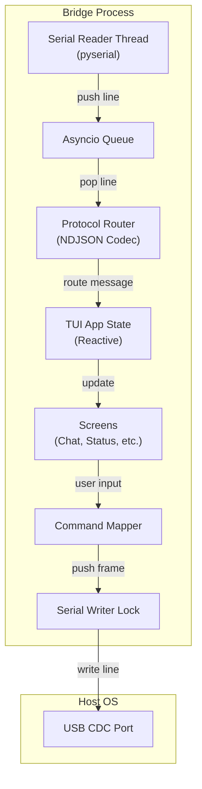

# 05 — Bridge TUI

Status: frozen by `docs/00-overview.md` §1, §2 (D5, D8, D9). This document specifies the terminal UI implementation.
Audience: bridge developers.

## 1. Scope & Constraints

The Bridge is a **dumb terminal**. It provides a user interface to the device but performs no agent logic, no prompt assembly, and no inference.

- **No local history**: All conversation context is stored on the device (`llm.max_history_messages`).
- **No local keys**: API keys are stored in the device's NVS; the bridge never sees them.
- **No local inference**: The bridge does not call LLM APIs; it only routes frames.
- **Stateless**: All state (e.g., scrollback) is in-memory. Reconnecting to the device resets the TUI scrollback.

## 2. Stack

| Component | Value | Note |
|---|---|---|
| Runtime | Python 3.12 | Standard distribution |
| TUI Framework | Textual | Async-first, reactive UI |
| Serial Link | pyserial | Blocked reads in a dedicated thread |
| Package Mgr | `uv` | Fast, reproducible environment |
| Deployment | `uv run bridge` | Single entry point |

### 2.1 Module Layout

- `bridge/protocol/` (L0): THE protocol module. Envelope build, parse and validate, NDJSON line framing, type and error-code enums, `reply_to` correlation ids. Pure functions and dataclasses.
- `bridge/link/` (L1): `Transport` ABC, `SerialTransport` (pyserial reader thread into an asyncio queue) and `FakeTransport` for tests.
- `bridge/client/` (L2): `Session`. Request/reply correlation, heartbeat, reconnect backoff, link state machine, frame-sink dispatch. Framework-agnostic.
- `bridge/ui/` (L3): Textual app, screens and widgets. Consumes `Session` events.
- `bridge/__main__.py` (L4): CLI flags, wiring, `uv run bridge` entry.
- `bridge/commands.py` (L2): slash-command string to `list[Frame]`. Pure, no Textual.

The dependency law between these layers and the two ports are specified in `docs/09-bridge-architecture.md`; this document only describes behavior.

## 3. Architecture



## 4. Connection Management

### 4.1 Handshake & Lifecycle

1. **Open**: The bridge opens the peer named by `--target` (`usb` or `test`, default
   `usb`). For `usb`, `--port` is optional and defaults to autodetect via VID/PID;
   for `test`, `--port` is required and points at the pseudo-terminal printed by
   `bridge/tools/test_agent.py`. Each target refuses a path belonging to the other
   before opening it, so a test session cannot reach real firmware and a hardware
   session cannot be pointed at a pty. The selection itself is specified in
   `10-test-agent.md` §3.
2. **Hello**: Bridge sends `hello` frame. When the user has configured a link token, the frame carries it as `token`; otherwise the field is omitted.
3. **Ack**: Bridge waits for `hello_ack` (5 s timeout). If missing, close and retry.
   - **Rejected**: If the device answers with `event` and `kind:"link.rejected"`, the token is wrong: render red line `link rejected: bad token` and stop -- no auto-retry, no backoff loop.
4. **Ready**: On `hello_ack`, the Bridge sets the app state to `CONNECTED` and triggers an immediate `status` command.

### 4.2 Heartbeat & Recovery

The bridge maintains the link using a ping-pong loop: it sends a `ping` frame
periodically and expects a `pong` within 5 s.

- **Degradation**: After 3 consecutive missed pongs, the TUI displays a `DEGRADED` banner.
- **Reconnect**: If the port closes or 3 pongs fail, the bridge enters an exponential backoff retry loop: 1 s, 2 s, 4 s, 8 s, 15 s (max).
- **Rejected**: A `link.rejected` close is not retried; see §4.1.

## 5. Screens

### 5.1 Chat Screen (F2)
The primary interaction pane.

- **Input**: A multi-line input box at the bottom.
- **Output**: A scrollable log of the conversation.
- **Behavior**:
  - `prompt` is sent on Enter.
  - Every submitted line is kept in a bounded in-memory ring (100 entries,
    adjacent duplicates collapsed, blank lines ignored). `Up` walks back through
    it, `Down` walks forward and returns to the line being typed, so a draft is
    never lost. The ring dies with the process: the bridge still stores no
    conversation (`00-overview.md` §RQ-1).
  - `Tab` accepts the completion instead of moving focus, because completing a
    half-typed command is what the composer's suggestion is for. `Shift+Tab`
    keeps its platform meaning.
  - When `agent.start` arrives, a spinner is displayed.
  - `agent.tool` and `agent.tool_result` are rendered as collapsed "tool calls" (expandable).
  - `agent.final` stops the spinner and renders the assistant's answer.
  - `agent.error` stops the spinner and renders a red error box with the `code` and `message`.

**Mockup:**
```text
+-----------------------------------------------------------------------+
| [Chat]                                                     [Status: OK|
+-----------------------------------------------------------------------+
| User: What time is it?                                                |
| Assistant:                                                            |
|   ( ) Thinking... [run_id: r-7]                                       |
|   v Tool: time.now (2ms) -> {unix: 1730563213}                        |
|   The device clock reads 2026-11-02T12:00:13Z.                        |
|                                                                       |
| User: [ /tasks list ]                                                 |
+-----------------------------------------------------------------------+
| > Hello agent!                                                        |
+-----------------------------------------------------------------------+
```

### 5.2 Status Screen (`/status`, F3)
Displays real-time device health.

- **Source**: `status` message (periodic or commanded).
- **Layout**: A grid of value-pairs.

**Mockup:**
```text
+-----------------------------------------------------------------------+
| [Status]                                                   [R to Refre|
+-----------------------------------------------------------------------+
| WIFI: connected (home-2g) | RSSI: -58dBm | IP: 192.168.1.42           |
| TIME: 2026-11-02 12:00:15 | TZ: UTC | Synced: Yes                     |
| LLM:  openai (gpt-4o-mini) | Available: Yes                           |
| AGENT: Busy (r-7) | Queue: 0/2                                        |
| MEM:  Heap: 181KB | PSRAM: 8.1MB                                      |
| DISK: userfs 18KB/3.75MB | wsfs 0KB/1MB (quota 64KB)                  |
| MQTT: home connected | lab down (2 brokers)                           |
| GEO:  52.3676, 4.9041 (+/-65m) | age 42s                              |
| BOOT: 9f2c1a7e | Uptime: 834s                                         |
+-----------------------------------------------------------------------+
```

### 5.3 Tasks Screen (`/tasks`, F4)
Lists scheduled and triggered tasks.

- **Source**: `tasks.list` command.
- **Interaction**: Arrow keys select a task. Enter runs it, `E` edits it, `Space`
  toggles enabled, `D` deletes it after confirmation, `N` adds a new one. Mutations
  re-issue `tasks.list` on `command.result` so the table never shows a stale row.

**Mockup:**
```text
+-----------------------------------------------------------------------+
| [Tasks]                                              [R to Refresh]   |
+-----------------------------------------------------------------------+
| ID        Description         Trigger       Status      Next Fire     |
| --------  ------------------  ------------  ----------  -----------   |
| morning   Morning briefing    schedule      Enabled     12:00:00      |
| on_boot   Boot report         boot          Enabled     -             |
| nightly   Nightly backup      schedule      Disabled    -             |
| > sensor  Temp check          gpio (pin 3)  Enabled     -             |
+-----------------------------------------------------------------------+
| [Enter] Run [E] Edit [Space] Enable [D] Delete [N] New [R] Refresh    |
+-----------------------------------------------------------------------+
```

### 5.4 Logs Screen (`/logs`, F5)
Streams firmware logs.

- **Source**: `log` messages.
- **Features**:
  - Coloring by `level` (Error=Red, Warn=Yellow, Info=Green).
  - Filtering by `tag` (e.g., only show `llm` logs) and by minimum level.
  - Auto-scroll (follow mode).

The buffer is bounded at 2000 lines and keeps a line whether or not the filter
passes it, so widening the filter shows what already arrived instead of only what
arrives next. A line carries its level in brackets (`[warn]`), which is what both
the colouring and the level filter read; a line with no bracket counts as `info`,
and an unrecognised token such as `[trace]` also counts as `info` so it is never
mistaken for a warning. `/` opens a one-line prompt holding the current filter,
`tag` or `tag:level`; an unknown level names itself and changes nothing. `C` clears
the buffer, `S` turns follow mode off so the view stays where the reader scrolled
while lines keep arriving.

**Mockup:**
```text
+-----------------------------------------------------------------------+
| [Logs]  Filter: [ llm ]  Level: [ warn ]  Follow: [ON]                |
+-----------------------------------------------------------------------+
| 12:00:01 [info]  net: wifi connected to home-2g (rssi -57)            |
| 12:00:02 [warn]  llm: provider openai timed out; falling back...      |
| 12:00:05 [debug] agent: assembling prompt for run r-7                 |
| 12:00:06 [error] storage: /workspace/run_7.json (E_STORAGE)           |
+-----------------------------------------------------------------------+
```

### 5.5 MQTT Screen (`/mqtt`, F6)
Read-only view of broker state and inbound traffic. Publishing is done from the
Chat input (`/mqtt publish`) or by the agent; the screen has no composer.

- **Source**: `mqtt.status` command result (broker list) and `mqtt.message` events
  (traffic log). A run in flight does not block it.
- **Features**:
  - Broker list with connected state and subscription count.
  - Scrolling log of inbound messages: time, topic, payload (single line).
  - Sanitised rendering: control characters are stripped and payloads are clipped
    for display. Payload text is never interpreted as a terminal escape sequence.
  - `R` refreshes the broker list.

**Mockup:**
```text
+-----------------------------------------------------------------------+
| [MQTT]  2 brokers                                    [R to Refresh]   |
+-----------------------------------------------------------------------+
| home   connected    4 subs                                            |
| lab    disconnected 2 subs                                            |
+-----------------------------------------------------------------------+
| 12:04:11 home garage/door/state        open                           |
| 12:04:19 home sensors/temp             {"t":21.5}                     |
| 12:05:02 lab  bench/heartbeat          ok                             |
+-----------------------------------------------------------------------+
```

### 5.6 Help Screen (`/help`, F1)

The help body is generated from one table, `COMMANDS` in `bridge/ui/help.py`: every
head `commands.py` accepts and every `LOCAL_COMMANDS` entry appears exactly once, so
the screen cannot drift from the parser. Each entry carries a `usage`, a one-line
`summary`, and whether it is local (`05` §7). A command that is accepted but absent
from the table, or documented but rejected, fails a test rather than a user's memory.

When the longest usage in a group is wider than a column that still fits a terminal,
each form moves to its own line with the summary indented beneath it. The result
never exceeds 78 columns, so no line wraps on a narrow terminal.

```text
F1 Help | F2 Chat | F3 Status | F4 Tasks | F5 Logs | F6 MQTT
Ctrl+R Reconnect | Ctrl+Q Quit
Esc Closes a modal and cancels a run

Device commands
  /status
      force a status refresh
  /tasks
  /tasks add
  /tasks set <id>
  /tasks enable <id>
  /tasks disable <id>
  /tasks delete <id>
      list tasks, or add, set, enable, disable or delete one
  /run <id>
      run a task now

Local commands
  /tools    list built-in and MCP tools
  /mcp      list MCP servers from the last status
```

### 5.7 Settings Screen (`/settings`)

The device config, browsable without memorising dotted paths. One row per scalar
or simple-list key of `03-config.md` §Full schema, in table order and grouped by
section; the keys whose value is a nested object or an object array
(`wifi.networks[]`, `llm.providers[]`, `mcp.servers[]`, `geo.providers[]` and their
children) are not rows, because they need a form rather than a line.

Opening the screen sends `config.get` with no `path` once and renders
the reply through `flatten`, which indexes arrays so a dotted row finds its value
(`04` §4.8). Until a config has been fetched the value column reads `-` and a note
says so; nothing here invents a default and presents it as the device's answer.

Fetched is recorded separately from what came back, because an empty config and a
config never asked for are both an empty mapping. A device that reports no config
must therefore be fetched once, not on every return to the screen; `R` is the only
thing that asks again.

`Enter` on a row opens a pre-filled prompt. The typed text is coerced to the row's
kind and checked against the bounds column before sending, so an out-of-range value
costs no round trip and names its own path in the error. The device re-validates:
this check is for latency and clarity, never the authority. A successful
`config.set` reports `applied` and `requires_reboot`, then re-fetches so the screen
shows what the device actually holds.

```text
+-----------------------------------------------------------------------+
| Key                          Value              Default    Bounds     |
| version                      1                  1          must be 1  |
| device.name                  musteval           musteval   1..32      |
| device.log_level             info               info       enum       |
| wifi.connect_timeout_ms      15000              15000      1000..     |
| llm.max_calls_per_hour       100                100        0..100000  |
+-----------------------------------------------------------------------+
| [Enter] Edit [R] Fetch from device                                    |
+-----------------------------------------------------------------------+
```

## 6. Keybindings

Focus follows the screen: entering a screen puts focus on the widget that consumes
keys there — the composer on Chat, the table on Tasks and Settings — and the
conversation log is never focusable, so `Tab` cannot land on it. `PageUp`,
`PageDown` and the wheel scroll it without focus.

### 6.1 Global Bindings

| Key | Action |
|---|---|
| `F1` | Switch to Help screen |
| `F2` | Switch to Chat screen |
| `F3` | Switch to Status screen |
| `F4` | Switch to Tasks screen |
| `F5` | Switch to Logs screen |
| `F6` | Switch to MQTT screen |
| `Esc` | Close the top modal; otherwise leave a non-Chat screen for Chat; on Chat, cancel the current run |
| `Ctrl+R` | Force reconnect (close port, clear state, re-handshake) |
| `Ctrl+Q` | Exit bridge |

The slash commands are the primary route to every screen; the function keys above
remain as aliases for them.

`Esc` on a modal is bound by the modal, not by the App: `ModalScreen` sets
`_modal`, which suppresses app-level bindings, so an app-level `Esc` never fires
while one is open. Every prompt therefore extends `PromptBox` in
`bridge/ui/modals.py`, which owns that binding and dismisses with a result.
Popping the screen instead would leave the `push_screen_wait` worker awaiting a
future that is never resolved.

### 6.2 Screen-Specific Bindings

| Screen | Key | Action |
|---|---|---|
| Chat | `Enter` | Send prompt |
| Chat | `Ctrl+J` | Insert newline in input |
| Chat | `Right`/`Tab` | Accept the autocomplete suggestion in the composer. With no suggestion pending, `Tab` does nothing: it never moves focus, because a keystroke landing in the conversation log is silently lost |
| Chat | `Up`/`Down` | Recall a submitted prompt; `Down` past the newest returns to the draft |
| Chat | `Esc` | No modal and no other screen on top: cancel the current agent run (`cancel` message) |
| Chat | `Ctrl+L` | Clear current session scrollback |
| Status | `R` | Request `status` command |
| Tasks | `Up`/`Down` | Navigate task list |
| Tasks | `Enter` | Send `tasks.run` for selected ID |
| Tasks | `E` | Edit selected task in a JSON modal, send `tasks.set` |
| Tasks | `Space` | Toggle `enabled` on selected task, send `tasks.set` |
| Tasks | `D` | Delete selected task after `y`/`n`, send `tasks.delete` |
| Tasks | `N` | Add a new task from a blank JSON modal, send `tasks.set` |
| Tasks | `R` | Request `tasks.list` command |
| Logs | `/` | Open filter search box |
| Logs | `C` | Clear log buffer |
| Logs | `S` | Toggle follow-mode (auto-scroll) |
| MQTT | `Up`/`Down` | Navigate broker/ message list |
| MQTT | `R` | Request `mqtt.status` command |
| Settings | `Up`/`Down` | Move between config rows |
| Settings | `Enter` | Edit the selected row in a pre-filled prompt, then send `config.set` |
| Settings | `R` | Re-request `config.get` |
| Settings | `Esc` | Cancel the edit prompt; on no prompt, back to Chat |

## 7. Slash Commands

Slash commands in the Chat input are mapped to protocol frames.

| Command | Protocol Mapping | Args | Note |
|---|---|---|---|
| `/status` | `command {name:"status"}` | none | Forces status refresh; also switches to the Status screen |
| `/reload` | `command {name:"reload"}` | none | Re-reads flash configs |
| `/reboot` | `command {name:"reboot"}` | none | Restarts device |
| `/tasks` | `command {name:"tasks.list"}` | none | Lists tasks in chat; also switches to the Tasks screen |
| `/run <id>` | `command {name:"tasks.run"}` | `id` | Runs a task now |
| `/tasks add` | `command {name:"tasks.set"}` | `task` | Opens a blank task modal, then sends it |
| `/tasks set <id>` | `command {name:"tasks.set"}` | `task` | Opens the cached task in a modal, then sends it |
| `/tasks enable <id>` | `command {name:"tasks.set"}` | `task` | Resends the task with `enabled: true` |
| `/tasks disable <id>` | `command {name:"tasks.set"}` | `task` | Resends the task with `enabled: false` |
| `/tasks delete <id>` | `command {name:"tasks.delete"}` | `id` | Confirms, then deletes |
| `/config get <p>` | `command {name:"config.get"}` | `path` | Dumps config value |
| `/config set <p> <v>`| `command {name:"config.set"}` | `path, value` | Updates config |
| `/secret set <k>` | `secret.set` | `key` | Prompts for value (masked) |
| `/templates` | `command {name:"templates.list"}`| none | Lists prompt templates |
| `/template <n>` | `command {name:"template.get"}` | `name` | Dumps template text |
| `/mqtt` | `command {name:"mqtt.status"}` | none | Lists brokers and state; also switches to the MQTT screen |
| `/fs put <p>` | `command {name:"fs.put"}` | `path, data, offset, final` | Uploads a local file to `userfs` in 2 KiB chunks; refuses a path outside the allowlist before sending |
| `/mqtt publish <srv> <topic> <payload>` | `command {name:"mqtt.publish"}` | `server_id, topic, payload` | Publishes once |
| `/geo` | `command {name:"geo.locate"}` | none | Forces a fresh fix |
| `/tools` | (Local) | none | Lists `capabilities.tools` (every tool currently callable, declarative ones included) and `capabilities.mcp` |
| `/mcp` | (Local) | none | Lists servers from the last `status.mcp[]` |
| `/usage` | (Local) | none | Token totals from observed `agent.final.usage` |
| `/context` | (Local) | none | Shows last `input_bytes` and observed `usage` totals |
| `/todo` | (Local) | none | Re-renders the phases and their tasks from the last observed `todo` tool result, one line per task, with `pending`, `in_progress`, `completed`, `abandoned` and `blocked` distinguished. It also marks a finished run whose `agent.final` carried `todo_open: true`, so an unfinished plan is visible instead of silent |
| `/export` | (Local) | none | Writes the chat log to `bridge-export-<ts>.md` |
| `/retry` | `prompt` | none | Resends the last prompt verbatim |
| `/ping` | `ping` | none | Tests link latency |
| `/diag` | `status` | none | Renders the diagnostic half of `status`: heap, PSRAM, safe-mode flag, boot failures, tool call counts, and the LLM hour/day counters against their caps. Local rendering only; the frame it reuses is `status` |
| `/cancel` | `cancel` | none | Cancels current run |
| `/logs` | (Local) | none | Switches to the Logs screen |
| `/help` | (Local) | none | Switches to the Help screen |
| `/settings` | (Local) | none | Opens the settings screen (`05` §5.7); the screen sends `config.get` and `config.set` |
| `/quit` | (Local) | none | Exits TUI |

Commands marked `(Local)` render from state the bridge already holds from
`hello_ack`, `status` and `agent.final`, and send no frame at all. The five rows that
are neither `command` nor `(Local)` send the frame named in their mapping instead:
`/secret set` sends `secret.set`, `/retry` sends `prompt`, `/ping` sends `ping`,
`/diag` sends `status`, and `/cancel` sends `cancel`.

4. **Link token**: the value sent as `hello.token` is a bridge-side config value that the user sets when provisioning the device (`06-security.md` §9); it is not a slash command and the bridge never prints it.
`/fs put <p>` is the one command that sends more than one frame per invocation: it
4 KiB RX line cannot carry an 8 KiB skill. A rejected chunk aborts the upload and
leaves the previous version of the file untouched, because the device only renames
the staged file into place on `final: true`. The bridge refuses a path outside the
`fs.put` allowlist before sending anything, and reports a built-in target as a
refusal rather than retrying under another name.

`/tasks add` takes no `<id>`: the id is a field inside the task body, so a blank
modal with every field empty is the only unambiguous starting point. Typing
`/tasks add morning` and getting a modal that pre-fills one field would leave the
other eleven to guesswork. Both `/tasks add` and the Tasks screen's `N` open the same
modal; `/tasks set <id>` and the screen's `E` open the same cached-entry modal.

`/tasks enable|disable` are shorthands, not a separate protocol operation: the
bridge takes the entry from its last `tasks.list` result, flips `enabled`, and sends
the whole task back through `tasks.set`, because the device replaces the entry
wholesale rather than patching fields. If the cached list is stale because the id
was deleted elsewhere, `tasks.set` appends it - the result's `created: true` is what
tells the bridge this happened, and it reports "re-created" rather than "enabled" so
a resurrection is never silent.

`/tasks delete` requires a `y`/`n` confirmation. Every other command is reversible
by re-sending the old body; delete is not, so it is the one place the bridge blocks
on input.

`/tools` covers what the device advertises in `hello_ack`: every tool currently
callable, which includes the declarative tools loaded from `/tools/*.json` as well
as the MCP tool names (`04-protocol.md` §3.2). Declarative tools are therefore
discoverable in v1: `weather_now` and `web_search` appear in that list when their
files parsed. What stays unavailable is the *file* view — no frame carries the
`/tools/` directory listing, so the bridge can name each declarative tool but cannot
show its schema, description or which file defined it. `/reload` reports `tools` in
`reloaded[]` when the directory parsed, without naming them. Showing schemas needs a
`tools.list` command, which v1 does not have.

`/context` shows only frame-borne values: the last `agent.start.input_bytes` and
the summed `agent.final.usage`. Config limits such as `llm.max_history_messages`
and `agent.max_input_bytes` are not on the wire, so the bridge cannot show them
without a `/config get` round trip.

Deliberately absent, because the device has no surface for them: `/compact` (the
device keeps `llm.max_history_messages` messages and truncates oldest-first with
no summarisation step to invoke), `/model` (`llm.providers[]` is the fallback
chain, not a selectable list, and the fallback only advances on failure),
`/clear` (history lives on the device in PSRAM and has no reset command), and
`/mcp add|remove|test` (MCP servers are config-file entries; changing them means
`config.set` and `reload`).

## 8. Secrets & Redaction

The Bridge follows strict security rules to prevent secret leakage on the host:
1. **Masked Input**: `/secret set <key>` opens a modal holding a single `password=True` field, so every character renders as `*`. The value is read only through `Screen.dismiss` on Enter; Esc or an empty value dismisses with `None`, and the command is never sent. The parser receives the value afterwards, so no secret is ever a constructor argument, an argument to a logged call, or a rendered line.
2. **No Echo**: The Bridge never renders the `value` field of a `secret.set` result.
3. **Log Redaction**: If the device sends a `log` message that accidentally contains a secret (should be prevented by firmware), the bridge cannot detect it; however, the Bridge MUST NOT log its own internal protocol frames to a file unless `--json` (debug) is enabled.

## 9. Error Surfacing

Protocol errors are surfaced based on their `retryable` flag:

| Error | TUI Presentation | Action |
|---|---|---|
| `E_BUSY` | Yellow banner: "Agent Busy" | Wait for run to end |
| `E_PROTOCOL` | Red banner: "Protocol Error" | Log frame to Logs screen, reconnect |
| `E_WIFI` / `E_LLM_UNAVAILABLE` | Yellow toast: "Network issue" | Show retry timer |
| `E_CONFIG` | Red modal: "Invalid Config" | Direct user to fix `config.json` |
| `E_INTERNAL` | Red banner: "Device Fault" | Suggest reboot |
| `E_MQTT` | Yellow banner: "MQTT Error" | Check broker connectivity |
| `E_GEO` | Yellow toast: "Geo Fix Failed" | Wait for better signal |

## 10. Frame-to-UI Traceability

Every device `→` bridge frame maps to exactly one UI surface. A frame with no
surface is a protocol bug, not a silently dropped message.

The `Frame` column is not a second catalogue: `04-protocol.md` §2.1 owns the type
list, and this table must contain exactly the 14 types whose device `→` bridge cell
is populated there — no more, no fewer. A type added to `04` without a row here is
caught mechanically (§7 of `09-bridge-architecture.md`), so the two cannot drift.

| Frame | Surface | Behaviour |
|---|---|---|
| `hello_ack` | Chat screen header | Version, boot id, capabilities |
| `status` | Status screen (F3) | Renders the grid in §5.2 |
| `log` | Logs screen (F5) | Filterable, follow mode |
| `agent.start` | Chat screen | Starts a run block |
| `agent.tool` | Chat screen | Tool call line under the run |
| `agent.tool_result` | Chat screen | Result line, truncated with indicator |
| `agent.final` | Chat screen | Closes the run block |
| `agent.error` | Chat screen | Red error line; banner if terminal |
| `task.fired` | Tasks screen (F4) | Highlights the fired row; appends to chat |
| `gpio.edge` | Logs screen (F5) | Log line, `gpio` tag |
| `mqtt.message` | MQTT screen (F6) | Appends to traffic log; no chat entry |
| `event` | Logs screen (F5) | Log line, `event:<kind>` tag |
| `command.result` | Originating screen | Resolves the pending command |
| `pong` | Status screen footer | Updates latency |

Commands map to surfaces the same way: `geo.locate` updates the Status screen
GEO row and reports in chat, `mqtt.status` refreshes F6, and `mqtt.publish`
reports its result in chat.


## 11. Maintenance Tooling

- `bridge/tools/build_userfs.py`: builds the `userfs` image from a source directory and flashes it to the device. Planned M5 deliverable (`07-roadmap.md` M5), not yet written.
- `bridge/tools/test_agent.py`: fake device over a pseudo-terminal for hardware-free bridge testing. Selected with `--target test` (§4.1); specified in `10-test-agent.md`.
- `--json` (debug): the flag from §8 under which the bridge may log its own internal protocol frames; without it, frames are never written to a file.

## 12. Connecting Without Hardware

The bridge can be driven end to end against a fake peer, over a real serial
device, with no board attached. Run `uv run python bridge/tools/test_agent.py`,
note the device path it prints on stdout, then start the bridge with
`uv run bridge --target test --port <that path>`.

A green run exercises the framing, the envelope, frame direction, the handshake
of §4.1, the heartbeat of §4.2, request/reply correlation and error rendering.
It proves nothing about firmware. The validation ladder, the reply table, the
scenario flags and the limits of the fake peer are in `10-test-agent.md`; they
are not restated here, because a second copy of a reply table is a second table
to keep true.
