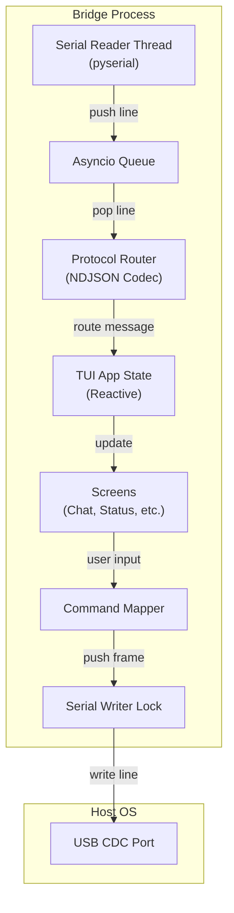

# 05 — Bridge TUI

Status: frozen by `docs/00-overview.md` §1, §2 (D5, D8, D9). This document specifies the terminal UI implementation.
Audience: bridge developers.

## 1. Scope & Constraints

The Bridge is a **dumb terminal**. It provides a user interface to the device but performs no agent logic, no prompt assembly, and no inference.

- **No local history**: All conversation context is stored on the device (`llm.max_history_messages`).
- **No local keys**: API keys are stored in the device's NVS; the bridge never sees them.
- **No local inference**: The bridge does not call LLM APIs; it only routes frames.
- **Stateless**: All state (e.g., scrollback) is in-memory. Reconnecting to the device resets the TUI scrollback.

## 2. Stack

| Component | Value | Note |
|---|---|---|
| Runtime | Python 3.12 | Standard distribution |
| TUI Framework | Textual | Async-first, reactive UI |
| Serial Link | pyserial | Blocked reads in a dedicated thread |
| Package Mgr | `uv` | Fast, reproducible environment |
| Deployment | `uv run bridge` | Single entry point |

### 2.1 Module Layout

- `bridge/protocol/` (L0): THE protocol module. Envelope build, parse and validate, NDJSON line framing, type and error-code enums, `reply_to` correlation ids. Pure functions and dataclasses.
- `bridge/link/` (L1): `Transport` ABC, `SerialTransport` (pyserial reader thread into an asyncio queue) and `FakeTransport` for tests.
- `bridge/client/` (L2): `Session`. Request/reply correlation, heartbeat, reconnect backoff, link state machine, frame-sink dispatch. Framework-agnostic.
- `bridge/ui/` (L3): Textual app, screens and widgets. Consumes `Session` events.
- `bridge/__main__.py` (L4): CLI flags, wiring, `uv run bridge` entry.
- `bridge/commands.py` (L2): slash-command string to `list[Frame]`. Pure, no Textual.

The dependency law between these layers and the two ports are specified in `docs/09-bridge-architecture.md`; this document only describes behavior.

## 3. Architecture



## 4. Connection Management

### 4.1 Handshake & Lifecycle

1. **Open**: The bridge opens the peer named by `--target` (`usb` or `test`, default
   `usb`). For `usb`, `--port` is optional and defaults to autodetect via VID/PID;
   for `test`, `--port` is required and points at the pseudo-terminal printed by
   `bridge/tools/test_agent.py`. Each target refuses a path belonging to the other
   before opening it, so a test session cannot reach real firmware and a hardware
   session cannot be pointed at a pty. The selection itself is specified in
   `10-test-agent.md` §3. Opening does not touch DTR or RTS: on the ESP32-S3's
   native USB-JTAG that pair is the reset strap, and any transition on it pulses a
   reset, so a bridge that drove them would reboot the board on every connection
   instead of reconnecting to the running device. The evidence is in
   `09-bridge-architecture.md` §4.2.
2. **Hello**: Bridge sends `hello` frame. When the user has configured a link token, the frame carries it as `token`; otherwise the field is omitted.
3. **Ack**: Bridge waits for `hello_ack` (5 s timeout). If missing, close and retry.
   - **Rejected**: If the device answers with `event` and `kind:"link.rejected"`, the token is wrong: render red line `link rejected: bad token` and stop -- no auto-retry, no backoff loop.
4. **Ready**: On `hello_ack`, the Bridge sets the app state to `CONNECTED` and triggers an immediate `status` command.

### 4.2 Heartbeat & Recovery

The bridge maintains the link using a ping-pong loop: it sends a `ping` frame
periodically and expects a `pong` within 5 s.

- **Degradation**: After 3 consecutive missed pongs, the TUI displays a `DEGRADED` banner.
- **Reconnect**: If the port closes or 3 pongs fail, the bridge enters an exponential backoff retry loop: 1 s, 2 s, 4 s, 8 s, 15 s (max).
- **Rejected**: A `link.rejected` close is not retried; see §4.1.

### 4.3 Headless Invocation

`bin/bridge` is the launcher: it locates the checkout, then `exec`s the venv's
`python -m bridge` with every argument passed through unchanged, so there is one
CLI definition, not two. The port is autodetected from the USB CDC vendor id when
`--port` is omitted.

`--send TEXT` skips the TUI: it connects, sends each `TEXT` (a prompt, or a
slash command turned into its frame), prints the reply, and exits. The exit code
is the contract a script depends on:

|Code|Meaning|
|---|---|
|`0`|every `--send` got its reply|
|`1`|the link never came up, a send was refused, or a reply never arrived|
|`2`|bad usage: a missing `--port`, a target/port mismatch, or a malformed command|

A send that is never answered is a `1` with one line of explanation, never a
traceback: the request timeout has no message of its own, so the headless path
supplies one.

## 5. Screens

### 5.1 Chat Screen (F2)
The primary interaction pane.

- **Input**: A multi-line input box at the bottom, with a one-row prompt bar
  directly above it.
- **Output**: A scrollable log of the conversation.
- **Behavior**:
  - `prompt` is sent on Enter. A prompt submitted while the link cannot answer —
    `down`, `linking` or `refused` — is answered in the log at once, naming the
    word the prompt bar is showing, rather than waiting for an acknowledgement
    that cannot arrive: the ack timeout is `6 × connect_timeout`, so the silent
    version left the reader with a typed prompt and no reply for half a minute.
    `flaky` is not refused: a degraded link still carries traffic, so the prompt
    is sent and either succeeds or reports its timeout like any other. A prompt on
    a `linked` peer that never answers leaves one line saying so, never silence.
    Slash commands are not gated this way — `/help`, `/settings` and the other
    local screens work with no link.
  - Every submitted line is kept in a bounded in-memory ring (100 entries,
    adjacent duplicates collapsed, blank lines ignored). `Up` walks back through
    it, `Down` walks forward and returns to the line being typed, so a draft is
    never lost. The ring dies with the process: the bridge still stores no
    conversation (`00-overview.md` §RQ-1).
  - `Tab` accepts the completion instead of moving focus, because completing a
    half-typed command is what the composer's suggestion is for. `Shift+Tab`
    keeps its platform meaning.
  - While a slash command is being typed, the candidate completions are listed
    above the composer: the command names after `/`, and a command's subcommands
    after `/tasks ` and the like. The list filters as the user types, shows at
    most eight rows and ends with a `+N more` row when the list is longer, so it
    never pushes the conversation off the screen. The list disappears when the
    composer is empty and when the typed text stops being a command prefix.
  - The list is navigated the way OMP navigates a picker. Its top row is
    selected when the list opens and a `>` marks it, so the selection is never
    carried by colour. `Up` and `Down` walk the rows and wrap at the edges,
    `Home` and `End` jump to them, and `Page Up` and `Page Down` move by a whole
    window. While the list is open these keys drive it and the history ring is
    left alone; when it is closed they recall history as usual, so `Up` never
    does both.
  - `Tab` and a `Right` at the end of the line apply the selected row and move
    the cursor to its end; a `Right` before the end keeps its cursor role.
    `Enter` applies the selected row and then submits the applied value, which
    is what makes `/tasks a` run `/tasks add` rather than the half-typed
    fragment. The marked row is always one the user can see, never the `+N more`
    counter, so a keypress cannot apply a command that was not on screen. `Esc`
    closes the list and does nothing else; with no list open it backs out of the
    screen as before.
  - The prompt bar above the composer is one row of facts about the link and the
    agent, in the manner of a shell's prompt line. Segments are joined by ` | `
    and each is a value the bridge already holds, so the bar never costs a
    frame: the link state (`down`, `linking`, `linked`, `flaky`, `refused`; while the
    link is down, linking or refused that word is the whole bar, because every
    other fact would be the last thing heard before the link died), the
    provider and model while a `status` has named one, the agent's `idle` or
    `busy <run_id>`, a queue segment only while the queue is non-empty, the wifi
    state and its signal, workspace use against its quota, the running token
    total once a call has been charged, and the `device` from `hello_ack`. A
    segment whose fact is unknown is omitted rather than rendered as `none`: a
    bar that blamed the provider before the first `status` arrived would send
    the reader after the wrong thing.
  - Two facts sit immediately behind the link word, because the bar drops from
    the right: `SAFE MODE` while safe mode is active, and the uptime from
    `status.uptime_s` as one compact segment — `45s`, `12m05s`, `3h04m`, `1d2h`.
    Safe mode is the fact that explains a failure, so it outranks everything the
    model or agent says; uptime dates every other fact on the bar.
  - The wifi fact carries `state`, not only the signal: `up` beside `-58dBm`
    while connected, and `wifi linking`, `wifi failed` or `wifi off` with no
    signal segment at all when there is none — a bar that showed nothing for a
    dead association would read as silence rather than as a fault. A `failovers`
    count above zero is appended as `N failover(s)`, because a network that took
    three tries to come up is about to take three tries again. All of it comes
    from the last `status` the bridge holds; none of it costs a frame.
  - The bar is redrawn when a fact changes: `hello_ack`, a `status` frame, the
    `status` command's own reply (a `/status` is a command, not a push, and a bar
    that ignored it would stay empty until the device volunteered one), a usage
    frame, a link-state transition (a drop emits no frame of its own), mount and
    a resize. Never on a keystroke. It is one row and drops whole trailing
    segments when the terminal is too narrow, so a narrow window loses the
    rightmost facts rather than showing half a word or the composer. The link
    word is never dropped: an empty bar would say less than a short one.
  - When `agent.start` arrives, a spinner is displayed.
  - `agent.tool` and `agent.tool_result` are rendered as collapsed "tool calls" (expandable).
  - `agent.final` stops the spinner and renders the assistant's answer.
  - `agent.error` stops the spinner and renders a red error box with the `code` and `message`.

**Mockup:**
```text
+-----------------------------------------------------------------------+
| [Chat]                                                     [Status: OK|
+-----------------------------------------------------------------------+
| User: What time is it?                                                |
| Assistant:                                                            |
|   ( ) Thinking... [run_id: r-7]                                       |
|   v Tool: time.now (2ms) -> {unix: 1730563213}                        |
|   The device clock reads 2026-11-02T12:00:13Z.                        |
|                                                                       |
| User: [ /tasks list ]                                                 |
+-----------------------------------------------------------------------+
| linked | 3h04m | openai/gpt-4o-mini | idle | up | -58dBm              |
| > Hello agent!                                                        |
+-----------------------------------------------------------------------+
```

### 5.2 Status Screen (`/status`, F3)
Displays real-time device health.

- **Source**: `status` message (periodic or commanded).
- **Layout**: A grid of value-pairs.

**Mockup:**
```text
+-----------------------------------------------------------------------+
| [Status]                                          [Ctrl+R] Refresh    |
+-----------------------------------------------------------------------+
| WIFI: connected (home-2g) | RSSI: -58dBm | IP: 192.168.1.42           |
| TIME: 2026-11-02 12:00:15 | TZ: UTC | Synced: Yes                     |
| LLM:  openai (gpt-4o-mini) | Available: Yes                           |
| AGENT: Busy (r-7) | Queue: 0/2                                        |
| MEM:  Heap: 181KB | PSRAM: 8.1MB                                      |
| DISK: userfs 18KB/3.75MB | wsfs 0KB/1MB (quota 64KB)                  |
| MQTT: home connected | lab down (2 brokers)                           |
| GEO:  52.3676, 4.9041 (+/-65m) | age 42s                              |
| BOOT: 9f2c1a7e | Uptime: 834s                                         |
+-----------------------------------------------------------------------+
```

### 5.3 Tasks Screen (`/tasks`, F4)
Lists scheduled and triggered tasks.

- **Source**: `tasks.list` command.
- **Interaction**: Arrow keys select a task. Enter or `Ctrl+X` runs it, `Ctrl+E`
  edits it, `Ctrl+Y` toggles enabled, `Ctrl+D` deletes it after confirmation,
  `Ctrl+N` adds a new one, `Ctrl+R` re-lists. Mutations re-issue `tasks.list` on
  `command.result` so the table never shows a stale row.

**Mockup:**
```text
+-----------------------------------------------------------------------+
| [Tasks]                                     [Ctrl+R] Refresh          |
+-----------------------------------------------------------------------+
| ID        Description         Trigger       Status      Next Fire     |
| --------  ------------------  ------------  ----------  -----------   |
| morning   Morning briefing    schedule      Enabled     12:00:00      |
| on_boot   Boot report         boot          Enabled     -             |
| nightly   Nightly backup      schedule      Disabled    -             |
| > sensor  Temp check          gpio (pin 3)  Enabled     -             |
+-----------------------------------------------------------------------+
| [Ctrl+X] Run  [Ctrl+E] Edit  [Ctrl+Y] Enable  [Ctrl+D] Delete         |
| [Ctrl+N] New  [Ctrl+R] Refresh                                        |
```

### 5.4 Logs Screen (`/logs`, F5)
Streams firmware logs.

- **Source**: `log` messages.
- **Features**:
  - Coloring by `level` (Error=Red, Warn=Yellow, Info=Green).
  - Filtering by `tag` (e.g., only show `llm` logs) and by minimum level.
  - Auto-scroll (follow mode).

The buffer is bounded at 2000 lines and keeps a line whether or not the filter
passes it, so widening the filter shows what already arrived instead of only what
arrives next. A line carries its level in brackets (`[warn]`), which is what both
the colouring and the level filter read; a line with no bracket counts as `info`,
and an unrecognised token such as `[trace]` also counts as `info` so it is never
mistaken for a warning. `Ctrl+F` opens a one-line prompt seeded with the current
filter, `tag` or `tag:level`; an unknown level names itself and changes nothing.
`Ctrl+L` clears the buffer, `Ctrl+Y` turns follow mode off so the view stays where
the reader scrolled while lines keep arriving.

**Mockup:**
```text
+-----------------------------------------------------------------------+
| [Logs]  Filter: [ llm ]  Level: [ warn ]  Follow: [ON]                |
+-----------------------------------------------------------------------+
| 12:00:01 [info]  net: wifi connected to home-2g (rssi -57)            |
| 12:00:02 [warn]  llm: provider openai timed out; falling back...      |
| 12:00:05 [debug] agent: assembling prompt for run r-7                 |
| 12:00:06 [error] storage: /workspace/run_7.json (E_STORAGE)           |
+-----------------------------------------------------------------------+
```

### 5.5 MQTT Screen (`/mqtt`, F6)
Read-only view of broker state and inbound traffic. Publishing is done from the
Chat input (`/mqtt publish`) or by the agent; the screen has no composer.

- **Source**: `mqtt.status` command result (broker list) and `mqtt.message` events
  (traffic log). A run in flight does not block it.
- **Features**:
  - Broker list with connected state and subscription count.
  - Scrolling log of inbound messages: time, topic, payload (single line).
  - Sanitised rendering: control characters are stripped and payloads are clipped
    for display. Payload text is never interpreted as a terminal escape sequence.
  - `Ctrl+R` refreshes the broker list.

**Mockup:**
```text
+-----------------------------------------------------------------------+
| [MQTT]  2 brokers                               [Ctrl+R] Refresh      |
+-----------------------------------------------------------------------+
| home   connected    4 subs                                            |
| lab    disconnected 2 subs                                            |
+-----------------------------------------------------------------------+
| 12:04:11 home garage/door/state        open                           |
| 12:04:19 home sensors/temp             {"t":21.5}                     |
| 12:05:02 lab  bench/heartbeat          ok                             |
+-----------------------------------------------------------------------+
```

### 5.6 Help Modal (`/help`, F1)

Help is a modal over the current screen, not a screen of its own: `F1` is pressed
mid-composition, and a screen swap would discard the half-typed prompt. The draft
survives the modal opening and closing, which a test asserts.

The body is generated from one table, `COMMANDS` in `bridge/ui/help.py`: every
head `commands.py` accepts and every `LOCAL_COMMANDS` entry appears exactly once, so
the screen cannot drift from the parser. Each entry carries a `usage`, a one-line
`summary`, and whether it is local (`05` §7). A command that is accepted but absent
from the table, or documented but rejected, fails a test rather than a user's memory.

The entries are grouped by a second table, `CATEGORIES`, into four `TabPane`s —
**Device**, **Chat**, **Info**, **Screens** — and a coverage test asserts that the
groups name every command exactly once, so a new command cannot silently vanish
from the modal. A keybinding strip sits above the tabs, from `KEYS_TEXT`, because
the keys that close the modal are the ones a reader looks for. `Esc` dismisses.

When the longest usage in a group is wider than a column that still fits a terminal,
each form moves to its own line with the summary indented beneath it. The result
never exceeds 78 columns, so no line wraps on a narrow terminal.

```text
F1 Help  | F2 Chat   | F3 Status | F4 Tasks | F5 Logs | F6 MQTT | F7 Files
Ctrl+R Reconnect | Ctrl+Q Quit | Esc Closes a modal and cancels a run
```

The modal itself, over whatever screen was open:

```text
+--------------------------------------------------------------+
| Help  Device | Chat | Info | Screens                         |
+--------------------------------------------------------------+
| Device commands                                              |
|   /status                                                    |
|       force a status refresh                                 |
|   /sys reset-counter                                         |
|       clear the boot-failure counter                         |
+--------------------------------------------------------------+
```

### 5.7 Settings Screen (`/settings`)

The device config, browsable without memorising dotted paths. One row per scalar
or simple-list key of `03-config.md` §Full schema, in table order and grouped by
section; the keys whose value is a nested object or an object array
(`wifi.networks[]`, `llm.providers[]`, `mcp.servers[]`, `geo.providers[]` and their
children) are not rows, because they need a form rather than a line.

Opening the screen sends `config.get` with no `path` once and renders
the reply through `flatten`, which indexes arrays so a dotted row finds its value
(`04` §4.8). Until a config has been fetched the value column reads `-` and the
heading reads `no config yet: Ctrl+R fetches it from the device`, so the screen names
the key that fills it; nothing here invents a default and presents it as the device's
answer.

Fetched is recorded separately from what came back, because an empty config and a
config never asked for are both an empty mapping. A device that reports no config
must therefore be fetched once, not on every return to the screen; `Ctrl+R` is the
only thing that asks again.

`Enter` on a row opens a pre-filled prompt. The typed text is coerced to the row's
kind and checked against the bounds column before sending, so an out-of-range value
costs no round trip and names its own path in the error. The device re-validates:
this check is for latency and clarity, never the authority. A successful
`config.set` reports `applied` and `requires_reboot`, then re-fetches so the screen
shows what the device actually holds.

```text
+-----------------------------------------------------------------------+
| Key                          Value              Default    Bounds     |
| version                      1                  1          must be 1  |
| device.name                  musteval           musteval   1..32      |
| device.log_level             info               info       enum       |
| wifi.connect_timeout_ms      15000              15000      1000..     |
| llm.max_calls_per_hour       100                100        0..100000  |
+-----------------------------------------------------------------------+
| [Enter] Edit  [Ctrl+R] Fetch from device                              |
+-----------------------------------------------------------------------+
```

### 5.8 Files Screen (`/files`, F7)

The agent sandbox, `/workspace/`, browsed from the TUI. The screen is deliberately
scoped to that one mount: it is the only location the device exposes for browsing,
and it is where the agent writes, so a user debugging what the agent produced looks
here and not in `userfs`. Content outside it is `E_CONFIG` from the device and is
never reachable from this screen (`04` §4.17).

The pane is a three-column table, matching the mockup below: the type column holds
`d` for a directory and `f` for a file, the name column the entry as the device
reported it, and the size column the byte count or `-` for a directory. At any path
below the root an extra `..` row sits at the top so `Enter` can climb without a
separate key. The current path is the screen title. Entries sort as the device
returns them, directories first, so the browser never re-orders what it was given.

Opening the screen sends `sandbox.list` for `/workspace/` once. `Enter` on a
directory descends into it; `Enter` on a file opens it for viewing.

Editing happens in one modal holding a `TextArea`, pre-filled from `sandbox.read`.
`Ctrl+S` sends `sandbox.write` for the whole buffer, split into `04` §4.20 chunks of
at most 2048 raw bytes, `base64`-encoded, each carrying its `offset` and the last
carrying `final:true`. The device therefore commits or leaves the previous file
intact; a buffer is never half-written by a failed frame. A file the device reported
`truncated` is refused for editing instead, because saving a partial read would write
the cut back over the original. `Esc` discards. Nothing is written on navigation, so
leaving the screen with an open modal cannot silently save.

Deleting asks `y`/`n` first. For a file the question names the path. For a
directory the screen lists it first, counts the entries, and says how many a
recursive delete would take: *"Delete /workspace/runs and the 3 entries under it?"*
An empty directory asks without a count, because there is nothing to lose, and the
frame omits `recursive` (`04` §4.19). The destructive form of the command is never
sent for a directory the reader was not told the size of.

`Ctrl+M` moves or renames the selected entry through `sandbox.move`, with the prompt
pre-filled with the current path so a rename is an edit rather than retyping. The
target is normalised locally by `sandbox_normalise`, so a path outside `/workspace/`
is refused before a frame is sent. `Ctrl+K` creates a directory via `sandbox.mkdir`, in
the directory currently browsed. `Ctrl+N` creates a new empty file through `sandbox.write`
with an empty body, then opens it for editing. Both `Ctrl+N` and `Ctrl+K` re-request the
listing on success, so the new entry appears without a manual refresh.

### 5.8.1 Upload and Download

`Ctrl+X` downloads the selected entry to the host, `Ctrl+O` uploads a host file into
the directory currently browsed. The two directions are separate keys rather than one
modal with a direction toggle, because a modal that asks which way round the copy goes
makes the reader answer a question the keypress already answered.

Downloading a file asks for a host path, defaulting to the entry's name in the
working directory, and writes what `sandbox.read` returned. A device reply with
`truncated:true` is refused: `04` §4.18 caps a read at 8192 raw bytes and forbids a
second frame, so the file on the host would be a prefix presented as a file. The
browser says how long the device file is and stops, rather than writing a short
copy the reader has no way to notice.

Downloading a directory walks it with `sandbox.list` and, for each file, one
`sandbox.read`, writing the tree under the chosen host directory. It refuses before
the first write when any file in the tree exceeds the read cap, naming that file:
a partial tree is worse than no tree, because the reader cannot tell which files
were clipped. The walk is depth-first in the order the device listed, so the host
tree matches what the browser showed.

Uploading a file sends its bytes through `sandbox.write` in `04` §4.20 chunks, the
same path the editor uses. Uploading a directory mirrors the download walk: create
each directory with `sandbox.mkdir`, then write each file. A host entry the device
would refuse — a name outside the workspace, a symlink, a socket — aborts the upload
with the offending path named, rather than being skipped silently.

Both directions run as a worker, one frame at a time on the single session, and
report one summary line to the chat log when the copy finishes, naming the count and
the destination. Nothing is printed per frame: a tree of a hundred files would
otherwise scroll every line that came before it out of the log.

The editor modal holds a `TextArea` and supports `Ctrl+F` to search: the first
`Enter` sets the needle and selects the first match, the second replaces every
occurrence with the new text in one edit, so the whole cascade undoes as one step.
`F3` jumps to the next match and wraps at the end, because a search that stops at the
buffer's end reads as "not found" when the match is above the caret. `Ctrl+Z` and
`Ctrl+Y` undo and redo, and the hint line under the buffer names both, since a
keybinding nobody can discover is not a feature.

```text
+-----------------------------------------------------------------------+
| /workspace/runs                              3 entries                |
|Type  Name                              Bytes                          |
| d     ..                               -                              |
| d     2026-11-02                       -                              |
| f     notes.md                         412                            |
| f     run_7.json                       1834                           |
+-----------------------------------------------------------------------+
| Ctrl+E Edit  Ctrl+D Delete  Ctrl+M Move  Ctrl+N New  Ctrl+K Mkdir     |
| Ctrl+U Up  Ctrl+R Refresh  Ctrl+O Upload  Ctrl+X Download             |
| Ctrl+F Find  Enter Open                                               |
+-----------------------------------------------------------------------+
```

`Ctrl+U` goes up one directory and stops at `/workspace/`, the root this screen
can see. `Ctrl+R` re-requests the listing for the current path. `Ctrl+F` narrows
the rows already held, without another `sandbox.list`; the heading then reads
`filter 'x': 2 of 9`, so a missing entry is explained rather than mysterious.

### 5.9 Splash Screen

The first surface a reader sees on a normal run: the mascot, who is the musteval
of `00-overview.md` §10, and one tip drawn from the tips table. It is mounted
alongside the eight screens and shown by `display`, like every other screen, so
dismissing it needs no screen-stack plumbing.

- **Art**: two hand-drawn half-block blocks held in `splash.py` — `WORDMARK`, the
  name in half-block letters 47 columns wide, and `MASCOT`, a 35-column side
  profile of the musteval. Rows are stored unpadded and padded to the block width
  when drawn, so the panel never jitters and the literals carry no trailing spaces
  that a reader would have to count. Both are emitted one character at a time
  rather than through Rich markup, so no glyph can be reinterpreted.
  - **The wordmark carries the identity.** This is the lesson taken from the omp
    and pi splashes: neither draws its character. Their marks are abstract block
    grids twelve columns wide and the *name* in half-block letters does the
    identifying, because a creature rendered at a few dozen cells is read by the
    viewer as a blob whatever it was meant to be. Drawing the name is the part
    that is legible by construction.
  - **The art is a side profile, not a face.** What survives at this size is the
    long low body, the tail sweeping up behind it, two tufted ears, one eye and
    four short legs. It is seven rows and 34 columns, so wordmark and art stack
    inside the 78-column budget. A head alone reads as a cat; a head with tall ears reads as a bat;
    both were drawn and rejected before this shape was kept. The eye stays a
    literal `o` rather than a block so it survives the half-block merge.
  - **Solid blocks, not line art.** An outline made of `/ \ _ |` reads as scratches
    in a cell grid this small, which is why the omp and pi splashes use filled
    half-blocks for their marks too.
  - **Gradient, not a flat colour.** A diagonal pink → violet → cyan ramp runs
    across both blocks — the same three stops the omp lockup uses, sampled per
    cell. Each block spans the full ramp on its own geometry, so the wordmark is
    not squeezed into the top-left corner of the art's range. The eye is
    `hot_pink`, breaking out of the ramp, so the face keeps a focal point.
  - **The blocks stack**, following omp's lockup rather than setting them side by
    side: at this width a side-by-side layout either starves the tip or overruns
    the 78-column budget, and an overrun soft-wraps at the terminal edge and drops
    its tail to column 0.
- **Tip**: `TIPS` holds twelve one-line hints, each naming at most one slash
  command. `/onboard` is among them. A tip that names a command the catalogue
  dropped is a lie, so a test asserts every `/<head>` in `TIPS` is in the Help
  catalogue's names; the table lives here and not on the device because a tip read
  from `userfs` would need an answer from a link that is not up yet.
- **Dismissal**: any key, `Esc`, or `SPLASH_SECONDS` (8 s) elapsed, whichever comes
  first; a single guard makes the loser a no-op. The timer covers the reader who
  walked away, the key covers the reader who did not.
- **Headless**: `--json` runs and tests are headless, so the splash is never
  displayed and its timer is never started — a fired timer would steal focus from
  the composer the caller is driving. Chat is displayed instead.

### 5.10 Modals

Every modal derives from `PromptBox`, a `ModalScreen`, and all of them sit in the
centre of the terminal. The rule is `ModalScreen, * { align: center middle; }`:
selecting `Screen` alone does not match, because a `ModalScreen` subclass carries
its own `DEFAULT_CSS` with `layout: vertical`, and the more specific rule wins. The
symptom is a box pinned to the top-left while the stylesheet still reads correctly,
so a parametrised test measures each modal's rendered region and requires it within
one cell of centre on both axes.

Width follows content rather than a constant: a one-line prompt is narrow, the
editor takes most of the screen because a file is not a sentence, and every box
carries `max-width: 100%` so a 40-column terminal still shows the whole of it.
Textual has no CSS `min()`, so this is a clamp applied in the stylesheet, not a
measured `max-content`; a very narrow terminal clips rather than overflows.

State a modal needs — the selected row, the brokers already known, the answers
being edited — is set in `__init__`, never in `compose()`. A `compose()` that mutates
the screen re-applies its initial value on every mount, so a modal dismissed and
reopened loses what the reader had chosen.

## 6. Keybindings

Focus follows the screen: entering a screen puts focus on the widget that consumes
keys there — the composer on Chat, the table on Tasks and Settings — and the
conversation log is never focusable, so `Tab` cannot land on it. `PageUp`,
`PageDown` and the wheel scroll it without focus.

### 6.1 Global Bindings

| Key | Action |
|---|---|
| `F1` | Switch to Help screen |
| `F2` | Switch to Chat screen |
| `F3` | Switch to Status screen |
| `F4` | Switch to Tasks screen |
| `F5` | Switch to Logs screen |
| `F6` | Switch to MQTT screen |
| `F7` | Switch to Files screen |
| `Esc` | Close the top modal; otherwise leave a non-Chat screen for Chat; on Chat, cancel the current run |
| `Ctrl+R` | Force reconnect (close port, clear state, re-handshake) |
| `Ctrl+Q` | Exit bridge |

The slash commands are the primary route to every screen; the function keys above
remain as aliases for them.

`Esc` on a modal is bound by the modal, not by the App: `ModalScreen` sets
`_modal`, which suppresses app-level bindings, so an app-level `Esc` never fires
while one is open. Every prompt therefore extends `PromptBox` in
`bridge/ui/modals.py`, which owns that binding and dismisses with a result.
Popping the screen instead would leave the `push_screen_wait` worker awaiting a
future that is never resolved.

### 6.2 Screen-Specific Bindings

| Screen | Key | Action |
|---|---|---|
| Chat | `Enter` | Send prompt |
| Chat | `Ctrl+J` / `Shift+Enter` | Insert newline in input |
| Chat | `Right`/`Tab` | Accept the autocomplete suggestion in the composer. With no suggestion pending, `Tab` does nothing: it never moves focus, because a keystroke landing in the conversation log is silently lost |
| Chat | `Up`/`Down` | Recall a submitted prompt; `Down` past the newest returns to the draft |
| Chat | `Esc` | No modal and no other screen on top: cancel the current agent run (`cancel` message) |
| Chat | `Ctrl+L` | Clear current session scrollback |
| Status | `Ctrl+R` | Request `status` command |
| Tasks | `Up`/`Down` | Navigate task list |
| Tasks | `Enter` | Send `tasks.run` for selected ID |
| Tasks | `Ctrl+E` | Edit selected task in a JSON modal, send `tasks.set` |
| Tasks | `Ctrl+Y` | Toggle `enabled` on selected task, send `tasks.set` |
| Tasks | `Ctrl+D` | Delete selected task after `y`/`n`, send `tasks.delete` |
| Tasks | `Ctrl+N` | Add a new task from a blank JSON modal, send `tasks.set` |
| Tasks | `Ctrl+R` | Request `tasks.list` command |
| Tasks | `Ctrl+X` | Run the selected task, send `tasks.run` |
| Logs | `Ctrl+F` | Open the filter line, seeded with the applied filter |
| Logs | `Ctrl+L` | Clear log buffer |
| Logs | `Ctrl+Y` | Toggle follow-mode (auto-scroll) |
| MQTT | `Up`/`Down` | Navigate broker/ message list |
| MQTT | `Ctrl+R` | Request `mqtt.status` command |
| Settings | `Up`/`Down` | Move between config rows |
| Settings | `Enter` | Edit the selected row in a pre-filled prompt, then send `config.set` |
| Settings | `Ctrl+R` | Re-request `config.get` |
| Settings | `Esc` | Cancel the edit prompt; on no prompt, back to Chat |
| Files | `Up`/`Down` | Move between entries |
| Files | `Enter` | Open the selected directory, or view the selected file |
| Files | `Ctrl+E` | Edit the selected file in a `TextArea` modal, send `sandbox.write` on `Ctrl+S` |
| Files | `Ctrl+D` | Delete the selected entry after `y`/`n`, send `sandbox.delete`; a directory is listed first and its entry count named |
| Files | `Ctrl+M` | Move or rename the selected entry through `sandbox.move`, prompt pre-filled with its current path |
| Files | `Ctrl+N` | Create an empty file at a prompted name, send `sandbox.write`, then edit it |
| Files | `Ctrl+K` | Create a directory at a prompted name, send `sandbox.mkdir` |
| Editor | `Ctrl+F` | Search: first `Enter` finds, second replaces every match in one undo step |
| Editor | `F3` | Jump to the next match, wrapping at the end of the buffer |
| Editor | `Ctrl+Z` / `Ctrl+Y` | Undo and redo |
| Files | `Ctrl+O` | Upload a host file or directory into the browsed directory, send `sandbox.mkdir` and `sandbox.write` |
| Files | `Ctrl+X` | Download the selected entry to a prompted host path, one `sandbox.read` per file |
| Files | `Ctrl+U` | Go up one directory, stopping at `/workspace/` |
| Files | `Ctrl+R` | Re-request `sandbox.list` for the current path |
| Files | `Ctrl+F` | Find: narrow the listing by name substring, locally |

## 7. Slash Commands

Slash commands in the Chat input are mapped to protocol frames.

| Command | Protocol Mapping | Args | Note |
|---|---|---|---|
| `/status` | `command {name:"status"}` | none | Forces status refresh; also switches to the Status screen |
| `/reload` | `command {name:"reload"}` | none | Re-reads flash configs |
| `/reboot` | `command {name:"reboot"}` | none | Restarts device |
| `/tasks` | `command {name:"tasks.list"}` | none | Lists tasks in chat; also switches to the Tasks screen |
| `/run <id>` | `command {name:"tasks.run"}` | `id` | Runs a task now |
| `/tasks add` | `command {name:"tasks.set"}` | `task` | Opens a blank task modal, then sends it |
| `/tasks set <id>` | `command {name:"tasks.set"}` | `task` | Opens the cached task in a modal, then sends it |
| `/tasks enable <id>` | `command {name:"tasks.set"}` | `task` | Resends the task with `enabled: true` |
| `/tasks disable <id>` | `command {name:"tasks.set"}` | `task` | Resends the task with `enabled: false` |
| `/tasks delete <id>` | `command {name:"tasks.delete"}` | `id` | Confirms, then deletes |
| `/config get <p>` | `command {name:"config.get"}` | `path` | Dumps config value |
| `/config set <p> <v>`| `command {name:"config.set"}` | `path, value` | Updates config |
| `/secret set <k>` | `secret.set` | `key` | Prompts for value (masked) |
| `/templates` | `command {name:"templates.list"}`| none | Lists prompt templates |
| `/template <n>` | `command {name:"template.get"}` | `name` | Dumps template text |
| `/mqtt` | `command {name:"mqtt.status"}` | none | Lists brokers and state; also switches to the MQTT screen |
| `/fs put <p>` | `command {name:"fs.put"}` | `path, data, offset, final` | Uploads a local file to `userfs` in 2 KiB chunks; refuses a path outside the allowlist before sending |
| `/files` | `command {name:"sandbox.list"}` | `path?` | Opens the Files screen at `/workspace/` |
| `/files <p>` | `command {name:"sandbox.list"}` | `path` | Opens the Files screen at that sandbox directory |
| `/sandbox mkdir <p>` | `command {name:"sandbox.mkdir"}` | `path` | Creates one directory; refuses outside sandbox before sending |
| `/sandbox move <f> <t>` | `command {name:"sandbox.move"}` | `from, to` | Renames or relocates a file or directory |
| `/sandbox delete <p> [-r]` | `command {name:"sandbox.delete"}` | `path, recursive?` | Deletes one entry; recursive removes populated directories |
| `/sys reset-counter` | `command {name:"sys.reset_counter"}` | none | Clears the boot-failure counter |
| `/mqtt publish <srv> <topic> <payload>` | `command {name:"mqtt.publish"}` | `server_id, topic, payload` | Publishes once |
| `/geo` | `command {name:"geo.locate"}` | none | Forces a fresh fix |
| `/tools` | (Local) | none | Lists `capabilities.tools` (every tool currently callable, declarative ones included) and `capabilities.mcp` |
| `/mcp` | (Local) | none | Lists servers from the last `status.mcp[]` |
| `/usage` | (Local) | none | Token totals from observed `agent.final.usage` |
| `/context` | (Local) | none | Shows last `input_bytes` and observed `usage` totals |
| `/todo` | (Local) | none | Re-renders the phases and their tasks from the last observed `todo` tool result, one line per task, with `pending`, `in_progress`, `completed`, `abandoned` and `blocked` distinguished. It also marks a finished run whose `agent.final` carried `todo_open: true`, so an unfinished plan is visible instead of silent |
| `/export` | (Local) | none | Writes the chat log to `bridge-export-<ts>.md` |
| `/retry` | `prompt` | none | Resends the last prompt verbatim |
| `/ping` | `ping` | none | Tests link latency: the answer is a `pong: <n> ms` chat line and the `PING` row on F3 |
| `/diag` | `status` | none | Renders the diagnostic half of `status`: heap, PSRAM, safe-mode flag, boot failures, tool call counts, and the LLM hour/day counters against their caps. Local rendering only; the frame it reuses is `status` |
| `/cancel` | `cancel` | none | Cancels current run |
| `/logs` | (Local) | none | Switches to the Logs screen |
| `/help` | (Local) | none | Switches to the Help screen |
| `/settings` | (Local) | none | Opens the settings screen (`05` §5.7); the screen sends `config.get` and `config.set` |
| `/onboard` | `wifi.scan`, `status`, `reload`, `secret.set`, `command {name:"config.set"}`, `command {name:"config.get"}` | none | Wizard of three sequential steps: network and time (SSID, password, region), provider (provider, base URL, API key) and model (model, thinking level). Each step is pre-filled from the current config and each is **written and tested before the next is asked for** (§13.6). The SSID comes from a `wifi.scan` dropdown or a manual entry; the provider comes from the bridge-side catalog (§7.1). Writes whole values only, secrets always before the `config.set` naming their `nvs:` key. Refuses at once on `down`, `linking` or `refused` |
| `/quit` | (Local) | none | Exits TUI |

Commands marked `(Local)` render from state the bridge already holds from
`hello_ack`, `status` and `agent.final`, and send no frame at all — except
`/onboard`, which is local only in that it takes no argument from the command line:
its whole purpose is to send the frames in its mapping. The five rows that are
neither `command` nor `(Local)` send the frame named in their mapping instead:
`/secret set` sends `secret.set`, `/retry` sends `prompt`, `/ping` sends `ping`,
`/diag` sends `status`, and `/cancel` sends `cancel`.

`/onboard`'s writes are whole-value sets rather than per-leaf paths:
`config.set` with path `wifi.networks.0.ssid` assumes index 0 exists, and `04` §4.9
does not say that setting a missing index creates the array. `03` revalidates the
whole file, so on a fresh device the per-leaf form would answer `E_CONFIG` at the
second step, and on a configured one it would silently overwrite network 0.
`wifi.networks` and `llm.providers` are therefore sent as whole arrays, and
`ntp.servers` as a whole array with `ntp.timezone` beside it. `04` §4.9 defines a
set as creating a missing **object** parent, which is what lets a device with no
`ntp` block at all accept the timezone; it never creates a missing array index or
array, which is why the arrays go whole.

### 7.1 The provider catalog

`/onboard` offers providers, models and thinking levels from a catalog that lives
on the host, in `bridge/providers.py` at L2. The device never sees it: a provider
entry reaches the device only as the `base_url`, `model`, `token_param` and
`extra_body` fields of `llm.providers[]`, which is all `03-config.md` gives it. This
keeps a growing catalog of providers and model names out of a 3 MiB firmware image
and off its update cycle.

**The catalog is data, not behaviour.** Each entry is a name, a `base_url`, an
optional model-list endpoint and the thinking levels the provider's models accept:

| Field | Meaning |
|---|---|
| `id` | The `llm.providers[].id` written to the device: `[a-z0-9_-]{1,16}` |
| `label` | What the dropdown shows (`OpenAI`, `Ollama (local)`) |
| `base_url` | The request prefix, version path included, because the firmware appends `/chat/completions` verbatim |
| `models_url` | Optional; the absolute URL returning the model list, because a custom provider's list may live on another host than its `base_url`. Absent means the provider has no list this bridge can read |
| `thinking` | `none`, or the `extra_body` member names that express a level |
| `needs_key` | `false` for a local server that ignores the header but still requires it |

The built-in list covers the providers `03-config.md` §Provider compatibility
already documents, in that table's order, because it is the frozen statement of what
the firmware can talk to and a second list would drift from it. Adding a provider the
firmware can already reach is a catalog entry, not a code change. The same table
decides `token_param`: the rows that say to set `max_completion_tokens` are
transcribed once as `TOKEN_PARAM` in `bridge/providers.py`, and every other provider
keeps the firmware default.

**Models come from the provider when it publishes them.** With `models_url` set,
the bridge fetches it with the key the reader just typed and offers the result. The
call happens on a worker thread, never on the UI thread, and a failure — no network,
a rejected key, a shape this bridge does not recognise — is reported as one chat
line and leaves the model field free-text. The field is never left empty and the
wizard never blocks on a provider being reachable: a manual model name is always
accepted, which is also the only route for a provider with no `models_url`.

The two list shapes in use are OpenAI's `{"data":[{"id":"..."}]}` and Ollama's
`{"models":[{"name":"..."}]}`. Both are accepted; anything else is "no list", not
an error, because a provider that answers 200 with an unfamiliar document is not
broken.

**Thinking levels are only offered where the provider takes them.** A level is
written into `llm.providers[].extra_body`, which `03-config.md` merges into the
request verbatim and caps at four flat members. So:

| Catalog `thinking` | Levels offered | `extra_body` written |
|---|---|---|
| `none` | none; the field is absent | nothing |
| `reasoning_effort` | `none`, `low`, `medium`, `high` | `{"reasoning_effort":"<level>"}` |
| `thinking_budget` | the same names, mapped to token budgets | `{"thinking_budget":<n>}` |

A provider with `thinking: none` shows no level picker rather than a disabled one:
the device passes `extra_body` straight through, so a level written for a provider
that rejects the member turns every call into a 400. Where the picker is absent,
`extra_body` is left as the device had it.

**Custom providers come from a host file, not a screen.** `~/.config/musteval/
providers.json` (honouring `XDG_CONFIG_HOME`) is a list of entries in the same shape
as the built-ins; an entry sharing an `id` replaces the built-in, which is how a
reader corrects a stale `base_url` without patching the bridge. The file is read
when the wizard opens. A malformed file is reported as one chat line naming the
path and the parse error, and the built-ins are used alone — a broken local file
never costs the reader the ability to onboard a device. A custom entry that is
missing `id`, `base_url` or `label` is skipped with its reason named, because a
half-entry cannot be written to the device and silently dropping it would look like
the file was not read.

`[ASSUMPTION]`: a model list is fetched with the same bearer token that will be
written to the device. If a provider requires a token exchange or a different scope
for its list endpoint, that provider's `models_url` is left unset and the model is
typed. The consequence of being wrong is a failed fetch and a chat line, not a
broken write.

Time belongs to step 1. `ntp.timezone` takes a **POSIX TZ string**, not an IANA
name — the firmware applies it with `setenv("TZ", ...)`, which knows no
`Europe/Amsterdam`. The dropdown therefore offers named regions and maps each to its
POSIX string. The `ntp.servers` value is derived from the same choice: the ntppool
zone whose servers are nearest to that region (`europe`, `north-america`, `asia`,
`oceania`, `south-america`, `africa`), written as `0.<zone>.pool.ntp.org`. Two rows
from two regions that share a zone still differ in `timezone`, so the map is region
→ (TZ, zone), not zone → TZ. A region whose country zone exists is not used:
`ntppool.org` documents that a country zone may hold one or two servers or none at
all, and the continental zone is the safer of the two.

4. **Link token**: the value sent as `hello.token` is a bridge-side config value that the user sets when provisioning the device (`06-security.md` §9); it is not a slash command and the bridge never prints it.
`/fs put <p>` is the one command that sends more than one frame per invocation: it
4 KiB RX line cannot carry an 8 KiB skill. A rejected chunk aborts the upload and
leaves the previous version of the file untouched, because the device only renames
the staged file into place on `final: true`. The bridge refuses a path outside the
`fs.put` allowlist before sending anything, and reports a built-in target as a
refusal rather than retrying under another name.

`/tasks add` takes no `<id>`: the id is a field inside the task body, so a blank
modal with every field empty is the only unambiguous starting point. Typing
`/tasks add morning` and getting a modal that pre-fills one field would leave the
other eleven to guesswork. Both `/tasks add` and the Tasks screen's `Ctrl+N` open the
same modal; `/tasks set <id>` and the screen's `Ctrl+E` open the same cached-entry
modal.

`/tasks enable|disable` are shorthands, not a separate protocol operation: the
bridge takes the entry from its last `tasks.list` result, flips `enabled`, and sends
the whole task back through `tasks.set`, because the device replaces the entry
wholesale rather than patching fields. If the cached list is stale because the id
was deleted elsewhere, `tasks.set` appends it - the result's `created: true` is what
tells the bridge this happened, and it reports "re-created" rather than "enabled" so
a resurrection is never silent.

`/tasks delete` requires a `y`/`n` confirmation. Every other command is reversible
by re-sending the old body; delete is not, so it is the one place the bridge blocks
on input.

`/tools` covers what the device advertises in `hello_ack`: every tool currently
callable, which includes the declarative tools loaded from `/tools/*.json` as well
as the MCP tool names (`04-protocol.md` §3.2). Declarative tools are therefore
discoverable in v1: `weather_now` and `web_search` appear in that list when their
files parsed. What stays unavailable is the *file* view — no frame carries the
`/tools/` directory listing, so the bridge can name each declarative tool but cannot
show its schema, description or which file defined it. `/reload` reports `tools` in
`reloaded[]` when the directory parsed, without naming them. Showing schemas needs a
`tools.list` command, which v1 does not have.

`/context` shows only frame-borne values: the last `agent.start.input_bytes` and
the summed `agent.final.usage`. Config limits such as `llm.max_history_messages`
and `agent.max_input_bytes` are not on the wire, so the bridge cannot show them
without a `/config get` round trip.

Deliberately absent, because the device has no surface for them: `/compact` (the
device keeps `llm.max_history_messages` messages and truncates oldest-first with
no summarisation step to invoke), `/model` (`llm.providers[]` is the fallback
chain, not a selectable list, and the fallback only advances on failure),
`/clear` (history lives on the device in PSRAM and has no reset command), and
`/mcp add|remove|test` (MCP servers are config-file entries; changing them means
`config.set` and `reload`).

## 8. Secrets & Redaction

The Bridge follows strict security rules to prevent secret leakage on the host:
1. **Masked Input**: `/secret set <key>` opens a modal holding a single `password=True` field, so every character renders as `*`. The value is read only through `Screen.dismiss` on Enter; Esc or an empty value dismisses with `None`, and the command is never sent. The parser receives the value afterwards, so no secret is ever a constructor argument, an argument to a logged call, or a rendered line.
2. **No Echo**: The Bridge never renders the `value` field of a `secret.set` result.
3. **Log Redaction**: If the device sends a `log` message that accidentally contains a secret (should be prevented by firmware), the bridge cannot detect it; however, the Bridge MUST NOT log its own internal protocol frames to a file unless `--json` (debug) is enabled.

## 9. Error Surfacing

Protocol errors are surfaced based on their `retryable` flag:

| Error | TUI Presentation | Action |
|---|---|---|
| `E_BUSY` | Yellow banner: "Agent Busy" | Wait for run to end |
| `E_PROTOCOL` | Red banner: "Protocol Error" | Log frame to Logs screen, reconnect |
| `E_WIFI` / `E_LLM_UNAVAILABLE` | Yellow toast: "Network issue" | Show retry timer |
| `E_CONFIG` | Red modal: "Invalid Config" | Direct user to fix `config.json` |
| `E_INTERNAL` | Red banner: "Device Fault" | Suggest reboot |
| `E_MQTT` | Yellow banner: "MQTT Error" | Check broker connectivity |
| `E_GEO` | Yellow toast: "Geo Fix Failed" | Wait for better signal |

## 10. Frame-to-UI Traceability

Every device `→` bridge frame maps to exactly one UI surface. A frame with no
surface is a protocol bug, not a silently dropped message.

The `Frame` column is not a second catalogue: `04-protocol.md` §2.1 owns the type
list, and this table must contain exactly the 14 types whose device `→` bridge cell
is populated there — no more, no fewer. A type added to `04` without a row here is
caught mechanically (§7 of `09-bridge-architecture.md`), so the two cannot drift.

| Frame | Surface | Behaviour |
|---|---|---|
| `hello_ack` | Chat screen header | Version, boot id, capabilities |
| `status` | Status screen (F3) | Renders the grid in §5.2 |
| `log` | Logs screen (F5) | Filterable, follow mode |
| `agent.start` | Chat screen | Starts a run block |
| `agent.tool` | Chat screen | Tool call line under the run |
| `agent.tool_result` | Chat screen | Result line, truncated with indicator |
| `agent.final` | Chat screen | Closes the run block |
| `agent.error` | Chat screen | Red error line; banner if terminal |
| `task.fired` | Tasks screen (F4) | Highlights the fired row; appends to chat |
| `gpio.edge` | Logs screen (F5) | Log line, `gpio` tag |
| `mqtt.message` | MQTT screen (F6) | Appends to traffic log; no chat entry |
| `event` | Logs screen (F5) | Log line, `event:<kind>` tag |
| `command.result` | Originating screen | Resolves the pending command |
| `pong` | Status screen footer, Chat screen | Updates the `PING` row from `Session.last_rtt_ms`, the measured round trip; a pong answering a ping the reader typed also writes `pong: <n> ms` to the chat log, while the heartbeat stays silent so it cannot bury the conversation |

Commands map to surfaces the same way: `geo.locate` updates the Status screen
GEO row and reports in chat, `mqtt.status` refreshes F6, and `mqtt.publish`
reports its result in chat.


## 11. Maintenance Tooling

- `bridge/tools/build_userfs.py`: builds the `userfs` image from a source directory and flashes it to the device. Planned M5 deliverable (`07-roadmap.md` M5), not yet written.
- `bridge/tools/test_agent.py`: fake device over a pseudo-terminal for hardware-free bridge testing. Selected with `--target test` (§4.1); specified in `10-test-agent.md`.
- `--json` (debug): the flag from §8 under which the bridge may log its own internal protocol frames; without it, frames are never written to a file.

## 12. Connecting Without Hardware

The bridge can be driven end to end against a fake peer, over a real serial
device, with no board attached. Run `uv run python bridge/tools/test_agent.py`,
note the device path it prints on stdout, then start the bridge with
`uv run bridge --target test --port <that path>`.

A green run exercises the framing, the envelope, frame direction, the handshake
of §4.1, the heartbeat of §4.2, request/reply correlation and error rendering.
It proves nothing about firmware. The validation ladder, the reply table, the
scenario flags and the limits of the fake peer are in `10-test-agent.md`; they
are not restated here, because a second copy of a reply table is a second table
to keep true.

## 13. UX Rules

These are the rules a new screen, modal or keybinding is held to. They exist because
the screens grew one at a time and each solved the same problem slightly differently:
nine screens, three spellings of the same hint line, and a mnemonic key that meant
"delete" on one screen and "download" on another. A rule that is only in a reviewer's
head does not survive the next screen.

### 13.1 Keys

| Rule | Why |
|---|---|
| **`Ctrl` + a letter for every action.** A single printable letter is never an action while a table or a text field has focus. | The same letter meant different things per screen, so muscle memory from Files destroyed a task, and no key could be pressed while typing a filename into a prompt. |
| Function keys remain as **aliases** for the seven screens only (`F1`–`F7`). | They are in the muscle memory of the first users and cost nothing, but they are not the documented route: §6.1 lists them second. |
| `Enter` and `Esc` keep their platform meaning. | `Enter` activates the focused row and `Esc` leaves; remapping either to a letter's job makes every widget fight the screen. |
| A destructive action is confirmed by `y`/`n` **only in its own confirmation modal**, never on the screen itself. | A screen-level `y` would fire while the cursor sits on a row, so a stray keystroke deletes. A modal routes the key to the question. |
| Two actions never share a key on one screen. | `W`/`O` were chosen because `U` was taken; that is a collision being discovered after the fact, not a design. |

The `Ctrl` letters are chosen per screen and reused across screens for the same job,
so the set is learnable once rather than per screen:

| Letter | Job, wherever it appears |
|---|---|
| `Ctrl+R` | Refresh / re-fetch the thing this screen shows |
| `Ctrl+N` | New |
| `Ctrl+E` | Edit |
| `Ctrl+D` | Delete |
| `Ctrl+M` | Move or rename |
| `Ctrl+K` | Create a directory |
| `Ctrl+U` | Up one level, or upload |
| `Ctrl+O` | Open, or upload |
| `Ctrl+F` | Find / filter |
| `Ctrl+S` | Save (editing only) |
| `Ctrl+Y` | Toggle (follow mode, enabled state) |
| `Ctrl+X` | Run or execute, or download |

A key that would mean two things on one screen is a design error, not a table entry.

### 13.2 Colour

Colour is an **enhancement, never the only carrier of a fact.** Every rule below
keeps the plain text identical when colour is unavailable, so a monochrome terminal
and a screen reader lose no information. This is the same rule as §5's syntax
highlighting, applied to the chrome.

| Slot | Meaning | Fallback |
|---|---|---|
| `$success` | healthy: `linked`, `up`, `Enabled`, a stored value | the word itself |
| `$warning` | degraded but working: `flaky`, `wifi failed`, `SAFE MODE`, `Disabled` | the word itself |
| `$error` | broken: `down`, `refused`, `llm down`, an error code | the word itself |
| `$text-muted` | context that must not compete with the value: units, defaults, bounds, hints | dim text |
| `$accent` | the heading that names what the panel is, and the selected row's marker | bold |

Semantic slots come from the application theme (`THEME` in `bridge/ui/app.py`), not
from hard-coded hex in a widget, so a terminal in a light theme gets a light palette
and a contrast that still holds. The one fixed colour is the splash gradient, which
is the identity mark rather than chrome.

### 13.3 Hint lines

Every screen ends in a **hint line**, and every hint line is built by one function,
`hint_bar()` in `bridge/ui/render.py`, from the same `(key, label)` pairs the screen's
`BINDINGS` already declare. Three rules follow from that:

- **The hint cannot drift from the binding.** It is not a hand-written string; if a
  key changes, the hint changes in the same edit. A hint that names a key the screen
  no longer binds is a lie the user acts on.
- **The key is styled, the label is muted.** `Ctrl+D` in `$accent` and `Delete` in
  `$text-muted` reads as a key and a verb at a glance in a line of eight.
- **It wraps rather than truncating.** A screen with more than a terminal's worth of
  keys loses the last one silently if it is clipped; wrapping costs a row and keeps
  every key discoverable.

`Enter` and `Esc`, where the screen acts on them, are written into the same line as
if they were bindings, because from the reader's side they are.

### 13.4 Modals

- **Width follows the content, bounded by the terminal.** A one-line prompt is not
  widened to 90 columns to match the editor, and the editor is not pinned to 90 on a
  60-column terminal. Width is `min(content, terminal - margin)`.
- **A modal that edits a document is wide.** The file editor takes at least 80% of
  the terminal width, because a document wrapped at 60 columns is unreadable and the
  wrap point is not the file's.
- **Vertical is content-sized** unless the content is a document, which takes a
  fraction of the screen and scrolls inside itself.
- **State is set in `__init__`, never in `compose()`.** `compose` may run more than
  once and is a pure description of the tree; a constructor assignment inside it
  resets the screen on a re-mount.
- **`Esc` always leaves**, per §5.10 and §6.1.

### 13.5 Search and filtering

A list longer than a screen needs a way to narrow it without leaving the screen.

- `Ctrl+F` opens the screen's filter, seeded with what is currently applied, so
  refining beats retyping.
- The filter is a **case-insensitive substring** over the columns a reader would
  search by name, not a regex: a terminal user typing `run_7` should not have to
  escape a `_`.
- Filtering never re-orders what it keeps. The rows are the device's order, narrowed.
- The applied filter is **shown**, in the screen's heading, so a reader who forgot it
  is not left wondering where an entry went.
- Clearing the filter is one key (`Esc` in the filter bar, or an emptied field), and
  restoring the full list is instant because the rows are all still held.

### 13.6 Onboarding

`/onboard` is **three sequential steps**, and each is written and tested before the
next is asked for:

| Step | Asks | Writes | Test |
|---|---|---|---|
| 1. Network and time | SSID, passphrase, region | `wifi.networks`, `ntp.timezone`, `ntp.servers`, `nvs:wifi_psk` | `reload`, then `status`: `wifi.state` and `time.tz` |

| 2. Provider | provider, base URL, API key | — (the list is the proof) | the provider's model list, fetched with this key |
| 3. Model | model, thinking level | `llm.providers`, `nvs:llm_api_key` | the chosen name is in the list step 2 fetched |

The order is the dependency order: `reload` decides whether the station joins, the
station decides whether a provider is reachable, and the provider's published list
decides which model names are real. Writing all three and testing at the end reports
after the fact — which is how a configured device sat with a blank provider and a
model list nobody could load.

The provider entry is written in step **3**, not step 2, because `03-config.md` makes
`model` required: there is no half-configured provider to write, and a device given one
refuses the document.

Network and time are one step because they are **one test**. A single `reload` reruns
the boot sequence that applies both `wifi.*` and `ntp.timezone`, and one `status` reply
answers both facts. Two steps would mean two reloads, each blocking up to one
`connect_timeout` per configured network, to learn what one reply already says.

**A step's test is a consequence, not the write's `ok`.** `config.set` answering ok
means the document changed; it says nothing about whether the station associated or
whether `setenv("TZ")` took. Each step therefore reads back the fact it depends on and
says so in one chat line: `network: joined HomeLab`, or `network: the station is still
not associated`, or `time: zone still UTC0; the write did not apply`.

**The form reads the config in the shape the app holds it.** `app.py` keeps the config
flattened to dotted paths (`settings.flatten`), so a pre-fill that reads nested keys
finds nothing and the whole form opens empty — including the provider, which is what
left the model list unloaded.

**The form fetches the config itself.** `_config` is filled by a `config.get` reply, and
the only other request came from opening the settings screen. A process that opened the
wizard first therefore pre-filled from an empty document, which looked identical to a
device with nothing configured. `/onboard` requests the document before it shows the
first step, and restores the screen the reader was on afterwards, because a
whole-document reply also navigates to the settings grid.

**A choice is a dropdown where the values are known and a text field where they are
not.** The SSID, the provider, the model and the region are `Select`s, because each has
a finite list the bridge can offer: the scan result, the catalog, the provider's model
list, the region table. Every dropdown keeps a manual route — an SSID the scan cannot
see (a hidden network, a scan that answered `E_WIFI`), a model the provider does not
publish, and a region the table lacks — so the wizard never traps a reader behind a
list that did not load.

**A loaded list is also a selected one.** A list in a `Select` with no value chosen
reads the same as a field the reader has not reached yet, so each step selects the
configured value when the list still offers it and the first entry otherwise. The model
list is fetched in step 2, before the model is asked for, and again when an API key is
typed: a provider that answers `401` without one returns nothing the first time.

**A stored id the catalog does not name is a row, not a value.** `id` is free text in
`03-config.md`, so a device configured over raw frames holds whatever was written — the
board holds `p1`. A `Select` whose value is absent from its own options raises
`InvalidSelectValueError` on mount, so passing that id as the value killed the wizard
before it drew, and only on a device that already had a provider. Every dropdown
therefore offers the stored value as a row next to the known ones.

**A stored TZ string is translated back to its region, never shown raw.**
`ntp.timezone` holds a POSIX string; the dropdown holds place names. Comparing the two
directly always missed, which is how `CET-1CEST,M3.5.0,M10.5.0/3` was shown back to a
reader who expected a place. `providers.region_for_timezone` does the reverse lookup,
and a zone the table does not list keeps its own `custom: <tz>` row — with no
`ntp.servers` written, because guessing a pool could replace a working server.

**Each step can be passed over with `Ctrl+G` when the device already answers it.**
A step is skipped only when its own domain is stored — a network *and* a zone for
step 1, a provider with a `base_url` and a model for step 2, a model for step 3 — and
`Ctrl+G` on an unconfigured step does nothing rather than advancing. A passed step
sends no frame and prints no verdict: a test that did not run must not report, or the
reader learns to distrust the line that a real test produced. The step's own line says
which it is: `network and zone stored; Ctrl+G keeps both` or `no stored network; fill
this step in`.

**Cancelling a step writes nothing and stops the wizard.** Each step is its own modal,
so `Esc` at step 2 leaves the step-1 writes in place — they were already tested and
reported — and sends no further frame.

### 13.7 Empty and loading states

A screen with no data says **which command would fill it**, not only that it is
empty. `no config yet: Ctrl+R to fetch` tells the reader the next action; `no config`
leaves them to guess whether the device is silent, the screen is broken, or they are
on the wrong screen. No screen may present a spinner or a blank panel where a word
and a key would do.
