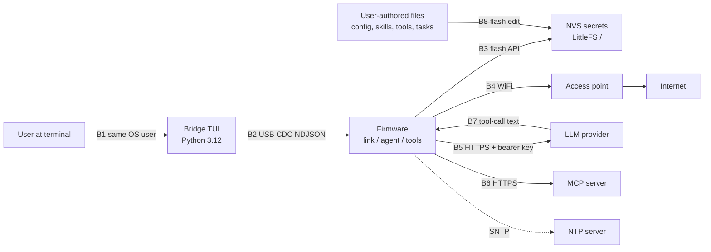

# 06 - Security Model

Status: derived from `docs/00-overview.md` (authoritative). Where this document and
the overview disagree, the overview wins.

Scope of this document: assets, trust boundaries, threat model, secret handling in
NVS, TLS policy, authorization of tools, and redaction rules. It does not redefine
config keys (see `docs/03-config.md`), protocol payload fields (see
`docs/04-protocol.md`), or module APIs (see `docs/02-firmware.md`).

## 1. Security posture in one paragraph

One device, one persona, one conversation. Secrets live only in NVS on the device.
The computer runs a terminal and nothing else: no keys, no history, no agent logic
(overview D7, section 1). There is no multi-role and no subagent execution, so
there is exactly one authority context and no privilege boundary inside the agent
loop to police. Security work therefore concentrates on four things: keeping
secret values off the wire and out of logs, verifying TLS peers, confining what a
model-driven tool call may touch, and treating physical possession of the device
as game over.

## 2. Assets

| ID | Asset | Where it lives | Loss impact |
|---|---|---|---|
| A1 | LLM API key (`nvs:<key>` from `llm.providers[].api_key_ref`) | NVS namespace `secrets` | Provider account abuse, billing |
| A2 | WiFi PSK (`nvs:<key>` from `wifi.networks[].password_ref`) | NVS namespace `secrets` | LAN access |
| A3 | MCP auth header (`nvs:<key>` from `mcp.servers[].auth_header_ref`) | NVS namespace `secrets` | Upstream account abuse |
| A4 | Agent configuration, prompts, skills, tools, tasks | LittleFS (`/`) | Behaviour control, tool abuse |
| A5 | `/workspace/` (agent-written files) | LittleFS | Data loss, tampering |
| A6 | Conversation history | Device RAM only | Disclosure (not persisted by design) |
| A7 | Trigger/schedule state | NVS namespace `runtime` | Misfires, replay |
| A8 | Composer history file (`$XDG_CONFIG_HOME/musteval/history.ndjson`) | Host filesystem, user config dir | Local disclosure of past prompts |

Notes on scope: conversation history is RAM-only in v1 (no persistence is specified
in the overview) so a reboot destroys it; A6 is conversation history and stays
RAM-only on the device; A8 is the bridge's composer recall, which is written to
the host config directory by design, contains only user-typed composer lines
(no model output, no secrets from the link), and is not the conversation.
`[ASSUMPTION]` history is not written to LittleFS.

## 3. Trust boundaries



| ID | Boundary | Data crossing | Control |
|---|---|---|---|
| B1 | User → bridge process | Keystrokes, displayed transcript | OS user account; bridge holds no secrets |
| B2 | Bridge → device over USB CDC | NDJSON envelopes, prompts, `secret.set` values | Line framing and size caps (`E_PROTOCOL`), no authentication in v1 (see section 9) |
| B3 | Firmware → flash | Config, prompts, NVS secrets | NVS namespace separation; LittleFS `/workspace/` is the only agent-writable path |
| B4 | Device → WiFi AP | Traffic, PSK during association | WPA2/WPA3 as configured by the AP; PSK from NVS only |
| B5 | Device → LLM provider | Prompt text, tool definitions, API key | TLS with certificate verification (section 5) |
| B6 | Device → MCP server | Tool calls, auth header | TLS with certificate verification; per-server `enabled` |
| B7 | Model output → tool executor | Tool names and JSON arguments | Frozen tool surface, gating flags, path confinement (section 6) |
| B8 | User-authored files → agent | System prompt, skills, declarative tools | Files are user-owned and trusted at the same level as the firmware config |

## 4. Threat model

Method: STRIDE-style enumeration against the assets in section 2. "Status" is the
state in v1; anything not closed is an accepted risk. Section 10 records how each
design question was settled.

| ID | Threat | Vector | Impact | Control in v1 | Status |
|---|---|---|---|---|---|
| T1 | Secret read-back over the link | A host process sends `config.get` or any command and expects values | A1-A3 disclosure | No wire message returns a resolved secret. The frozen `type` set and `command.name` set in overview section 6 contain no secret-read operation; `config.get` returns `secret_ref` strings (`nvs:<key>`) only | Closed by contract |
| T2 | Secret leakage into logs | `E_CONFIG` diagnostics, HTTP client debug logs, tool argument dumps | A1-A3 disclosure | Redaction rules in section 7; log hook emits NDJSON `log` messages with redacted fields | Closed by policy, tested in M5 |
| T3 | Secret leakage to the LLM provider | Prompt assembly or tool results including key material | A1 disclosure to third party | Secrets are resolved at use time by `net`/`llm`/`mcp`, never stored in message history or tool results; `/config.json` holds refs only, so `fs.read /config.json` cannot leak a value | Closed by design |
| T4 | Secret leaked by physical flash dump | SPI readout of NVS partition | A1-A3 disclosure | NVS encryption is enabled in v1 with a `nvs_keys` partition, so a dump of the `secrets` namespace is ciphertext. Flash encryption and secure boot are not enabled: the application image stays readable, and an attacker who can read the key partition's protection state may still recover values | Residual risk v1, see section 8 and OQ-1 in section 10 |
| T5 | Link injection into framing | Raw bytes, partial lines, oversized lines | Agent hijack, memory exhaustion | NDJSON only (D9); 4 KiB RX / 16 KiB TX caps; malformed or oversized input rejected with `E_PROTOCOL` and the line discarded, link stays alive | Closed, acceptance M1 |
| T6 | Command replay from host | Re-sending a captured `command` envelope | Unintended `reboot`, `config.set`, `secret.set` | No nonce and no per-frame signature: `link_token` (section 9) is checked only in `hello`, so any valid envelope sent on an already-open port is executed. It is a weak authenticator, not a session. Mitigation is host trust | Accepted risk v1, see T13 |
| T7 | Write tool abuse by the model | Prompt injection from tool output or web content asks for `gpio.write` / `i2c.write` / `fs.write` | Hardware actuation, bus actuation, file tampering | All three refused unless `tools.allow_dangerous` is `true`; `fs.write` confined to `/workspace/`; `tasks.json` is writable only through `task.set`, which is itself gated by `tools.allow_dangerous` and capped by `tools.task_max`, so injected text cannot persist a trigger that survives the gate | Closed, acceptance M4 |
| T8 | Arbitrary outbound HTTP by a declarative tool | Model or `/tools/*.json` targeting an unlisted host | Exfiltration, SSRF | Tools refused unless the URL host is in `tools.http_allow_hosts`; scheme must be `https`, never `http` (rule frozen, see `03-config.md` §tools) | Closed, acceptance M4 |
| T9 | Malicious MCP server | Server returns hostile tool names or tool results | Prompt injection, namespace collision | Tools namespaced `mcp.<server_id>.<tool_name>`; `enabled:false` removes the server; a failing server surfaces `E_MCP` and does not abort the run | Closed, acceptance M5 |
| T10 | Rogue AP or DNS redirection | Attacker AP with same SSID, DNS spoof | Traffic interception, key theft | TLS certificate verification on every outbound HTTPS request; no insecure-skip flag exists | Closed, acceptance M3 |
| T11 | Clock skew breaks or bypasses TLS | Boot before NTP sync, wrong time | False "expired certificate" failures or wrong trust decisions | Verification is unconditional; before `ntp_synced` an LLM call may fail and is reported as `E_LLM_UNAVAILABLE`; the device never falls back to unverified TLS | Closed by design |
| T12 | Flash wear attack via task triggers | Rapid repeat writes of trigger state | Storage exhaustion | Volatile trigger state (`last_fired`, `fired_count`, sync timestamps) goes to NVS namespace `runtime`, not LittleFS | Closed by design |
| T13 | Unauthorized serial access on the workstation | Any local process opening the CDC device | Full agent control, secret overwrite | Optional boot-time `link_token`, checked in `hello` and unset by default (section 9). It crosses the link in cleartext, so it stops a process that opens the port naively, not a host attacker with the user's privileges. Single-user workstation assumption otherwise | Accepted risk v1, see section 9 |
| T14 | Bridge compromising the device | Compromised bridge sends hostile prompts | Agent misuse, but no secret disclosure | Bridge has no keys and no history; worst case is the same as a local user typing a prompt | Accepted risk v1 |
| T15 | Secret clobbering / downgrade | `secret.set` with empty or short value, unresolved ref silently emptied | Auth failures masked as success | Unresolved ref is `E_CONFIG` at boot, never a silent empty substitution (overview section 4); empty `secret.set` value is `E_CONFIG`, never deletion | Closed by contract, acceptance M2 |
| T16 | MQTT broker compromise: credential theft, publish spoofing, topic injection | Attacker reads `mqtt.servers[].password_ref`, injects a forged `mqtt.message`, or tricks the model into publishing to a topic the user never configured | Credential disclosure, actions fired on a fabricated inbound message, outbound data leak to an unknown topic | Broker password only as a `nvs:<key>` ref (resolved in the `mqtt` module, never on the wire or in a tool result); topics restricted to `mqtt.servers[].topics[]`, which is the allowlist; `mqtt.publish` refuses any server id or topic absent from config with `E_MQTT` (S13); `tls: true` means certificate-verified TLS with no plaintext fallback (section 5); inbound payloads are truncated to the RX cap and sanitised (control bytes and invalid UTF-8 stripped) before they become an `mqtt.message` frame | Closed, acceptance M6 |
| T17 | Geolocation privacy: the device's position leaves the local network | `geo.locate` sends scanned BSSIDs, or the public IP as a fallback, to a third-party provider | Location disclosure to an unrelated service; provider learns the household's position and network fingerprint | `geo.enabled` defaults to `false`, so nothing leaves the device until the user opts in (`E_CONFIG` otherwise, S14); a fix is cached for `geo.cache_ttl_s`, so repeated calls do not mean repeated disclosure; accuracy is reported with the fix rather than implied; `geo.providers[]` order is user-controlled and the `ip` provider is the documented last resort; the response states that a BSSID-derived fix locates the access point, which is not necessarily the device | Accepted risk, explicit opt-in, acceptance M6 |
| T18 | Resolved header secret logged or reflected | A declarative tool's `http.headers` value is `nvs:<key>`; a naive implementation substitutes the value before the argument object is emitted, so it lands in `agent.tool`, `agent.tool_result`, or a `log` message | Secret disclosure over the link and in bridge scrollback | Resolution happens inside the HTTP layer after header assembly: the tool-argument object only ever holds the literal `nvs:<key>`; `agent.tool`, `agent.tool_result` and `log` redact resolved values (section 7); a sentinel-secret capture covers the whole path (S12b, S15) | Closed, acceptance M6 |

## 5. TLS policy

| Rule | Detail |
|---|---|
| Verification always on | Every outbound HTTPS request (LLM provider, MCP server, declarative HTTP tool) uses mbedTLS via `esp_http_client` with the ESP-IDF CA bundle attached and hostname verification enabled. There is no config key to disable verification and no `setInsecure`-style path |
| No plaintext fallback | `http://` provider base URLs are a config error (`E_CONFIG`). A verification failure is `E_LLM_UNAVAILABLE` (provider) or `E_MCP` (MCP) and is not retried without TLS |
| Time dependency | Certificate validity needs a sane clock. Calls made before `ntp_synced` may fail verification; the failure is reported, not suppressed |
| Scope of trust store | The bundled ESP-IDF root store only. Custom CA injection or certificate pinning is not in v1 |
| Mutual TLS | Not supported in v1 (device holds no client certificate) |
| Key material | The bearer API key and MCP auth header are read from NVS into RAM per request, used for the `Authorization` header, then released. They are never written to LittleFS or to the link |
| Cipher and memory | Default mbedTLS configuration plus PSRAM for buffers; TLS handshake heap cost is a real constraint on the XIAO (8 MB octal PSRAM, 512 KB SRAM) and is measured in M3 |

## 6. Authorization model

The only authorization decisions in v1 are tool gating and path confinement. There
are no users, roles, or per-tool ACLs: one persona, one authority context (overview
section 1.2, "No multirole").

| Capability | Gate | Failure code |
|---|---|---|
| `gpio.read`, `adc.read`, `i2c.scan`, `i2c.read`, `time.now`, `fs.list`, `fs.read`, `skill.read`, `task.list`, `event.emit`, `mqtt.list`, `todo`, `memory.get`, `memory.list`, `sys.diagnostics` | Always available (peripheral and heap bounds noted below) | `E_TOOL` on runtime failure |
| `gpio.write`, `i2c.write`, `fs.write`, `fs.delete`, `task.set` | `tools.allow_dangerous` must be `true` | `E_TOOL` (refused) |
| `memory.set`, `memory.delete` | No gate; bounded by `tools.memory_max_bytes` and the 32-key cap instead. Nothing escapes NVS: no path, no actuation, no network | `E_TOOL` (over cap or reserved key) |
| `fs.write` / `fs.delete` target | Must resolve under `/workspace/`, which is the `wsfs` mount; `userfs` has no tool-reachable write path | `E_TOOL` |
| `fs.list` target | Both mounts are listable; nothing outside them | `E_TOOL` |
| `http.get`, Declarative tool (`/tools/*.json`) | URL must be `https` and its host must appear in `tools.http_allow_hosts`; any `nvs:` header ref must resolve at load time | `E_TOOL` / `E_CONFIG` |
| MCP tool (`mcp.<server_id>.<tool_name>`) | Server must exist and be `enabled: true` | `E_MCP` |
| `geo.locate` | `geo.enabled` must be `true` | `E_CONFIG` |
| `mqtt.publish` | Server ID AND topic must pre-exist in `mqtt.servers[].topics[]` | `E_MQTT` |
| Any write to `/config.json` | Never exposed as a tool; only the `config.set` and `fs.put` commands write it | n/a |
| Write to `/tasks.json` from the `task.set` tool | `tools.allow_dangerous` must be `true`, and the write must stay under `tools.task_max` | `E_TOOL` |
| Write to `/tasks.json` from the `tasks.set`/`tasks.delete` commands | No `tools.*` gate - the frame can only originate from the bridge. Bound by schema `tasks[]` cap (16) and the 8 KiB file limit | `E_CONFIG` |
| `fs.read` on `/config.json` (or `/fs/config.json`) | Refused: the model may not read the host config file (OQ-6) | `E_TOOL` |

**This table is the sole authority for tool gating.** Other documents name the gate
a tool needs but do not restate the matrix: `00-overview.md` §7 owns the frozen
*set*, `03-config.md` §tools owns the config keys that the gates read, and each
domain file under `tools/` states only its own tools' argument-level refusals. If a
gate changes, this table and `S6` change together.

### 6.1 Workspace confinement

`/workspace/` is the agent's only writable location **and a different filesystem**:
partition `wsfs`, mounted at `/workspace`; the user tree is partition `userfs`,
mounted at `/fs` (`docs/01-hardware.md` §4). Three layers, each with a different
job — none of them is sufficient alone:

1. **Mount boundary (traversal).** VFS normalises before dispatch, so
   `/workspace/../config.json` resolves at the `wsfs` root where `..` yields
   `ENOENT`. No `..` chain crosses a mount point. This does **not** stop an
   absolute `/fs/...` path; VFS dispatches that to `userfs` happily.
2. **Resolver (path validation).** One function canonicalises and requires the
   `/workspace/` prefix before any open:

   1. Reject empty paths and paths not starting with `/`.
   2. Normalise by splitting on `/`, dropping empty and `.` segments, and processing
      `..` by popping one segment. A `..` that would pop above the root is a
      rejection, not a clamp.
   3. Rebuild the canonical path, then require the literal prefix `/workspace/` with
      at least one further segment (`/workspace/` alone is not a file target).
   4. Reject any segment containing a NUL, and any path whose length exceeds the
      LittleFS limits in `docs/03-config.md`.
3. **No-write-API discipline (last line).** Only three call paths open `userfs` for
   writing, and every one of them is host-only except `task.set`:
   - the `config.set` command (for `/fs/config.json`),
   - the host-only `fs.put` command (for `/fs/skills/`, `/fs/prompts/` and
     `/fs/tools/`, path-allowlisted in `04-protocol.md` §4.16),
   - the `task.set` tool (for `/fs/tasks.json` via `store_task_write()`), the only
     model-reachable writer, gated by `tools.allow_dangerous`.

   No generic filesystem entry point exists for either mount, so an absolute
   `/fs/...` path has nothing to reach even if the resolver were bypassed. This is a
   review rule, not an accident: `S6d` keeps it true, and its expected caller count
   is three.

| Input | Result |
|---|---|
| `/workspace/notes.md` | allowed, VFS `/workspace/notes.md` |
| `/workspace/sub/../notes.md` | allowed, normalises to `/workspace/notes.md` |
| `/workspace/../config.json` | `E_TOOL`; mount boundary also rejects it |
| `/workspace/../../config.json` | `E_TOOL`, escapes above root |
| `/workspace/./a/./b.txt` | allowed, normalises to `/workspace/a/b.txt` |
| `/config.json` | `E_TOOL`, maps to `/fs/config.json`, not writable by any tool |
| `/fs/config.json` | `E_TOOL`; resolver rejects, and no layer below would stop it |
| `workspace/notes.md` | `E_TOOL`, not absolute |
| `/workspace/data/../../skills/x.md` | `E_TOOL` |

`fs.read` is not sandboxed -- reading is not a write -- but it can reach `/fs`, which
is intentional: the agent may read its own skills, prompts and tools. One path is carved
out: `/config.json` (i.e. `/fs/config.json`) is refused with `E_TOOL`, because the model
needs no view of the host config and the file names the allowlisted hosts. The restriction
is on the tool, not on the `config.get` command, which stays host-only and still returns
the file (section 10, OQ-6). NVS has no mount point, so NVS key material is unreachable
regardless. The partition split exists to bound destruction; disclosure is bounded
separately by T3 (no secrets in files).
is intentional: the agent may read its own skills, prompts and tools. NVS has no
mount point, so NVS key material is unreachable regardless. The partition split
exists to bound destruction; disclosure is bounded separately by T3 (no secrets
in files).

Enforcement point: `store_write_data()` and `fs.write` share one resolver. A tool
that re-implements path logic is a bug, and adding a second path-checking site is
how this boundary gets bypassed.

What each layer actually buys, stated without overclaiming:

| Attack | Mount boundary | Resolver | No-write-API rule |
|---|---|---|---|
| `/workspace/../config.json` | stops it: normalises to `wsfs` root, `..` is `ENOENT` | stops it | stops it |
| Path accepted without canonicalisation, still under `/workspace/` | contained: the write lands in `wsfs` | does not stop it | contained |
| Path accepted as absolute `/fs/config.json` | **does not stop it**: VFS dispatches to `userfs` | stops it | **stops it**: no tool path opens `userfs` for writing |
| New `store` entry point that writes `userfs` | does not stop it | does not stop it | review-blocking change |

The split buys one real guarantee — traversal escapes die at the mount — plus a
blast-radius bound when a resolver bug admits a path relative to `wsfs`. It does
**not** make a fully bypassed resolver safe: an absolute `/fs/config.json` opened
`O_WRONLY` succeeds. That case rests on API discipline
(`02-firmware.md` §`store`: no entry point writes `userfs` except `config.set`
`fs.put` and `store_task_write()`), and `S6d` is the test that keeps it true.

### 6.2 Workspace quota

Confinement bounds *where* the agent writes; the quota bounds *how much*. The mount
split already stops a full `wsfs` from breaking `config.set`/`reload`, so the quota
is an availability control: it keeps the agent from filling its own filesystem and
then failing every write until reset.

| Limit | Value | Failure |
|---|---|---|
| Total bytes under `/workspace/` | 64 KiB `[ASSUMPTION]` | `E_STORAGE` |
| File count under `/workspace/` | 64 `[ASSUMPTION]` | `E_STORAGE` |
| Single file | 16 KiB `[ASSUMPTION]` | `E_STORAGE` |

Checked before truncation: a write whose final size would exceed any limit is
refused without touching the existing file, so a rejected write cannot destroy
prior contents. Overwriting an existing file counts the new size, not both.

Deleting is exposed via `fs.delete` in v1, gated by `tools.allow_dangerous` and
confined to `wsfs` through `store_delete_file()`. Quota is recomputed from the
directory state after a delete rather than decremented, so free space is never
over- or under-counted and a failed unlink changes nothing. Growth is therefore
not strictly monotonic. The only other ways space is reclaimed are a `wsfs` reformat
or a full reflash, both of which require the user to act outside the session. `S17`
pins the recompute.

### 6.3 The `store_task_write()` carve-out

`userfs` accepts writes from three host-visible callers (barrier 3 in §6.1):
`config.set` touching `/fs/config.json`, `fs.put` touching a path-allowlisted file,
and `store_task_write()` touching `/fs/tasks.json`. The third is the only one with a
model-facing entry point, and it has three callers with unequal authority:

| Caller | Gate | Add | Update | Delete |
|---|---|---|---|---|
| `task.set` tool | `tools.allow_dangerous` + `tools.task_max` | yes | yes | **no** |
| `tasks.set` command | none (host-originated) | yes | yes | no |
| `tasks.delete` command | none (host-originated) | no | no | yes |

None of them can touch `config.json`. Every write through any caller is validated
against the task schema before being committed to flash.

Deletion is split away from the tool on purpose. `task.set` has no delete mode, so a
model that is fully convinced by injected text still cannot remove a task that the
user scheduled. The host removes tasks with the `tasks.delete` command, which the
model has no path to reach: `command` frames are bridge-to-device only, and the
device never re-issues one to itself. That is the same reasoning that keeps
`config.set` out of the tool surface - destructive edits stay user-initiated.

Consequences worth stating explicitly:

- A model that is fully convinced by injected text still cannot exceed the table
  of available tools, the host allowlist, or the workspace quota.
- Skills and prompts are user-authored files, trusted at the same level as config.
- Because `tasks.json` can be machine-written via `task.set`, persistence is
  capped by the schema's 16-entry array limit and every write is validated against
  the schema; the tool's own ceiling is the stricter `tools.task_max`.
  A successful prompt injection cannot create an unbound number of scheduled
  actions; the worst case is bounded by these limits and `llm.max_tool_rounds`.

### 6.4 MQTT and geolocation inputs

Broker payloads and positioning responses are **untrusted input that reaches the
prompt**. `mqtt_message` tasks and `geo.locate` results are wrapped in delimiters
that the system prompt declares as data, never as instructions
(T16, T17). Neither is auto-injected into a running conversation: a payload
enters the model only through a matched trigger, and position only when the model
calls `geo.locate`.

## 7. Redaction rules


Canonical rule: **a resolved secret value is never emitted anywhere.** Only the

reference (the literal `nvs:<key>` string) may be printed, logged, or returned.

| Item | May appear in | Rule |
|---|---|---|
| API key / PSK / MCP auth header value | RAM only, inside the outbound HTTP header | Never formatted into a log, a `log` message, a `command.result`, an `agent.tool` argument dump, or an `agent.error` message. `E_LLM_UNAVAILABLE` carries the provider's rejection body (`02-firmware.md` §llm), which is third-party text, so the firmware scrubs the resolved key from it before the frame is emitted (`llm_redact`) rather than trusting the provider not to echo |
| `secret_ref` string (`nvs:<key>`) | `config.json`, `config.get` result, diagnostics | Returned verbatim; never substituted with the value |
| `secret.set` request value | Link RX, NVS write | Not echoed, not logged, not included in the `command.result`; the result carries success/failure only |
| Resolved header value (`nvs:<key>` from a declarative tool `http.headers`) | Outbound HTTP header only, inserted by the HTTP layer | Resolved after header assembly, so it never exists as a tool argument; redacted in `agent.tool`, `agent.tool_result` and `log`; covered by S12b and S15 |
| NVS key name | `E_CONFIG` diagnostics | Allowed (name only, e.g. `nvs:llm_api_key`), so the user can fix the reference |
| `Authorization` header | HTTP client internals | Excluded from HTTP debug logging; header dumps are not enabled |
| WiFi `password_ref` | `config.get` output | Same rule as any ref: ref only |
| Tool arguments containing paths or URLs | `agent.tool` events | Emitted as-is; URLs are already allowlist-bounded, paths confined to `/workspace/` |
| Bridge transcript | TUI scrollback | Displays device output unchanged; it has no secrets to redact because none cross the link |

Example of a compliant diagnostic (envelope fields per overview section 6; payload
fields are owned by `docs/04-protocol.md`):

```json
{"v":1,"type":"log","id":"d-4","ts":1762041600,"level":"error","tag":"cfg","msg":"secret_ref nvs:llm_api_key did not resolve","t_ms":1840}
```

The failing `secret_ref` is reported by name in `msg`, never by value; the frame shape
is owned by `docs/04-protocol.md` §3.10.

Example of a compliant `config.get` view: references preserved, values absent.

```json
{
  "version": 1,
  "llm": {
    "providers": [
      {
        "id": "primary",
        "base_url": "https://api.example.com/v1",
        "model": "example-model",
        "api_key_ref": "nvs:llm_api_key",
        "timeout_ms": 30000,
        "max_output_tokens": 1024
      }
    ]
  },
  "wifi": {
    "networks": [
      {
        "ssid": "home",
        "password_ref": "nvs:wifi_home",
        "priority": 1
      }
    ]
  }
}
```

The test agent (`10-test-agent.md`) receives `secret.set` frames when a developer points
it at a live session. It returns only the key and the value length, never the value,
and `04-protocol.md` §3.6 forbids the value from travelling device `→` bridge at all.

## 8. NVS secret handling

| Aspect | Rule |
|---|---|
| Namespace | `secrets`, per overview section 3. `runtime` holds volatile trigger state and never secrets |
| Key syntax | At most 15 characters, `[A-Za-z0-9_]` only. Valid: `llm_api_key`, `wifi_home`, `mcp_gh_token`. Invalid: `llm-api-key`, `openai_api_key_primary` |
| Reference syntax | `nvs:<key>`, exactly. `config.json` stores references only, so the file is safe to dump and share (D7) |
| Resolution | At load time and at each use, from namespace `secrets`. Missing, empty, or malformed reference is `E_CONFIG` reported at boot; never silently replaced with an empty value |
| Write path | Only via the `secret.set` link message (`command.name` includes `secret.set`). No HTTP endpoint, no filesystem path, no tool can write NVS `secrets` |
| Read path | None over the link. Internal `cfg` API only, returned to `llm`/`mcp`/`net` for header construction |
| Rotation | Send `secret.set` with the new value, then `reload` (or reboot). In-flight requests keep the old value |
| Erasure | `idf.py erase-flash` destroys all secrets; re-provisioning is required. There is no recovery path, by design |
| Encryption | NVS encryption is enabled in v1 with a `nvs_keys` partition; keys are generated once at first boot or at provisioning. Flash encryption and secure boot are not enabled, so a flash dump yields ciphertext for the `secrets` namespace but the application image stays readable, and an attacker who can read the protection state of the key partition may still recover values |

Provisioning flow, first boot on a fresh device:

1. Flash firmware (`idf.py -p <port> flash monitor`).
2. Bridge sends `secret.set` for each key named in `config.json`.
3. Bridge sends `reload`; `cfg` re-reads `/config.json` and re-resolves every ref.
4. Any unresolved ref surfaces as `E_CONFIG` in the `log` stream with the key name.

## 9. Link trust model

The USB-Serial/JTAG CDC link is unauthenticated unless a `link_token` is provisioned. Any local process that can
open the device node can then send prompts, `config.set`, `secret.set`, and `reboot`.
That is accepted because:

- the device is physically attached to a single-user workstation,
- the bridge holds no secrets, so compromising the bridge gains nothing that
  typing a prompt would not gain,
- there is no secret read-back path (T1), so the blast radius is behaviour and
  availability, not key material.
Link token (OQ-4 answer). The secret lives in NVS namespace `secrets`, key `link_token` (`nvs:link_token`), and is not set by default, so the link stays open until the user provisions it. `hello` carries one optional field, `token` (string, 1..64 characters); it is required when the key is provisioned and must be omitted otherwise. On a wrong or missing token the device sends no `hello_ack`: it emits one `event` frame with `kind:"link.rejected"` and `data:{"reason":"auth"}`, then closes the port, and the bridge reports the error without retrying. This adds a `hello` field, not an envelope field: the frozen envelope in overview section 6 is unchanged.

What it buys, without overclaiming: the token crosses the USB link in cleartext. It stops a process that opens the port naively; it stops nothing against a hostile host with the user's privileges, which can read the token from the bridge config, from a capture, or simply use the open port before the check. It is a weak authenticator, not a session: it is checked only in `hello`, so command replay after a successful handshake (T6) is unaffected, and T13 stands.
Framing rules that protect the device from a hostile or buggy host:

| Condition | Behaviour |
|---|---|
| Line exceeds `serial.max_line_bytes` (default bounded by the 4 KiB RX cap) | Line discarded, `E_PROTOCOL` |
| Invalid JSON | Line discarded, `E_PROTOCOL` |
| Missing or wrong `v` | Line discarded, `E_PROTOCOL` |
| Unknown `type` | `E_PROTOCOL`, no state change |
| Device TX object exceeds the 16 KiB cap | `agent.final` is truncated; every other frame is refused with `E_PROTOCOL` (matching every other framing-capped failure in section 9); `agent.final` still truncates instead (OQ-3) |
| Raw non-JSON bytes on the link | Impossible by construction: ESP-IDF logging is hooked to emit `log` messages (D9) |

## 10. Resolved design questions

Every question below was open during design and is now answered. The IDs are kept
so references elsewhere stay and nothing is reopened by accident.

**OQ-1 — NVS encryption, flash encryption and secure boot?** NVS encryption only.
A `nvs_keys` partition is added to the hardware layout and NVS encryption is
enabled in v1; the keys are generated once at first boot or at provisioning. Flash
encryption and secure boot are not enabled. A flash dump therefore no longer
yields secrets in cleartext, but the application image stays readable, and an
attacker who can also read the key partition's protection state may still recover
data. `S18` checks the secret path.

**OQ-2 — Pin the provider CA instead of using the bundle?** No. The ESP-IDF bundle
is trusted as shipped; there is no pinning and no custom CA injection. Residual
risk: any compromised public CA can issue a certificate for a provider host and
impersonate it, and certificate verification cannot detect that. Accepted for
v1; no code change follows from the answer.

**OQ-3 — Oversized TX: `E_PROTOCOL` or `E_INTERNAL`?** `E_PROTOCOL`. A non-final
frame above the 16 KiB TX cap is refused with `E_PROTOCOL`, matching every other
framing-capped failure in section 9; `agent.final` still truncates rather than
erroring, because a truncated final answer is still a usable answer.

**OQ-4 — Any link authentication at all?** A boot-time shared token, sent in `hello`.
The device holds at most one token in NVS namespace `secrets` under key
`link_token` (`nvs:link_token`). It is optional and unset by default, so the link
stays open exactly as before until the user provisions one. When set, `hello.token`
is required; a missing or wrong token produces `event` with `kind:"link.rejected"`
and `data:{"reason":"auth"}`, then the port closes, and the bridge does not retry.
The token crosses the USB link in cleartext: it stops a process that opens the port
naively, not a host attacker who already has the user's privileges.

**OQ-5 — Should empty `secret.set` values be rejected or accepted as deletion?**
Rejected with `E_CONFIG`; it never deletes. Erasure stays `idf.py erase-flash`
plus re-provisioning (section 8), so a mistyped or truncated value cannot silently
remove a working credential and a missing credential surfaces as `E_CONFIG` at
resolution time rather than as a blank success.

**OQ-6 — Is `fs.read` allowed on `/config.json`?** Denied with `E_TOOL`. The file
holds `nvs:` references only, so this is not a secret leak (T3 still stands); it is
refused because the model would otherwise ingest a file it has no reason to read,
which is a prompt-injection surface, and because the file names the allowlisted
hosts and other operator choices. Note the asymmetry: the restriction applies to
the `fs.read` tool only. `config.get` is a host-only command that still returns the
file, since the user typed it.

No question in this document remains open.

Two further questions were settled during design and are no longer open. They are
listed here so the ID sequences stay stable and nobody reopens them by accident:

- **OQ-7 — does `fs.delete` ship in M4?** Yes, from M6, gated by
  `tools.allow_dangerous` and confined to `wsfs`.
- **OQ-8 — should MQTT payloads be fed to the LLM automatically?** No. A payload
  reaches the model only through a trigger whose `payload_contains` matched.

## 11. Security acceptance checklist

Each item is exercised by a roadmap milestone; failures are release blockers.

| # | Check | Milestone |
|---|---|---|
| S1 | Unresolved `secret_ref` yields `E_CONFIG` naming the key, boot continues in degraded mode | M2 |
| S2 | `config.get` output contains only `nvs:` refs; no value anywhere in the reply | M2 |
| S3 | Sentinel-secret grep: after `secret.set` of a known sentinel, a full link capture contains zero occurrences of the sentinel | M5 |
| S4 | 6 KiB link line, malformed JSON, and unknown `type` each produce `E_PROTOCOL` without reset | M1 |
| S5 | Provider with an expired or self-signed certificate fails; no insecure retry exists in the code | M3 |
| S6 | `gpio.write`, `i2c.write` and `fs.write` refused with `tools.allow_dangerous: false`; `fs.write` outside `/workspace/` refused when enabled, including `..` traversal that resolves outside it | M4 |
| S6b | `fs.write` that would exceed the `/workspace/` quota returns `E_STORAGE` without modifying the target file | M4 |
| S6c | Deleting `wsfs` and rebooting reformats only `wsfs`; `/fs/config.json` survives, proving the mounts are independent filesystems | M0 |
| S6d | A source audit of every `open(..., O_WRONLY/O_RDWR/O_CREAT)` site finds exactly three `userfs`-reachable callers, all sanctioned: `config.set` writing `/fs/config.json`, `fs.put` writing a path-allowlisted file under `/fs`, and `store_task_write()` writing `/fs/tasks.json`. Of the three only `task.set` is model-reachable. Every other write target is `/workspace/*`, and `fs.write` or `fs.delete` against `/fs/config.json` returns `E_TOOL`. NVS writes are not filesystem writes and are enumerated separately: the `memory` namespace is written only by `memory.set` / `memory.delete`, `secrets` only by `secret.set`, and `runtime` by the boot guard (`boot_failures`), task bookkeeping (`last_fired`, `fired_count`), the clock sync timestamp, and the LLM budget counters. None of these is reachable as a path by any tool | M4 |
| S6e | `task.set` cannot remove an entry: a task object carrying any key outside the `03-config.md` task schema is refused with `E_TOOL` and `tasks.json` is unchanged; `enabled: false` leaves the entry present in `tasks.list` | M6 |
| S7 | Declarative tool to a host absent from `tools.http_allow_hosts` is refused with `E_TOOL` | M4 |
| S8 | Disabled or unreachable MCP server yields `E_MCP` and the agent run still completes | M5 |
| S9 | Second `prompt` while a run is active returns `E_BUSY` rather than interleaving | M4 |
| S10 | `fs.delete`, `task.set` and `i2c.write` refused with `tools.allow_dangerous: false` | M6 |
| S11 | `mqtt.list` returns server IDs and topics only; no password material emitted | M6 |
| S12 | `tls: true` MQTT server with plaintext endpoint fails closed; no fallback | M6 |
| S12b | Unit test: a resolved `nvs:` header value is absent from `agent.tool`, `agent.tool_result` and `log` output | M6 |
| S13 | `mqtt.publish` to an unknown topic or server ID returns `E_MQTT` | M6 |
| S14 | `geo.locate` returns `E_CONFIG` when `geo.enabled: false` | M6 |
| S15 | Sentinel-secret capture: full link trace shows the resolved header secret is never emitted, and the unit test covers `agent.tool`, `agent.tool_result` and `log` (`S12b` is the unit-level half) | M6 |
| S16 | `task.set` beyond `tools.task_max` returns `E_TOOL` and `tasks.json` remains unchanged | M6 |
| S16b | `tasks.delete` of an unknown id returns `E_CONFIG` and `tasks.json` is byte-identical; `tasks.set` for an existing id updates in place and leaves `count` unchanged | M6 |
| S16c | After `tasks.delete`, `tasks.list` omits the id and a re-`tasks.set` of the same id reports `fired_count: 0` | M6 |
| S17 | After `fs.delete` of a `/workspace/` file, the reported free space equals a fresh directory walk, and a delete of a non-existent or `/fs` path changes nothing | M6 |
| S18 | Sentinel-secret grep: after `secret.set` of a known sentinel into `secrets`, read the NVS partition over the serial bootloader: the sentinel does not appear in cleartext | M5 |
| S19 | `llm.max_calls_per_hour: 2` with a three-provider chain: calls 1 and 2 charge one attempt each, call 3 returns `E_LLM_RATE` before any socket is opened, and a failover inside call 2 does not charge a third | M3 |
| S20 | Safe mode: a `boot` task that aborts on every start reaches safe mode after `safe_mode_after` failures; `prompt` and `tasks.run` return `E_SAFE_MODE`, `status` and the full host command set still answer over the link, no MQTT client is connected, and `config.set` plus `reload` clears the flag and the counter | M0 |
| S21 | `memory.set` into a reserved prefix returns `E_TOOL`, and no `memory.*` value can be reached by any `fs.*` path or appears in `agent.tool_result` for a `fs.read` | M4 |
