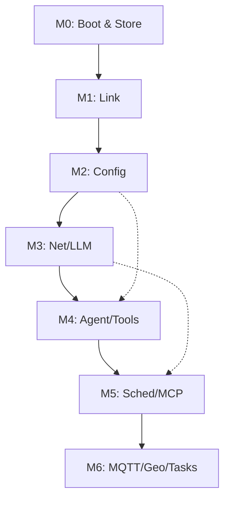

# 07 - Roadmap & Milestones

Status: derived from `docs/00-overview.md`. This document maps the frozen requirements and decisions to a phased implementation plan.

## 1. Implementation Phases
The project is divided into 7 milestones (M0-M6). A milestone is considered "done" only when all its acceptance tests pass on target hardware (Seeed Studio XIAO ESP32-S3) using the production toolchain.

### M0: Board Bring-up & Storage
Goal: Establish a bootable baseline with correct memory and storage layout.
- **Scope**: Target configuration, PSRAM, dual LittleFS partitions, NVS namespaces, LED.
- **Deliverables**: `app`, `store` modules.
- **Acceptance Tests**:
 - `idf.py set-target esp32s3 build flash monitor` → Boots, prints PSRAM: 8MB (octal), and logs both mounts: `userfs` at `/fs` (`3932160` bytes) and `wsfs` at `/workspace` (`1048576` bytes).
 - Cross-mount isolation: after writing `/workspace/probe.txt`, `open("/workspace/../config.json", "r")` fails with `ENOENT`; formatting `wsfs` leaves `/fs/config.json` intact.
 - Corrupt-`wsfs` recovery: erase `wsfs` from the monitor, reboot, firmware reformats it and boots; the same test on `userfs` halts with `E_STORAGE` instead of wiping.
 - NVS namespaces `secrets`, `runtime` and `memory` initialized.
 - Boot guard: three consecutive boots that halt before the scheduler starts set `sys.safe_mode: true` on the fourth; a boot that reaches idle resets `boot_failures` to `0`; a `safe_mode_after` outside 2..10 falls back to the default `3` instead of locking the device out.
 - LED on GPIO21 toggles via simple driver.
 - `idf.py size` verifies flash budget fits 8MB and the partition table matches `01-hardware.md` §4 offsets.
- **Non-goals**: Network, Link, LLM.

### M1: Link & Transport
Goal: Establish the NDJSON communication channel with the Bridge.
- **Scope**: USB CDC, NDJSON framing, basic command dispatch, log bridging.
- **Deliverables**: `link` module; bridge-side `protocol` + `link` + `client` packages, importable and testable without Textual so M1's `hello`/`hello_ack` and `ping`/`pong` acceptance tests run headless via `FakeTransport`. Also `bridge/tools/test_agent.py`, the fake peer these tests run against headlessly over a pty (`10-test-agent.md`).
- **Acceptance Tests**:
 - Connect `uv run bridge` → `hello` / `hello_ack` exchange successful.
 - `ping` / `pong` cycle < 10ms.
 - `status` command returns current device state.
 - Input validation: Send 5 KiB line → `E_PROTOCOL` emitted; malformed JSON → `E_PROTOCOL`. Link survives without reboot.
 - Log hook: `ESP_LOGI` prints in monitor as NDJSON `log` messages while link is open (D9).
 - `uv run bridge --target test --port <pty>` completes `hello`/`hello_ack`, `ping`/`pong` and one `command` round trip against `bridge/tools/test_agent.py`, with no board attached.

Firmware status: `hello`/`hello_ack`, `ping`/`pong` and `status` are wired in `link`, not only in the fake agent.

### M2: Configuration & Static Assets
Goal: Implement the frozen config schema and secret resolution.
- **Scope**: `/config.json` parsing, `secret_ref` resolution, `config.get/set`, `secret.set`.
- **Deliverables**: `cfg` module.
- **Acceptance Tests**:
 - Boot with an unresolved `secret_ref` (e.g., `nvs:missing_key`) → Monitor emits `E_CONFIG` naming the key; device continues in degraded mode.
 - Bridge sends `secret.set` → Value stored in `secrets` namespace; `reload` command re-resolves refs without reboot.
 - `config.get` returns `secret_ref` strings (e.g., `"nvs:llm_api_key"`) and never the resolved values.
 - Filesystem baselines: `/prompts/`, `/skills/`, `/tools/` read-only; `/workspace/` writable.

### M3: Network, Clock & LLM
Goal: Secure connectivity to the AI provider.
- **Scope**: WiFi (failover), SNTP, mbedTLS, OpenAI-compatible API, provider fallback.
- **Deliverables**: `net`, `clock`, `llm` modules.
- **Acceptance Tests**:
 - WiFi: Connect to multiple networks in `wifi.networks[]`; first failure (wrong password) logs `E_WIFI` then connects to second.
 - Clock: `ntp_synced` event fires; clock discipline verified via `time.now`.
 - LLM: Non-streaming prompt → `agent.start` (spinner) → `agent.final`.
 - TLS Security: Connect to host with self-signed cert → fails with `E_LLM_UNAVAILABLE`; no plaintext fallback.
 - Fallback: First provider unreachable → second provider used transparently.

### M4: Agent Loop & Tool surface
Goal: implement the serialized agent run and the tool execution engine.
- **Scope**: Agent state machine, tool round logic, built-in tools, declarative tools, gating, `fs.put` import path.
- **Deliverables**: `agent`, `tools`, `skills` modules.
- **Acceptance Tests**:
 - Serialized runs: Second `prompt` while agent is active returns `E_BUSY`.
 - Tool round: `time.now` and `gpio.read` execute successfully.
 - Gating: `gpio.write` returns `E_TOOL` (refused) if `tools.allow_dangerous` is `false`.
 - Path confinement: `fs.write` to `/config.json` returns `E_TOOL`; `fs.write` to
   `/workspace/test.txt` succeeds if allowed; `fs.write` to `/workspace/../config.json`
   and `/workspace/a/../../config.json` both return `E_TOOL`; `/workspace/sub/x.txt`
   creates the file under the sandbox.
 - Sandbox normalisation: `fs.write` to `/workspace/./a//b.txt` resolves to
   `/workspace/a/b.txt` and succeeds; `fs.write` to `workspace/x.txt` (relative)
   returns `E_TOOL`.
 - Workspace quota: writes that would exceed 64 KiB or 64 files return
   `E_STORAGE` and leave the existing file intact; `status.storage` still reports
   the pre-write usage.
 - HTTP Allowlist: Declarative tool to host not in `tools.http_allow_hosts` returns `E_TOOL`.
 - Response Projection: a tool with `response_path` returns only that subtree; an unresolvable path is `E_TOOL` and no partial body is returned.
 - Shipped tools: `weather_now` (Open-Meteo, keyless) and `web_search` (Brave, `nvs:brave_key`) both return results with no secret in any emitted frame; `web_search` with `brave_key` absent fails to load with `E_CONFIG`.
 - Peripherals: `adc.read` on D0/D1/D3 returns raw and millivolts; `i2c.scan` finds a device on the configured bus; `i2c.read` caps at 64 bytes.
 - Bus write: `i2c.write` to a connected device succeeds and a subsequent `i2c.read` observes the change; with `tools.allow_dangerous: false` the same call returns `E_TOOL`; a NACK surfaces `E_TOOL` with the address in `detail`.
 - Memory: `memory.set` then `memory.get` round-trips a value across a reboot; `memory.delete` removes it and a second `memory.get` returns `E_TOOL`; a write past `tools.memory_max_bytes` returns `E_TOOL` and leaves the previous value intact.
 - Memory isolation: no `memory.*` key is reachable by `fs.read`, and a key using a reserved prefix returns `E_TOOL`.
 - Diagnostics: `sys.diagnostics` with each `scope` returns its field subset, reports the same `heap_free` as `status`, and an unknown scope returns `E_TOOL`; no result contains a secret.
 - LLM budget: with `llm.max_calls_per_hour: 2`, the third attempt returns `E_LLM_RATE` without opening a socket, and a provider chain of three does not exceed the cap by failing over.
 - Progress: a mutating `todo` op returns the phase/task tree; the state is gone after
   `reload` and after reboot.
 - Progress view: `todo` with `view` changes nothing.
 - Progress exclusivity: two consecutive `start` targets leave exactly one task
   `in_progress`, the earlier one demoted to `pending`.
 - Progress errors: an op naming an unknown task returns `E_TOOL` and leaves the list
   unchanged.
 - Progress bounds: exceeding 32 tasks or 8 phases returns `E_TOOL` with no partial
   mutation.
 - Close-out: a run ending with a `pending`/`in_progress`/`blocked` task does not
   finalize; the loop re-prompts until the list is clean or the round budget ends,
   and `agent.final` carries `todo_open: false` only when every task is closed or the
   list is empty.
 - Untracked work: a run of two or more tool rounds that never called `todo` is
   re-prompted once per remaining round, and a one-round question is never blocked.
 - Close-out exhaustion: with `llm.max_tool_rounds` reached, the run finalizes anyway
   and `agent.final` reports `todo_open: true`; the run never hangs.
 - Control: `cancel` command interrupts current run → `E_CANCELLED`.
 - Import: `fs.put` in 2 KiB chunks writes `/skills/<n>.md`, and after `reload` the
   skill appears; the same upload to a path shipped in the image returns `E_CONFIG`
   and the built-in is unchanged; an interrupted upload leaves the prior file
   intact and `fs.read` never shows a partial file.
 - Import caps: an upload whose assembled size exceeds the per-directory cap, or
   would push the directory past 16 entries, returns `E_STORAGE` and does not commit.

### M5: Scheduler, MCP & Hardening
Goal: Full automation, remote capabilities, and final security audit.
- **Scope**: Trigger engine, `tasks.json` execution, MCP servers, redaction audit, NVS encryption (`nvs_keys` partition).
- **Deliverables**: `sched`, `mcp` modules, plus `bridge/tools/build_userfs.py` (Python script that builds the `userfs` image from a source directory and flashes it).
- **Acceptance Tests**:
  - Triggers: `boot`, `wifi_connected`, `gpio`, `event`, `schedule` (at/every) all fire associated tasks.
  - Missed-fire: `missed: "skip"` skips late tasks; `run_once` fires them on next sync.
  - MCP: Server enabled → `mcp.<server_id>.<tool_name>` appears in tool list; server down → `E_MCP` isolated, agent continues.
  - Redaction Audit: Set `llm_api_key` to `"SENTINEL-123"`. Capture full link traffic. `grep "SENTINEL-123"` must return 0 results.
  - Safe-mode recovery: with a `tasks.json` whose `boot` task panics, the device reaches safe mode, `prompt` and `tasks.run` return `E_SAFE_MODE`, no MQTT client connects, and `config.set` plus `reload` clears safe mode without reflashing.
  - NVS Encryption: `secret.set` a sentinel, read the NVS partition over the serial bootloader, and the sentinel is absent from the dump (`S18`).
  - `event.emit` emits `agent.event` frame with correct `task_hits` count.
  - Soak: 24h runtime with randomized scheduled tasks and prompts; no memory leaks or crashes.
  - Energy: a USB power meter on the 5 V rail reads idle-with-link, idle-without-link and peak-during-LLM. Idle-with-link must stay under 120 mA and peak under the brownout threshold implied by `01-hardware.md` §5. DFS is enabled and observable as `esp_pm` reporting 80 MHz at idle and 160 MHz during a run. A miss is the only trigger for the conditional light-sleep path in `08-code-architecture.md` §5.4 — it is not built speculatively.
  - Dependency law: a CI grep finds no include of a higher-layer header from any component, and no same-layer include except the seven permitted edges (five at L0, two at L2 — `08-code-architecture.md` §1.1, marked `*` in `02-firmware.md` §1). Removing `geo` from the build still produces a booting firmware; removing `mqtt` must fail the build at the `mqtt.publish` domain's `present` hook rather than at link time (`08-code-architecture.md` §6).

### M6: MQTT, Geolocation & Task Authoring
Goal: Enable asynchronous external triggers and agent-managed task persistence.
- **Scope**: MQTT client, BSSID/IP geolocation, `task.set` tool plus `tasks.set`/`tasks.delete` commands, task quota enforcement.
  `store`'s sandbox primitives and the four wired commands are implemented
  ahead of the rest of M6.
- **Deliverables**: `mqtt`, `geo` modules.
- **Acceptance Tests**:
  - Multi-broker: Connect to two brokers simultaneously (one TLS, one plain) and receive messages from both.
  - Inbound MQTT: Inbound message produces `mqtt.message` frame and fires a `mqtt_message` trigger.
  - Outbound MQTT: `mqtt.publish` to an unknown topic or server ID rejected with `E_MQTT`.
  - Geolocation: `geo.locate` returns a fix with accuracy; falls back to `ip` provider when BSSID provider fails.
  - Task Authoring: `tasks.set` adds a task from the bridge and it fires via its trigger; `task.set` does the same from the model.
  - Task Edit: `tasks.set` on an existing id updates in place and the new trigger takes effect without `reload`.
  - Task Toggle: `tasks.set` with `enabled: false` stops a task firing; re-enabling resumes it with `fired_count` intact.
  - Task Delete: `tasks.delete` removes the id and it stops firing; `task.set` has no equivalent.
  - Task Bound: `task.set` beyond `tools.task_max` returns `E_TOOL` and `tasks.json` remains unchanged.
  - Deletion: `fs.delete` removes a `/workspace/` file and frees quota; `/fs/config.json` and a non-existent path are both refused with `E_TOOL` and change nothing.
  - Host Bound: `tasks.set` on a full file (16 entries) returns `E_CONFIG`, and lowering `tools.task_max` does not block `tasks.set`.
  - Sandbox browse: `sandbox.list` on `/workspace/` returns its entries directories-first, and on `/skills/` returns `E_CONFIG`.
  - Sandbox round-trip: `sandbox.write` then `sandbox.read` returns the same text and `sandbox.delete` removes it, leaving the quota where it started.
  - Sandbox confinement: `sandbox.list`, `sandbox.read` and `sandbox.delete` on `/workspace/../config.json`, on `workspace/x.txt` and on `/fs/config.json` each return `E_CONFIG` and change nothing.
  - Sandbox delete bound: `sandbox.delete` on a non-empty directory returns `E_CONFIG` and the directory keeps its entries.
  - Sandbox oversized read: `sandbox.read` of a file above the read cap returns `truncated:true`, and the bridge refuses to open it for editing.
- **Non-goals**: MQTT 5 properties, QoS 2, automatic LLM ingestion of broker payloads.

## 2. Requirement Traceability

| Overview Requirement | Milestone | Verification |
|---|---|---|
| XIAO ESP32-S3 (8MB/8MB) | M0 | `idf.py size` / `esp_psram_get_size()` |
| NDJSON over USB CDC | M1 | Bridge connectivity / `E_PROTOCOL` tests |
| NVS Secrets / `secret_ref` | M2 | `config.get` ref check / `E_CONFIG` boot |
| WiFi Failover / NTP | M3 | Multi-SSID test / `ntp_synced` event |
| TLS-verified OpenAI LLM | M3 | Self-signed cert failure / provider fallback |
| Serialized Agent / Tool rounds | M4 | `E_BUSY` test / tool result cycle |
| Built-in & Declarative Tools | M4 | `gpio.read` / HTTP allowlist test |
| Write-gating / Path confinement | M4 | `tools.allow_dangerous` / `/workspace/` check |
| Scheduler (Boot, GPIO, Schedule) | M5 | `task.fired` events per trigger type |
| Remote MCP Servers | M5 | `mcp.<id>.<tool>` execution / `E_MCP` |
| Redaction of secrets on wire | M5 | Sentinel-secret grep audit |
| MQTT connectivity | M6 | Multi-broker connection / `mqtt_message` trigger |
| Geolocation | M6 | BSSID fix + IP fallback |
| Agent task authoring | M6 | `task.set` persistence / `tools.task_max` bound |
| User task authoring and deletion | M6 | `tasks.set` / `tasks.delete` round-trip, delete unreachable from any tool |
| Sandbox file manager in the TUI | M6 | `sandbox.list` / `sandbox.read` / `sandbox.write` / `sandbox.delete` round-trip, path-confinement refusals |
| LLM spend cap | M3 | Third call with `max_calls_per_hour: 2` returns `E_LLM_RATE`; fallback chain cannot exceed the cap |
| Boot guard / safe mode | M0 | Three failed boots enter safe mode; `reload` clears it |
| Durable key/value memory | M4 | `memory.*` round-trip across reboot, cap enforced, no path into it |
| Device self-diagnostics | M4 | `sys.diagnostics` scopes match `status`, no secret in any result |
| I2C bus write | M4 | `i2c.write` gated, observable through `i2c.read` |

## 3. Dependency Graph

## 4. Risk Matrix

| Risk | Impact | Mitigation |
|---|---|---|
| TLS Heap Exhaustion | High | Use PSRAM for mbedTLS buffers; measure in M3 |
| Flash Wear (NVS) | Med | Volatile state in `runtime` namespace (Overview §3) |
| JSON Buffer Overflow | High | 4 KiB RX / 16 KiB TX hard caps (Overview §6) |
| Tool Loop Latency | Low | Non-streaming v1; TUI spinner masks latency |
| MCP Connection Cost | Med | Lazy opening; one TLS conn per server |

## 5. Open Questions

Design questions that remained open for v1 are now answered.

| ID | Question | Answer | Owner |
|---|---|---|---|
| RQ-1 | OTA updates for v2? | None, and none is planned: there is no update path in v1 or later milestones, so changing firmware means wired flash | this doc |
| RQ-2 | Streaming LLM responses? | No. Non-streaming is permanent for v1 and `capabilities.streaming` stays `false` (`04-protocol.md` §3.2) | this doc |
| RQ-3 | Cron-style expressions? | No. `at`/`every` only (`00-overview.md` §5) | this doc |
| RQ-4 | Agent editing its own `tasks.json`? | Resolved by `task.set`, bounded by `tools.task_max` and schema validation; add/update only, deletion stays host-only through `tasks.delete` | this doc |

The roadmap adds its own items under a separate RQ- prefix.
### 5.1 Index of Design Questions

This table tracks where design decisions for the agent's core surfaces were recorded.

| Where | IDs | Status |
|---|---|---|
| `03-config.md` §Open questions | items 1–8 | All answered in that section |
| `06-security.md` §10 | `OQ-1`…`OQ-6`, `OQ-7`, `OQ-8` | All answered in that section |
| This section | `RQ-1`…`RQ-3`, `RQ-4` | All answered above |
| `tools/events.md` §Delivery | none | 1, answered: `event.emit` feeds the scheduler via a ninth `event` trigger |
| `tools/geo.md` §Provider chain | none | 1, answered: a failed provider continues the chain |
| `tools/skills.md` §`skill.read` | none | 1, answered: the skill index is assembled into the system prompt |
| `tools/tasks.md` §Errors | none | 1, answered: reload refusal is `E_BUSY` |

The four tool-level questions carry no IDs because they were each raised inside the domain that owns the mechanism, before any ID series existed; the IDs are not backfilled, so the existing series stay stable.
