# Class Diagrams

Generated views of the two codebases: the bridge (host-side Python) and the agent
(ESP-IDF C firmware). They exist to answer "what is in here, and where does it
live" in one screen; the authoritative prose stays where it is owned — `09` §4 for
bridge modules, `08` §2 for firmware modules, `05` §5 for screens, `02` for module
APIs.

## How to read these

- Every class carries its source as `path:line` **inside the box**, under the name.
  GitHub strips Mermaid `click` directives, so the label is the portable link and
  the tables below are the clickable form.
- Only the public surface is drawn. `_`-prefixed members are omitted; dunder
  methods appear only where the object is a data model (`__post_init__`).
- `.. data ..`, `.. properties ..` and `.. methods ..` separate a class's parts.
  A `@property` is a field, not a method — it is drawn under `.. properties ..`.
- Firmware has no classes. Each C component is drawn as one `<<component>>`
  pseudo-class whose methods are the component's public functions, and every
  `typedef` struct or enum is its own box with its fields or members verbatim.
- `link` is a Mermaid reserved word, so the firmware link component is drawn as
  `linkLayer`.

## Bridge

51 classes across 18 namespaces, matching the layering in `09` §2.

```mermaid
classDiagram
  direction TB
  namespace protocol {
    class ProtocolError["ProtocolError<br/>bridge/protocol/__init__.py:116"] {
      .. data ..
      code
      detail
    }
    class Frame["Frame<br/>bridge/protocol/__init__.py:126"] {
      <<dataclass(frozen=True)>>
      .. data ..
      type : str
      id : str
      ts : int
      body : dict[str, Any]
      reply_to : str?
    }
  }
  namespace protocol_sandbox {
    class SandboxPathError["SandboxPathError<br/>bridge/protocol/sandbox.py:27"] {
    }
  }
  namespace linkLayer {
    class LineAssembler["LineAssembler<br/>bridge/link/transport.py:13"] {
      .. methods ..
      +feed(chunk) list[bytes]
    }
    class Transport["Transport<br/>bridge/link/transport.py:48"] {
      <<abstract>>
      .. methods ..
      +async open() None
      +async close() None
      +async read_line() bytes?
      +async write_line(line) None
    }
    class TransportError["TransportError<br/>bridge/link/transport.py:79"] {
    }
    class SerialTransport["SerialTransport<br/>bridge/link/serial_transport.py:54"] {
      .. properties ..
      port : str
      .. methods ..
      +async open() None
      +async read_line() bytes?
      +async write_line(line) None
      +async close() None
    }
    class FakeTransport["FakeTransport<br/>bridge/link/fake_transport.py:12"] {
      .. methods ..
      +async open() None
      +async close() None
      +async read_line() bytes?
      +async write_line(line) None
      +feed() None
    }
  }
  namespace client {
    class LinkState["LinkState<br/>bridge/client/session.py:31"] {
    }
    class SessionError["SessionError<br/>bridge/client/session.py:40"] {
    }
    class Session["Session<br/>bridge/client/session.py:44"] {
      .. properties ..
      state : LinkState
      hello_ack : Frame?
      .. methods ..
      +install_sink(cb) None
      +install_state_hook(cb) None
      +async connect() LinkState
      +async close() None
      +async request(frame, timeout) Frame
      +async send(frame) None
    }
  }
  namespace commands {
    class CommandError["CommandError<br/>bridge/commands.py:48"] {
    }
    class CommandState["CommandState<br/>bridge/commands.py:53"] {
      <<dataclass>>
      .. data ..
      tasks : list[dict[str, Any]]
      last_prompt : str?
      secret_value : str?
      upload_bytes : bytes?
      upload_path : str?
    }
  }
  namespace providers {
    class Provider["Provider<br/>bridge/providers.py:48"] {
      <<dataclass(frozen=True)>>
      .. data ..
      id : str
      label : str
      base_url : str
      models_url : str
      thinking : str
      needs_key : bool
      levels : tuple[str, ...]?
      .. properties ..
      thinking_levels : tuple[str, ...]
      .. methods ..
      +extra_body(level) dict[str, object]
      +level_of(extra_body) str
      +without_level(extra_body) dict[str, object]
    }
  }
  namespace transfer {
    class TransferError["TransferError<br/>bridge/transfer.py:27"] {
    }
    class FileNode["FileNode<br/>bridge/transfer.py:33"] {
      <<dataclass(frozen=True)>>
      .. data ..
      path : str
      text : str
    }
  }
  namespace ui_app {
    class ChatLog["ChatLog<br/>bridge/ui/app.py:90"] {
    }
    class ChatScreen["ChatScreen<br/>bridge/ui/app.py:105"] {
      .. methods ..
      +compose() ComposeResult
      +on_key(event) None
      +on_input_changed(event) None
      +on_mount() None
      +on_show() None
      +write(text, kind) None
      +render_bar(line, styled) None
      +on_input_submitted(event) None
      +action_clear_log() None
      +action_clear_input() None
      +open_turn() None
      +action_history_back() None
      +action_history_forward() None
      +action_first_candidate() None
      +action_last_candidate() None
      +action_page_back() None
      +action_page_forward() None
      +action_accept_completion() None
      +action_cursor_right() None
      +action_dismiss_completion() None
      +action_newline() None
    }
    class StatusScreen["StatusScreen<br/>bridge/ui/app.py:418"] {
      .. methods ..
      +on_show() None
      +compose() ComposeResult
      +action_refetch() None
      +render_status(status) None
      +show_latency(rtt_ms) None
    }
    class TasksScreen["TasksScreen<br/>bridge/ui/app.py:456"] {
      .. methods ..
      +compose() ComposeResult
      +on_mount() None
      +on_show() None
      +render_tasks(tasks) None
      +on_data_table_row_selected(event) None
      +action_run_selected() None
      +action_toggle_enabled() None
      +action_edit_task() None
      +action_delete_task() None
      +action_new_task() None
      +action_refetch() None
      +selected_task_id() str?
    }
    class LogsScreen["LogsScreen<br/>bridge/ui/app.py:534"] {
      .. data ..
      buffer
      follow
      .. methods ..
      +on_show() None
      +compose() ComposeResult
      +write(line) None
      +refresh_view() None
      +action_clear() None
      +action_toggle_follow() None
      +action_edit_filter() None
      +apply_filter(tag, min_level) None
    }
    class SettingsScreen["SettingsScreen<br/>bridge/ui/app.py:612"] {
      .. methods ..
      +compose() ComposeResult
      +on_mount() None
      +render_rows(values) None
      +on_show() None
      +selected_path() str?
      +on_data_table_row_selected(event) None
      +action_refetch() None
    }
    class FilesScreen["FilesScreen<br/>bridge/ui/app.py:673"] {
      .. methods ..
      +compose() ComposeResult
      +on_mount() None
      +on_show() None
      +render_entries(path, entries) None
      +needle() str
      +set_needle(needle) None
      +current_path() str
      +selected_entry() tuple[str, str]?
      +on_data_table_row_selected(event) None
      +action_edit_file() None
      +action_delete_entry() None
      +action_new_file() None
      +action_move_entry() None
      +action_new_directory() None
      +action_go_up() None
      +action_refetch() None
      +action_upload_entry() None
      +action_download_entry() None
      +action_search() None
    }
    class MqttScreen["MqttScreen<br/>bridge/ui/app.py:818"] {
      .. data ..
      selected
      .. methods ..
      +on_show() None
      +compose() ComposeResult
      +action_refetch() None
      +action_move(delta) None
      +render_brokers(servers) None
      +write_traffic(body) None
    }
    class SplashScreen["SplashScreen<br/>bridge/ui/app.py:885"] {
      .. data ..
      tip
      .. methods ..
      +compose() ComposeResult
      +on_mount() None
      +action_close_splash() None
      +on_key(event) None
    }
    class BridgeApp["BridgeApp<br/>bridge/ui/app.py:930"] {
      .. methods ..
      +compose() ComposeResult
      +async on_mount() None
      +action_help() None
      +action_show(name) None
      +async edit_setting(path) None
      +async run_task(task_id) None
      +async run_selected_task() None
      +async toggle_task() None
      +async delete_task() None
      +async edit_task(new) None
      +async edit_log_filter() None
      +async browse(path) None
      +async search_files() None
      +async open_entry() None
      +async view_file(path) None
      +async edit_file() None
      +async delete_entry() None
      +async move_entry() None
      +async new_directory() None
      +async download_entry() None
      +async upload_entry() None
      +async new_file() None
      +async save_file(path, text) None
      +action_back() None
      +async action_reconnect() None
      +on_resize() None
      +submit(text) None
      +async onboard() None
    }
  }
  namespace ui_modals {
    class PromptBox["PromptBox<br/>bridge/ui/modals.py:72"] {
      .. methods ..
      +action_cancel() None
    }
    class SecretPrompt["SecretPrompt<br/>bridge/ui/modals.py:89"] {
      .. data ..
      key
      .. methods ..
      +compose() ComposeResult
      +on_input_submitted(event) None
      +action_submit() None
      +action_cancel() None
    }
    class ConfirmPrompt["ConfirmPrompt<br/>bridge/ui/modals.py:135"] {
      .. data ..
      question
      .. methods ..
      +compose() ComposeResult
      +action_confirm() None
      +action_cancel() None
    }
    class FilterPrompt["FilterPrompt<br/>bridge/ui/modals.py:160"] {
      .. data ..
      current
      title
      placeholder
      .. methods ..
      +compose() ComposeResult
      +on_input_submitted(event) None
      +action_submit() None
    }
    class ValuePrompt["ValuePrompt<br/>bridge/ui/modals.py:201"] {
      .. data ..
      path
      current
      .. methods ..
      +compose() ComposeResult
      +on_input_submitted(event) None
      +action_submit() None
    }
    class _StepBox["_StepBox<br/>bridge/ui/modals.py:254"] {
      .. data ..
      verdict
      passed
      .. methods ..
      +compose() ComposeResult
      +fields() Any
      +on_mount() None
      +action_submit() None
      +action_pass_step() None
      +can_pass() bool
      +pass_note() str
      +answer() Any
    }
    class NetworkStep["NetworkStep<br/>bridge/ui/modals.py:402"] {
      .. data ..
      current
      scan
      .. methods ..
      +fields() Any
      +can_pass() bool
      +pass_note() str
      +answer() onboard.Answers
    }
    class ProviderStep["ProviderStep<br/>bridge/ui/modals.py:523"] {
      .. data ..
      current
      providers
      .. methods ..
      +fields() Any
      +can_pass() bool
      +pass_note() str
      +on_select_changed(event) None
      +answer() onboard.Answers
    }
    class ModelStep["ModelStep<br/>bridge/ui/modals.py:612"] {
      .. data ..
      models
      provider
      model
      thinking
      entries
      efforts
      .. methods ..
      +fields() Any
      +on_select_changed(event) None
      +on_input_changed(event) None
      +answer() dict[str, Any]
      +can_pass() bool
      +pass_note() str
    }
    class ModelPicker["ModelPicker<br/>bridge/ui/modals.py:755"] {
      .. data ..
      provider
      label
      models
      current
      .. methods ..
      +compose() ComposeResult
      +on_input_submitted(event) None
      +action_submit() None
    }
    class FilePrompt["FilePrompt<br/>bridge/ui/modals.py:835"] {
      .. data ..
      path
      text
      .. methods ..
      +compose() ComposeResult
      +action_find() None
      +action_find_next() None
      +action_undo() None
      +action_redo() None
      +on_input_submitted(event) None
      +on_key(event) None
      +action_save() None
    }
    class Working["Working<br/>bridge/ui/modals.py:983"] {
      .. data ..
      BINDINGS : list[Binding]
      .. methods ..
      +compose() ComposeResult
    }
    class HelpModal["HelpModal<br/>bridge/ui/modals.py:1023"] {
      .. data ..
      categories
      .. methods ..
      +compose() ComposeResult
      +action_cancel() None
      +on_mount() None
    }
  }
  namespace ui_modals_task {
    class TaskPrompt["TaskPrompt<br/>bridge/ui/task_prompt.py:19"] {
      .. methods ..
      +compose() ComposeResult
      +on_input_submitted(event) None
      +action_submit() None
    }
  }
  namespace ui_onboard {
    class Answers["Answers<br/>bridge/ui/onboard.py:72"] {
      <<dataclass>>
      .. data ..
      ssid : str
      password : str
      base_url : str
      api_key : str
      model : str
      auth : str
      provider : str
      token_param : str
      extra_body : dict[str, object]
      model_list : list[str]
      model_efforts : dict[str, tuple[str, ...]]
      timezone : str
      ntp_server : str
      skip_network : bool
      skip_provider : bool
      skip_model : bool
    }
  }
  namespace ui_settings {
    class ConfigRow["ConfigRow<br/>bridge/ui/settings.py:23"] {
      <<dataclass(frozen=True)>>
      .. data ..
      path : str
      kind : str
      default : object
      bound : str
      section : str
    }
  }
  namespace ui_history {
    class PromptHistory["PromptHistory<br/>bridge/ui/history.py:28"] {
      .. data ..
      max_entries
      path
      .. methods ..
      +add(text) None
      +previous(current) str
      +next(current) str
      +reset() None
    }
  }
  namespace ui_logs {
    class LogFilter["LogFilter<br/>bridge/ui/logs.py:43"] {
      .. data ..
      tag
      min_level
      .. properties ..
      active : bool
      .. methods ..
      +matches(line) bool
      +with_tag(tag) LogFilter
      +with_level(min_level) LogFilter
    }
    class LogBuffer["LogBuffer<br/>bridge/ui/logs.py:67"] {
      .. data ..
      max_lines
      .. properties ..
      log_filter : LogFilter
      .. methods ..
      +add(line) bool
      +clear() None
      +set_filter(log_filter) None
      +visible() list[str]
    }
  }
  namespace ui_help {
    class CommandHelp["CommandHelp<br/>bridge/ui/help.py:16"] {
      <<dataclass(frozen=True)>>
      .. data ..
      name : str
      usage : str
      summary : str
      local : bool
    }
    class CommandSuggester["CommandSuggester<br/>bridge/ui/help.py:239"] {
      .. methods ..
      +async get_suggestion(value) str?
    }
  }
  namespace ui_render {
    class SlashHighlighter["SlashHighlighter<br/>bridge/ui/render.py:412"] {
      .. methods ..
      +highlight(text) None
    }
  }
  namespace ui_testing {
    class ModalHost["ModalHost<br/>bridge/ui/testing.py:17"] {
      .. data ..
      modal
      .. methods ..
      +on_mount() None
    }
    class ModalCanvas["ModalCanvas<br/>bridge/ui/testing.py:37"] {
    }
  }
  namespace tools_test_agent {
    class TestAgent["TestAgent<br/>bridge/tools/test_agent.py:111"] {
      .. data ..
      fd
      token
      fail_on
      delay_ms
      no_hello
      script
      stream
      hello_seen
      .. methods ..
      +emit(frame) None
      +reply(frame_type, body, reply_to) None
      +log(message) None
      +run() None
      +handle(line) None
      +answer(frame) None
    }
  }
  Transport <|-- SerialTransport
  Transport <|-- FakeTransport
  PromptBox <|-- SecretPrompt
  PromptBox <|-- ConfirmPrompt
  PromptBox <|-- FilterPrompt
  PromptBox <|-- ValuePrompt
  PromptBox <|-- _StepBox
  _StepBox <|-- NetworkStep
  _StepBox <|-- ProviderStep
  _StepBox <|-- ModelStep
  PromptBox <|-- ModelPicker
  PromptBox <|-- FilePrompt
  PromptBox <|-- Working
  PromptBox <|-- TaskPrompt
```



### Bridge source index

|Class|Module|Source|
|---|---|---|
|`LinkState`|`client`|[bridge/client/session.py:31](../bridge/client/session.py#L31)|
|`SessionError`|`client`|[bridge/client/session.py:40](../bridge/client/session.py#L40)|
|`Session`|`client`|[bridge/client/session.py:44](../bridge/client/session.py#L44)|
|`CommandError`|`commands`|[bridge/commands.py:48](../bridge/commands.py#L48)|
|`CommandState`|`commands`|[bridge/commands.py:53](../bridge/commands.py#L53)|
|`LineAssembler`|`linkLayer`|[bridge/link/transport.py:13](../bridge/link/transport.py#L13)|
|`Transport`|`linkLayer`|[bridge/link/transport.py:48](../bridge/link/transport.py#L48)|
|`TransportError`|`linkLayer`|[bridge/link/transport.py:79](../bridge/link/transport.py#L79)|
|`SerialTransport`|`linkLayer`|[bridge/link/serial_transport.py:54](../bridge/link/serial_transport.py#L54)|
|`FakeTransport`|`linkLayer`|[bridge/link/fake_transport.py:12](../bridge/link/fake_transport.py#L12)|
|`ProtocolError`|`protocol`|[bridge/protocol/__init__.py:116](../bridge/protocol/__init__.py#L116)|
|`Frame`|`protocol`|[bridge/protocol/__init__.py:126](../bridge/protocol/__init__.py#L126)|
|`SandboxPathError`|`protocol.sandbox`|[bridge/protocol/sandbox.py:27](../bridge/protocol/sandbox.py#L27)|
|`Provider`|`providers`|[bridge/providers.py:48](../bridge/providers.py#L48)|
|`TestAgent`|`tools.test_agent`|[bridge/tools/test_agent.py:111](../bridge/tools/test_agent.py#L111)|
|`TransferError`|`transfer`|[bridge/transfer.py:27](../bridge/transfer.py#L27)|
|`FileNode`|`transfer`|[bridge/transfer.py:33](../bridge/transfer.py#L33)|
|`ChatLog`|`ui.app`|[bridge/ui/app.py:90](../bridge/ui/app.py#L90)|
|`ChatScreen`|`ui.app`|[bridge/ui/app.py:105](../bridge/ui/app.py#L105)|
|`StatusScreen`|`ui.app`|[bridge/ui/app.py:418](../bridge/ui/app.py#L418)|
|`TasksScreen`|`ui.app`|[bridge/ui/app.py:456](../bridge/ui/app.py#L456)|
|`LogsScreen`|`ui.app`|[bridge/ui/app.py:534](../bridge/ui/app.py#L534)|
|`SettingsScreen`|`ui.app`|[bridge/ui/app.py:612](../bridge/ui/app.py#L612)|
|`FilesScreen`|`ui.app`|[bridge/ui/app.py:673](../bridge/ui/app.py#L673)|
|`MqttScreen`|`ui.app`|[bridge/ui/app.py:818](../bridge/ui/app.py#L818)|
|`SplashScreen`|`ui.app`|[bridge/ui/app.py:885](../bridge/ui/app.py#L885)|
|`BridgeApp`|`ui.app`|[bridge/ui/app.py:930](../bridge/ui/app.py#L930)|
|`CommandHelp`|`ui.help`|[bridge/ui/help.py:16](../bridge/ui/help.py#L16)|
|`CommandSuggester`|`ui.help`|[bridge/ui/help.py:239](../bridge/ui/help.py#L239)|
|`PromptHistory`|`ui.history`|[bridge/ui/history.py:28](../bridge/ui/history.py#L28)|
|`LogFilter`|`ui.logs`|[bridge/ui/logs.py:43](../bridge/ui/logs.py#L43)|
|`LogBuffer`|`ui.logs`|[bridge/ui/logs.py:67](../bridge/ui/logs.py#L67)|
|`PromptBox`|`ui.modals`|[bridge/ui/modals.py:72](../bridge/ui/modals.py#L72)|
|`SecretPrompt`|`ui.modals`|[bridge/ui/modals.py:89](../bridge/ui/modals.py#L89)|
|`ConfirmPrompt`|`ui.modals`|[bridge/ui/modals.py:135](../bridge/ui/modals.py#L135)|
|`FilterPrompt`|`ui.modals`|[bridge/ui/modals.py:160](../bridge/ui/modals.py#L160)|
|`ValuePrompt`|`ui.modals`|[bridge/ui/modals.py:201](../bridge/ui/modals.py#L201)|
|`_StepBox`|`ui.modals`|[bridge/ui/modals.py:254](../bridge/ui/modals.py#L254)|
|`NetworkStep`|`ui.modals`|[bridge/ui/modals.py:402](../bridge/ui/modals.py#L402)|
|`ProviderStep`|`ui.modals`|[bridge/ui/modals.py:523](../bridge/ui/modals.py#L523)|
|`ModelStep`|`ui.modals`|[bridge/ui/modals.py:612](../bridge/ui/modals.py#L612)|
|`ModelPicker`|`ui.modals`|[bridge/ui/modals.py:755](../bridge/ui/modals.py#L755)|
|`FilePrompt`|`ui.modals`|[bridge/ui/modals.py:835](../bridge/ui/modals.py#L835)|
|`Working`|`ui.modals`|[bridge/ui/modals.py:983](../bridge/ui/modals.py#L983)|
|`HelpModal`|`ui.modals`|[bridge/ui/modals.py:1023](../bridge/ui/modals.py#L1023)|
|`TaskPrompt`|`ui.modals.task`|[bridge/ui/task_prompt.py:19](../bridge/ui/task_prompt.py#L19)|
|`Answers`|`ui.onboard`|[bridge/ui/onboard.py:72](../bridge/ui/onboard.py#L72)|
|`SlashHighlighter`|`ui.render`|[bridge/ui/render.py:412](../bridge/ui/render.py#L412)|
|`ConfigRow`|`ui.settings`|[bridge/ui/settings.py:23](../bridge/ui/settings.py#L23)|
|`ModalHost`|`ui.testing`|[bridge/ui/testing.py:17](../bridge/ui/testing.py#L17)|
|`ModalCanvas`|`ui.testing`|[bridge/ui/testing.py:37](../bridge/ui/testing.py#L37)|

## Agent

The firmware side of `02`. Ten components, 40 `typedef`s (31 structs, 9 enums) and 176 public functions.

```mermaid
classDiagram
  direction TB
  namespace cfg {
    class cfg_module["cfg_module<br/>firmware/components/cfg/include/cfg.h:34"] {
      <<component>>
      +cfg_load_degraded(degraded, degraded_cap) esp_err_t
      +cfg_load() esp_err_t
      +cfg_adopt(doc) void
      +cfg_unload() void
      +cfg_loaded() bool
      +cfg_set(doc, path, value) bool
      +cfg_needs_reboot(path) bool
      +cfg_is_live_path(path) bool
      +cfg_emit(doc, buf, cap, written) esp_err_t
      +cfg_validate(doc, why, why_cap) esp_err_t
      +cfg_validate_refs(doc, why, why_cap) esp_err_t
      +cfg_resolve_secret(ref, buf, cap, len) esp_err_t
      +cfg_ref_is_valid(ref) bool
      +cfg_redact(line, cap, secrets, n) bool
      +cfg_store_secret(key, value, stored) esp_err_t
    }
  }
  namespace store {
    class store_module["store_module<br/>firmware/components/store/include/store.h:26"] {
      <<component>>
      +json_parse_at(buf, len, out, error_offset) esp_err_t
      +json_parse(buf, len, out) esp_err_t
      +json_emit(doc, buf, cap, written) esp_err_t
      +json_free(doc) void
      +json_add_string(obj, key, value) bool
      +json_add_int(obj, key, value) bool
      +json_add_bool(obj, key, value) bool
      +json_add_null(obj, key) bool
      +json_is_object(node) bool
      +json_is_array(node) bool
      +json_is_string(node) bool
      +json_is_int(node) bool
      +json_is_bool(node) bool
      +json_is_null(node) bool
      +json_is_number(node) bool
      +json_int(node, out) bool
      +json_bool(node, out) bool
      +json_array_len(node) size_t
      +json_object_len(obj) size_t
      +json_path_set(doc, path, value) bool
      +store_map_path(agent_path, out, out_cap) esp_err_t
      +store_resolve_write_path(in, out, out_cap) esp_err_t
      +store_resolve_sandbox_path(in, out, out_cap) esp_err_t
      +store_path_is_under(dir, path) bool
      +store_resolve_image_path(in, out, out_cap) esp_err_t
      +store_mount() esp_err_t
      +store_fs_usage(fs, used, total) esp_err_t
      +store_init() esp_err_t
      +store_nvs_set_int(key, value) esp_err_t
      +store_nvs_get_int(key, out) esp_err_t
      +store_nvs_set_str(namespace, key, value, out_len) esp_err_t
      +store_nvs_get_str(namespace, key, out, cap, out_len) esp_err_t
      +store_quota_exceeded(q, new_size) bool
      +store_import_cap(agent_path) size_t
      +store_import_path_ok(path) bool
      +store_chunk_fits(offset, chunk_raw, staged) bool
      +store_list_image_dir(agent_path, out, cap, count) esp_err_t
      +store_list_dir(agent_path, out, cap, count) esp_err_t
      +store_is_staging_entry(vfs_dir, entry_name, stage_path) bool
      +store_read_text(agent_path, buf, cap, len, total, truncated) esp_err_t
      +store_read_file(agent_path, buf, cap, len) esp_err_t
      +store_write_chunk(agent_path, data, len, offset, final, out_bytes, out_created) esp_err_t
      +store_write_image_chunk(agent_path, data, len, offset, final, out_bytes, out_created) esp_err_t
      +store_delete_file(agent_path, recursive, entries) esp_err_t
      +store_mkdir(agent_path, created) esp_err_t
      +store_move(from, to) esp_err_t
      +store_is_dir(agent_path, out) esp_err_t
      +store_count_entry(count, name) size_t
      +store_entry_cmp(a, b) int
      +store_entry_name_ok(name) bool
      +store_template_name_ok(name) bool
      +store_decode_chunk(data, encoding, out, cap, len) esp_err_t
      +store_read_truncated(read_n, cap, total) bool
      +store_utf8_prefix(buf, n) size_t
      +store_nvs_key_at(namespace, index, out, cap) esp_err_t
      +store_nvs_erase(namespace, key) esp_err_t
    }
    class store_fs_t["store_fs_t<br/>firmware/components/store/include/store.h:164"] {
      <<enumeration>>
      STORE_FS_USERFS = 0,
      STORE_FS_WSFS,
    }
    class store_delete_action_t["store_delete_action_t<br/>firmware/components/store/include/store.h:320"] {
      <<enumeration>>
      STORE_DELETE_FILE,
      STORE_DELETE_EMPTY,
      STORE_DELETE_TREE,
      STORE_DELETE_NEEDS_RECURSIVE,
    }
    class store_move_verdict_t["store_move_verdict_t<br/>firmware/components/store/include/store.h:333"] {
      <<enumeration>>
      STORE_MOVE_OK = 0,
      STORE_MOVE_SOURCE_MISSING,
      STORE_MOVE_TARGET_TAKEN,
      STORE_MOVE_INTO_ITSELF,
    }
    class store_quota_t["store_quota_t<br/>firmware/components/store/include/store.h:204"] {
      <<struct>>
      size_t files;
      size_t bytes;
      bool   replacing;
      size_t replacing_bytes;
    }
    class store_entry_t["store_entry_t<br/>firmware/components/store/include/store.h:242"] {
      <<struct>>
      char   name[STORE_ENTRY_NAME_MAX];
      bool   dir;
      size_t bytes;
    }
  }
  namespace clock {
    class clock_module["clock_module<br/>firmware/components/clock/include/clock.h:26"] {
      <<component>>
      +clock_init() esp_err_t
      +clock_sync() esp_err_t
      +clock_synced() bool
      +clock_now() int64_t
      +clock_uptime_ms() int64_t
      +clock_utc_offset_s() int32_t
      +clock_next_interval_ms(configured_s) int64_t
    }
  }
  namespace net {
    class net_module["net_module<br/>firmware/components/net/include/net.h:45"] {
      <<component>>
      +net_init() esp_err_t
      +net_connect() esp_err_t
      +net_connected() bool
      +net_status(out) void
      +net_post(url, content_type, authorization, body, body_len, timeout_ms, resp) esp_err_t
      +net_rank(candidates, count) void
      +net_backoff_ms(backoff, count, attempt) int32_t
      +net_get(url, header_names, header_values, count, timeout_ms, resp) esp_err_t
      +net_request(method, url, header_names, header_values, count, body, body_len, timeout_ms, resp) esp_err_t
      +net_scan(out, cap, count, truncated) esp_err_t
      +net_scan_condense(entries, count, cap, truncated) void
      +net_ping_summarise(rtt_ms, count, out) void
      +net_gateway(out, cap) esp_err_t
      +net_ping_icmp(host, rtt_ms, count) esp_err_t
    }
    class net_state_t["net_state_t<br/>firmware/components/net/include/net.h:25"] {
      <<enumeration>>
      NET_STATE_OFF = 0,
      NET_STATE_CONNECTING,
      NET_STATE_CONNECTED,
      NET_STATE_FAILED,
    }
    class net_status_t["net_status_t<br/>firmware/components/net/include/net.h:32"] {
      <<struct>>
      net_state_t state;
      const char *ssid;
      int32_t     rssi;
      const char *ip;
      int32_t     failovers;
    }
    class net_response_t["net_response_t<br/>firmware/components/net/include/net.h:63"] {
      <<struct>>
      int      status;
      char    *body;
      size_t   body_len;
      int64_t  elapsed_ms;
    }
    class net_candidate_t["net_candidate_t<br/>firmware/components/net/include/net.h:84"] {
      <<struct>>
      const char *ssid;
      int32_t     priority;
    }
    class net_scan_entry_t["net_scan_entry_t<br/>firmware/components/net/include/net.h:131"] {
      <<struct>>
      char    ssid[33];
      int32_t rssi;
      uint8_t auth;
    }
    class net_ping_stats_t["net_ping_stats_t<br/>firmware/components/net/include/net.h:171"] {
      <<struct>>
      int32_t sent, received, loss_pct, rtt_min_ms, rtt_avg_ms, rtt_max_ms;
    }
  }
  namespace llm {
    class llm_module["llm_module<br/>firmware/components/llm/include/llm.h:58"] {
      <<component>>
      +llm_budget_reset(budget) void
      +llm_budget_charge(budget, max_hour, max_day, unix_now) bool
      +llm_budget_counters(budget, hour, day) void
      +llm_assemble_prompt(request, extra_body_json, out, cap) size_t
      +llm_escape_json(in, out, cap, used) bool
      +llm_endpoint(base_url, out, cap) size_t
      +llm_slice_member(json, out, cap) size_t
      +llm_flatten_members(extra, out, cap) size_t
      +llm_next_provider(current, count) int
      +llm_provider_loop_ok(index, count) bool
      +llm_init() esp_err_t
      +llm_query(request, response_buf, response_cap, provider_out) esp_err_t
      +llm_counters(hour, day) void
      +llm_last_answer(id, model) bool
      +llm_limits(hour, day) void
      +llm_active_host(out, cap) bool
      +llm_copy_error_detail(body, body_len, id, status, out, cap) size_t
      +llm_redact(text, secret) size_t
    }
    class llm_window_t["llm_window_t<br/>firmware/components/llm/include/llm.h:47"] {
      <<struct>>
      int32_t count;
      int64_t bucket;
    }
    class llm_budget_t["llm_budget_t<br/>firmware/components/llm/include/llm.h:52"] {
      <<struct>>
      llm_window_t hour;
      llm_window_t day;
    }
    class llm_request_t["llm_request_t<br/>firmware/components/llm/include/llm.h:73"] {
      <<struct>>
      const char *model;
      const char *token_param;
      int32_t     max_output_tokens;
      const char *system_prompt;
      const char *history_json;
      const char *user_prompt;
      const char *tools_json;
    }
  }
  namespace skills {
    class skills_module["skills_module<br/>firmware/components/skills/include/skills.h:45"] {
      <<component>>
      +skills_parse(stem, text, len, out, body_offset) esp_err_t
      +skills_index(skills, count, out, cap, budget, written, dropped) esp_err_t
      +skills_read_body(name, out, cap, len) esp_err_t
      +skills_name_ok(name) bool
      +skills_scan(out, cap, count) esp_err_t
      +skills_sort(skills, count) void
    }
    class skill_meta_t["skill_meta_t<br/>firmware/components/skills/include/skills.h:28"] {
      <<struct>>
      char name[SKILL_NAME_MAX];
      char description[SKILL_DESC_MAX];
      char version[SKILL_VERSION_MAX];
      size_t max_body_bytes;
      bool has_max_body;
      bool valid;
    }
  }
  namespace agent {
    class agent_module["agent_module<br/>firmware/components/agent/include/agent.h:69"] {
      <<component>>
      +todo_task_total(list) size_t
      +todo_list_clear(list) void
      +todo_apply(list, args, why, why_cap) esp_err_t
      +todo_render(list, out) esp_err_t
      +agent_todo_open_flag(verdict, budget_spent) bool
      +agent_history_append(history, cap, used, message_json, max_messages) esp_err_t
      +agent_history_trim(history, used, max_messages) esp_err_t
      +agent_history_count(history) size_t
      +agent_history_truncate(history, used, keep) esp_err_t
      +agent_parse_reply(body, len, out) esp_err_t
      +agent_run_settings_resolve(raw, out) void
      +agent_submit(prompt, len, source, reply_to) esp_err_t
      +agent_cancel() bool
      +agent_status(out) void
      +agent_start() esp_err_t
      +agent_todo_reset() void
    }
    class todo_status_t["todo_status_t<br/>firmware/components/agent/include/agent.h:35"] {
      <<enumeration>>
      TODO_PENDING = 0,
      TODO_IN_PROGRESS,
      TODO_COMPLETED,
      TODO_ABANDONED,
      TODO_BLOCKED,
    }
    class closeout_verdict_t["closeout_verdict_t<br/>firmware/components/agent/include/agent.h:92"] {
      <<enumeration>>
      CLOSEOUT_OK = 0,
      CLOSEOUT_OPEN_TASKS,
      CLOSEOUT_UNTRACKED,
    }
    class agent_source_t["agent_source_t<br/>firmware/components/agent/include/agent.h:171"] {
      <<enumeration>>
      AGENT_SOURCE_PROMPT = 0,
      AGENT_SOURCE_TASK,
      AGENT_SOURCE_TEMPLATE,
    }
    class todo_task_t["todo_task_t<br/>firmware/components/agent/include/agent.h:45"] {
      <<struct>>
      char content[AGENT_TODO_CONTENT_MAX + 1];
      todo_status_t status;
      bool has_blocker;
      char blocker[AGENT_TODO_BLOCKER_MAX + 1];
      /* Index into `todo_list_t.phases`. Tasks are stored grouped by phase, in * phase/task order, so 'the first in phase/task order' is an array walk. */ uint8_t phase_index;
    }
    class todo_list_t["todo_list_t<br/>firmware/components/agent/include/agent.h:58"] {
      <<struct>>
      char phases[AGENT_TODO_MAX_PHASES][AGENT_TODO_PHASE_MAX + 1];
      size_t phase_count;
      todo_task_t tasks[AGENT_TODO_MAX_TASKS];
      size_t task_count;
    }
    class agent_tool_call_t["agent_tool_call_t<br/>firmware/components/agent/include/agent.h:142"] {
      <<struct>>
      char id[64];
      char name[65];
      char args[2048];
    }
    class agent_reply_t["agent_reply_t<br/>firmware/components/agent/include/agent.h:150"] {
      <<struct>>
      char content[AGENT_TEXT_MAX];
      size_t content_len;
      agent_tool_call_t calls[AGENT_MAX_TOOL_CALLS];
      size_t call_count;
      int32_t prompt_tokens;
      int32_t completion_tokens;
    }
    class agent_rejection_t["agent_rejection_t<br/>firmware/components/agent/include/agent.h:182"] {
      <<struct>>
      esp_err_t err;
      const char *code;
      const char *message;
      bool retryable;
      bool queue_detail;
    }
    class agent_raw_settings_t["agent_raw_settings_t<br/>firmware/components/agent/include/agent.h:205"] {
      <<struct>>
      bool has_max_tool_rounds;
      int32_t max_tool_rounds;
      bool has_max_history;
      int32_t max_history;
      bool has_max_input;
      int32_t max_input;
    }
    class agent_run_settings_t["agent_run_settings_t<br/>firmware/components/agent/include/agent.h:214"] {
      <<struct>>
      int32_t max_tool_rounds;
      int32_t max_history_messages;
      size_t max_input_bytes;
    }
    class agent_status_t["agent_status_t<br/>firmware/components/agent/include/agent.h:244"] {
      <<struct>>
      bool busy;
      const char *run_id;
      int32_t queue_depth;
    }
  }
  namespace tools {
    class tools_module["tools_module<br/>firmware/components/tools/include/tools.h:68"] {
      <<component>>
      +tools_is_builtin(name) bool
      +tools_validate(tool, args, why, why_cap) esp_err_t
      +tools_host_allowed(policy, host) bool
      +tools_gate_check(tool, policy, host, why, why_cap) esp_err_t
      +tools_context_from_config(ctx) void
      +tools_counters(out) void
      +tools_offered(name, ctx) bool
      +tools_memory_key_ok(key) bool
      +tools_call(ctx, name, args, out, wire_code, why, why_cap) esp_err_t
      +tools_declared_compile(stem, body, len, secret_resolves, probe_ctx, out, why, why_cap) esp_err_t
      +tools_json_build(ctx, declared, out) esp_err_t
      +tools_capability_names(ctx, declared, out) esp_err_t
      +tools_ping(target, host, host_cap, stats, why, why_cap) esp_err_t
    }
    class tools_gate_t["tools_gate_t<br/>firmware/components/tools/include/tools.h:45"] {
      <<enumeration>>
      TOOLS_GATE_NONE = 0,
      TOOLS_GATE_DANGEROUS,
      TOOLS_GATE_ALLOWLIST,
    }
    class tools_builtin_t["tools_builtin_t<br/>firmware/components/tools/include/tools.h:53"] {
      <<struct>>
      const char *name;
      const char *description;
      tools_gate_t gate;
      const char *schema;
    }
    class tools_policy_t["tools_policy_t<br/>firmware/components/tools/include/tools.h:89"] {
      <<struct>>
      bool allow_dangerous;
      const json_node_t *http_allow_hosts;
    }
    class tools_todo_port_t["tools_todo_port_t<br/>firmware/components/tools/include/tools.h:115"] {
      <<struct>>
      esp_err_t (*apply)(const json_node_t *args, json_doc_t **out, char *why, size_t why_cap, void *ctx);
      void *ctx;
    }
    class tools_context_t["tools_context_t<br/>firmware/components/tools/include/tools.h:122"] {
      <<struct>>
      tools_policy_t policy;
      tools_todo_port_t todo;
      size_t memory_max_bytes;
      /* `tools.i2c_sda` / `tools.i2c_scl`, or < 0 when the bus is not configured: * the three i2c tools are then absent from `tools_json` (`tools/i2c.md`). */ int i2c_sda;
      int i2c_scl;
    }
    class tool_counters_t["tool_counters_t<br/>firmware/components/tools/include/tools.h:143"] {
      <<struct>>
      int32_t calls;
      int32_t failures;
    }
    class tools_declared_t["tools_declared_t<br/>firmware/components/tools/include/tools.h:189"] {
      <<struct>>
      char name[33];
      char description[301];
      char url[256];
      char method[8];
      char response_path[128];
      char headers[TOOLS_RESULT_MAX];
      char query[1024];
      char body[2048];
      char schema[2048];
      int32_t timeout_ms;
    }
    class tools_declared_set_t["tools_declared_set_t<br/>firmware/components/tools/include/tools.h:202"] {
      <<struct>>
      tools_declared_t items[TOOLS_MAX_DECLARED];
      size_t count;
    }
  }
  namespace sys {
    class sys_module["sys_module<br/>firmware/components/sys/include/sys.h:20"] {
      <<component>>
      +boot_guard_next_count(current) int32_t
      +boot_guard_should_enter_safe_mode(count, safe_mode_after) bool
      +boot_guard_clamp_threshold(configured) int32_t
      +sys_board_init() esp_err_t
      +sys_led_set(on) esp_err_t
      +sys_pin_readable(pin) bool
      +sys_pin_writable(pin) bool
      +sys_pin_adc(pin) bool
      +sys_gpio_read(pin, level) esp_err_t
      +sys_gpio_write(pin, level) esp_err_t
      +sys_adc_read(pin, raw) esp_err_t
      +sys_i2c_read(sda, scl, addr, out, len) esp_err_t
      +sys_i2c_write(sda, scl, addr, data, len) esp_err_t
      +sys_i2c_probe(sda, scl, addr) esp_err_t
    }
  }
  namespace linkLayer {
    class linkLayer_module["linkLayer_module<br/>firmware/components/link/include/link.h:46"] {
      <<component>>
      +link_reader_reset(reader) void
      +link_reader_feed(reader, byte, line_len, status) bool
      +link_envelope_wrap(body, type, id, ts, reply_to, out, out_cap, written) esp_err_t
      +link_frame_parse(line, len, out, bad_field) esp_err_t
      +link_type_inbound(type) bool
      +link_next_id(out, cap) void
      +link_log_frame(tag, msg, level, ts, t_ms, out, out_cap, written) esp_err_t
      +link_log_parse(line, len, out) bool
      +link_set_writer(writer) void
      +link_emit(frame, cap, len) esp_err_t
      +link_emit_body(type, id, ts, reply_to, body) esp_err_t
      +link_build_hello_ack(obj, hello) esp_err_t
      +link_build_status(obj, st) esp_err_t
      +link_start() esp_err_t
      +link_refuse_line(line, len, name, message, ts) esp_err_t
      +link_emit_pong(reply_to, ts) esp_err_t
      +link_set_sink(sink) esp_err_t
    }
    class link_line_status_t["link_line_status_t<br/>firmware/components/link/include/link.h:27"] {
      <<enumeration>>
      LINK_LINE_OK = 0,
      LINK_LINE_OVERSIZE,
      LINK_LINE_BAD_JSON,
      LINK_LINE_BAD_ENVELOPE,
    }
    class link_reader_t["link_reader_t<br/>firmware/components/link/include/link.h:36"] {
      <<struct>>
      char buf[LINK_RX_MAX];
      size_t len;
      bool discarding;
      /* Bytes of the current line, including those past the cap. An oversize line * keeps counting here after `len` stops growing, so `protocol.error` can report * what was actually dropped instead of a hardcoded 0 (`04` §1.2). */ size_t seen;
    }
    class link_log_line_t["link_log_line_t<br/>firmware/components/link/include/link.h:109"] {
      <<struct>>
      char level_letter;
      int64_t t_ms;
      const char *tag;
      size_t tag_len;
      const char *msg;
      size_t msg_len;
    }
    class link_hello_t["link_hello_t<br/>firmware/components/link/include/link.h:147"] {
      <<struct>>
      const char *device;
      const char *fw_version;
      const char *boot_id;
      bool time_synced;
      /* The live tool set, already a `name` array, filled by `app` through * `tools_capability_names`. NULL leaves `tools: []`, which is the honest answer * for a build where none is callable. */ const json_node_t *tools;
      bool dangerous_tools;
    }
    class link_status_t["link_status_t<br/>firmware/components/link/include/link.h:168"] {
      <<struct>>
      bool     safe_mode;
      int32_t  boot_failures;
      int64_t  uptime_s;
      const char *boot_id;
      int64_t  userfs_used, userfs_total;
      int64_t  wsfs_used, wsfs_total;
      int64_t  heap_free, psram_free;
      /* `net` (`04-protocol.md` §3.9 `wifi`). `ssid`, `rssi` and `ip` are NULL until the * station associates, because there is nothing truthful to report before that. */ const char *wifi_state;
      const char *wifi_ssid;
      int32_t  wifi_rssi;
      const char *wifi_ip;
      int32_t  wifi_failovers;
      bool     time_synced;
      int64_t  time_unix;
      const char *tz;
      /* `llm` (§3.9 `llm`). `llm_available` is whether a provider resolved at boot;
      * `llm_provider`/`llm_model` are the ones that last answered. */ const char *llm_provider;
      const char *llm_model;
      bool     llm_available;
      const char *llm_last_error;
      int32_t  llm_calls_hour, llm_calls_day;
      int32_t  llm_limit_hour, llm_limit_day;
      /* `agent` (§3.9). `run_id` is NULL while idle; `busy` is a live run, and * `queue_depth` counts runs accepted but not started. */ bool        agent_busy;
      const char *agent_run_id;
      int32_t     agent_queue_depth;
      /* `sys.diagnostics` (`tools/sys.md`) reports the same two counters `status` * does, so they are carried here rather than recounted. */ int32_t  tool_calls;
      int32_t  tool_failures;
    }
    class link_sink_t["link_sink_t<br/>firmware/components/link/include/link.h:264"] {
      <<struct>>
      void (*on_frame)(const json_node_t *frame);
    }
  }
  agent_module ..> agent_raw_settings_t : uses
  agent_module ..> agent_reply_t : uses
  agent_module ..> agent_run_settings_t : uses
  agent_module ..> agent_source_t : uses
  agent_module ..> agent_status_t : uses
  agent_module ..> closeout_verdict_t : uses
  agent_module ..> todo_list_t : uses
  agent_reply_t --> agent_tool_call_t : holds
  linkLayer_module ..> link_hello_t : uses
  linkLayer_module ..> link_line_status_t : uses
  linkLayer_module ..> link_log_line_t : uses
  linkLayer_module ..> link_reader_t : uses
  linkLayer_module ..> link_sink_t : uses
  linkLayer_module ..> link_status_t : uses
  llm_budget_t --> llm_window_t : holds
  llm_module ..> llm_budget_t : uses
  llm_module ..> llm_request_t : uses
  net_module ..> net_candidate_t : uses
  net_module ..> net_ping_stats_t : uses
  net_module ..> net_response_t : uses
  net_module ..> net_scan_entry_t : uses
  net_module ..> net_status_t : uses
  skills_module ..> skill_meta_t : uses
  store_module ..> store_entry_t : uses
  store_module ..> store_fs_t : uses
  store_module ..> store_quota_t : uses
  todo_list_t --> todo_task_t : holds
  todo_task_t --> todo_list_t : holds
  tools_context_t --> tools_policy_t : holds
  tools_context_t --> tools_todo_port_t : holds
  tools_declared_set_t --> tools_declared_t : holds
  tools_module ..> net_ping_stats_t : uses
  tools_module ..> tool_counters_t : uses
  tools_module ..> tools_builtin_t : uses
  tools_module ..> tools_context_t : uses
  tools_module ..> tools_declared_set_t : uses
  tools_module ..> tools_declared_t : uses
  tools_module ..> tools_policy_t : uses
```

### Agent source index

|Type|Component|Source|
|---|---|---|
|`cfg_module`|`cfg`|[firmware/components/cfg/include/cfg.h:34](../firmware/components/cfg/include/cfg.h#L34)|
|`store_module`|`store`|[firmware/components/store/include/store.h:26](../firmware/components/store/include/store.h#L26)|
|`store_fs_t`|`store`|[firmware/components/store/include/store.h:164](../firmware/components/store/include/store.h#L164)|
|`store_delete_action_t`|`store`|[firmware/components/store/include/store.h:320](../firmware/components/store/include/store.h#L320)|
|`store_move_verdict_t`|`store`|[firmware/components/store/include/store.h:333](../firmware/components/store/include/store.h#L333)|
|`store_quota_t`|`store`|[firmware/components/store/include/store.h:204](../firmware/components/store/include/store.h#L204)|
|`store_entry_t`|`store`|[firmware/components/store/include/store.h:242](../firmware/components/store/include/store.h#L242)|
|`clock_module`|`clock`|[firmware/components/clock/include/clock.h:26](../firmware/components/clock/include/clock.h#L26)|
|`net_module`|`net`|[firmware/components/net/include/net.h:45](../firmware/components/net/include/net.h#L45)|
|`net_state_t`|`net`|[firmware/components/net/include/net.h:25](../firmware/components/net/include/net.h#L25)|
|`net_status_t`|`net`|[firmware/components/net/include/net.h:32](../firmware/components/net/include/net.h#L32)|
|`net_response_t`|`net`|[firmware/components/net/include/net.h:63](../firmware/components/net/include/net.h#L63)|
|`net_candidate_t`|`net`|[firmware/components/net/include/net.h:84](../firmware/components/net/include/net.h#L84)|
|`net_scan_entry_t`|`net`|[firmware/components/net/include/net.h:131](../firmware/components/net/include/net.h#L131)|
|`net_ping_stats_t`|`net`|[firmware/components/net/include/net.h:171](../firmware/components/net/include/net.h#L171)|
|`llm_module`|`llm`|[firmware/components/llm/include/llm.h:58](../firmware/components/llm/include/llm.h#L58)|
|`llm_window_t`|`llm`|[firmware/components/llm/include/llm.h:47](../firmware/components/llm/include/llm.h#L47)|
|`llm_budget_t`|`llm`|[firmware/components/llm/include/llm.h:52](../firmware/components/llm/include/llm.h#L52)|
|`llm_request_t`|`llm`|[firmware/components/llm/include/llm.h:73](../firmware/components/llm/include/llm.h#L73)|
|`skills_module`|`skills`|[firmware/components/skills/include/skills.h:45](../firmware/components/skills/include/skills.h#L45)|
|`skill_meta_t`|`skills`|[firmware/components/skills/include/skills.h:28](../firmware/components/skills/include/skills.h#L28)|
|`agent_module`|`agent`|[firmware/components/agent/include/agent.h:69](../firmware/components/agent/include/agent.h#L69)|
|`todo_status_t`|`agent`|[firmware/components/agent/include/agent.h:35](../firmware/components/agent/include/agent.h#L35)|
|`closeout_verdict_t`|`agent`|[firmware/components/agent/include/agent.h:92](../firmware/components/agent/include/agent.h#L92)|
|`agent_source_t`|`agent`|[firmware/components/agent/include/agent.h:171](../firmware/components/agent/include/agent.h#L171)|
|`todo_task_t`|`agent`|[firmware/components/agent/include/agent.h:45](../firmware/components/agent/include/agent.h#L45)|
|`todo_list_t`|`agent`|[firmware/components/agent/include/agent.h:58](../firmware/components/agent/include/agent.h#L58)|
|`agent_tool_call_t`|`agent`|[firmware/components/agent/include/agent.h:142](../firmware/components/agent/include/agent.h#L142)|
|`agent_reply_t`|`agent`|[firmware/components/agent/include/agent.h:150](../firmware/components/agent/include/agent.h#L150)|
|`agent_rejection_t`|`agent`|[firmware/components/agent/include/agent.h:182](../firmware/components/agent/include/agent.h#L182)|
|`agent_raw_settings_t`|`agent`|[firmware/components/agent/include/agent.h:205](../firmware/components/agent/include/agent.h#L205)|
|`agent_run_settings_t`|`agent`|[firmware/components/agent/include/agent.h:214](../firmware/components/agent/include/agent.h#L214)|
|`agent_status_t`|`agent`|[firmware/components/agent/include/agent.h:244](../firmware/components/agent/include/agent.h#L244)|
|`tools_module`|`tools`|[firmware/components/tools/include/tools.h:68](../firmware/components/tools/include/tools.h#L68)|
|`tools_gate_t`|`tools`|[firmware/components/tools/include/tools.h:45](../firmware/components/tools/include/tools.h#L45)|
|`tools_builtin_t`|`tools`|[firmware/components/tools/include/tools.h:53](../firmware/components/tools/include/tools.h#L53)|
|`tools_policy_t`|`tools`|[firmware/components/tools/include/tools.h:89](../firmware/components/tools/include/tools.h#L89)|
|`tools_todo_port_t`|`tools`|[firmware/components/tools/include/tools.h:115](../firmware/components/tools/include/tools.h#L115)|
|`tools_context_t`|`tools`|[firmware/components/tools/include/tools.h:122](../firmware/components/tools/include/tools.h#L122)|
|`tool_counters_t`|`tools`|[firmware/components/tools/include/tools.h:143](../firmware/components/tools/include/tools.h#L143)|
|`tools_declared_t`|`tools`|[firmware/components/tools/include/tools.h:189](../firmware/components/tools/include/tools.h#L189)|
|`tools_declared_set_t`|`tools`|[firmware/components/tools/include/tools.h:202](../firmware/components/tools/include/tools.h#L202)|
|`sys_module`|`sys`|[firmware/components/sys/include/sys.h:20](../firmware/components/sys/include/sys.h#L20)|
|`linkLayer_module`|`linkLayer`|[firmware/components/link/include/link.h:46](../firmware/components/link/include/link.h#L46)|
|`link_line_status_t`|`linkLayer`|[firmware/components/link/include/link.h:27](../firmware/components/link/include/link.h#L27)|
|`link_reader_t`|`linkLayer`|[firmware/components/link/include/link.h:36](../firmware/components/link/include/link.h#L36)|
|`link_log_line_t`|`linkLayer`|[firmware/components/link/include/link.h:109](../firmware/components/link/include/link.h#L109)|
|`link_hello_t`|`linkLayer`|[firmware/components/link/include/link.h:147](../firmware/components/link/include/link.h#L147)|
|`link_status_t`|`linkLayer`|[firmware/components/link/include/link.h:168](../firmware/components/link/include/link.h#L168)|
|`link_sink_t`|`linkLayer`|[firmware/components/link/include/link.h:264](../firmware/components/link/include/link.h#L264)|
